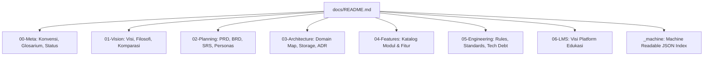

# Portal Dokumentasi Enterprise ObMap

## Ringkasan 3 Baris
- ObMap adalah workspace pengetahuan *local-first* berbasis Markdown yang menggabungkan visualisasi graf interaktif (XMind/Obsidian) dengan kolaborasi dan publikasi instan (Notion/Wikipedia).
- Dokumentasi ini disusun dengan prinsip *Human + AI friendly* menggunakan skema identifikasi stabil, front-matter terstruktur, dan validasi langsung ke kode sumber (`src/domains/*`).
- Repositori telah bermigrasi ke arsitektur Domain-Driven Design (DDD) dengan 12 domain independen, Orchestrator pattern, dan Zustand scoped stores.

---

## 1. Peta Navigasi Dokumentasi



---

## 2. Panduan Membaca Berdasarkan Peran (Audience)

| Peran | Tujuan Utama | Titik Masuk yang Direkomendasikan |
| :--- | :--- | :--- |
| **Software Engineer / AI Agent** | Memahami batas domain, aturan impor, pola store, dan tech debt | `05-engineering/repository-rules.md`, `03-architecture/domain-map.md` |
| **System Architect** | Menelaah arsitektur C4, strategi hybrid storage, dan ADR | `03-architecture/system-overview.md`, `03-architecture/data-and-storage.md` |
| **Product Manager / Owner** | Memvalidasi fitur berstatus implemented vs planned, persona, dan PRD | `02-planning/prd.md`, `04-features/feature-catalog.md` |
| **Business / Domain Lead** | Mengevaluasi positioning pasar, use-case LMS, dan model nilai | `01-vision/positioning.md`, `06-lms/lms-vision.md` |

---

## 3. Struktur Dokumen Fase 1

- `docs/00-meta/doc-conventions.md`: Aturan penulisan, struktur front-matter, dan taksonomi ID.
- `docs/00-meta/glossary.md`: Glosarium istilah domain ObMap.
- `docs/00-meta/status-legend.md`: Definisi label status `[IMPLEMENTED]`, `[PARTIAL]`, `[PLANNED]`, `[VISION]`.
- `docs/00-meta/changelog.md`: Riwayat evolusi dan restrukturisasi arsitektur.
- `docs/03-architecture/repository-structure.md`: Pemetaan hierarki repositori level 1–3.
- `docs/03-architecture/domain-map.md`: Matriks 12 domain bisnis, tanggung jawab, dan dependensi.
- `docs/05-engineering/doc-drift-log.md`: Log perbedaan antara asumsi rencana terdahulu dengan kode aktual.
- `docs/05-engineering/repository-rules.md`: Aturan batas domain, pola orchestrator, dan konvensi penamaan.

---

## Terkait
- [Aturan Dokumentasi](00-meta/doc-conventions.md)
- [Peta Domain](03-architecture/domain-map.md)
- [Aturan Repositori](05-engineering/repository-rules.md)
```