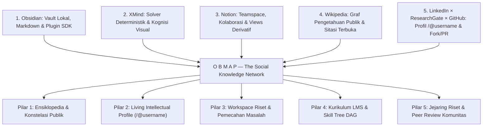
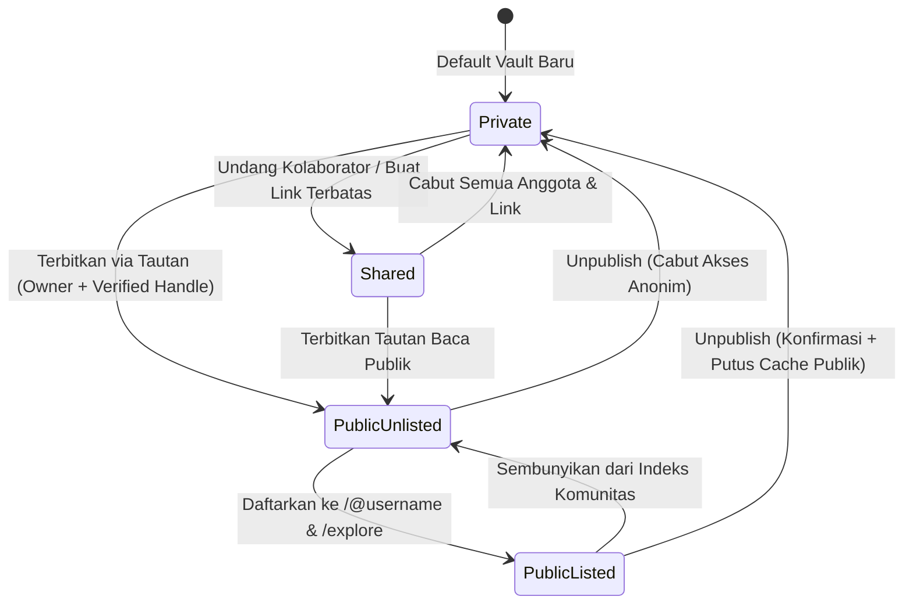
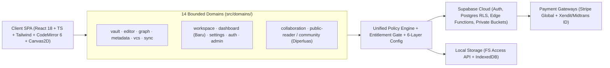
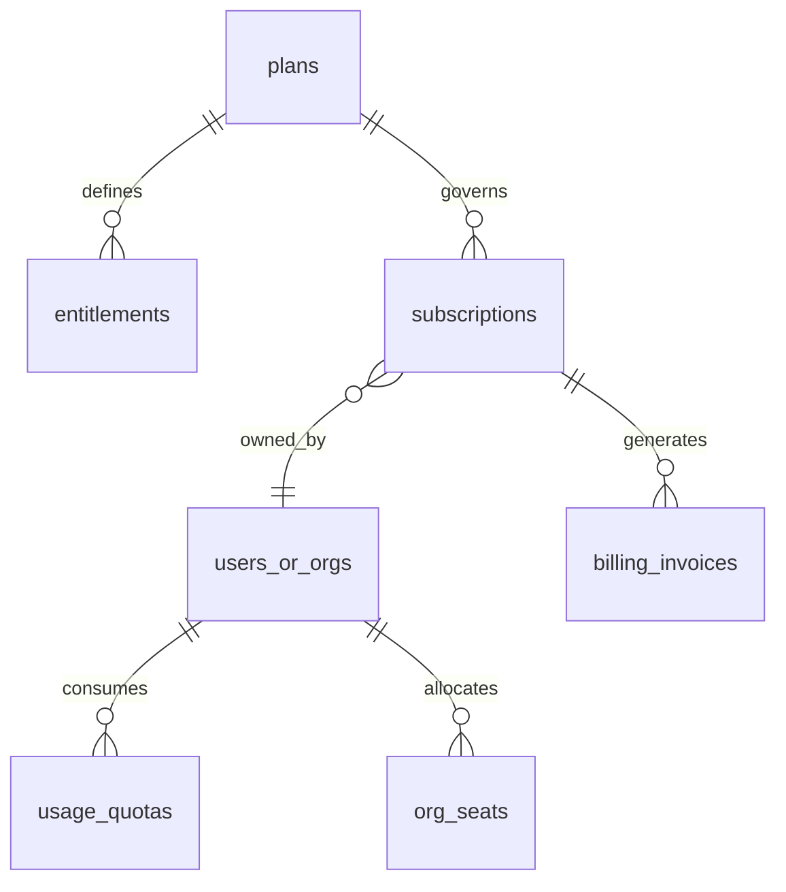
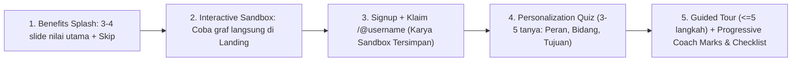

# Master Blueprint ObMap ("Pancasila" Konstitusi Produk & Arsitektur Sistem)

## Ringkasan 3 Baris
- Menetapkan **Konstitusi Induk ObMap** sebagai **The Social Knowledge Network & Visual Thinking OS**: fusi 5 DNA (**Obsidian × XMind × Notion × Wikipedia × LinkedIn/ResearchGate/GitHub**) untuk menyeimbangkan media sosial hiburan dengan jejaring cendekiawan.
- Mengunci standar rute sosial kanonik `/@:username`, tata kelola visibilitas (`Private`, `Shared`, `Public Listed/Unlisted`), monetisasi etis (XMind + Notion, menolak paywall *sync/publish* ala Obsidian), RBAC berlapis, dan kustomisasi 6-lapis + `@obmap/sdk`.
- Menjadi sumber kebenaran normatif bagi seluruh dokumen di `docs/`, `AGENTS.md`, dan `llms.txt`, sedangkan evaluasi gap serta jadwal eksekusi dirinci di [Quo Vadis v2](00-2-quovadis.md).

---

## Pembukaan Konstitusional & North Star

> **Positioning Satu Kalimat:** ObMap adalah **The Social Knowledge Network & Visual Thinking Operating System** yang menyatukan kedaulatan catatan lokal (*Obsidian*), kognisi visual deterministik (*XMind*), kolaborasi tim (*Notion*), ensiklopedia terbuka (*Wikipedia*), dan reputasi intelektual publik (*LinkedIn × ResearchGate × GitHub*).

- **North Star Metric:** **Weekly Active Knowledge Connections (`WAKC`)** — jumlah simpul pengetahuan yang dibuat, dipetakan secara visual, disitasi lintas-vault, atau di-*fork* secara bermakna setiap minggu.
- **Metrik Pendukung:**
  - *Time-to-First-Value (`TTFV`)* `< 90 detik` dari kunjungan landing hingga graf pertama tersusun.
  - *Activation Rate* (menyelesaikan sandbox + klaim `/@username` / membuat vault pertama) `>= 35%` `[ASSUMPTION]`.
  - *Retention D7 / D30* `>= 40% / 22%` untuk kreator aktif `[ASSUMPTION]`.
  - *Public Knowledge Viral K-Factor* `>= 0.35` melalui tautan `/@username`, sitasi, dan tombol *Fork to My Vault* `[ASSUMPTION]`.
  - *Free-to-Paid Conversion* `>= 4%` (Pro/Team) dan *Scholarly NPS* `>= +50` `[ASSUMPTION]`.

| Dimensi | Quo Vadis v1 (`00-1-quovadis.md`) | Master Blueprint v2 (`00-0-master-blueprint.md`) |
| :--- | :--- | :--- |
| **Identitas Produk** | Hybrid PKM & Visual LMS (3 DNA) | Social Knowledge Network & Visual Thinking OS (5 DNA) |
| **Kolaborasi Tim** | VCS lokal + RLS dasar (`[PARTIAL]`) | DNA Notion penuh: Teamspace, komentar, presence, Kanban/Kalender derivatif |
| **Identitas & Rute Publik** | Portal statis `/p/:username/:vaultSlug` | Profil cendekiawan `/@:username`, eksplorasi `/explore`, sitasi & fork |
| **Model Bisnis** | Draft kasar di `brd.md` (`{{TBD}}`) | Model hibrida XMind + Notion + Academic Economy dengan entitlement server-side |
| **Home & Akuisisi** | Belum ada domain Dashboard & Sandbox | Domain baru `src/domains/dashboard/` (`/vaults`), Landing Sandbox, Onboarding 5-lapis |
| **Kustomisasi & Ekstensi** | Internal `configRegistry` & `pluginRegistry` | Config 6-lapis berbasis Role, Unified Theme Engine, `@obmap/sdk` bersandbox |

### Hukum Dasar Arsitektur (Non-Negotiable)
1. **Zero Feature Deletion:** Dilarang menghapus atau meminifikasi fitur, paket, atau arsip (`00-1-quovadis.md`) tanpa mandat eksplisit.
2. **Markdown + Frontmatter Sovereignty:** Kanban, Kalender, LMS DAG, dan sitasi sosial wajib **diturunkan** (*derived*) dari berkas Markdown + YAML Frontmatter, bukan format blok JSON *proprietary*.
3. **Deterministic Graph Solvers (`ADR-0003`):** Hanya `Free-Force` yang menjalankan simulasi D3 kontinu; seluruh solver terstruktur (`Mindmap`, `Org`, `Timeline`, `Fishbone`, `Argument Map`, `Citation Tree`) bersifat deterministik.
4. **Headless Controller & Reactive Governance (`ADR-0006`):** Pemisahan Orchestrator / View (`<=300` baris) / `use<Feature>Controller.ts`, mutasi via pure Zustand actions, Single Source of Truth, dan Canvas Frame Invalidation.
5. **Security by Design:** Skema DB hanya via migrasi `supabase/migrations/` dengan RLS ketat & grant eksplisit (`authenticated`, `service_role`); bucket media privat (`vault-media`, `avatars`) diakses eksklusif via `createSignedUrl`.
6. **Local-First Gratis Selamanya:** Penggunaan lokal (`FileSystemService.ts`, `IndexedDbVaultDriver.ts`) 100% gratis selamanya tanpa paksaan registrasi.

---

## Sila 1: Visi Peradaban & Fusi 5 DNA Superpower ("Pengimbang Media Sosial Entertainment")

Media sosial arus utama mengoptimalkan *dopamine loop*, konten dangkal, dan polarisasi. ObMap membalik paradigma tersebut: membangun ruang digital berkejelasan tinggi tempat para akademisi, peneliti, dosen, mahasiswa, insinyur, dan pembelajar memetakan pemikiran nyata (*Proof-of-Thought*) dan mewariskan graf pengetahuan kolektif.

| DNA Patokan | Kekuatan yang Diserap | Kelemahan yang Dilampaui | Standar Konkret Terukur di ObMap | Status Saat Ini |
| :--- | :--- | :--- | :--- | :--- |
| **Obsidian** | Plaintext `.md`, `[[wikilinks]]`, multi-pane workspace, command palette, config modular & ekosistem plugin | Graph view *hairball*, Sync & Publish berbayar mahal, nol fitur tim bawaan | 10k+ catatan tanpa lag (Aho-Corasick Worker), split pane & hotkeys, config `.obmap/`, `@obmap/sdk` | `[IMPLEMENTED]` (inti PKM), `[PARTIAL]` (plugin SDK) |
| **XMind** | Layout radial/hierarkis deterministik, Bézier, branch colors, fold/unfold, tema & ekspor presentasi | File biner `.xmind` tertutup, non-searchable Git, bukan PKM panjang | 6+ solver deterministik, subtree override, navigasi `Tab`/`Enter`/`Space`, ekspor SVG/PDF/OPML, Pitch Mode | `[IMPLEMENTED]` (4+ solver), `[PLANNED]` (Pitch/OPML) |
| **Notion** | Share dialog mudah, teamspace, komentar kontekstual, presence, template, view Kanban/Kalender/Tabel | *Cloud lock-in*, format blok tertutup, berat offline, tidak punya graf pengetahuan sejati | View Kanban/Kalender diturunkan dari YAML frontmatter, komentar paragraf, presence & share dialog terpadu | `[PARTIAL]` (V4 RLS & co-presence), `[VISION]` (views/teamspace) |
| **Wikipedia** | Rujukan silang terbuka, riwayat suntingan publik, netralitas kategori, indeks pencarian instan | Teks linier statis tanpa peta konsep visual; kontribusi terhambat markup lawas | Dual-pane Graph + Markdown reader, riwayat revisi VCS terbuka, metadata sitasi & kategori topik | `[IMPLEMENTED]` (`/p/*` & VCS), `[VISION]` (indeks global) |
| **LinkedIn × ResearchGate × GitHub** | Identitas profesional, jejaring sitasi ilmiah, model sosial *Fork & Merge Request* berbasis teks | LinkedIn penuh pamer tanpa bukti karya; ResearchGate statis PDF; GitHub terlalu teknis untuk non-dev | Profil kanonik `/@username`, `[[@user/vault/note]]`, *Fork & Knowledge Merge Request*, reputasi anti-vanity | `[PARTIAL]` (claim username & `VcsCreateMergeRequestModal`), `[VISION]` (social graph) |

### Matriks Posisi Kompetitif Jujur

| Dimensi | Obsidian | Notion | XMind | Wikipedia | LinkedIn / RG | **ObMap v2** |
| :--- | :--- | :--- | :--- | :--- | :--- | :--- |
| **Kedaulatan Data Lokal** | Sangat Tinggi | Rendah | Tinggi | Publik | Rendah | **Sangat Tinggi (FS API + IDB)** `[IMPLEMENTED]` |
| **Visualisasi Multi-Model** | Force-directed | Tidak ada | Sangat Kuat | Tidak ada | Tidak ada | **Multi-Solver Deterministik + Force** `[IMPLEMENTED]` |
| **Kolaborasi & Views Derivatif** | Add-on Sync | Sangat Kuat | Terbatas | Wiki Edit | Terbatas | **VCS + Views dari Frontmatter** `[PARTIAL]`/`[VISION]` |
| **Publikasi & Jejaring Sosial** | Berbayar statis | Share link | Ekspor berkas | Selalu publik | Profil + PDF | **Gratis `/@username` + Citation + Fork** `[VISION]` |
| **Kurikulum LMS Native** | Plugin pihak ke-3 | Template manual | Tidak ada | Kategori saja | Tidak ada | **DAG Skill Tree & Progress Engine** `[VISION]` |

---

## Sila 2: Arsitektur Identitas Publik (`/@username`), Visibilitas & Jejaring Sosial Pengetahuan

### 2.1 Standar Rute Kanonik Modern (`/@:username`)

| Rute Kanonik | Peran Halaman | Orchestrator / Komponen Target | Kompatibilitas & Catatan Teknis |
| :--- | :--- | :--- | :--- |
| `/` | Landing Page + Live Sandbox | `src/pages/Landing.tsx` | Pengguna login diarahkan ke `/vaults` (bukan langsung `/app`) |
| `/explore` | Direktori Eksplorasi Komunitas | `CommunityOrchestrator` `[VISION]` | Kurasi bidang ilmu, *Trending Maps*, *Featured Scholars* |
| `/@:username` | **Living Intellectual Profile** | `ScholarProfileOrchestrator` `[VISION]` | Bio, afiliasi/ORCID, Konstelasi Vault Publik, statistik dampak |
| `/@:username/:vaultSlug` | Portal Vault Publik & Graf | `PublicReaderOrchestrator` `[PARTIAL]` | Kanvas interaktif + tombol *Cite*, *Star/Bookmark*, *Fork* |
| `/@:username/:vaultSlug/:noteSlug` | Dual-Pane Knowledge Reader | `PublicReaderOrchestrator` `[PARTIAL]` | Bacaan Markdown + kompas graf + anotasi paragraf |
| `/vaults` | **Dashboard App (Home)** | `DashboardOrchestrator` `[PLANNED]` | Pusat kendali vault, views derivatif, dan feed komunitas |
| `/app` | Workspace Editor & Graf | `WorkspaceOrchestrator.tsx` `[IMPLEMENTED]` | Multi-pane CodeMirror 6 + Canvas2D + VCS |
| `/p/:username/:vaultSlug/*` | Rute Publik Legacy | `PublicReader.tsx` `[IMPLEMENTED]` | Wajib dipertahankan sebagai *301/client redirect* ke `/@:username/*` |

- **Implementasi React Router v6:** Segmen `/:handle` divalidasi di wrapper route (`handle.startsWith("@")`), sementara rute sistem (`/auth`, `/app`, `/vaults`, `/explore`, `/admin`, `/install`, `/p/*`) dideklarasikan lebih dahulu agar bebas tabrakan namespace. `ProfileService.ts` dan `SettingsClaimUsernameModal.tsx` (`[IMPLEMENTED]`) tetap menjadi gerbang klaim *handle* unik.

### 2.2 Standar Visibilitas Vault (`Private`, `Shared`, `Public Listed`, `Public Unlisted`)

| Aspek | `Private` | `Shared` (Team / Guest) | `Public Unlisted` | `Public Listed` (`/@username`) |
| :--- | :--- | :--- | :--- | :--- |
| **Manajemen & Kontrol** | Hanya Owner | Owner/Admin kelola email/link ber-expiry | Owner/Admin; per-note exclude (`visibility: private`) | Owner; muncul di profil `/@username` & `/explore` |
| **Frontend UX** | Workspace `/app` saja | Indikator *Co-Presence* & komentar | Dual-pane Reader + badge *Unlisted* | Profil sosial + aksi *Cite*, *Fork*, *Discuss* |
| **Backend & RLS** | `auth.uid() = owner_id` | Policy `vault_members` & `share_links` | Snapshot/live notes dengan `status = 'published'` | Terindeks Full-Text Search & Citation Graph |
| **Media Storage** | Bucket privat + `createSignedUrl` | Signed URL berdurasi pendek per sesi | Proxy/CDN asset terpublikasi yang disetujui | CDN asset terpublikasi + OG Image graf dinamis |
| **SEO & Caching** | `noindex, nofollow` | `noindex, nofollow` | `noindex` (aman untuk draf privat klien) | SSR/Meta OG dinamis, Sitemap, Schema.org `ScholarlyArticle` |

- **Unified Share Dialog:** Satu dialog ala Notion (evolusi `CollabDocumentSharePopover.tsx` dan `CollabBulkPublishModal.tsx`) mengelola undangan email, link dengan peran & masa berlaku, toggle *Publish to `/@username`*, *Listed vs Unlisted*, serta pengecualian folder/catatan.

### 2.3 Enam Inovasi Jejaring Pengetahuan (All-Rounded Scholarly Features)
1. **Federated Cross-Vault Wikilinks (`[[@username/vaultSlug/noteSlug]]`):** Referensi lintas-pengguna menghasilkan *Cross-Vault Backlink* otomatis dan mencatat sitasi di tabel `cross_vault_citations`.
2. **GitHub-Style "Fork & Knowledge Merge Request":** Pembaca dapat mem-*fork* vault publik ke akun sendiri lalu mengajukan usulan perbaikan via `VcsCreateMergeRequestModal.tsx` & `vcsDiffEngine.ts` untuk di-review pemilik asli.
3. **Epistemic Status & Scholarly Frontmatter:** Skema standar `epistemic_status` (`seedling` | `budding` | `evergreen` | `peer_reviewed`), `confidence`, `doi`, `license` (default `CC BY-SA 4.0` `[ASSUMPTION]`), dan `references` (BibTeX/CSL), ditambah tombol **"Cite this Note"** (APA, MLA, IEEE, BibTeX, ObMap Wikilink).
4. **Paragraph-Level Scholarly Annotations:** Komentar tertambat pada hash blok paragraf atau ID simpul graf (mendukung mode *Public Peer Review* maupun *Private Study Group*).
5. **Anti-Vanity Reputation System:** Reputasi diukur dari *Citation Impact*, *Accepted Merge Requests*, *Fork Reuses*, rasio catatan *Evergreen*, dan penyelesaian kurikulum LMS — bukan algoritma *clickbait*.
6. **Dua Solver Graf Ilmiah Baru (Deterministik):**
   - **`argument-map` (Toulmin Debate Map):** memetakan *Claim*, *Evidence*, *Warrant*, *Counter-Argument*, dan *Synthesis* dari properti frontmatter/heading.
   - **`citation-tree` (Genealogy Tree):** memvisualisasikan silsilah evolusi gagasan dan rujukan antar-paper secara kronologis.

---

## Sila 3: Dua Standar Mutlak — Developer Standard & User Standard

### 3.1 Developer Standard (Enterprise Engineering Excellence)

| Kategori Quality Gate | Standar Target Enterprise (Wajib Lulus Sebelum Rilis) | Status Saat Ini |
| :--- | :--- | :--- |
| **Type Safety & Lint** | TypeScript strict 0 error; `TD-005` (`untypedSupabase.ts`) terhapus; `npm run lint` bersih | `[PARTIAL]` (`TD-005` aktif) |
| **Automated Testing** | `npx vitest run` 100% hijau; coverage `>= 85%` pada solver, VCS, policy engine, entitlement; E2E Playwright untuk alur auth, onboarding, share, dan billing | `[PARTIAL]` (Vitest unit hijau) |
| **Performance Budget** | `/`, `/@username` LCP `< 2.0s`, CLS `< 0.05`; initial bundle `< 250KB` gzipped; Landing Sandbox `< 65KB`; Canvas2D `60 FPS` (2.000 node) & `>=30 FPS` (5.000 node) | `[PARTIAL]` |
| **A11y & i18n** | WCAG 2.2 AA (kontras, navigasi keyboard penuh, ARIA pada modal & reader); dwibahasa `id-ID` dan `en-US` via kamus terstruktur | `[PARTIAL]` |
| **Security & Privacy** | Kepatuhan OWASP ASVS Level 2; uji otomatis RLS (pgTAP/integration) setiap migrasi; sanitasi XSS Markdown & CSS snippet; `createSignedUrl` wajib untuk bucket privat | `[PARTIAL]` |
| **Observability & SLO** | Error tracking terstruktur, product funnel telemetry (opt-in privasi), `audit_logs` untuk aksi sensitif, feature flags, backup PITR, SLO `99.9%` untuk reader & sync | `[PARTIAL]` (`audit_logs` ada) |

- **Definition of Done (DoD) PR:** (1) Kepatuhan aturan Headless Controller (`<=300` baris/komponen UI), (2) Uji unit + uji RLS bila menyentuh DB, (3) Pembaruan dokumen di `docs/` bila ada perubahan kontrak/fitur, (4) Zero regresi pada `npx vitest run` dan `npm run build`.

### 3.2 User Standard (Cognitive & Experience Excellence)
- **Prinsip UX Inti:** (1) *3-Clicks-to-Aha*, (2) *Zero Blank Slate* (empty state selalu mengajar atau menyediakan template), (3) *Universal Undo* untuk editor & kanvas, (4) *Calm High-Signal UI* (bebas distraksi notifikasi hiburan), (5) *Keyboard-First & Touch-Ready*, (6) *Guided Recovery* (pesan error selalu disertai aksi pemulihan).

| Peran Utama | Menulis & Memetakan (`/app`) | Dashboard (`/vaults`) | Kolaborasi & VCS | Publikasi `/@username` & Sosial | LMS, Admin & Billing |
| :--- | :--- | :--- | :--- | :--- | :--- |
| **Visitor / Sandbox** | Editor & graf demo di Landing (in-memory) | Terkunci (arahkan daftar) | Tidak tersedia | Baca & eksplorasi `/explore`, `/@username` | Ikut modul LMS publik terbuka |
| **Free Scholar** | Penuh (Lokal tak terbatas + sync terbatas) | Semua 5 mode workspace + Feed | Commit/branch lokal; terima Fork PR | Profil `/@username` penuh, sitasi, diskusi | Belajar/mengajar dasar gratis |
| **Pro Creator** | Penuh + tema, solver & ekspor lanjut | Analitik pembaca & sitasi pribadi | Unlimited cloud snapshots & 90+ hari | Custom domain, PDF/SVG HD, badge Pro | Kupon/tagihan pribadi |
| **Editor / Commenter (Shared)** | Edit (Editor) / Read+Annotate (Commenter) | Muncul di *"Shared with me"* | Buat branch & ajukan Merge Request | Ikut kontribusi jika diizinkan Owner | Lihat progres kelas/tim |
| **Team / Org Admin** | Penuh + kunci kebijakan gaya & plugin | Analitik beban kerja & progres tim | Kelola branch protection & anggota | Kelola *Team Publication* institusi | Kelola seat, SSO, allowlist plugin |
| **Superadmin** | Tidak mengakses konten privat tanpa audit | Telemetry global | Audit keamanan & moderasi konten | Verifikasi cendekiawan & takedown DMCA | Kelola tier, override plan, kupon |

- **Katalog Persona Diperbarui (`PER-01` s/d `PER-09`):** Mempertahankan `PER-01` (Peneliti Akademik), `PER-02` (Dosen/Instruktur LMS), `PER-03` (Konsultan Bisnis), `PER-04` (Product Lead), `PER-05` (Pembaca Publik), `PER-06` (System Admin), serta menambah `PER-07` (**Kreator Pengetahuan / Cendekiawan Publik `/@username`**), `PER-08` (**Kepala Lab / Admin Kampus**), dan `PER-09` (**Kontributor Terbuka & Peer Reviewer**).

---

## Sila 4: Tata Kelola Peran (RBAC), Monetisasi Etis (Free vs Paid) & Arsitektur Entitlement

### 4.1 Hierarki RBAC Dua Lapis & Unified Policy Engine
- **Lapis 1 — Platform/Account Roles:** `anonymous`, `trial_sandbox`, `free_scholar`, `pro_creator`, `verified_academic`, `team_member`, `team_admin`, `billing_owner`, `moderator`, `support`, `superadmin`.
- **Lapis 2 — Resource Roles (Vault / Teamspace / Classroom):** `owner`, `admin` (maintainer), `editor`, `commenter`, `contributor` (via Fork/PR), `viewer`, `guest`, `public_reader`.
- **Perilaku UI Deterministik:**
  - *Disembunyikan total:* Menu `/admin` untuk non-superadmin; tombol *Billing* untuk member biasa.
  - *Dinonaktifkan + Tooltip Penjelasan:* Tombol *Publish* atau *Invite* pada peran `viewer`/`commenter` menampilkan alasan peran atau batas kuota paket.
  - *Read-Only Banner:* Saat pengguna berada di vault *downgraded* atau mode `viewer`/`guest`, editor tetap terbuka dalam mode baca dengan aksi eksplisit *"Fork ke Vault Saya"*.
- **Unified Policy Engine:** Evolusi `src/domains/auth/shared/hooks/useVaultPermission.ts` menjadi fungsi murni `can(actor, action, resource, context)` yang mengombinasikan **Resource Role + Platform Entitlement + Org Policy**, berpasangan dengan fungsi Postgres RLS `public.can_access_resource(...)` dan pencatatan ke `audit_logs`.

### 4.2 Monetisasi Etis (XMind × Notion × Academic Economy — Menolak Model Obsidian)

| Aplikasi Patokan | Filosofi Bisnis | Penilaian & Sikap ObMap |
| :--- | :--- | :--- |
| **Obsidian** | Fitur inti Sync & Publish dijual mahal sebagai add-on terpisah; tidak ada model tim terintegrasi | **DITOLAK.** Menyandera sinkronisasi dan publikasi mematikan efek jaringan sosial pengetahuan |
| **XMind** | Fitur dasar gratis kuat; Pro membuka tema, presentasi & ekspor premium lintas perangkat | **DIADOPSI** untuk diferensiasi alat visualisasi, ekspor HD/OPML, dan *Pitch Mode* |
| **Notion** | Individu sangat murah hati/gratis; monetisasi pada kolaborasi tim per-seat, riwayat & kontrol admin | **DIADOPSI** untuk teamspace, izin granular, guest, analitik tim, dan billing per-seat |

| Fitur & Kuota | **Free Scholar** (`$0`) | **Pro Creator** (`[ASSUMPTION]` ~$8/bln / Rp79rb) | **Team / Lab** (`[ASSUMPTION]` ~$12/seat/bln) | **Academic / Enterprise** (`Custom`) |
| :--- | :--- | :--- | :--- | :--- |
| **Vault Lokal (FS API & IDB)** | **Tak Terbatas Selamanya** | Tak Terbatas | Tak Terbatas | Tak Terbatas |
| **Profil `/@username` & Publikasi Terbuka** | **Gratis Penuh** (`Public Listed`) | Penuh + Custom Domain + Analitik | Publikasi Tim + *Unlisted* | Katalog Kampus + Lencana Resmi |
| **Cloud Sync & Media Privat** | 2 Vault Cloud, 250 MB media | Tak Terbatas, 20 GB media | Tak Terbatas, 100 GB+ bersama | Kuota Organisasi Khusus |
| **Solver & Ekspor Graf** | 4 Solver dasar, ekspor PNG/MD | Semua Solver + Pitch Mode + PDF/SVG/OPML | Sama + Template & Tema Tim | Sama + Branding Institusi |
| **Kolaborasi, Riwayat & Tamu** | 2 tamu baca/komentar, VCS 14 hari | 5 tamu/vault, riwayat 180 hari | Unlimited anggota, riwayat 1 tahun, PR Review | SSO/SAML, Admin-Locked Config, Audit SLA |

- **Enforcement & Payment Gateway:** Validasi kuota dan fitur mutlak ditegakkan di sisi server (Postgres RLS + Supabase Edge Functions); klien hanya memakai `useEntitlement()` / `<FeatureGate>` untuk UX. Integrasi ganda **Stripe** (global) dan **Xendit/Midtrans** (QRIS, Virtual Account, e-wallet Indonesia).
- **Non-Destructive Downgrade & Admin Lifecycle:** Siklus `trialing` → `active` → `past_due` → `grace_period` (7 hari) → `downgraded_readonly`. Data di atas kuota **tidak pernah dihapus** (menjadi *read-only* + bebas ekspor ZIP/lokal). Domain `src/domains/admin/` mengelola override manual, kupon beasiswa/akademik, dan manajemen seat.

---

## Sila 5: Pengalaman Pengguna Menyeluruh — Landing, Onboarding, Dashboard & Kustomisasi

### 5.1 Landing Page (`/`) & Embedded Live Sandbox Trial
- **Struktur Halaman:** (1) Hero dengan proposisi 5 DNA, (2) **Embedded Live Sandbox** (lazy-loaded `< 65KB` gzipped, memakai in-memory driver tanpa memuat store penuh: ketik outline → ubah instan antara Mindmap / Fishbone / Timeline), (3) Live Showcase Konstelasi `/@username` & `/explore`, (4) Penjelasan 5 Sila Produk, (5) Matriks Perbandingan, (6) Kalkulator & Tabel Paket Gratis/Berbayar, (7) FAQ + CTA *"Simpan Karyamu & Klaim `/@username`"*.

### 5.2 Onboarding Kelas Dunia (Hybrid 5 Model Berlapis)

- **Adaptasi Peran:** *Owner Baru* diarahkan memilih template & mempublikasikan node pertama; *Member Undangan* langsung masuk ke vault tim dengan ringkasan peran; *Pembaca Publik* yang mengklik *Fork* langsung masuk ke workspace berbekal salinan vault tersebut. Status progres disimpan di `LocalConfigStore` & `CloudConfigStore` dan tidak mengganggu *power user* (tombol *Skip All* selalu tersedia).

### 5.3 Dashboard App (`/vaults`) — Domain Baru `src/domains/dashboard/`
- Menjadi domain ke-13 (`DashboardOrchestrator.tsx`, `DashboardWidgetRegistry.ts`, `useDashboardController.ts`) yang mengelola rute `/vaults`, setara dengan `WorkspaceOrchestrator.tsx` pada `/app`. `src/domains/vault/` tetap menangani manajemen driver/CRUD penyimpanan vault, sedangkan `dashboard` menangani komposisi layar Home.
- **5 Mode Workspace Pribadi & Tim (Seluruhnya Derivatif dari Markdown + Frontmatter):**
  1. **Content-First Grid/List (Default):** Daftar vault lokal/cloud/shared/public dengan badge, catatan *pinned*, cuplikan teks, filter tag, dan *Command Palette* (`⌘K`).
  2. **Knowledge-Base Hierarchy Tree:** Penjelajah pohon dokumen lintas vault.
  3. **Task-Centric Kanban:** Papan kolom yang diturunkan dari properti frontmatter (`status`, `assignee`, `due`) dan checkbox `- [ ]` di berkas Markdown.
  4. **Time-Oriented Calendar & Timeline:** Jadwal dan garis waktu rilis dari frontmatter tanggal & *daily notes* menggunakan solver Timeline.
  5. **Productivity & Learning Analytics:** Grafik kontribusi mingguan, rasio penyelesaian tugas, *workload* tim, dan progres kurikulum LMS.
- **Community & Knowledge Discovery Hub:** Widget *Following Scholars Feed* (`/@username` yang diikuti), kotak masuk *Citations & Merge Requests*, galeri template (Riset, LMS, Konsultasi Fishbone, PM/Meeting, Portofolio), serta indikator kuota paket.

### 5.4 Multi-Layer Settings, Full-App Theme Engine & Public Extension SDK (`@obmap/sdk`)
- **6-Layer Cascading Config Berbasis Role:** Resolusi deterministik dari tingkat terendah ke tertinggi (*dengan Org Policy dapat mengunci kunci di bawahnya*):
  1. `System Defaults` → 2. `Org/Campus Policy (Admin-Locked)` → 3. `Vault Config (.obmap/config.json / VaultConfigFile.ts)` → 4. `User Profile (LocalConfigStore / CloudConfigStore)` → 5. `Workspace/Leaf Override` → 6. `Session/URL`.
  - Pengaturan yang dikunci admin menampilkan badge *"Dikelola oleh Organisasi"*; pengaturan di luar wewenang role (`viewer`, `guest`) disembunyikan atau *read-only*.
- **Unified Design Token & Theme Engine:** Evolusi `useThemeStore.ts` menjadi sistem token tunggal yang menggerakkan CSS Variables Tailwind (DOM di Landing, Dashboard, Workspace, `/@username` & Reader) **sekaligus** Canvas2D (`graph/shared/utils/theme.ts`, `atmosphereConfig.ts`), plus dukungan **Scoped CSS Snippets** yang disanitasi untuk keamanan publik.
- **Modular Config & Sandboxed Public Extension SDK (`@obmap/sdk`):**
  - Evolusi `configRegistry.ts`, `schemaRegistry.ts`, dan `pluginRegistry.ts` menjadi SDK publik berbasis `manifest.json` dengan izin deklaratif (`vault:read`, `vault:write`, `network`, `ui:only`), isolasi Web Worker / iframe CSP, dan *Error Boundary* per plugin.
  - **12 Extension Points:** `WorkspaceViewRegistry`, `DashboardWidgetRegistry`, `CommandRegistry`, `ConfigSectionRegistry`, `CodeMirror6Extension`, `MarkdownPostProcessor`, `SlashCommandProvider`, `FrontmatterSchemaProvider`, `GraphLayoutSolver`, `GraphThemeDecorator`, `ExportAdapter`, dan `Ribbon/StatusBar`.
  - **Developer Portal (`docs/07-developers/`) & Community Directory:** Quickstart 5 menit, TypeDoc API Reference otomatis, Cookbook, Theme Authoring Guide, CLI Hot-Reload, alur submission PR ber-audit keamanan, serta kontrol *allowlist* plugin bagi Admin Enterprise.

---

## Terkait
- [Quo Vadis ObMap v2 — Evaluasi & Peta Jalan ("UUD 1945")](00-2-quovadis.md)
- [Konvensi Dokumentasi Sistem](doc-conventions.md)
- [Quo Vadis ObMap v1 (Arsip Historis Wave 3)](00-1-quovadis.md)
- [Tata Kelola State Reaktif & Headless Controller (ADR-0006)](../03-architecture/adr/ADR-0006-reactive-state-and-headless-controller-governance.md)
