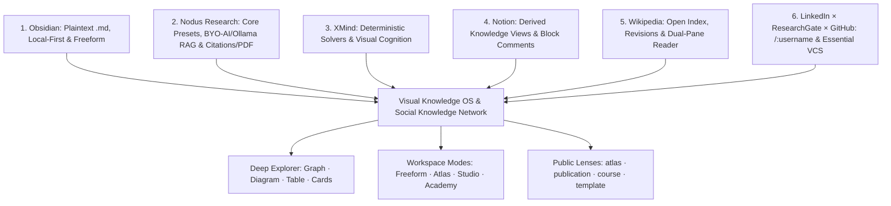
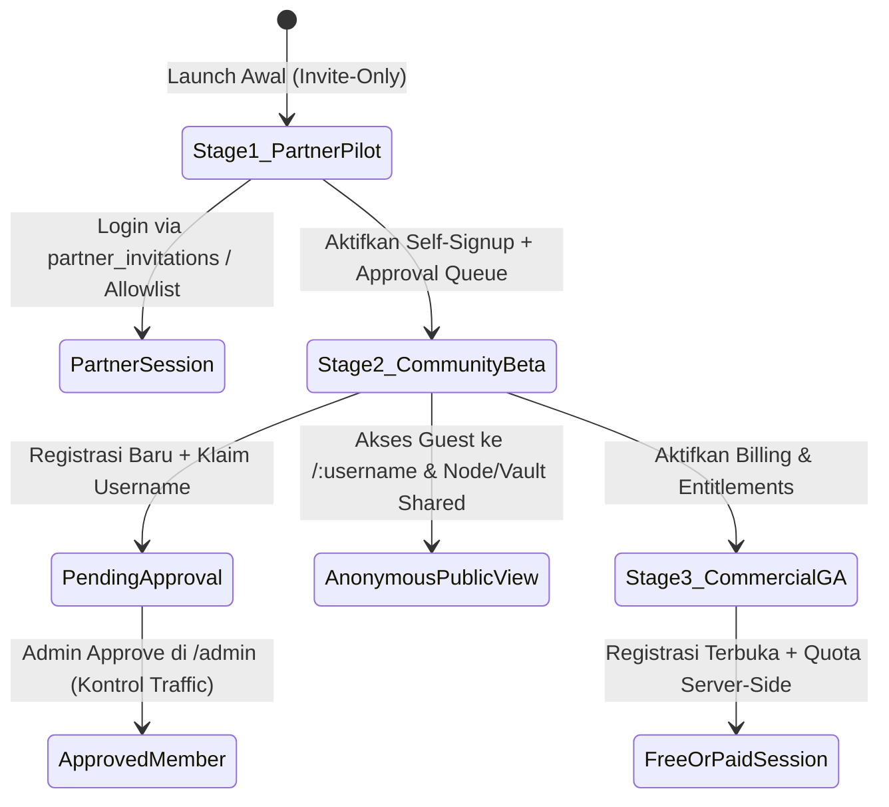
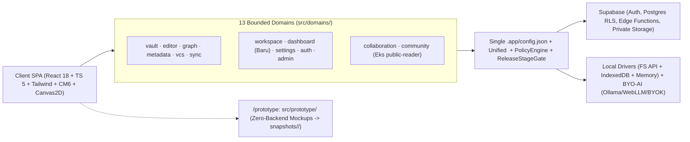

# ObMap System Architecture & Product Master Blueprint (v2.0)

## Ringkasan 3 Baris
- Spesifikasi induk arsitektur dan produk sebagai **Local-First Visual Knowledge OS & High-Signal Social Knowledge Network** berbasis fusi **6 Sistem Referensi Inti** (**Obsidian**, **Nodus Research**, **XMind**, **Notion**, **Wikipedia**, dan **LinkedIn × ResearchGate × GitHub**), dengan batas tegas menolak posisi sebagai papan manajemen proyek korporat (*office-board-central*).
- Mengunci filosofi *"Unopinionated Data, Opinionated Lenses, Visual by Default, Connected by Design"*, standar rute publik `/:username` dan `/@:username` (*hard cutover* tanpa `/p/*`), **`Deep Explorer`** dengan 4 lensa visual wajib, klasifikasi **Workspace Modes** (`Freeform`, `Atlas`, `Studio`, `Academy` + inkubator `Community Presets`), **3-Stage Progressive Shipping Gate**, serta **Unified Essential VCS & Granular Vault/Node Publishing & Access (`AS & WITH`)**.
- Mengkonsolidasikan seluruh konfigurasi multi-lapis secara tunggal ke dalam **`.app/config.json`** (dilarang memecah ke file konfigurasi terpisah), mengatur kontrol lewat **Single Adaptive `<SettingsHub />`** (*Dual Navigator*: *Interactive Breadcrumb* + *Synchronized Right Sidebar*; 3 kategori **`Account` → `Workspace` → `Vault`**), menstandarkan **`@app/sdk`**, serta menetapkan **3 Jalur Resmi Development** & siklus hidup arsip **`src/prototype/snapshots/<stage-id>/`**.

---

## 1. System Definition, Product Constitution & Telemetry Targets

> **Filosofi Inti:** *"Unopinionated Data, Opinionated Lenses, Visual by Default, Connected by Design."*
> Vault dan datanya tetap 100% *unopinionated* (murni berkas Markdown `.md` + YAML Frontmatter + `.app/config.json`), sedangkan **Workspace Mode** adalah lensa *opinionated* yang dapat dipasang, diganti, dimodifikasi, atau dilepas kapan saja tanpa merusak struktur berkas asli.

> **Motto:** *"Archive Everything. See from Above. Think, Teach, & Publish Without Lock-in."*

> **Positioning Statement (Visi Produk):** Menjadi **Local-First Visual Knowledge OS & High-Signal Social Knowledge Network** terbaik—seportabel **Obsidian** dalam kedaulatan data, sesiapsaji **Nodus Research** dalam riset, referensi, & pembelajaran *out-of-the-box*, sekuat **XMind** dalam kognisi visual deterministik, sekolaboratif **Notion** pada *Derived Views* pengetahuan & komentar blok, dan seterbuka **Wikipedia × LinkedIn × ResearchGate × GitHub** dalam identifikasi intelektual `/:username`, sitasi lintas-vault, serta *Essential VCS (Fork & Knowledge Merge Request)*.

### 1.1 Explicit Product Non-Goal (Batas Tegas Produk)
- Aplikasi ini **BUKAN** *office-board-central* atau sistem manajemen proyek/tugas korporat sekompleks **Trello, Asana, Monday.com, ClickUp, atau Notion enterprise board**.
- Seluruh *Derived Views* (`Table`, `Cards`, serta `Kanban`/`Calendar` ringan berbasis YAML) difokuskan **murni untuk manajemen pengetahuan, pengarsipan, pemetaan ide, riset, editorial publikasi (`Studio`), dan progres pembelajaran (`Academy`)**—bukan manajemen proyek korporat yang membebani fondasi aplikasi.

### 1.2 Peta Misi 3 Level Pengguna & Telemetry KPIs
1. **Beginner (*Zero-Friction Start*):** Langsung produktif dalam `< 90 detik` lewat *Opinionated Core Presets* (`Atlas`, `Studio`, `Academy`) tanpa intimidasi kanvas kosong.
2. **Intermediate (*Modular Discovery & Mastery*):** Menikmati eksplorasi **`Deep Explorer`** (4 lensa visual: `Graph`, `Diagram`, `Table`, `Cards`), *deterministic graph solvers*, properti YAML, dan kustomisasi preset.
3. **Advanced (*Full Control, No Ceiling*):** Kendali penuh via **`Freeform` Mode**, konfigurasi sentral **`.app/config.json`**, *Essential VCS (Snapshot, Visual Diff, Fork, Knowledge Merge Request)*, *Vault-Level & Node-Level Granular Publishing*, Native BYO-AI / Ollama, dan **`@app/sdk`**.

- **North Star Metric:** **Weekly Active Knowledge Connections (`WAKC`)** — jumlah node pengetahuan yang dibuat, dipetakan secara deterministik, disitasi lintas-vault, atau di-*fork* secara bermakna setiap minggu.
- **Supporting KPIs:**
  - *Time-to-First-Value (`TTFV`)* `< 90 detik` sejak akses Landing Sandbox atau aktivasi *Core Preset*.
  - *Activation Rate* (sandbox → registrasi/approval → pembuatan vault atau klaim `username`) `>= 35%` `[ASSUMPTION]`.
  - *Retention D7 / D30* `>= 40% / 22%` untuk pengguna aktif `[ASSUMPTION]`.
  - *Public Knowledge Viral K-Factor* `>= 0.35` melalui tautan `/:username`, sitasi lintas-vault, dan *Fork to My Vault* `[ASSUMPTION]`.
  - *Free-to-Paid Conversion* `>= 4%` (pada Stage 3 Commercial GA), *Core Canvas* `60 FPS` pada `2.000` node, dan LCP `< 2.0s`.

### 1.3 Baseline Delta (`00-1-quovadis.md` v1.0 → `00-0-master-blueprint.md` v2.0)

| Aspek Sistem | Baseline v1.0 (`00-1-quovadis.md`) | Target Architecture v2.0 (`00-0-master-blueprint.md`) |
| :--- | :--- | :--- |
| **Klasifikasi & DNA Produk** | Hybrid PKM & Visual LMS (3 referensi) | Visual Knowledge OS & Social Knowledge Network (**6 Referensi Inti** + Non-Goal non-enterprise-board) |
| **Lensa & Konfigurasi** | Mode graf datar + config tersebar | **4 Workspace Modes** (`Freeform`, `Atlas`, `Studio`, `Academy`) + **`Deep Explorer`** + **Single `.app/config.json`** |
| **Model Kolaborasi & VCS** | VCS lokal + RLS dasar (`[PARTIAL]`) | *Essential VCS* (*Snapshot, Visual Diff, Fork, KMR*), *Give Access / Publish `AS & WITH`* di **Vault & Node Level**, & Drawer terpadu *"Share · Access · Versions"* |
| **LMS & Kompetensi** | Visi DAG dasar | **Living Pedagogical & Competence Tree** (`Falsafah → Kurikulum → Silabus → RPS → Instruksi/Tugas`) 3 lapis dengan *Living Student Sub-Nodes* |
| **Rute & Identitas Publik** | Sub-path legacy `/p/:username/:vaultSlug` | Root-level kanonik `/:username` dan `/@:username` (*hard cutover*, `/p/*` langsung dimatikan), Presentation Lens `atlas`/`publication`/`course`/`template`, plus `/explore` |
| **Strategi Rilis & Domain** | Belum terdefinisi (*big-bang*); 12 domain | **3-Stage Progressive Shipping Gate**, **3 Development Tracks** (+ `/prototype` *Zero-Backend Snapshots*), **13 Bounded Domains** (`community` + `dashboard`), dan **Unified `<SettingsHub />` (Dual Navigator + 3 Kategori)** |
| **Kustomisasi & SDK** | Registry internal (`configRegistry`, `pluginRegistry`) | Single `.app/config.json` dalam hierarki 6-Lapis, Unified Design Tokens, & **`@app/sdk`** |

### 1.4 Six Core Principles & Six Engineering Invariants
**Enam Prinsip Inti Produk:**
1. **Plaintext Sovereignty & Local-First Forever Free:** `.md` + YAML adalah *Single Source of Truth*.
2. **Separation of Data & Lens:** Workspace Mode hanya mengubah proyeksi, layout, dan aksi kontekstual, tidak pernah mengunci data.
3. **Polymorphic Visual Navigation by Default:** Siklus utama: *Archive Everything → View & Explore from Above [`Deep Explorer`] → Restructure & Reorganize → Discover Meaning*.
4. **Essential VCS, Zero Git CLI Friction:** Kekuatan *Snapshot*, *Visual Diff*, *Fork*, dan *Knowledge Merge Request* dengan UX manusiawi tanpa CLI.
5. **Granular Vault-Level & Node-Level Sovereignty:** Hak akses, kolaborasi, kebijakan Academy, dan publikasi berlaku penuh baik di level Vault maupun spesifik Folder-Node / File-Node.
6. **Single Central Configuration (`.app/config.json`):** Dilarang memecah konfigurasi ke banyak file seperti `preset.json`, `lms-policy.json`, atau `setting.json`.

**Enam Invarian Rekayasa (*Non-Negotiable Engineering Constraints*):**
1. **Zero Feature Deletion (`AGENTS.md` Rule 1):** Mempertahankan fitur dan catatan arsip historis (`00-1-quovadis.md`) secara utuh.
2. **Derived Views Only:** Tampilan `Table`, `Cards`, dan `Kanban`/`Calendar` ringan wajib diturunkan dari `.md` + YAML + `.app/config.json`, bukan skema blok *proprietary*.
3. **Deterministic Graph Solvers (`ADR-0003`):** Hanya `Free-Force` menjalankan simulasi D3 kontinu; seluruh diagram terstruktur (`Mindmap`, `Org`, `Timeline`, `Fishbone`, `Argument Map`, `Competence/Skill Tree DAG`) bersifat deterministik (`layoutCategory.ts`).
4. **Headless Controller & Reactive Governance (`ADR-0006`):** Pemisahan Orchestrator / Pure View (`<=300` baris) / `use<Feature>Controller.ts`, mutasi via pure Zustand actions, dan Canvas Frame Invalidation.
5. **Database & Private Storage Security:** Skema melalui migrasi SQL di `supabase/migrations/` dengan RLS ketat serta bucket privat (`vault-media`, `avatars`) eksklusif via `createSignedUrl`.
6. **Local-First Forever Free:** Penyimpanan lokal (`FileSystemService.ts`, `IndexedDbVaultDriver.ts`) gratis selamanya tanpa wajib akun cloud.

---

## 2. Six-System Reference Architecture (Core DNA Specification)

Platform ini dirancang sebagai penyeimbang ekosistem media sosial hiburan melalui lingkungan kerja kognitif dan jejaring cendekiawan berkejelasan tinggi (*high-signal knowledge network*).

| Sistem Referensi | Kapabilitas yang Diadopsi | Limitasi yang Dieliminasi | Acceptance Standard di Sistem | Status Kode Aktual |
| :--- | :--- | :--- | :--- | :--- |
| **1. Obsidian** | Plaintext `.md` + YAML, `[[wikilinks]]`, penyimpanan lokal (FS API & IndexedDB), *split-pane workspace*, kebebasan mode `Freeform`, ekstensibilitas `@app/sdk` | Graph *hairball*, Sync & Publish berbayar terpisah, minim kolaborasi tim | Indexing `< 100ms` (`mentions.worker.ts`), sentralisasi tunggal `.app/config.json` (fallback legacy `.vk/` & `.obmap/`), & `@app/sdk` | `[IMPLEMENTED]` (PKM/FS), `[PARTIAL]` (SDK) |
| **2. Nodus Research** | Kesiapan alur kerja *out-of-the-box* (*opinionated workspace presets*), kesiapan studi/riset/pengajaran tanpa merakit puluhan plugin, *Native BYO-AI & Local AI*, manajemen referensi/sitasi/PDF | Ekosistem tertutup tanpa *Freeform* manual atau kendali penuh berkas lokal & VCS | Core presets (`Atlas`, `Studio`, `Academy`), roadmap *Local AI* (Ollama / WebLLM + BYOK dengan RAG lokal), sitasi/PDF | `[PLANNED]` / `[VISION]` |
| **3. XMind** | Kognisi visual & *Deterministic Graph Solvers* (`Mindmap`, `Org`, `Timeline`, `Fishbone`, `Argument Map`, `Competence/Skill Tree DAG`) | Format biner `.xmind` tertutup, tidak ramah diff teks, bukan editor Markdown | Solver deterministik komposit bebas-tabrakan, *subtree override*, *Boundary/Summary*, ekspor PDF/SVG/OPML | `[IMPLEMENTED]` (4+1 composite engine), `[PLANNED]` (`argument-map`/DAG/ekspor) |
| **4. Notion** | *Derived Data Views* (`Table`, `Cards`, serta `Kanban`/`Calendar` ringan dari YAML Frontmatter & `.app/config.json`), *block comments*, *co-presence* | *Vendor lock-in* blok JSON, beban manajemen proyek korporat, offline lemah | *Derived Views* khusus pengetahuan/riset/Studio/Academy (menolak board korporat ala Trello/Asana), komentar blok, co-presence | `[PARTIAL]` (V4 RLS, `VcsCoPresenceAvatars`), `[VISION]` (`dashboard`) |
| **5. Wikipedia** | Ensiklopedia pengetahuan terbuka, rujukan silang terverifikasi, riwayat revisi transparan, *Dual-Pane Graph + Reader* di `/explore` | Teks linier tanpa navigasi graf konsep; hambatan kontribusi markup lawas | Dual-pane Graph + Reader di `/explore` & `/:username`, riwayat VCS terbuka, metadata sitasi | `[IMPLEMENTED]` (`community`), `[VISION]` (`/explore` penuh) |
| **6. LinkedIn × ResearchGate × GitHub** | Identitas intelektual kanonik `/:username` & `/@:username`, sitasi lintas-vault `[[@user/vault/note]]`, *Essential VCS* (*Snapshot, Visual Diff, Fork, Knowledge Merge Request*) | Feed *vanity engagement*; Git CLI terlalu rumit bagi non-developer | Profil `/:username`, `[[@user/vault/note]]`, serta *Essential VCS* visual tanpa Git CLI | `[PARTIAL]` (`VcsCreateMergeRequestModal`, `CommunityRouting`), `[VISION]` |

### 2.1 Seven-Column Competitive Matrix

| Dimensi Teknis | Obsidian | Nodus Research | Notion | XMind | Wikipedia | LinkedIn / RG | **Arsitektur v2.0** |
| :--- | :---: | :---: | :---: | :---: | :---: | :---: | :--- |
| **Data Sovereignty (`.md` + `.app/config.json`)** | Tinggi | Menengah | Rendah | Biner | Publik | Rendah | **Tinggi (FS API + IndexedDB + Config Tunggal)** `[IMPLEMENTED]` |
| **Out-of-the-Box Readiness vs Control** | Tinggi kontrol, butuh rakit plugin | Siap pakai riset | Template manual | Visual cepat | Read/Wiki | Profil saja | **Presets `Atlas`/`Studio`/`Academy` + `Freeform`** `[PLANNED]` |
| **`Deep Explorer` (4 Lensa Visual)** | Force 2D | Graph/Notes | Table/Board/Cal | Deterministik | Tidak ada | Tidak ada | **Graph + Diagram Deterministik + Table + Cards + Pengelompokan Dinamis** `[PARTIAL]` |
| **Native BYO-AI / Local AI & Sitasi PDF** | Plugin | Native AI + PDF | AI berbayar | AI berbayar | Tidak ada | PDF statis | **Ollama/WebLLM + BYOK Local RAG + Zotero/PDF** `[VISION]` |
| **Essential VCS, Granular Access & Publish** | Eksternal | Terbatas | Share Vault/Page | Ekspor | Wiki Rev | Profil + PDF | **Snapshot/Diff/Fork/KMR & Vault/Node `AS & WITH`** `[PARTIAL]`/`[VISION]` |
| **Pedagogical & Competence Tree (LMS)** | Plugin | Modul riset | Manual | Tidak ada | Kategori | Kursus video | **3-Layer Living Competence Tree + Student Sub-Nodes** `[VISION]` |

---

## 3. Canonical Vocabulary, Workspace Modes, `Deep Explorer` & Progressive Shipping

### 3.1 Workspace Modes (1 Unopinionated + 3 Core Modes + Community Presets)
1. **`Freeform` (*Unopinionated Mode*):** Kanvas bebas ala Obsidian dengan kendali manual penuh + akses ke seluruh 4 lensa visual **`Deep Explorer`**.
2. **`Atlas` (*Core Mode — Mapping, Organizing, Studying & Researching*):**
   - Fokus pada pengarsipan, pemetaan konsep, *brainstorming*, studi, dan riset literatur/argumen.
   - Menggunakan **`Deep Explorer`** (*Graph*, *Diagram* [`mindmap`, `fishbone`, `timeline`, `argument-map`], *Table* matriks literatur, *Cards*).
   - Terhubung **1-to-1** dengan Presentation Lens **`atlas`**.
3. **`Studio` (*Core Mode — CMS for Writing, Blogging & Portfolio*):**
   - Fokus pada penulisan artikel, esai, buku, dokumentasi, dan kurasi portofolio publikasi (*Publish Studio*: slug, SEO/YAML, visibilitas, status editorial).
   - **Wajib dilengkapi `Deep Explorer`** bagi penulis/editor (*Cards* galeri karya, *Table* status publikasi/SEO, *Graph* *internal linking & topic clusters*, *Diagram* struktur bab/outline).
   - Terhubung **1-to-1** dengan Presentation Lens **`publication`**.
4. **`Academy` (*Core Mode — LMS for Courses, School & University*):**
   - Fokus pada kurikulum terstruktur (**Falsafah → Kurikulum → Silabus → RPS → Instruksi/Tugas**), pembelajaran bertahap via *Living Student Sub-Nodes*, dan pelacakan kompetensi 3 lapis.
   - Terhubung **1-to-1** dengan Presentation Lens **`course`**.
5. **Inkubator `Community Presets → Core Presets`:** Pengguna dapat menerbitkan konfigurasi `.app/config.json` sebagai Presentation Lens **`template`** di `/explore`; preset komunitas yang matang dan selaras DNA aplikasi dapat diadopsi menjadi *Core Preset* resmi.

> **Persistence Mode:** `primary_mode` disimpan sebagai niat persisten di `.app/config.json` & tabel `vaults`, dan dapat di-*override* secara sementara (*ephemeral* *Active Workspace Lens*) per tab/sesi tanpa mengubah struktur data vault.

### 3.2 `Deep Explorer` (4 Lensa Visual, Pengelompokan Dinamis & Dual Surface)
**`Deep Explorer`** adalah sistem eksplorasi dan reorganisasi multi-dimensi terhadap *vaults, nodes, branches,* dan *files* menggunakan **4 lensa visual** serta **pengelompokan dinamis** (*Hierarchy, Properties, Tags, Backlinks, Keywords* — baik *Virtual Grouping* maupun *Physical Sync*), yang **wajib tersedia di semua Workspace Modes**:
1. **Graph View** *(Network)*: Keterhubungan organik via `[[backlinks]]`, `tags`, `keywords`, dan klaster properti.
2. **Diagram View** *(Deterministic Solvers)*: `Mindmap`, `Org`, `Timeline`, `Fishbone`, `Argument Map`, dan `Competence/Skill Tree DAG`.
3. **Table View** *(Structured Matrix)*: Tampilan & pengeditan massal properti YAML, status, sitasi, dan metadata.
4. **Cards View** *(Spatial Gallery)*: Grid visual berdasarkan Folder-Node, tag, status epistemik, atau grup properti.

Dua mode **Restructure & Reorganize** di `Deep Explorer` + dua permukaan eksekusi:
- **Virtual Grouping (*Non-Destructive*):** Mengelompokkan ulang node secara visual berdasarkan *Hierarchy, Properties, Tags, Backlinks,* atau *Keywords* tanpa memindahkan file fisik.
- **Structural Refactoring (*Physical Sync*):** *Drag-and-drop* di Diagram/Tree yang langsung memindahkan struktur Folder-Node/File-Node `.md` atau memperbarui YAML & `[[wikilinks]]`.
- **Dual Execution Surface:** `Deep Explorer` dapat dikustomisasi dan dijalankan langsung di dalam **`Settings Hub > Workspace > Deep Explorer`** maupun dibuka sebagai **Tab Workspace mandiri** di Editor.

### 3.3 Three-Stage Progressive Shipping Gate (`ReleaseStageGate`) & Root Namespace Routing

| Stage Rilis | Flag Konfigurasi | Mekanisme Autentikasi & Traffic Control | Akses Publik & Target Verifikasi |
| :--- | :--- | :--- | :--- |
| **Stage 1: Closed Partner & Institutional Pilot** | `stage_1_partner` | Akses melalui `partner_invitations` atau provisi Admin di `/admin`. | Validasi Workspace Modes, `Deep Explorer`, Essential VCS, & storage lokal/cloud. |
| **Stage 2: Approval-Gated Community Beta** | `stage_2_community_beta` | Registrasi publik + klaim `username` (`pending_approval`); persetujuan **individual per-user di `/admin`**. | Direktori `/explore`, `/:username`, sitasi lintas-vault, & *Fork/Knowledge Merge Request*. |
| **Stage 3: Public Commercial GA** | `stage_3_commercial_ga` | Registrasi aktif langsung dengan kuota dinamis DB (`plans`, `plan_quotas`) via **Xendit/Midtrans → Stripe**. | Semua fitur + Teamspaces, CRDT Yjs, Academy Lapisan 3, & `@app/sdk`. |

| Pola URL Kanonik | Handler / Orchestrator | Akses & Stage Gate | Deskripsi Fungsional |
| :--- | :--- | :--- | :--- |
| `/` | `src/pages/Landing.tsx` | Publik (Stage 1–3) | Landing page dengan *Embedded In-Memory Sandbox* dan CTA adaptif stage |
| `/explore` | `CommunityOrchestrator` `[VISION]` | Stage 2–3 | Direktori kurasi topik, *Trending Knowledge Graphs*, *Featured Scholars*, & **`Community Presets` (`template`)** |
| `/prototype` | `ThreePillarPrototypePage` (`src/prototype/`) `[IMPLEMENTED]` | Dev / Stage 1–3 | Katalog pemilih **Dynamic Zero-Backend Mockup** & arsip historis **`src/prototype/snapshots/<stage-id>/`** (Track 2, terisolasi 100% dari backend) |
| `/vaults` | `DashboardOrchestrator` `[PLANNED]` | Auth + `approved` | Hub Vault & *Derived Knowledge Views* + umpan komunitas |
| `/app` | `WorkspaceOrchestrator.tsx` `[IMPLEMENTED]` | Auth + `approved` | Editor multi-pane CM6 + Tab **`Deep Explorer`** + Unified *"Share · Access · Versions"* Drawer + Right Sidebar |
| `/settings` | `SettingsHub` (`<SettingsHub />`, `Ctrl+,`) `[IMPLEMENTED]` / `[PLANNED]` | Auth | **Single Adaptive `<SettingsHub />`** (*Dual Navigator*: Breadcrumb + Right Sidebar; 3 kategori `Account → Workspace → Vault`): **Complete Full Page** di luar Editor, **Workspace Tab** di dalam Editor |
| `/:username` & `/@:username` | `CommunityOrchestrator` | Publik (`approved` + publik) | Profil Intelektual: bio, ORCID, Portofolio (*Atlas / Publication / Course / Template*), tombol ringan kurasi + *"Full Account Settings →"* |
| `/:username/:vaultSlug/...` & `/@:username/...` | `CommunityOrchestrator` `[IMPLEMENTED]`/`[PARTIAL]` | Publik / Shared | Reader Vault maupun **Node/Folder spesifik yang diterbitkan secara granular** |

- **Namespace Collision Prevention (`RESERVED_SLUGS`):** Seluruh rute sistem (`app`, `vaults`, `auth`, `admin`, `explore`, `prototype`, `install`, `settings`, `api`, `assets`, `p`, `pricing`, `docs`, `help`, `legal`, `about`, `login`, `signup`) dijaga 3 lapis agar tidak pernah bertabrakan dengan `/:username`.

### 3.4 Unified Essential VCS, Collaboration (`Give Access AS & WITH`) & Publishing (`Publish AS & WITH`)
Ketiga kemampuan disatukan pada **level Vault maupun spesifik Folder-Node / File-Node** dan diakses melalui satu panel kontekstual cerdas di `/app`: **"Share · Access · Versions" Drawer/Sheet** (3 tab: *Publish*, *Collaborate*, *Versions & Diff/MR*):

1. **Essential VCS (*Zero Git CLI Friction*):**
   - **Snapshot:** Riwayat versi otomatis/manual beserta *rollback* instan.
   - **Visual Diff:** Membandingkan perubahan isi Markdown, properti YAML, dan struktur node/pohon secara visual.
   - **Fork & Knowledge Merge Request (`KMR`):** Alur kontribusi kolaboratif lintas pengguna untuk riset publik maupun pengumpulan/review tugas di mode `Academy`.
2. **Collaborate — *"Give Access AS & WITH"* (Vault-Level & Node-Level):**
   - **AS (Peran):** `Viewer`, `Commenter/Reviewer`, `Contributor (via Merge Request)`, `Editor/Co-Author`, `Admin/Curator`, serta peran kontekstual `Academy`: `Student`, `Teacher/Mentor`, `Institution Admin`.
   - **WITH (Cakupan & Batasan):** Berlaku untuk **seluruh Vault** ATAU **spesifik Folder-Node / File-Node** dengan izin CRUD, rentang waktu (*time-window*), dan visibilitas undangan.
3. **Share & Publish — *"Publish AS & WITH"* (Vault-Level & Node-Level):**
   - **AS (Presentation Lens):** Terbitkan *as `atlas`*, *as `publication`*, *as `course`*, atau *as `template`* (`.app/config.json`).
   - **WITH (Jangkauan & Hak Publik):** `public_listed` (`/explore` & `/:username`), `public_unlisted` (via link), `shared` (komunitas/grup tertentu), atau `private`; dilengkapi lisensi (**default `CC BY-SA 4.0`**), *Allow Citation*, dan *Allow Fork*.
   - **Granularitas Node-Level:** Vault dapat tetap berstatus `private` sambil menerbitkan Folder-Node atau File-Node tertentu ke `/:username` atau kolaborator terpilih.

### 3.5 Federated Citations, Epistemic Metadata & Academy Competence Tree
1. **Federated Cross-Vault Wikilinks (`[[@username/vaultSlug/noteSlug]]`):** Membangun sitasi terfederasi beserta *Impact Index* non-vanity dan tombol *"Cite this Note"* (APA, MLA, IEEE, BibTeX, Wikilink).
2. **Block-Hash Annotations & Manual Scholar Verification:** Komentar tertambat pada hash paragraf/simpul; lencana *Verified Scholar / Educator / Institution* dikurasi manual Admin di `/admin`.
3. **Academy Living Pedagogical & Competence Tree (3 Lapisan Evolusi):** Visualisasi utuh **Falsafah → Kurikulum → Silabus → RPS → Instruksi/Tugas** di mana proses dan hasil murid menjadi **Living Student Sub-Nodes** (`locked` → `available` → `in_progress` → `submitted` → `mastered`) dengan aturan 3 lapis tersimpan pada blok `academy` di `.app/config.json`.

---

## 4. Engineering Quality Gates, Three Development Tracks & Interaction Matrix

### 4.1 Developer Standard (Enterprise Engineering Excellence)

- **Mandatory PR DoD:** (1) Headless Controller (`<= 300` baris, `OVER_300=0`), (2) `npx tsc --noEmit` & `npx vitest run` 100% lulus, (3) Track-2 zero-backend & snapshot parity (jika lewat jalur mockup), (4) Pembaruan atomik 3 lapis changelog (`AGENTS.md` Rule 11).

### 4.2 Tiga Jalur Resmi Development (*Three Development Tracks*) & Prototype Snapshot Lifecycle
1. **Track 1 — Spec-Driven Track (`docs/ → main-app`):** Implementasi fitur langsung dari spesifikasi `docs/` yang sudah matang ke `src/domains/` (`main-app`).
2. **Track 2 — Mockup-Incubated Track (`src/prototype → 1:1 main-app → Isolated Snapshot → docs/`):**
   - **Phase 2A (*Dynamic Zero-Backend Mockup*):** Eksperimen UI/UX interaktif di `src/prototype/` (aktif saat ini: `src/prototype/three-pillar/`). Wajib **100% terisolasi dari backend (*zero-backend*)**, menggunakan *in-memory deterministic mock state* (dilarang memanggil runtime Supabase, Auth live, atau storage backend) agar selalu cepat, portabel, dan deterministik di semua browser.
   - **Phase 2B (*1:1 Identical Front-End Migration & Backend Integration*):** Setelah mockup final disetujui, komponen front-end dimigrasikan **1:1 secara identik** ke `src/domains/` (`main-app`) dan diintegrasikan penuh dengan layanan backend (Supabase, RLS, IndexedDB, File System Access API, Web Workers).
   - **Phase 2C (*Archived UI/UX Snapshot*):** Mockup yang telah diimplementasikan dibekukan ke direktori berversi `src/prototype/snapshots/<stage-id>/` dan dapat diakses melalui katalog pemilih snapshot di rute `/prototype` sebagai arsip sejarah UI/UX yang abadi dan portabel.
3. **Track 3 — Direct Rapid Experiment Track (`main-app experiment → docs/ sync`):** Eksperimen dan iterasi langsung di `main-app` (`src/domains/`), yang setelah tervalidasi wajib disinkronkan kembali ke `docs/` + Rule 11.

### 4.3 Persona & Stage Access Matrix
- **Katalog Persona (`PER-01`–`PER-09`):** Peneliti Akademik (`Atlas`), Dosen/Instruktur (`Academy`), Konsultan (`Atlas`/`Freeform`), Product/Knowledge Lead (`Atlas`/`Studio`), Pembaca Publik (`/explore`), Platform Admin (`/admin`), Penulis/Kreator Publik (`Studio` → `/:username`), Admin Kampus (`Academy` institusi), Peer Reviewer (`Essential VCS` / `KMR`).

---

## 5. Multi-Layer RBAC Policy Engine & Dynamic Monetization Model

1. **Symmetric RBAC:** Evaluator `can(actor, action, resource, context)` (termasuk evaluasi izin per-Folder/Node `access` & `academy`) selaras simetris dengan Postgres RLS `public.can_access_resource(...)` serta mencatat mutasi ke `audit_logs`.
2. **Commercial Model (Xendit/Midtrans First → Stripe) & Dynamic Admin Quotas:** Seluruh harga dan kuota disimpan di DB (`plans`, `plan_entitlements`, `plan_quotas`), dikelola Admin via `/admin` dengan prinsip *Local-First Forever Free*, publikasi pengetahuan gratis, dan *Non-Destructive Downgrade* (Grace 7 hari → `downgraded_readonly`).

---

## 6. Single Central `.app/config.json`, Unified `<SettingsHub />` & `@app/sdk`

### 6.1 Satu File Konfigurasi Sentral (`.app/config.json`)
- Seluruh konfigurasi tingkat vault dan per-node **wajib terpusat dalam satu berkas: `.app/config.json`** (`VaultConfigFile.ts` menyediakan migrasi baca *zero-loss* dari path legacy `.vk/` dan `.obmap/`).
- **Larangan Fragmentasi File:** Dilarang membuat berkas terpisah seperti `preset.json`, `lms-policy.json`, `setting.json`, atau file konfigurasi sampingan lainnya.
- **Tujuh Blok Top-Level Wajib `.app/config.json`:** `meta`, `mode` (`primary_mode`, `default_deep_explorer_view`, `layout`), `schema` (YAML templates & required properties), `publishing` (vault & `node_overrides`), `access` (collaborators, permissions, `node_overrides`), `academy` (3-layer pedagogical rules & constraints per node/folder), dan `extensions`.

### 6.2 Arsitektur Unified `<SettingsHub />` (Dual Navigator & 3 Kategori Utama)
Seluruh pengendalian konfigurasi lintas **3 Scope Logis** (*App & Account*, *Vault `.app/config.json`*, *Node & Session*) disatukan ke dalam **Single Adaptive `<SettingsHub />` Component** yang menggantikan seluruh antarmuka Settings multi-tab terpecah sebelumnya:

1. **Adaptivitas Permukaan & Eliminasi Clutter:**
   - Dirender sebagai **Workspace Tab** saat berada di dalam Editor (*Vault Scope*) dan sebagai **Complete Full Page** (`/settings` atau modal penuh) saat di luar Editor (Explore / Profile — *App Scope*).
   - **Tanpa Clutter UI:** Tidak ada tombol *Quick Share* atau *Quick View Lens* di tab bar Editor, dan **tidak ada *inline vertical/horizontal nav rail* di dalam body `<SettingsHub />`**.
   - Halaman Profil `/:username` hanya menampilkan kontrol ringan kurasi publik + *"Full Account Settings →"*, sedangkan kolaborasi/publikasi kanvas di `/app` dilayani lewat **Drawer *"Share · Access · Versions"***.
2. **Dual Navigator Architecture (Desktop, Tablet, & Mobile):**
   - **Navigator 1 — Interactive Breadcrumb Navigator (VS Code / Antigravity Style):** Berada di bagian atas `<SettingsHub />`, menampilkan jalur hierarki aktif (`Settings Hub ▸ Kategori ▸ Sub-Setting ▸ Section Symbol`). Mengklik segmen mana pun membuka **Floating Dropdown Outline** tepat di bawah segmen tersebut yang memuat daftar kategori saudara, sub-setting saudara, atau daftar seksi/simbol di dalam halaman aktif untuk lompat cepat tanpa membuka sidebar.
   - **Navigator 2 — Synchronized Right Sidebar:** Panel navigasi di Right Sidebar Editor (dengan fitur pencarian) yang tersinkron **1:1** dengan struktur kategori dan sub-setting `<SettingsHub />`.
3. **Urutan & Struktur 3 Kategori Utama (`Account` → `Workspace` → `Vault`):**
   1. **`Account`:**
      - *`Profile Customization`*: Nama, `@username`, bio, informasi tambahan & tautan media sosial.
      - *`Credentials & Security`*: Reset kredensial, reset email & password.
      - *`Session Activity`*: Daftar perangkat aktif, lokasi, waktu akses, dan pencabutan sesi.
   2. **`Workspace`** *(mencakup seluruh pengaturan workspace, editor, schema, sync preferences, AI Ollama/BYOK, Zotero, dan ekstensi `@app/sdk`)*:
      - *`Workspace Preset (Dashboard Overview Settings Hub)`*: Peta ringkasan & tautan ke seluruh sub-setting terkait; katalog *Built-in Presets* (`Freeform`, `Atlas`, `Studio`, `Academy`), *User Custom Presets*, dan *Community Presets*; fitur tambah/ubah/hapus/set default preset; wajib menyertakan **Mini Instruction-Helps**, **Impact Preview (daftar perubahan sebelum ganti preset)**, dan **Validasi perubahan preset**.
      - *`Central .app/config.json Raw Inspector & Dynamic Editor`*: Menampilkan dan mengedit secara manual seluruh konfigurasi aplikasi & workspace dalam satu JSON mentah `.app/config.json` yang terhubung secara dinamis ke seluruh UI pengaturan, dilengkapi **Real-Time Validation** dan **Help/Documentation Section**.
      - *`Deep Explorer`*: Konfigurasi lanjutan & ruang eksplorasi interaktif untuk *vaults, nodes, branches, files* (4 lensa visual *Graph, Diagram, Table, Cards*, pengelompokan dinamis *Hierarchy/Properties/Tags/Backlinks/Keywords*, termasuk *Properties & Schema*, *Academy Competence Tree & Pedagogical Policy*, dan tombol buka sebagai **Tab Workspace**).
      - *`Appearance & Accessibility`*: Kustomisasi tampilan lintas aplikasi (*Profile & Explore page*) serta lintas *Workspace/Vault* (tipografi editor, pengetikan, asisten penulisan, bilah alat Markdown, *Features & System Sync preferences*).
      - *`Visual Engine`*: Pengaturan *Graph Mode* dan *Mindmap / Deterministic Diagram Solvers*.
   3. **`Vault`:**
      - *`Vaults Dashboard`*: Overview, statistik, status sinkronisasi, dan insight seluruh vaults.
      - *`Vaults Collaborating`*: Manajemen kolaborasi & hak akses (`Give Access AS & WITH` di level Vault & Node).
      - *`VCS, Diff, Backup & History`*: Timeline snapshot, visual diff, Knowledge Merge Request, serta backup & riwayat vault.
      - *`Vaults Publish`*: Manajemen publikasi (`Publish AS & WITH` di level Vault & Node).
      - *`Import & Export Vault`*: Alat impor dan ekspor vault.

### 6.3 Unified Theme Tokens & Sandboxed `@app/sdk`
- **Unified Design Tokens & Dynamic Brand Registry (`ADR-0013`):** Mendukung token `--app-*` (dengan kompatibilitas `--vk-*` dan `--ob-*` lintas DOM Tailwind ↔ Canvas2D) dan `BrandManifest` dinamis (`src/global/config/brand.config.ts`).
- **Sandboxed `@app/sdk` (`ADR-0012`):** Evolusi `pluginRegistry.ts`, `configRegistry.ts`, dan `schemaRegistry.ts` menjadi SDK ber-sandbox Web Worker / Iframe CSP dengan `manifest.json`, *Permission Manifest*, dan **12 Extension Points** terstandar (membaca/mendaftar skema secara terisolasi melalui blok `extensions` & `schema` di `.app/config.json`).

---

## Terkait
- [Glosarium Kanonik & Teknis](glossary.md)
- [Quo Vadis v2.0 — Audit & Roadmap](00-2-quovadis.md)
- [Arsitektur Data & Skema `.app/config.json`](../03-architecture/data-and-storage.md)
- [Kolaborasi, Essential VCS & Publikasi Granular](../03-architecture/collaboration-and-publishing.md)
- [Visi & Spesifikasi Academy 3-Lapis](../06-lms/lms-vision.md)
- [Playbook Antrean Eksekusi Bertahap](../02-planning/README.md)
- [Portal Pengembang `@app/sdk`](../07-developers/README.md)
