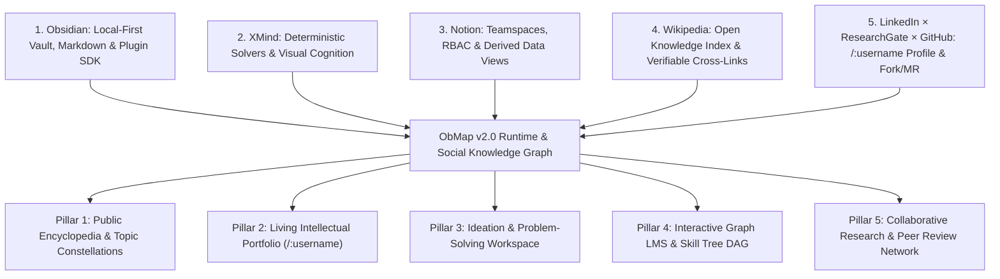
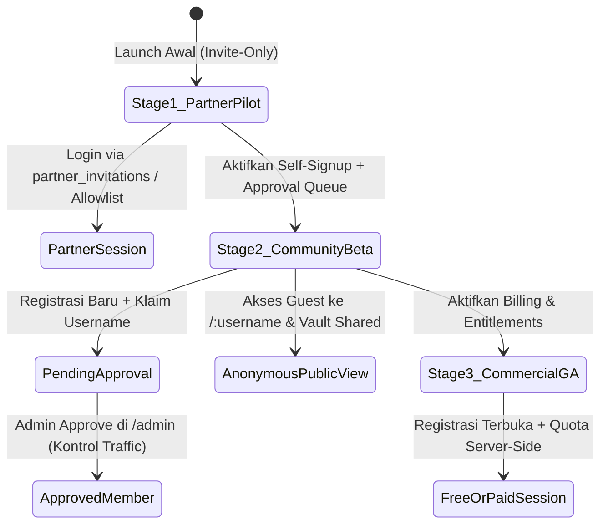
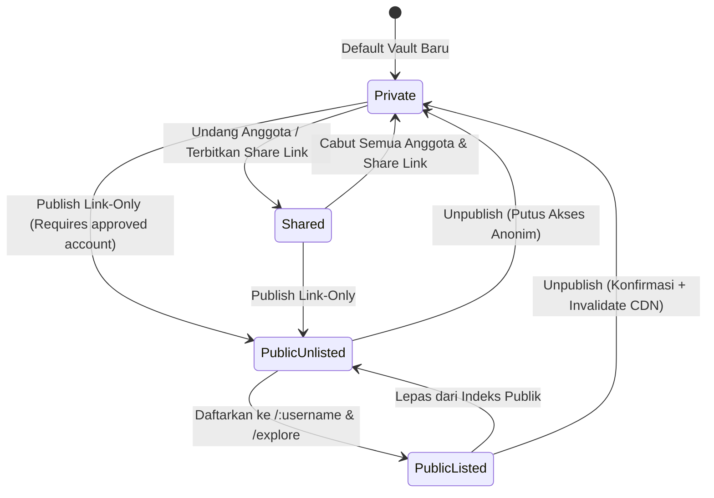
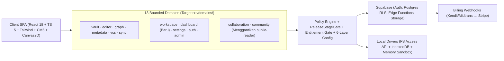
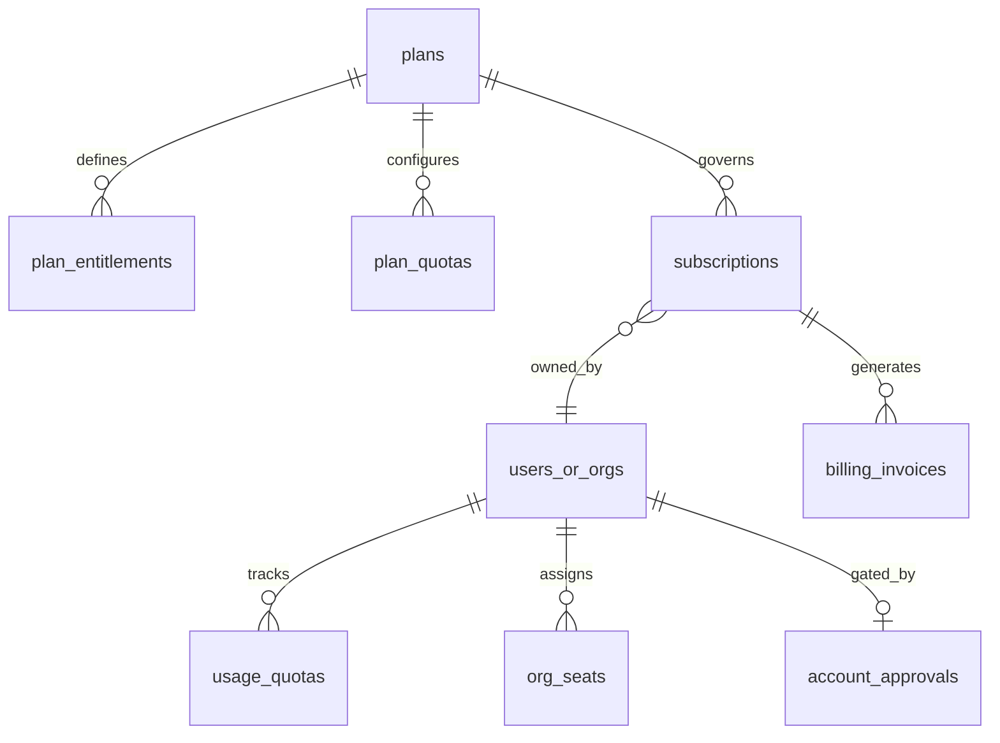
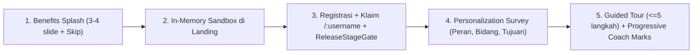

# ObMap System Architecture & Product Master Blueprint (v2.0)

## Ringkasan 3 Baris
- Spesifikasi induk arsitektur dan produk ObMap v2.0 sebagai **Local-First Visual Knowledge Management System, Collaborative Research Workspace, dan High-Signal Social Knowledge Graph** berbasis fusi 5 sistem referensi (Obsidian, XMind, Notion, Wikipedia, LinkedIn/ResearchGate/GitHub).
- Mengunci standar rute publik root-level `/:username` dan `/@:username` (menghapus `/p/*`), mekanisme **3-Stage Progressive Shipping Gate** (*Partner Pilot → Approval-Gated Community Beta → Commercial GA*), RBAC berlapis, dan arsitektur *entitlement server-side*.
- Mendefinisikan standar kualitas ganda (Developer Standard & User Standard), domain baru `dashboard`, konfigurasi 6-lapis, Unified Theme Engine, serta Public Extension SDK `@obmap/sdk`.

---

## 1. System Definition, Product Thesis & Telemetry Targets

> **Positioning Statement:** ObMap adalah **Local-First Visual Knowledge Management System, Collaborative Research Workspace, dan High-Signal Social Knowledge Graph** yang menggabungkan kedaulatan plaintext Markdown (*Obsidian*), tata letak graf deterministik (*XMind*), kolaborasi tim & tampilan data derivatif (*Notion*), keterbukaan pengetahuan terverifikasi (*Wikipedia*), serta identitas intelektual & alur *Fork/Merge* (*LinkedIn × ResearchGate × GitHub*).

### 1.1 Telemetry & Success Metrics
- **North Star Metric:** **Weekly Active Knowledge Connections (`WAKC`)** — jumlah node pengetahuan yang dibuat, dipetakan secara deterministik, disitasi lintas-vault, atau di-*fork* secara bermakna setiap minggu.
- **Supporting Product & Engineering KPIs:**
  - *Time-to-First-Value (`TTFV`)* `< 90 detik` sejak akses Landing Sandbox hingga graf pertama terbentuk.
  - *Activation Rate* (sandbox → registrasi/approval → pembuatan vault atau klaim `username`) `>= 35%` `[ASSUMPTION]`.
  - *Retention D7 / D30* `>= 40% / 22%` untuk pengguna aktif `[ASSUMPTION]`.
  - *Public Knowledge Viral K-Factor* `>= 0.35` melalui tautan `/:username`, sitasi, dan tombol *Fork to My Vault* `[ASSUMPTION]`.
  - *Free-to-Paid Conversion* `>= 4%` (pada Stage 3 Commercial GA) dan *Core Canvas Performance* `60 FPS` pada `2.000` node serta LCP `< 2.0s`.

### 1.2 Baseline Delta (`00-1-quovadis.md` v1.0 → `00-0-master-blueprint.md` v2.0)

| Aspek Sistem | Baseline v1.0 (`00-1-quovadis.md`) | Target Architecture v2.0 (`00-0-master-blueprint.md`) |
| :--- | :--- | :--- |
| **Klasifikasi Produk** | Hybrid PKM & Visual LMS (3 referensi) | Visual Knowledge OS & Social Knowledge Network (5 referensi) |
| **Model Kolaborasi** | VCS lokal + RLS dasar (`[PARTIAL]`) | Teamspaces, izin granular, komentar blok, CRDT, view derivatif frontmatter |
| **Rute & Identitas Publik** | Sub-path legacy `/p/:username/:vaultSlug` | Root-level kanonik `/:username` dan `/@:username` (*hard cutover*, `/p/*` langsung dimatikan), plus `/explore` |
| **Strategi Rilis** | Tidak terdefinisi (*big-bang*) | **3-Stage Progressive Shipping Gate**: Partner Pilot → Approval Beta (per-user `/admin`) → Commercial GA (Xendit/Midtrans → Stripe) |
| **Home, Komunitas & Akuisisi** | 12 domain (`public-reader` di `/p/*`, tanpa Dashboard & Sandbox) | **13 Bounded Domains** (`community` menyerap `public-reader` + domain baru `dashboard`), Landing Sandbox `< 65KB`, Onboarding 5-tahap |
| **Kustomisasi & SDK** | Registry internal (`configRegistry`, `pluginRegistry`) | 6-Layer Cascading Config, Unified DOM/Canvas2D Theme Engine, `@obmap/sdk` |

### 1.3 Six Architectural Invariants (Non-Negotiable Engineering Constraints)
1. **Zero Feature Deletion:** Tidak menghapus atau meminifikasi fitur, dependensi, atau catatan arsip (`00-1-quovadis.md`) tanpa persetujuan eksplisit.
2. **Markdown + Frontmatter Single Source of Truth:** Tampilan Kanban, Kalender, Timeline, LMS DAG, dan sitasi sosial wajib **diturunkan** (*derived*) dari berkas Markdown + YAML Frontmatter, bukan blok JSON *proprietary*.
3. **Deterministic Graph Solvers (`ADR-0003`):** Hanya mode `Free-Force` yang menjalankan simulasi D3 kontinu; seluruh layout terstruktur (`Mindmap`, `Org`, `Timeline`, `Fishbone`, `Argument Map`, `Citation Tree`) bersifat deterministik (`layoutCategory.ts`).
4. **Headless Controller & Reactive Governance (`ADR-0006`):** Pemisahan Orchestrator / Pure View (`<=300` baris) / `use<Feature>Controller.ts`, mutasi via pure Zustand actions, Single Source of Truth, Hierarchical Store Bridge, dan Canvas Frame Invalidation.
5. **Database & Private Storage Security:** Perubahan skema hanya melalui migrasi SQL di `supabase/migrations/` dengan RLS ketat serta grant eksplisit (`authenticated`, `service_role`); bucket privat (`vault-media`, `avatars`) diakses eksklusif via `createSignedUrl`.
6. **Local-First Forever Free:** Penyimpanan lokal (`FileSystemService.ts`, `IndexedDbVaultDriver.ts`) tetap 100% gratis selamanya tanpa mewajibkan akun cloud.

---

## 2. Five-System Reference Architecture (Core DNA Specification)

ObMap dirancang sebagai infrastruktur penyeimbang ekosistem media sosial hiburan dengan menyediakan lingkungan kerja kognitif dan jejaring cendekiawan berkejelasan tinggi (*high-signal knowledge network*).

| Sistem Referensi | Kapabilitas yang Diadopsi | Limitasi yang Dieliminasi | Acceptance Standard di ObMap | Status Kode Aktual |
| :--- | :--- | :--- | :--- | :--- |
| **Obsidian** | Plaintext `.md`, `[[wikilinks]]`, split-pane workspace, command palette, config `.obmap/`, Plugin API | Graph *hairball*, Sync & Publish berbayar terpisah, minim kolaborasi tim | Indexing `< 100ms` via Aho-Corasick Worker (`mentions.worker.ts`), config terisolasi, `@obmap/sdk` | `[IMPLEMENTED]` (inti PKM), `[PARTIAL]` (SDK) |
| **XMind** | Layout radial/hierarkis deterministik, Bézier, branch color coding, fold/unfold, tema & ekspor presentasi | Format biner `.xmind` tertutup, tidak ramah VCS/Git, bukan editor teks panjang | 6+ solver deterministik, subtree override, navigasi `Tab`/`Enter`/`Space`, ekspor PDF/SVG/OPML, Pitch Mode | `[IMPLEMENTED]` (4+ solver), `[PLANNED]` (Pitch/OPML) |
| **Notion** | Share modal terpadu, teamspace, komentar kontekstual, co-presence, template, Kanban/Kalender/Tabel | *Vendor lock-in* format blok tertutup, performa offline lemah, tanpa graph engine | View Kanban/Kalender derivatif YAML frontmatter, komentar terikat blok, presence real-time | `[PARTIAL]` (V4 RLS, `VcsCoPresenceAvatars`), `[VISION]` |
| **Wikipedia** | Rujukan silang terbuka, riwayat revisi transparan, pengindeksan kategori, pembacaan instan anonim | Teks linier tanpa navigasi graf konsep; hambatan kontribusi markup lawas | Dual-pane Graph + Markdown reader, riwayat VCS terbuka, metadata sitasi & direktori `/explore` | `[IMPLEMENTED]` (`public-reader` → `community`, VCS), `[VISION]` |
| **LinkedIn × ResearchGate × GitHub** | Identitas profesional, graf sitasi ilmiah, alur kontribusi *Fork & Merge Request* | Feed berbasis *vanity engagement*; portofolio PDF statis; Git CLI terlalu rumit bagi non-developer | Profil kanonik `/:username` / `/@:username`, `[[@user/vault/note]]`, Fork & Knowledge Merge Request | `[PARTIAL]` (`SettingsClaimUsernameModal`, `VcsCreateMergeRequestModal`), `[VISION]` |

### 2.1 Six-Column Competitive Matrix

| Dimensi Teknis | Obsidian | Notion | XMind | Wikipedia | LinkedIn / RG | **ObMap v2.0** |
| :--- | :---: | :---: | :---: | :---: | :---: | :--- |
| **Data Sovereignty** | Tinggi | Rendah | Sedang | Publik | Rendah | **Tinggi (FS API + IndexedDB)** `[IMPLEMENTED]` |
| **Graph & Visual Cognition** | Force 2D | Tidak ada | Deterministik | Tidak ada | Tidak ada | **Deterministik Multi-Solver + Force** `[IMPLEMENTED]` |
| **Team Collaboration & Views** | Add-on Sync | Sangat Kuat | Terbatas | Wiki Edit | Terbatas | **VCS + Derived Frontmatter Views** `[PARTIAL]`/`[VISION]` |
| **Public Identity & Citation** | Statis berbayar | Share URL | Ekspor file | Publik | Profil + PDF | **Gratis `/:username` + Citation + Fork** `[VISION]` |
| **Curriculum / LMS Engine** | Plugin | Manual | Tidak ada | Kategori | Tidak ada | **Native DAG Skill Tree & Progress** `[VISION]` |

---

## 3. Progressive Rollout Gate, Namespace Routing & Knowledge Graph Protocol

### 3.1 Three-Stage Progressive Shipping & Access Gate (`ReleaseStageGate`)
Untuk mempercepat rilis sembari mengembangkan kapabilitas penuh secara bertahap (*shipping while developing*), akses sistem dikendalikan oleh konfigurasi platform `release_stage` di backend dan gerbang autentikasi terpusat.

| Stage Rilis | Flag Konfigurasi | Mekanisme Autentikasi & Traffic Control | Akses Publik Anonim | Target Verifikasi |
| :--- | :--- | :--- | :--- | :--- |
| **Stage 1: Closed Partner & Institutional Pilot** | `stage_1_partner` | Pendaftaran publik ditutup; akses hanya via `partner_invitations` atau provisi manual oleh Admin di `/admin`. | Ditutup penuh atau terbatas pada vault partner bertautan khusus. | Validasi stabilitas Workspace, Graph, VCS, dan penyimpanan lokal/cloud bersama mitra awal. |
| **Stage 2: Approval-Gated Community Beta** | `stage_2_community_beta` | Registrasi publik & klaim `username` dibuka dengan status `account_status = 'pending_approval'`. Setiap akun baru wajib disetujui **secara individual oleh Admin di `/admin`** (tanpa kuota referral) sebelum masuk `/vaults` & `/app`. | Pengunjung publik hanya dapat melihat profil `/:username` dan vault berstatus `shared`/`published` dari akun berstatus `approved`. | Menguji pertumbuhan komunitas (`explore`, sitasi, fork) sambil menjaga kontrol trafik server secara ketat. |
| **Stage 3: Public Commercial GA** | `stage_3_commercial_ga` | Registrasi langsung aktif (`approved`) dengan penegakan kuota paket Free vs Paid dinamis berbasis DB/Admin di database & Edge Functions. | Direktori penuh `/explore`, `/:username`, dan publikasi terbuka gratis. | Konversi langganan berkelanjutan, teamspaces enterprise, dan `@obmap/sdk`. |

### 3.2 Root-Level Canonical Identity & Namespace Routing (`/:username` & `/@:username`)
Seluruh standar URL publik ObMap mematikan prefix legacy `/p/` secara langsung (*hard cutover* tanpa redirect transisi) dan mengadopsi rute root-level modern yang setara dengan standar jejaring sosial dan repositori kode masa kini. Refactor `src/domains/public-reader/` menjadi `src/domains/community/` menyatukan seluruh UI portal komunitas dan reader kanonik dalam satu bounded domain.

| Pola URL Kanonik | Handler / Orchestrator | Akses & Stage Gate | Deskripsi Fungsional |
| :--- | :--- | :--- | :--- |
| `/` | `src/pages/Landing.tsx` | Publik (Stage 1–3) | Landing page dengan *Embedded In-Memory Sandbox* dan CTA sesuai `release_stage` |
| `/explore` | `CommunityOrchestrator` `[VISION]` | Stage 2–3 | Indeks kurasi topik ilmu, *Trending Knowledge Graphs*, dan *Featured Scholars* |
| `/vaults` | `DashboardOrchestrator` `[PLANNED]` | Auth + `approved` | Dashboard Home (5 mode tampilan workspace derivatif + feed komunitas) |
| `/app` | `WorkspaceOrchestrator.tsx` `[IMPLEMENTED]` | Auth + `approved` | Multi-pane Markdown Editor + Canvas2D Graph + VCS |
| `/auth`, `/admin`, `/install` | Modul Auth / Admin / PWA | Sesuai RBAC | Login/Waitlist, Manajemen Approval/User/Quota/Billing, dan Instalasi PWA |
| `/:username` & `/@:username` | `CommunityOrchestrator` `[VISION]` | Publik (`approved` + publik) | Profil Intelektual: bio, afiliasi/ORCID, Konstelasi Vault, statistik dampak |
| `/:username/:vaultSlug` & `/@:username/:vaultSlug` | `CommunityOrchestrator` *(eks `PublicReaderOrchestrator`)* `[PARTIAL]` | Publik / Shared | Portal Vault Publik dengan kanvas interaktif + aksi *Cite*, *Bookmark*, *Fork* |
| `/:username/:vaultSlug/:noteSlug` & `/@:username/:vaultSlug/:noteSlug` | `CommunityOrchestrator` *(eks `PublicReaderOrchestrator`)* `[PARTIAL]` | Publik / Shared | *Dual-Pane Reader*: artikel Markdown + kompas graf + anotasi blok |

- **Namespace Collision Prevention (`RESERVED_SLUGS`):** Karena `/:username` berada di root domain, `ProfileService.checkUsernameAvailability()`, constraint PostgreSQL `CHECK (username NOT IN (...))`, dan urutan route di `src/App.tsx` wajib mencadangkan seluruh path sistem: `app`, `vaults`, `auth`, `admin`, `explore`, `install`, `settings`, `api`, `assets`, `p`, `pricing`, `docs`, `help`, `legal`, `about`, `login`, `signup`.
- **Handle Normalization:** Akses ke `/@budi` dan `/budi` di-resolve ke record profil `username = 'budi'` yang sama secara kanonik (dengan dukungan tag `<link rel="canonical">` konsisten).

### 3.3 Vault Visibility State Machine (`Private`, `Shared`, `Public Unlisted`, `Public Listed`)

| Dimensi Teknis | `Private` | `Shared` (Collaborator / Guest) | `Public Unlisted` | `Public Listed` (`/:username`) |
| :--- | :--- | :--- | :--- | :--- |
| **Kontrol Akses** | `auth.uid() = owner_id` | `vault_members` & token `share_links` ber-expiry | Token/URL vault diketahui + akun pemilik `approved` | Terbuka bagi seluruh pengunjung & crawler |
| **Per-Note Override** | Semua privat | Hormati peran member per folder | `visibility: private` di YAML dikecualikan dari bundle publik | `visibility: private` di YAML dikecualikan dari indeks & graf |
| **Media Delivery** | Bucket privat + `createSignedUrl` | Signed URL ber-TTL pendek per sesi | Edge-cached signed/published manifest terotorisasi | CDN publik + generator OG Card graf dinamis |
| **SEO & Discovery** | `noindex, nofollow` | `noindex, nofollow` | `noindex, nofollow` | SSR/Meta OG dinamis, Sitemap XML, Schema.org `ScholarlyArticle` |

### 3.4 Six Knowledge Network Protocols (Scholarly & Collaborative Capabilities)
1. **Federated Cross-Vault Wikilinks (`[[@username/vaultSlug/noteSlug]]`):** Referensi lintas-vault menghasilkan *Cross-Vault Backlink* otomatis dan merekam relasi di tabel `cross_vault_citations`.
2. **VCS-Backed Vault Fork & Merge Request Protocol:** Pengunjung terautentikasi (`approved`) dapat mem-*fork* vault publik dan mengajukan perbaikan melalui `VcsCreateMergeRequestModal.tsx` + `vcsDiffEngine.ts`.
3. **Epistemic Metadata & One-Click Citation Exporter:** Skema YAML standar `epistemic_status` (`seedling` | `budding` | `evergreen` | `peer_reviewed`), `confidence`, `doi`, `license` (**default `CC BY-SA 4.0`** agar ramah sitasi & *Fork/Merge Request*, dapat di-override per vault), dan `references` (BibTeX/CSL), lengkap dengan tombol *"Cite this Note"* (APA, MLA, IEEE, BibTeX, ObMap Wikilink).
4. **Block-Hash Anchored Paragraph Annotations & Manual Scholar Verification:** Diskusi tertambat pada hash paragraf atau ID simpul graf (mendukung *Public Peer Review* dan *Private Team Review*); lencana *Verified Scholar / Educator / Institution* diberikan melalui **kurasi manual oleh Admin di `/admin`**.
5. **High-Signal Scholarly Impact Index:** Penilaian reputasi berbasis kedalaman sitasi, *Merge Request* yang diterima, utilitas *Fork*, rasio catatan *Evergreen*, dan penyelesaian kurikulum — tanpa metrik *clickbait*.
6. **Deterministic Analytical Solvers (`ADR-0003`):** Penambahan dua layout deterministik baru pada `layoutCategory.ts`: `argument-map` (pemetaan *Claim–Evidence–Warrant–Counter–Synthesis*) dan `citation-tree` (silsilah kronologis literatur).

---

## 4. Engineering Quality Gates (Developer Standard) & Interaction Matrix (User Standard)

### 4.1 Developer Standard (Enterprise Engineering Excellence)

| Domain Gate | Standar Target Produksi | Status Saat Ini |
| :--- | :--- | :--- |
| **Type Safety & Static Analysis** | TypeScript strict 0 error; hapus `untypedSupabase.ts` (`TD-005`); `npm run lint` 0 warning | `[PARTIAL]` (`TD-005` aktif) |
| **Test Coverage & E2E** | `npx vitest run` 100% lulus; coverage `>= 85%` untuk solver, VCS, policy engine, entitlement; E2E Playwright untuk onboarding, approval gate, share, & checkout | `[PARTIAL]` |
| **Performance Budget** | `/`, `/:username` LCP `< 2.0s`, CLS `< 0.05`; initial JS `< 250KB` gzipped; Sandbox `< 65KB`; Canvas2D `60 FPS` (`2.000` node) & `>= 30 FPS` (`5.000` node) | `[PARTIAL]` |
| **Security & RLS Testing** | Kepatuhan OWASP ASVS L2; uji integrasi RLS otomatis tiap migrasi; sanitasi Markdown/CSS publik (`rehype-sanitize`); `createSignedUrl` wajib | `[PARTIAL]` |
| **A11y, i18n & Observability** | WCAG 2.2 AA; kamus `id-ID` & `en-US`; error tracking, `audit_logs`, feature flags, backup PITR, SLO `99.9%` | `[PARTIAL]` |

- **Mandatory PR Definition of Done (DoD):** (1) Komponen UI mematuhi Headless Controller (`<= 300` baris), (2) Uji unit/RLS lulus, (3) Pembaruan wajib pada `docs/_machine/changelog.jsonl` + `docs/changelogs/YYYY-MM.md` + `docs/changelogs/README.md` dalam perubahan yang sama.

### 4.2 User Standard (Interaction Principles & Role × Scenario × Function Matrix)
- **Enam Prinsip UX:** *3-Clicks-to-Aha*, *Zero Blank Slate*, *Universal Undo*, *Calm High-Signal UI*, *Keyboard-First & Touch-Ready*, dan *Guided Error Recovery*.

| Role / State | Landing & Onboarding | Dashboard (`/vaults`) | Workspace (`/app`) | Kolaborasi & VCS | Publik `/:username` & Sosial | Admin & Billing |
| :--- | :--- | :--- | :--- | :--- | :--- | :--- |
| **Visitor (Anonim)** | Coba Sandbox in-memory | Redirect ke `/auth` | Tidak dapat diakses | Tidak tersedia | Baca profil/vault `approved` & publik | Tidak tersedia |
| **Pending Approval (Stage 2)** | Sudah klaim `username` | Tahan di **Waitlist Status Card** | Terkunci hingga Admin approve | Tidak tersedia | Baca profil publik lain; profil sendiri belum tayang | Lihat status antrean saja |
| **Partner Pilot (Stage 1)** | Bypass waitlist via token | Penuh (5 mode derivatif) | Penuh (Lokal + Cloud Partner) | Commit, branch, share tim mitra | Sesuai kebijakan pilot partner | Tidak tersedia |
| **Free User (Stage 3)** | Penuh | Penuh + Community Feed | Lokal tak terbatas + 2 Cloud Vault | 2 tamu/vault, VCS 14 hari | Profil `/:username` gratis, *Cite*, *Fork* | Kelola profil & upgrade |
| **Pro / Team Admin** | Penuh + Preset Tim | Analitik pembaca / *workload* tim | Penuh + tema/ekspor lanjut & lock config | Unlimited anggota, PR review, CRDT | Custom domain / publikasi tim | Kelola seat, billing, allowlist plugin |
| **Superadmin** | Telemetry konversi | Telemetry platform | Opsional (audit-logged) | Audit & moderasi konten | Kurasi manual *Verified Scholar* & takedown | **Approval per-user Stage 2**, **atur harga & kuota dinamis**, kupon |

- **Katalog Persona (`PER-01`–`PER-09`):** `PER-01` Peneliti Akademik, `PER-02` Dosen/Instruktur LMS, `PER-03` Konsultan Bisnis, `PER-04` Product Lead, `PER-05` Pembaca Publik, `PER-06` System/Platform Admin, `PER-07` Kreator Pengetahuan Publik (`/:username`), `PER-08` Kepala Lab Riset / Admin Kampus, `PER-09` Kontributor Terbuka & Peer Reviewer.

---

## 5. Multi-Layer RBAC Policy Engine, Dynamic Entitlement Architecture & Monetization Model

### 5.1 Two-Layer RBAC & Unified Policy Engine
- **Layer 1 (Platform Account Roles & Gate):** `anonymous`, `trial_sandbox`, `pending_approval`, `partner_pilot`, `free`, `pro`, `academic_verified`, `team_member`, `team_admin`, `billing_owner`, `moderator`, `superadmin`.
- **Layer 2 (Resource / Vault Roles):** `owner`, `admin`, `editor`, `commenter`, `contributor` (via Fork/PR), `viewer`, `guest`, `public_reader`.
- **Deterministic UI Gating:** *Hidden* untuk rute administratif; *Disabled + Tooltip Alasan* untuk aksi terkunci oleh peran atau kuota dinamis; *Read-Only Banner + Tombol Fork* untuk vault *viewer* atau vault berstatus *downgraded*.
- **Unified Policy Engine:** Evolusi `src/domains/auth/shared/hooks/useVaultPermission.ts` menjadi evaluator `can(actor, action, resource, context)` yang identik dengan fungsi PostgreSQL RLS `public.can_access_resource(...)` serta mencatat mutasi izin ke `audit_logs`.

### 5.2 Commercial Model (XMind + Notion Hybrid & Dynamic Admin-Managed Quotas)

| Model Referensi | Mekanisme Monetisasi | Keputusan Arsitektural ObMap |
| :--- | :--- | :--- |
| **Obsidian** | Sync & Publish dijual sebagai add-on berbayar terpisah tanpa tier tim | **Ditolak.** Mengunci publikasi dan sinkronisasi memutus efek jaringan sosial pengetahuan. |
| **XMind** | Fitur inti gratis kuat; Pro membuka tema, presentasi & ekspor lanjut | **Diadopsi** untuk diferensiasi visualisasi lanjutan, *Pitch Mode*, dan ekspor PDF/SVG/OPML. |
| **Notion** | Penggunaan individu sangat luas; monetisasi per-seat untuk kolaborasi tim & kontrol admin | **Diadopsi** untuk Teamspaces, izin granular, guest tak terbatas, dan kontrol organisasi. |

> **Prinsip Konfigurasi Dinamis:** Seluruh nominal harga, batas kuota numerik, dan matriks fitur per paket **TIDAK di-hardcode** di kode frontend. Seluruhnya disimpan pada tabel database (`plans`, `plan_entitlements`, `plan_quotas`) dan dikelola secara real-time oleh Superadmin melalui `src/domains/admin/`. Nilai di tabel di bawah adalah konfigurasi awal (*seed baseline*):

| Fitur & Kuota (`Configurable in /admin`) | **Free** (`$0`) | **Pro** *(Seed Baseline)* | **Team / Lab** *(Seed Baseline)* | **Academic / Enterprise** (`Custom`) |
| :--- | :--- | :--- | :--- | :--- |
| **Local Storage (FS API & IDB)** | **Tak Terbatas Selamanya** | Tak Terbatas | Tak Terbatas | Tak Terbatas |
| **Profil `/:username` & Publikasi Terbuka** | **Gratis Penuh** (`Public Listed`, `CC BY-SA 4.0`) | Penuh + Custom Domain + Analitik | Publikasi Tim + `Public Unlisted` | Katalog Kampus + Lencana Kurasi |
| **Cloud Sync & Media Privat (Dinamis)** | Kuota dasar (mis. 2 Vault Cloud, 250 MB) | Kuota Pro (diatur Admin) | Kuota Team/Lab (diatur Admin) | Kuota Organisasi Khusus |
| **Solver, Tema & Ekspor** | 4 Solver dasar, PNG/Markdown | Semua Solver + Pitch Mode + PDF/SVG/OPML | Sama + Template & Tema Tim | Sama + Branding Institusi |
| **Kolaborasi, Riwayat & Tamu (Dinamis)** | Batas tamu & retensi VCS Free (diatur Admin) | Batas tamu & retensi Pro (diatur Admin) | Unlimited anggota, retensi lanjut, PR Review | SSO/SAML, Admin-Locked Config, Audit SLA |

- **Server-Side Enforcement & Payment Gateway Priority:** Validasi kuota dinamis dan hak akses fitur ditegakkan mutlak di Postgres RLS & Supabase Edge Functions (klien memakai `useEntitlement()` / `<FeatureGate>` hanya untuk UX). Integrasi pembayaran memprioritaskan **Xendit / Midtrans** terlebih dahulu (IDR, QRIS, Virtual Account, e-Wallet), disusul ekspansi **Stripe** untuk pasar global.
- **Non-Destructive Downgrade:** Siklus `trialing` → `active` → `past_due` → `grace_period` (7 hari) → `downgraded_readonly`. Data di atas kuota dinamis **tidak pernah dihapus**; tetap dapat dibaca dan diekspor ke lokal/ZIP. Domain `src/domains/admin/` menyediakan kontrol penuh untuk menyetel harga/kuota paket, override akun, kupon, dan persetujuan user Stage 2.

---

## 6. Acquisition Surface, Hybrid Onboarding, Dashboard Domain & Extensibility SDK

### 6.1 Landing Page (`/`) & In-Memory Sandbox Trial
- **Komposisi Halaman (`src/pages/Landing.tsx`):** Hero 5-DNA → **Embedded Live Sandbox** (lazy-loaded `< 65KB` gzipped memakai driver in-memory: ketik outline → toggle instan Mindmap/Fishbone/Timeline) → Live Showcase `/:username` & `/explore` → Matriks Perbandingan → Paket Harga (aktif/preview sesuai Stage) → CTA Adaptif Stage (`Minta Akses Mitra` pada Stage 1, `Daftar Antrean Beta` pada Stage 2, `Mulai Gratis` pada Stage 3).

### 6.2 Five-Stage Hybrid Onboarding Pipeline

- **State & Role Adaptation:** Progres onboarding disimpan pada `LocalConfigStore` dan `CloudConfigStore` serta dapat dilewati penuh oleh *power user*. Karya dari Sandbox Landing langsung dimigrasikan menjadi vault pertama begitu akun lolos `ReleaseStageGate`.

### 6.3 Dashboard Domain (`src/domains/dashboard/` at `/vaults`)
- Berperan sebagai **Domain ke-13** (`DashboardOrchestrator.tsx`, `DashboardWidgetRegistry.ts`, `useDashboardController.ts`) yang mengatur rute `/vaults`, memisahkan komposisi beranda dari logika CRUD driver penyimpanan di `src/domains/vault/`.
- **5 Mode Workspace Derivatif (100% dari Markdown + YAML Frontmatter):** (1) *Content-First Grid/List*, (2) *Knowledge-Base Hierarchy Tree*, (3) *Task-Centric Kanban* (`status`, `assignee`, `due`, checklist), (4) *Time-Oriented Calendar & Timeline*, (5) *Productivity & Learning Analytics*.
- **Community & Discovery Hub:** Widget *Following Scholars Feed* (`/:username`), kotak masuk *Citations & Merge Requests*, galeri template per use-case, dan status kuota paket.

### 6.4 Six-Layer Cascading Configuration, Unified Theme Engine & `@obmap/sdk`
- **Hierarki Resolusi Konfigurasi (6 Lapis):** `System Defaults` → `Org/Institution Policy (Admin-Locked)` → `Vault Config (.obmap/config.json / VaultConfigFile.ts)` → `User Profile (LocalConfigStore / CloudConfigStore)` → `Workspace/Leaf Override` → `Session/URL`. Pengaturan yang dikunci organisasi atau berada di luar izin peran tampil *read-only* dengan indikator pemilik kebijakan.
- **Unified Design Token & Theme Engine:** Menyatukan `useThemeStore.ts` agar satu set token tema mengendalikan CSS Variables Tailwind (DOM) sekaligus parameter render Canvas2D (`graph/shared/utils/theme.ts`, `atmosphereConfig.ts`), dilengkapi dukungan **Scoped CSS Snippets** yang disanitasi untuk halaman publik.
- **Modular Isolated Config & Sandboxed `@obmap/sdk`:** Evolusi `configRegistry.ts`, `schemaRegistry.ts`, dan `pluginRegistry.ts` menjadi SDK publik dengan `manifest.json`, *Permission Manifest* (`vault:read`, `vault:write`, `network`, `ui:only`), isolasi Web Worker / iframe CSP, 12 *Extension Points* terstandar (`WorkspaceViewRegistry`, `DashboardWidgetRegistry`, `CommandRegistry`, `ConfigSectionRegistry`, `CodeMirror6Extension`, `MarkdownPostProcessor`, `SlashCommandProvider`, `FrontmatterSchemaProvider`, `GraphLayoutSolver`, `GraphThemeDecorator`, `ExportAdapter`, `Ribbon/StatusBar`), *Community Directory*, serta dokumentasi developer di `docs/07-developers/`.

---

## Terkait
- [ObMap Quo Vadis v2.0 — Evaluasi & Peta Jalan Eksekusi](00-2-quovadis.md)
- [Playbook Antrean Eksekusi Bertahap (Step-by-Step Queue)](../02-planning/README.md)
- [Sistem Changelog Modular & Protokol Agen](../changelogs/README.md)
- [Konvensi Dokumentasi Sistem](doc-conventions.md)
- [Tata Kelola State Reaktif & Headless Controller (ADR-0006)](../03-architecture/adr/ADR-0006-reactive-state-and-headless-controller-governance.md)
