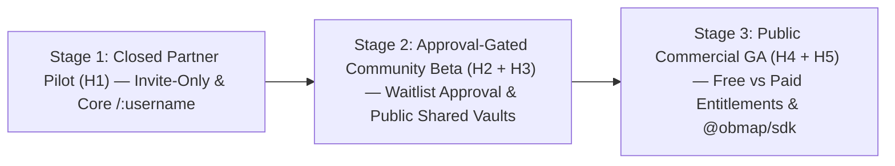

# ObMap Quo Vadis v2.0 — Technical Retrospective, System Readiness Audit & Execution Roadmap

## Ringkasan 3 Baris
- Evaluasi retrospektif arsitektur Wave 1–3 terhadap spesifikasi target [ObMap System Architecture & Product Master Blueprint (v2.0)](00-0-master-blueprint.md) (`DOC-META-000`).
- Mengintegrasikan strategi rilis inkremental **3-Stage Progressive Shipping** (*Partner Pilot → Approval-Gated Community Beta per-user di `/admin` → Commercial GA*), *hard cutover* rute root `/:username` & `/@:username`, refactor `public-reader` → `community`, serta audit 20 dimensi sistem dan register *Doc Drift* (`DRFT-006` s/d `DRFT-016`).
- Menetapkan peta jalan eksekusi teknis bertahap (`EPIC-01` s/d `EPIC-15` dan antrean step-by-step di `docs/02-planning/README.md`) serta arsitektur dokumentasi dan changelog otomatis untuk manusia dan LLM.

---

## 1. Architectural Retrospective: Wave 1–3 Baseline vs. v2.0 Target State

### 1.1 Verified Engineering Completions (Wave 1–3)
- **Modularitas 12 Domain DDD & Pola Headless Controller:** Restrukturisasi kode di `src/domains/` telah memisahkan orkestrasi, view deklaratif, dan controller hook. Seluruh hutang komponen besar (`TD-001`, `TD-002`, `TD-003`, `TD-004`, `TD-006`, `TD-007`) berstatus `[IMPLEMENTED]` dengan `0` komponen `.tsx` melebihi batas 300 baris (`OVER_300=0` pada `tech-debt-register.md`).
- **Deterministic Graph Solvers & Reactive State Governance:** Engine tata letak (`layoutCategory.ts`, `mindmap.ts`, `fishbone.ts`, `timeline.ts`) dan kontroler kanvas (`useGraphCanvasController.ts`) telah menerapkan isolasi store per-tab dan *Canvas Frame Invalidation* (`ADR-0006`).
- **Fondasi Kolaborasi V4 & Config Registry:** Skema migrasi `20261031000000_v4_collaboration_and_publishing.sql`, UI merge VCS (`VcsCreateMergeRequestModal.tsx`, `VcsInteractiveMergeModal.tsx`), share dialog (`CollabDocumentSharePopover.tsx`), klaim handle (`SettingsClaimUsernameModal.tsx`), serta registry internal (`configRegistry.ts`, `pluginRegistry.ts`, `schemaRegistry.ts`) sudah tersedia di codebase.

### 1.2 Architectural Gaps Requiring v2.0 Evolution
- **Ekspansi Cakupan Sistem Referensi:** `00-1-quovadis.md` hanya memodelkan Obsidian, XMind, dan Learn-Anything/Wikipedia. v2.0 menambahkan kapabilitas kolaborasi **Notion** (teamspaces, komentar terstruktur, view derivatif frontmatter) dan jejaring reputasi **LinkedIn × ResearchGate × GitHub**.
- **Eliminasi Sub-Path `/p/` Menuju Root `/:username` (Hard Cutover):** Skema URL `/p/:username/:vaultSlug` di `src/App.tsx` tidak mengikuti standar web modern dan membatasi identitas cendekiawan; v2.0 mematikannya langsung (*hard cutover* tanpa redirect transisi), menggantikannya dengan `/:username` dan `/@:username` beserta `RESERVED_SLUGS`, dan merefaktor `src/domains/public-reader/` menjadi `src/domains/community/`.
- **Ketiadaan Release Stage Gate untuk Continuous Shipping:** Kode saat ini belum memiliki kontrol trafik bertahap untuk mendukung shipping paralel selama pengembangan: **Stage 1** (*Closed Partner Pilot*), **Stage 2** (*Approval-Gated Community Beta*), dan **Stage 3** (*Commercial GA* dengan Free/Paid entitlements).
- **Observabilitas Changelog untuk AI Agents:** Riwayat perubahan masih tersimpan dalam satu file naratif (`docs/00-meta/changelog.md`) yang boros token bagi LLM dan belum memiliki direktif wajib di seluruh entrypoint agen.

---

## 2. System Readiness Audit (20-Dimension Scoring Matrix) & Drift Register

### 2.1 System Readiness Matrix (Skala 1–10)

| # | Domain / Kapabilitas Sistem | Skor v1 | Skor Aktual v2 | Status | Bukti Kode Sumber Terverifikasi | Technical Gap vs. Master Blueprint (`DOC-META-000`) | Prioritas |
| :-: | :--- | :---: | :---: | :---: | :--- | :--- | :---: |
| 1 | **DDD Architecture & Headless Pattern** | 9.0 | **9.2** | `[IMPLEMENTED]` | `src/domains/`, `ADR-0006`, `tech-debt-register.md` | 12 domain bersih (`OVER_300=0`); refactor `public-reader` → `community` & tambah `dashboard` (= 13 domain) | Rendah |
| 2 | **Markdown Editor (CodeMirror 6)** | 8.0 | **8.2** | `[IMPLEMENTED]` | `EditorMarkdownView.tsx`, `EditorPropertiesPanel.tsx` | Perlu dukungan skema `epistemic_status`, `references`, & block annotations | Sedang |
| 3 | **Deterministic Graph Solvers** | 8.5 | **8.8** | `[IMPLEMENTED]` | `layoutCategory.ts`, `mindmap.ts`, `fishbone.ts`, `timeline.ts` | Perlu solver deterministik baru (`argument-map`, `citation-tree`) & Pitch Mode | Sedang |
| 4 | **Canvas2D Rendering & Atmosphere** | 8.5 | **9.0** | `[IMPLEMENTED]` | `GraphCanvas.tsx`, `useGraphCanvasController.ts`, `GraphWorkspaceControls.tsx` | Perlu ikatan penuh token warna/tipografi ke Unified Theme Engine | Rendah |
| 5 | **Vault Storage & Driver Isolation** | 7.5 | **8.0** | `[IMPLEMENTED]` | `VaultManager.ts`, `IndexedDbVaultDriver.ts`, `FileSystemService.ts`, `CloudVaultService.ts` | Perlu driver *ephemeral in-memory* terisolasi untuk Landing Live Sandbox | Sedang |
| 6 | **Metadata Indexing Web Worker** | — | **8.5** | `[IMPLEMENTED]` | `mentions.worker.ts`, `aho-corasick.ts`, `MetadataCache.ts` | Perlu parser & resolver lintas-vault untuk sintaks `[[@username/vault/note]]` | Sedang |
| 7 | **In-Browser VCS Engine** | 6.5 | **7.5** | `[IMPLEMENTED]` | `VcsInteractiveMergeModal.tsx`, `VcsCreateMergeRequestModal.tsx`, `VcsCoPresenceAvatars.tsx` | Merge request masih internal; perlu alur *Cross-User Fork & Merge Request* | Tinggi |
| 8 | **Collaboration & Share Workflows** | — | **6.0** | `[PARTIAL]` | `CollabDocumentSharePopover.tsx`, `CollabBulkPublishModal.tsx` | Perlu teamspaces, komentar blok paragraf, dan sinkronisasi CRDT (Yjs) | Tinggi |
| 9 | **Community Reader & Canonical Routing** | 7.0 | **5.5** | `[PARTIAL]` | `PublicReaderOrchestrator.tsx`, `src/App.tsx`, `publicUrlHelper.ts` | Masih memakai `/p/*`; wajib *hard cutover* ke `/:username` & `/@:username` + `RESERVED_SLUGS`, refactor `public-reader` → `community` | Kritis |
| 10 | **Scholar Profile (`/:username`) & `/explore`** | — | **2.0** | `[VISION]` | `SettingsClaimUsernameModal.tsx`, `ProfileService.ts` | Klaim username ada, namun halaman profil publik, konstelasi, & `/explore` di `domains/community/` belum ada | Kritis |
| 11 | **Release Stage & Approval Gate (Stage 1–3)** | — | **1.5** | `[VISION]` | `src/domains/auth/`, `src/domains/admin/` | Belum ada `release_stage` config, `partner_invitations`, approval per-user di `/admin`, & kurasi manual *Verified Scholar* | Kritis |
| 12 | **RBAC Policy Engine & Visibility SM** | — | **4.8** | `[PARTIAL]` | `useVaultPermission.ts`, `VaultMemberService.ts`, SQL V4 | Baru cek dasar `superadmin`/`owner`/`vault_members`; belum ada `PolicyEngine` & 4 state visibilitas | Kritis |
| 13 | **Cross-Vault Citations & Fork/MR** | — | **1.5** | `[VISION]` | `note_links` (SQL V4), `VcsCreateMergeRequestModal.tsx` | Belum ada tabel `cross_vault_citations`, `vault_forks`, atau reputasi sitasi (`CC BY-SA 4.0` default) | Tinggi |
| 14 | **Monetization, Dynamic Quota & Billing** | — | **1.0** | `[VISION]` | `docs/02-planning/brd.md` (konsep awal) | Belum ada tabel dinamis `plans`/`plan_entitlements`/`plan_quotas` di `/admin` atau gateway **Xendit/Midtrans** | Tinggi |
| 15 | **Dashboard Domain (`/vaults`)** | — | **3.0** | `[PARTIAL]` | `VaultCard.tsx`, `VaultModeSelector.tsx` | Belum terdaftar di `src/App.tsx`; belum ada `DashboardOrchestrator` & views derivatif | Tinggi |
| 16 | **5-Stage Hybrid Onboarding** | — | **2.0** | `[PLANNED]` | `AdminFirstTimeSetupWizard.tsx` (admin only) | Belum ada onboarding end-user, personalization quiz, atau progressive coach marks | Tinggi |
| 17 | **Landing Page & Embedded Sandbox** | — | **4.5** | `[PARTIAL]` | `src/pages/Landing.tsx` (301 baris statis) | Redirect ke `/app` (seharusnya `/vaults`), belum ada sandbox `< 65KB` & stage-aware CTA | Tinggi |
| 18 | **6-Layer Config & Theme Engine** | — | **6.5** | `[PARTIAL]` | `configRegistry.ts`, `schemaRegistry.ts`, `VaultConfigFile.ts`, `LocalConfigStore.ts`, `useThemeStore.ts` | Perlu resolusi 6-lapis dengan Org-Lock, sinkronisasi DOM+Canvas2D, & CSS snippets | Tinggi |
| 19 | **Public Extension SDK (`@obmap/sdk`)** | — | **2.5** | `[PARTIAL]` | `src/domains/settings/shared/api/pluginRegistry.ts` | Masih registry internal tanpa sandbox Worker/iframe, permission manifest, atau `docs/07-developers/` | Sedang |
| 20 | **Type Safety (`TD-005`), A11y, i18n & Ops** | — | **5.5** | `[PARTIAL]` | `untypedSupabase.ts`, `AdminOrchestrator.tsx`, `audit_logs` | `TD-005` masih aktif; perlu automated RLS test suite, kamus i18n, & audit WCAG 2.2 AA | Kritis |

### 2.2 Documentation & Code Drift Register (`DRFT-006` s/d `DRFT-016`)

| ID Drift | Kondisi di Dokumen / Aturan Lama | Kondisi Aktual di Kode / Filesystem | Status Tindakan |
| :--- | :--- | :--- | :--- |
| **`DRFT-006`** | `00-1-quovadis.md` mencantumkan `TD-001`–`TD-004` & `TD-006` sebagai backlog. | `tech-debt-register.md` & kode sumber membuktikan `TD-001`–`TD-004`, `TD-006`, & `TD-007` sudah `[IMPLEMENTED]`. | `00-1-quovadis.md` dibekukan sebagai arsip historis. |
| **`DRFT-007`** | `AGENTS.md` mendokumentasikan rute `/vaults`. | `src/App.tsx` hanya mendaftarkan `/`, `/auth`, `/install`, `/p/*`, `/admin`, `/app`; `Landing.tsx` redirect ke `/app`. | Target perbaikan pada `EPIC-01` & `EPIC-04`. |
| **`DRFT-008`** | `llms.txt` menunjuk `docs/SUMMARY.md` sebagai Portal Dokumentasi. | `docs/SUMMARY.md` sebelumnya tertimpa laporan audit teks dan `docs/README.md` belum dibuat. | **Diselesaikan pada v2.0** (portal dipulihkan; audit dipindah ke `doc-drift-log.md`). |
| **`DRFT-009`** | `docs/01-visions/` memiliki huruf `s`, sedangkan beberapa link di `brd.md`, `personas.md`, `lms-vision.md` dan JSON menunjuk `01-vision/`. | Link markdown & JSON telah diseragamkan ke `01-visions/`. | **Diselaraskan (`G2`, `G5`, `G7`).** |
| **`DRFT-010`** | Penamaan 5 file ADR di `docs/_machine/docs-index.json` berbeda dari nama file fisik di `docs/03-architecture/adr/`. | File fisik (`ADR-0001`–`0012`) telah disinkronkan dengan `adr/README.md` dan `docs-index.json`. | **Diselaraskan (`G4`, `G7`).** |
| **`DRFT-011`** | `src/global/api/untypedSupabase.ts` (`TD-005`) masih digunakan. | Seluruh 12 caller beralih ke `supabaseClient.ts` & 17-tabel `supabaseTypes.ts` teregenerasi (`STEP-01.1`). | **Diselesaikan (`STEP-01.1`, `CHG-20261114-003`).** |
| **`DRFT-012`** | `useVaultPermission.ts` diasumsikan menangani seluruh RBAC kolaborasi. | `PolicyEngine` (`policyEngine.ts`) + SQL `can_access_resource()` aktif untuk peran `commenter`/`guest`, 4-state visibilitas, & `CC BY-SA 4.0`. | **Diselesaikan (`STEP-01.4`, `CHG-20261114-004`).** |
| **`DRFT-013`** | Registry config & plugin sudah ada di kode (`configRegistry.ts`, `pluginRegistry.ts`, `schemaRegistry.ts`). | Resolusi 6-lapis (`ConfigService`), indikator *Locked by Admin*, Scoped CSS sanitizer, & token `--ob-*` DOM↔Canvas2D aktif (`STEP-01.5`); SDK sandbox di `STEP-05.3`. | **Diselesaikan Config/Theme (`STEP-01.5`, `CHG-20261114-004`).** |
| **`DRFT-014`** | `docs/02-planning/brd.md` masih memakai placeholder `{{TBD_PRO_PRICE}}`. | Digantikan skema harga & kuota dinamis DB di `/admin` (`plans`, `plan_quotas`) & **Xendit/Midtrans** first. | **Diselaraskan (`G3`).** |
| **`DRFT-015`** | `src/App.tsx` & `publicUrlHelper.ts` menggunakan skema URL `/p/:username/:vaultSlug`. | Direfaktor ke `src/domains/community/`, *hard cutover* `/p/*` → `/:username` / `/@:username`, & 3-layer `RESERVED_SLUGS` (`STEP-01.2`). | **Diselesaikan (`STEP-01.2`, `CHG-20261114-003`).** |
| **`DRFT-016`** | Alur auth di `src/domains/auth/` mengizinkan akses langsung setelah signup tanpa antrean. | `ReleaseStageService`, gate `AuthProtectedRoute`, & UI antrean approval individual `/admin` aktif (`STEP-01.3`). | **Diselesaikan (`STEP-01.3`, `CHG-20261114-004`).** |

---

## 3. Progressive Shipping & Deployment Strategy (Shipping While Developing)

Pengembangan berkesinambungan dijalankan paralel dengan **3 Tahap Rilis Terkontrol** agar produk segera dipakai di dunia nyata tanpa mengorbankan stabilitas infrastruktur atau keamanan data.



| Tahap Rilis | Scope Horizon | Kontrol Akses & Trafik | Fitur yang Aktif di Produksi | Kriteria Lolos ke Tahap Berikutnya |
| :--- | :--- | :--- | :--- | :--- |
| **Stage 1: Closed Partner & Institutional Pilot** | **H1** (`EPIC-01`–`03`) | `release_stage = 'stage_1_partner'`. Pendaftaran publik ditutup; akses khusus rekanan & lembaga melalui `partner_invitations` dan approval manual Admin. | Workspace `/app`, Local + Cloud Vaults, RBAC Policy Engine, Visibility SM, Rute `/:username/:vaultSlug` untuk vault yang dibagikan mitra, Multi-Layer Config dasar. | 0 error RLS lintas-tenant, `TD-005` bersih, `npx vitest run` 100% hijau, validasi stabilitas bersama >= 5 mitra/lembaga pilot. |
| **Stage 2: Approval-Gated Community Beta** | **H2 + H3** (`EPIC-04`–`09`) | `release_stage = 'stage_2_community_beta'`. User dapat mendaftar & memilih `username`, namun berstatus `pending_approval` sampai disetujui **secara individual per-user oleh Admin di `/admin`**. Publik hanya mengakses profil & vault berstatus `shared`/`public` milik akun `approved`. | Semua Stage 1 + Dashboard `/vaults`, Landing Sandbox, Hybrid Onboarding, Profil `/:username`, `/explore`, Cross-Vault Citations (`CC BY-SA 4.0`), Fork & Knowledge Merge Request. | Rasio error `< 0.5%`, LCP `/:username` `< 2.0s`, alur approval & kurasi manual Admin berjalan lancar di beban komunitas awal. |
| **Stage 3: Public Commercial GA** | **H4 + H5** (`EPIC-10`–`15`) | `release_stage = 'stage_3_commercial_ga'`. Registrasi terbuka otomatis (`approved`) dengan penegakan kuota & harga dinamis dari `/admin` di database & Edge Functions. | Semua Stage 2 + Billing (**Xendit/Midtrans** terlebih dahulu, lalu Stripe), Teamspaces & CRDT Yjs, Interactive LMS Skill Tree, Solver `argument-map`/`citation-tree`, `@obmap/sdk`. | Uji E2E webhook pembayaran & *Non-Destructive Downgrade* 100% lulus; audit keamanan OWASP ASVS L2 & SLO `99.9%`. |

---

## 4. Engineering Execution Roadmap (Horizons H1–H5 & Epic Specifications)

### Horizon 1 — Stage 1 Readiness: Type Safety, `community` Refactor, Root `/:username` Hard Cutover, Stage Gate & Policy Engine
- **`EPIC-01` `[IMPLEMENTED — CHG-20261114-003]` Type-Safety (`TD-005`), Refactor `public-reader` → `community` & Root Namespace Hard Cutover (`/:username` / `/@:username`):** (`FR-SYS-001`, `NFR-006`) — `untypedSupabase.ts` dikonversi ke re-export bertipe, `supabaseTypes.ts` diregenerasi (17 tabel, 2 RPC, 3 enum + migrasi V4.1), `src/domains/public-reader/` direfaktor ke `src/domains/community/` (`CommunityOrchestrator.tsx`, `components/`, `shared/`, & barrel shims), rute `/vaults`, `/explore`, & `/:username/*` (mendukung `/@:username`) didaftarkan di `src/App.tsx` beserta guard 3-lapis `RESERVED_SLUGS`, dan `/p/*` dimatikan langsung. Domain: `global`, `community`, `settings`. Acceptance: `tsc --noEmit`, Vitest (`CommunityRouting.test.ts`), & build hijau 100%.
- **`EPIC-02` `[IMPLEMENTED — CHG-20261114-004]` ReleaseStageGate, Approval Queue Per-User, Unified RBAC Policy Engine & Visibility State Machine:** (`FR-AUTH-010`, `FR-VAULT-010`, `FEAT-COLLAB-004`) — Mengaktifkan `partner_invitations` (Stage 1), `account_status` (`pending_approval` | `approved` | `suspended` untuk Stage 2), `ReleaseStageService.ts`, gate `AuthProtectedRoute.tsx`, antrean approval **individual per-user di `/admin`** (`AdminReleaseStageBar.tsx`, `AdminService.ts`), `PolicyEngine` (`policyEngine.ts`) simetris dengan Postgres `can_access_resource()`, 4-state visibilitas + eksklusi frontmatter `visibility: private` + lisensi default `CC BY-SA 4.0`. Migrasi V4.2 selesai. Acceptance: `ReleaseStageAndPolicyEngine.test.ts` lulus 100%.
- **`EPIC-03` `[IMPLEMENTED — CHG-20261114-004]` Six-Layer Config & Unified DOM/Canvas2D Theme Tokens:** (`FR-SET-001`, `FEAT-SET-001`) — Mengaktifkan `resolveCascadingConfig` 6-lapis (`ConfigService.ts`, `SettingsConfigurationSection.tsx`) dengan indikator *Locked by Admin*, token `--ob-*` DOM↔Canvas2D (`useThemeStore.ts`, `graph/shared/utils/theme.ts`), Scoped CSS snippet sanitizer (`.obmap-themed-root`), & repaint reaktif Rule 10 (`useGraphCanvasController.ts`). Domain: `settings`, `graph`, `workspace`.

### Horizon 2 — Stage 2 Readiness: Dashboard Domain (`/vaults`), Hybrid Onboarding & Landing Sandbox
- **`EPIC-04` Dedicated `dashboard` Domain (`src/domains/dashboard/`):** (`FR-DASH-001`–`005`, `FEAT-DASH-001`) — Bangun `DashboardOrchestrator.tsx`, `DashboardWidgetRegistry.ts`, 5 view derivatif Markdown/Frontmatter (Grid, Knowledge Tree, Kanban, Calendar/Timeline, Analytics), dan template gallery; ubah redirect pasca-login di `Landing.tsx` dari `/app` ke `/vaults`. Acceptance: komponen view `<= 300` baris.
- **`EPIC-05` Conversion Landing Page & In-Memory Sandbox (`< 65KB`):** (`FR-GROWTH-001`, `FEAT-GROWTH-001`) — Rombak `Landing.tsx` dengan narasi 5 referensi, sandbox in-memory lazy-loaded (outline → Mindmap/Fishbone/Timeline), dan CTA adaptif per `release_stage`. Metrik: LCP `< 2.0s`, TTFV `< 90s`.
- **`EPIC-06` Five-Stage Hybrid Onboarding Pipeline:** (`FR-GROWTH-002`, `FEAT-GROWTH-002`) — Rangkai *Benefits Splash* → *Sandbox Transfer* → *Approval/Waitlist Handling* → *Personalization Survey* → *Guided Tour (<=5 langkah)* + *Progressive Coach Marks*.

### Horizon 3 — Stage 2 Completion: Social Knowledge Network (`/:username`, `/explore`, Sitasi & Fork/MR)
- **`EPIC-07` Living Intellectual Profile (`/:username`) & `/explore` Directory (`domains/community/`):** (`FR-SOC-001`, `FR-SOC-002`, `FEAT-SOC-001`) — Perluas `CommunityOrchestrator` (`src/domains/community/`) dengan tampilan bio/ORCID, Konstelasi Vault Publik (`CC BY-SA 4.0` default), indeks `/explore`, *Follow Scholar/Topic*, kurasi manual *Verified Scholar* dari `/admin`, dan dynamic OG image. Migrasi SQL: `scholar_profiles`, `scholar_follows`, `vault_topics`, `scholar_verifications`.
- **`EPIC-08` Federated Cross-Vault Citations & Epistemic Metadata:** (`FR-SOC-003`, `FEAT-SOC-002`) — Parser & indexer `[[@username/vault/note]]` di `mentions.worker.ts`, skema `epistemic_status` & `license: CC BY-SA 4.0`, tombol *"Cite this Note"* (APA/MLA/IEEE/BibTeX), dan tabel `cross_vault_citations`.
- **`EPIC-09` VCS Fork, Knowledge Merge Request & Paragraph Annotations:** (`FR-SOC-004`, `FR-SOC-005`, `FEAT-SOC-003`) — Aksi *Fork to My Vault*, pengajuan *Knowledge Merge Request* lintas-pengguna via `src/domains/vcs/`, serta komentar terikat hash blok paragraf. Migrasi SQL: `vault_forks`, `knowledge_merge_requests`, `note_annotations`.

### Horizon 4 — Stage 3 Commercial GA: Dynamic Entitlements, Xendit/Midtrans Billing, Teamspaces & CRDT
- **`EPIC-10` Dynamic Entitlements, Admin-Configured Pricing & Gateway Billing (`Xendit/Midtrans` First):** (`FR-BILL-001`–`003`, `FEAT-BILL-001`) — Skema dinamis `plans`, `plan_entitlements`, `plan_quotas`, `subscriptions`, `usage_quotas`, `billing_invoices` tanpa angka hardcode; Edge Functions webhook **Xendit/Midtrans** terlebih dahulu (QRIS, VA, e-Wallet, IDR), disusul adapter **Stripe**; hook `useEntitlement()`; dan *Non-Destructive Downgrade*.
- **`EPIC-11` Admin Commercial Console, Quota Configurator & Org Teamspaces:** (`FR-ADM-010`, `FR-COLLAB-010`, `FEAT-COLLAB-005`) — UI `/admin` di `src/domains/admin/` untuk mengatur harga & kuota per paket secara dinamis, persetujuan individual akun Stage 2, kurasi *Verified Scholar*, kupon/beasiswa, dan Teamspaces dengan *Admin-Locked Policies*.
- **`EPIC-12` Real-Time Multiplayer CRDT (Yjs) & Co-Presence:** (`FR-COLLAB-003`, `FEAT-COLLAB-003`) — Kolaborasi multi-kursor real-time untuk Team/Lab tanpa mengorbankan mode offline-first.

### Horizon 5 — Advanced Cognition, LMS Skill Tree & Sandboxed `@obmap/sdk`
- **`EPIC-13` Interactive Graph LMS & Skill Tree DAG:** (`FR-LMS-001`–`004`, `FEAT-LMS-001`) — Evaluator `prerequisites` frontmatter, status simpul (*Locked / Available / Mastered*), animasi pulsa progres, dan kuis terintegrasi.
- **`EPIC-14` Analytical Graph Solvers & Presentation Export:** (`FR-GRAPH-010`–`012`, `FEAT-GRAPH-008`) — Solver deterministik `argument-map` & `citation-tree`, Pitch Mode, serta ekspor PDF/SVG/OPML.
- **`EPIC-15` Public Extension SDK (`@obmap/sdk`), Security Sandbox & Dev Portal:** (`FR-EXT-001`–`003`, `FEAT-EXT-001`) — Evolusi `pluginRegistry.ts` ke SDK ber-manifest izin (`Web Worker / Iframe CSP`), *Scoped CSS Snippets*, allowlist Enterprise, dan dokumentasi `docs/07-developers/`.

### Immediate Execution Priority
Seluruh langkah Horizon 1 (`STEP-01.1`–`STEP-01.5` / `EPIC-01`–`EPIC-03`) telah berstatus `[IMPLEMENTED]`. AI coding agent dan developer melanjutkan implementasi secara gradual mengikuti antrean di [**Playbook Perencanaan (`docs/02-planning/README.md`)**](../02-planning/README.md) dimulai dari **`STEP-02.1` (`EPIC-04`: Dedicated `dashboard` Domain `/vaults` dengan 5 Derived Views)** hingga **`STEP-05.4`**.

---

## 5. Documentation Restructuring Blueprint & Automated LLM Changelog Protocol

### 5.1 Target `docs/` Directory Architecture
```text
docs/
├── README.md                    # Portal navigasi utama (manusia & LLM)
├── SUMMARY.md                   # Peta indeks terstruktur (selaras llms.txt)
├── 00-meta/                     # Dokumen induk: 00-0-master-blueprint.md, 00-2-quovadis.md, konvensi, glosarium
├── changelogs/                  # [BARU] Subsystem changelog sharded & efisien token untuk LLM
│   ├── README.md                # Rolling Top-10 changes + SOP update wajib bagi AI Agents
│   ├── _template.md             # Template entri standar CHG-YYYYMMDD-NNN
│   ├── archive-wave-1-to-3.md   # Arsip historis Wave 1–3
│   └── YYYY-MM.md               # Log bulanan terstruktur (mis. 2026-11.md)
├── 01-visions/                  # Visi, filosofi, positioning (5 referensi), use-case pillars
├── 02-planning/                 # Playbook step-by-step (README.md), PRD, BRD, SRS, SoW, Personas, Roadmap, Traceability
├── 03-architecture/             # System overview, 13 domain map (termasuk community & dashboard), storage, graf & ADR-0001..0012
├── 04-features/                 # Master feature catalog (sinkron source_of_truth Wave 3+)
├── 05-engineering/              # Coding standards, testing, repo rules, tech debt, doc-drift-log
├── 06-lms/                      # Spesifikasi kurikulum DAG & Skill Tree
├── 07-developers/               # SDK Quickstart, Extension Points, Theme Guide, Sandbox Security
└── _machine/                    # Indeks JSON + changelog.jsonl (append-only machine stream)
```

### 5.2 Automated LLM Changelog Protocol (`docs/changelogs/` + `docs/_machine/changelog.jsonl`)
Setiap AI agent atau developer yang memodifikasi kode, migrasi SQL, konfigurasi, atau dokumen arsitektur wajib melakukan 3 pembaruan atomik sebelum mengakhiri tugas:
1. Tambahkan 1 baris JSON valid ke `docs/_machine/changelog.jsonl` (pembacaan ringkas cukup `tail -n 15` dengan konsumsi `< 500` token).
2. Tambahkan entri detail pada `docs/changelogs/YYYY-MM.md` memakai format `_template.md`.
3. Mutakhirkan tabel *Rolling Top-10 Changes* di `docs/changelogs/README.md`.

### 5.3 Documentation Overhaul Matrix (`G1`–`G7`)

| Wave | Berkas Target | Ruang Lingkup Pembaruan |
| :---: | :--- | :--- |
| **G1** | `AGENTS.md`, `README.md`, `llms.txt`, `docs/README.md`, `docs/SUMMARY.md`, `docs/changelogs/*` | Terapkan Rule 11 (Mandatory Changelog Protocol), rute `/:username`, 13 domain (`community` + `dashboard`), dan portal navigasi |
| **G2** | `docs/00-meta/{glossary,changelog}.md`, `docs/01-visions/*` | Sinkronisasi istilah v2.0, perbaiki link `01-visions/` vs `01-vision/`, perbarui positioning 5 referensi |
| **G3** | `docs/02-planning/{README,prd,brd,srs,sow,personas,roadmap,traceability-matrix}.md` | Buat playbook step-by-step `README.md` (`STEP-01.1`..`05.4`), 3-Stage Gate, dynamic quota/pricing, Xendit/Midtrans, `PER-07`–`09` |
| **G4** | `docs/03-architecture/*` + `ADR-0007` s/d `ADR-0012` | Perbaiki nama file ADR di index, tambah ADR: `community` & `/:username` (`0007`), `dashboard` (`0008`), RBAC & Dynamic Quota/Xendit (`0009`), Visibility & `CC BY-SA 4.0` (`0010`), 6-Layer Config & Theme (`0011`), `@obmap/sdk` (`0012`) |
| **G5** | `docs/04-features/feature-catalog.md`, `docs/05-engineering/*`, `docs/06-lms/lms-vision.md` | Perbaiki path legacy Wave 3 di `feature-catalog.md` & `testing-strategy.md`, log `DRFT-006`–`016`, selaraskan LMS `/:username` |
| **G6** | `docs/07-developers/*` (Baru) | Quickstart SDK, referensi 12 Extension Points, Theme Authoring, dan aturan sandbox keamanan |
| **G7** | `docs/_machine/{docs-index,domains,features,requirements,repo-map}.json` | Sinkronisasi penuh metadata JSON mesin terhadap repositori |

---

## 6. Locked Architectural & Product Decisions (Resolved ADR Gate) `[LOCKED — 2026-11-14]`

Seluruh keputusan arsitektur dan produk di bawah ini telah dikunci untuk menjadi rujukan tunggal dokumentasi dan eksekusi gradual:

1. **Domain Boundary Sosial (`src/domains/community/`):** `src/domains/public-reader/` direfaktor dan diganti namanya menjadi **`src/domains/community/`** (`CommunityOrchestrator.tsx`). Seluruh sub-modul `components/` dan `shared/` bekas `public-reader` diserap ke dalam `domains/community/`, menghasilkan total **13 bounded domains** target (12 domain yang ada + domain baru `dashboard`, dengan `public-reader` bertransformasi menjadi `community`).
2. **Hard Cutover Rute `/p/*` → `/:username` & `/@:username`:** Rute legacy `/p/*` **langsung dimatikan** (*hard cutover* tanpa redirect transisi) pada `EPIC-01` dan digantikan oleh `/:username`, `/:username/:vaultSlug`, `/:username/:vaultSlug/:noteSlug`, serta alias `/@:username/*` dengan penjagaan `RESERVED_SLUGS`.
3. **Alur Persetujuan Stage 2 (`stage_2_community_beta`):** Persetujuan akun berstatus `pending_approval` dilakukan **secara individual per-user oleh Admin di `/admin`** (`src/domains/admin/`), tanpa mekanisme *referral/invite quota* dari pengguna umum.
4. **Pricing & Kuota Dinamis via Admin:** Nilai harga tier dan batas kuota paket (`Free`, `Pro`, `Team/Lab`, `Academic/Enterprise`) **tidak di-hardcode**, melainkan disimpan di database (`plans`, `plan_entitlements`, `plan_quotas`) dan dikonfigurasi secara dinamis di `src/domains/admin/`.
5. **Prioritas Payment Gateway:** Integrasi pembayaran mengutamakan **Xendit / Midtrans terlebih dahulu** (mendukung IDR, QRIS, Virtual Account, e-Wallet), baru kemudian diperluas dengan adapter **Stripe**.
6. **Kurasi Verifikasi Akademik:** Lencana *Verified Scholar / Educator / Institution* diberikan melalui **kurasi manual oleh Admin di `/admin`**.
7. **Lisensi Default Konten Publik:** Vault yang dipublikasikan ke profil atau direktori publik memakai lisensi default **`CC BY-SA 4.0`** agar ramah sitasi ilmiah serta kolaborasi *Fork & Knowledge Merge Request* (dapat diubah per vault melalui YAML frontmatter `license`).
8. **Urutan Eksekusi (Docs-First Gradual Playbook):** Perombakan seluruh `docs/` (`G1`–`G7`) diselesaikan tuntas sebelum modifikasi kode aplikasi. Setelah itu, implementasi kode mengeksekusi antrean bertahap di [**Playbook Eksekusi Step-by-Step (`docs/02-planning/README.md`)**](../02-planning/README.md).

---

## Terkait
- [ObMap System Architecture & Product Master Blueprint (v2.0)](00-0-master-blueprint.md)
- [Playbook Antrean Eksekusi Bertahap (`STEP-01.1`–`STEP-05.4`)](../02-planning/README.md)
- [Sistem Changelog Modular & Protokol Agen](../changelogs/README.md)
- [Quo Vadis ObMap v1.0 (Arsip Historis Wave 3)](00-1-quovadis.md)
- [Log Penyelarasan Kode & Drift (Doc Drift Log)](../05-engineering/doc-drift-log.md)
- [Register Hutang Teknis (Tech Debt Register)](../05-engineering/tech-debt-register.md)
