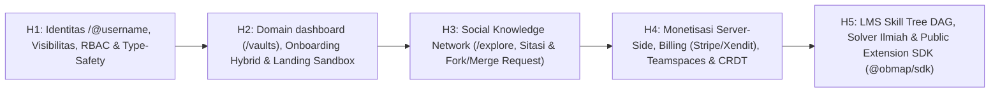

# Quo Vadis ObMap v2 ("UUD 1945" Evaluasi Reflektif & Peta Jalan Eksekusi)

## Ringkasan 3 Baris
- Menurunkan konstitusi [Master Blueprint](00-0-master-blueprint.md) (`DOC-META-000`) menjadi evaluasi retrospektif jujur atas kondisi kode Wave 3 dan peta jalan eksekusi 5 Horizon (`EPIC-01` s/d `EPIC-15`).
- Mengoreksi ketidakselarasan dokumen terhadap kode aktual melalui audit 20 dimensi sistem dan register *Doc Drift* (`DRFT-006` s/d `DRFT-014`).
- Mengunci mandat perombakan 32 berkas dokumentasi (`docs/`, `ADR-0007`–`ADR-0012`, `docs/07-developers/`, `_machine/*.json`, `AGENTS.md`, `llms.txt`) sambil menjaga `00-1-quovadis.md` sebagai arsip historis.

---

## Pasal 1: Refleksi & Retrospektif Strategis (Wave 1–3 & v1 → Konstitusi v2)

### 1.1 Apa yang Sudah Berhasil Dibangun (Capaian Nyata Wave 1–3)
- **Fondasi 12 Domain DDD & Kebersihan Kode:** Restrukturisasi arsitektur `src/domains/` tuntas dengan import alias `@/`. Seluruh *God Components* kritis (`TD-001`, `TD-002`, `TD-003`, `TD-004`, `TD-006`, `TD-007`) kini berstatus `[IMPLEMENTED]` — termasuk ekstraksi 157 komponen UI menjadi Headless Controller di bawah batas 300 baris (`OVER_300=0` di `tech-debt-register.md`).
- **Mesin Graf & Tata Letak Deterministik:** `layoutCategory.ts`, `mindmap.ts`, `fishbone.ts`, `timeline.ts`, dan `useGraphCanvasController.ts` membuktikan bahwa struktur direktori Markdown dapat dirender secara deterministik dan estetis, lengkap dengan *Single Source of Truth* dan *Hierarchical Store Bridge* (`ADR-0006`).
- **Fondasi Kolaborasi & Settings Modular:** Migrasi V4 (`20261031000000_v4_collaboration_and_publishing.sql`), komponen `VcsCreateMergeRequestModal.tsx`, `CollabDocumentSharePopover.tsx`, `SettingsClaimUsernameModal.tsx`, serta registry internal (`configRegistry.ts`, `pluginRegistry.ts`, `schemaRegistry.ts`) sudah tersedia sebagai batu pijakan.

### 1.2 Mengapa `00-1-quovadis.md` (v1) Tidak Lagi Memadai
- **Cakupan DNA Belum Lengkap:** v1 hanya memadukan Obsidian, XMind, dan Learn-Anything/Wikipedia. v1 belum menyerap DNA kolaborasi **Notion** serta jejaring identitas & reputasi **LinkedIn × ResearchGate × GitHub**.
- **Rute Publik Terisolasi (`/p/*`):** Publikasi saat ini bersifat pasif di `/p/:username/:vaultSlug` tanpa halaman profil sosial `/@:username`, tanpa *discovery feed* (`/explore`), tanpa sitasi lintas-vault, dan tanpa alur *Fork & Merge Request* antar-pengguna.
- **Ketiadaan Arsitektur Bisnis & Home Dashboard:** Belum ada rute `/vaults` (`src/App.tsx`), domain `dashboard`, arsitektur *entitlement* server-side, onboarding 5-lapis, maupun SDK ekstensi komunitas. Pergeseran ke **The Social Knowledge Network + `/@:username`** adalah langkah strategis pengubah kategori pasar (*category-defining move*).

---

## Pasal 2: Audit Kejujuran & Matriks Skor Sistem (Skala 1–10) terhadap Master Blueprint

### 2.1 Matriks Evaluasi 20 Dimensi Sistem

| # | Dimensi / Domain Sistem | Skor v1 | Skor Aktual v2 | Status | Bukti Kode Sumber Terverifikasi | Analisis Gap terhadap Master Blueprint | Prioritas |
| :-: | :--- | :---: | :---: | :---: | :--- | :--- | :---: |
| 1 | **Arsitektur DDD & Headless Pattern** | 9.0 | **9.2** | `[IMPLEMENTED]` | `src/domains/`, `ADR-0006`, `tech-debt-register.md` | 12 domain bersih (`OVER_300=0`); perlu tambah `dashboard` & `community`/profil | Rendah |
| 2 | **Editor Markdown (CM6)** | 8.0 | **8.2** | `[IMPLEMENTED]` | `src/domains/editor/components/EditorMarkdownView.tsx`, `EditorPropertiesPanel.tsx` | Perlu dukungan frontmatter epistemik (`epistemic_status`, `references`) & anotasi blok | Sedang |
| 3 | **Mesin Graf & Solvers** | 8.5 | **8.8** | `[IMPLEMENTED]` | `src/domains/graph/shared/utils/{layoutCategory,mindmap,fishbone,timeline}.ts` | Solver dasar solid; belum ada `argument-map`, `citation-tree`, & Pitch Mode | Sedang |
| 4 | **Living Canvas & Atmosphere** | 8.5 | **9.0** | `[IMPLEMENTED]` | `GraphCanvas.tsx`, `useGraphCanvasController.ts`, `GraphWorkspaceControls.tsx` | `TD-001` & `TD-002` tuntas; perlu sinkronisasi penuh dengan Unified Theme Tokens | Rendah |
| 5 | **Vault Storage & Isolasi** | 7.5 | **8.0** | `[IMPLEMENTED]` | `VaultManager.ts`, `IndexedDbVaultDriver.ts`, `FileSystemService.ts`, `CloudVaultService.ts` | `TD-003` & `TD-004` tuntas; perlu driver *in-memory* terpisah untuk Landing Sandbox | Sedang |
| 6 | **Metadata & Indexing Worker** | — | **8.5** | `[IMPLEMENTED]` | `src/domains/metadata/shared/api/mentions.worker.ts`, `aho-corasick.ts` | Cepat untuk internal vault; belum mendukung resolusi `[[@user/vault/note]]` lintas-vault | Sedang |
| 7 | **In-Browser VCS** | 6.5 | **7.5** | `[IMPLEMENTED]` | `src/domains/vcs/components/{VcsInteractiveMergeModal,VcsCreateMergeRequestModal,VcsCoPresenceAvatars}.tsx` | 3-way merge lokal ada; perlu integrasi *Cross-User Fork & Merge Request* publik | Tinggi |
| 8 | **Kolaborasi & Share Dialog** | — | **6.0** | `[PARTIAL]` | `src/domains/collaboration/components/{CollabDocumentSharePopover,CollabBulkPublishModal}.tsx` | Dialog berbagi dasar ada; belum ada teamspace, komentar paragraf, CRDT Yjs | Tinggi |
| 9 | **Portal Pembaca Publik** | 7.0 | **6.5** | `[PARTIAL]` | `src/domains/public-reader/PublicReaderOrchestrator.tsx`, `src/App.tsx` | Hanya `/p/*`; belum memakai `/@:username/:vaultSlug`, OG dinamis, tombol Cite/Fork | Sangat Tinggi |
| 10 | **Social Profile (`/@username`) & Explore** | — | **2.0** | `[VISION]` | `SettingsClaimUsernameModal.tsx`, `ProfileService.ts` | Klaim username sudah ada, namun halaman `/@:username` & `/explore` belum dibangun | Sangat Tinggi |
| 11 | **Cross-Vault Citations & Fork/PR** | — | **1.5** | `[VISION]` | `VcsCreateMergeRequestModal.tsx` (internal), `note_links` (SQL V4) | Belum ada skema lintas-vault, reputasi ilmiah, atau *Fork to My Vault* | Tinggi |
| 12 | **RBAC & Policy Engine** | — | **5.0** | `[PARTIAL]` | `useVaultPermission.ts`, `VaultMemberService.ts`, `20261031000000_v4_collaboration_and_publishing.sql` | Baru handle `superadmin`/`owner`/`vault_members`; belum ada `PolicyEngine` & `guest`/`commenter` | Sangat Tinggi |
| 13 | **Visibilitas Vault Terstandar** | — | **4.5** | `[PARTIAL]` | `20261031000000_v4_collaboration_and_publishing.sql`, `publicUrlHelper.ts` | Belum ada *state machine* terpadu `Private`/`Shared`/`Unlisted`/`Listed` & per-note exclude | Sangat Tinggi |
| 14 | **Monetisasi, Entitlement & Billing** | — | **1.0** | `[VISION]` | `docs/02-planning/brd.md` (konsep saja) | Belum ada tabel `plans`/`subscriptions`/`entitlements`, RLS kuota, atau Stripe/Xendit | Tinggi |
| 15 | **Onboarding 5-Model Hybrid** | — | **2.0** | `[PLANNED]` | `AdminFirstTimeSetupWizard.tsx` (admin saja) | Belum ada alur 5-tahap bagi user baru, kuesioner, maupun tour kontekstual | Tinggi |
| 16 | **Dashboard App (`/vaults`)** | — | **3.0** | `[PARTIAL]` | `src/domains/vault/components/VaultCard.tsx`, `VaultModeSelector.tsx` | Masih tercampur di `vault`; rute `/vaults` belum terdaftar di `src/App.tsx`; belum ada Kanban/Kalender | Sangat Tinggi |
| 17 | **Landing Page & Live Sandbox** | — | **4.5** | `[PARTIAL]` | `src/pages/Landing.tsx` (301 baris statis) | Narasi lama, redirect ke `/app`, belum ada *Embedded Live Sandbox* atau showcase `/@username` | Tinggi |
| 18 | **Settings, Config & Theme Engine** | — | **6.5** | `[PARTIAL]` | `configRegistry.ts`, `schemaRegistry.ts`, `VaultConfigFile.ts`, `LocalConfigStore.ts`, `useThemeStore.ts` | Fondasi registry ada, namun belum ada *6-Layer Cascading Lock*, Unified DOM+Canvas token, & CSS snippets | Tinggi |
| 19 | **Plugin/Extension SDK & Dev Docs** | — | **2.5** | `[PARTIAL]` | `src/domains/settings/shared/api/pluginRegistry.ts` | Hanya registry internal; belum ada `@obmap/sdk`, sandbox permission, maupun `docs/07-developers/` | Sedang |
| 20 | **Security, Type Safety, A11y, i18n & Obs** | — | **5.5** | `[PARTIAL]` | `src/global/api/untypedSupabase.ts`, `AdminOrchestrator.tsx`, `audit_logs` | `TD-005` belum tuntas; belum ada pengujian RLS otomatis, i18n penuh, atau audit WCAG 2.2 AA | Sangat Tinggi |

### 2.2 Register Doc Drift & Code Gap (`DRFT-006` s/d `DRFT-014`)

| ID Drift | Klaim di Dokumen Lama / Aturan | Realitas Kode Sumber Terverifikasi | Tindakan Penyelarasan Wajib |
| :--- | :--- | :--- | :--- |
| **`DRFT-006`** | `00-1-quovadis.md` menulis `TD-001`–`TD-004` & `TD-006` sebagai backlog Horizon 1. | `tech-debt-register.md` & kode nyata membuktikan `TD-001`–`TD-004`, `TD-006`, & `TD-007` sudah `[IMPLEMENTED]`. | Tandai `00-1-quovadis.md` sebagai arsip historis; gunakan skor v2. |
| **`DRFT-007`** | `AGENTS.md` menyebut rute `/vaults` untuk dashboard. | `src/App.tsx` hanya mendaftarkan `/`, `/auth`, `/install`, `/p/*`, `/admin`, `/app`. `Landing.tsx` me-redirect ke `/app`. | Daftarkan `/vaults` & `/@:username` di `src/App.tsx` pada H1–H2. |
| **`DRFT-008`** | `llms.txt` menunjuk `docs/SUMMARY.md` sebagai "Portal Dokumentasi ObMap". | `docs/SUMMARY.md` berisi laporan teks audit dokumentasi, bukan portal navigasi indeks. | Pulihkan `docs/SUMMARY.md` sebagai portal navigasi resmi. |
| **`DRFT-009`** | `doc-conventions.md` mewajibkan YAML front-matter pada semua file `.md` di `docs/`. | `00-1-quovadis.md` dan `docs/SUMMARY.md` tidak memiliki YAML front-matter. | Lengkapi header `SUMMARY.md`; biarkan `00-1-quovadis.md` sebagai arsip. |
| **`DRFT-010`** | `system-overview.md` & `AGENTS.md` mengasumsikan TypeScript strict penuh. | `src/global/api/untypedSupabase.ts` (`TD-005`) masih dipakai karena tipe DB belum sinkron dengan SQL V4. | Regenerasi `supabaseTypes.ts` dan hapus `untypedSupabase.ts`. |
| **`DRFT-011`** | `collaboration-and-publishing.md` menggambarkan kontrol akses berjenjang lengkap. | `useVaultPermission.ts` baru memeriksa `superadmin`, `owner`, dan `vault_members` dasar. | Bangun *Unified Policy Engine* + dukung `commenter` & `guest`. |
| **`DRFT-012`** | `SettingsClaimUsernameModal.tsx` menjanjikan tautan profil/publikasi username. | `ProfileService.ts` menyimpan `username`, namun belum ada halaman profil `/@:username`. | Bangun `ScholarProfileOrchestrator` & rute kanonik `/@:username`. |
| **`DRFT-013`** | `domain-map.md` & `feature-catalog.md` tidak mencatat arsitektur plugin/config internal. | `pluginRegistry.ts`, `configRegistry.ts`, `schemaRegistry.ts`, `VaultConfigFile.ts` sudah eksis di `settings`. | Dokumentasikan di `domain-map.md` & jadikan basis `@obmap/sdk`. |
| **`DRFT-014`** | `docs/02-planning/brd.md` mencantumkan harga `{{TBD_PRO_PRICE}}` tanpa model sosial/LMS. | Belum ada kode monetisasi, entitlement, atau integrasi payment gateway di repositori. | Mutakhirkan `brd.md` sesuai Sila 4 `00-0-master-blueprint.md`. |

---

## Pasal 3: Peta Jalan Eksekusi Bertahap (5 Horizon Strategis: H1 s/d H5)

### Horizon 1 — Fondasi Identitas `/@username`, Visibilitas, Policy Engine RBAC & Resolusi Drift
- **`EPIC-01` Resolusi Drift & Type Safety (`TD-005`):** (`FR-SYS-001`, `NFR-006`) — Hapus `untypedSupabase.ts`, regenerasi `supabaseTypes.ts`, daftarkan placeholder rute `/vaults` & `/@:username` di `src/App.tsx`, tambahkan redirect kompatibel `/p/*` → `/@:username/*`. Domain: `global`, `public-reader`. Risiko: regresi query (`RISK-04`). Kriteria selesai: `tsc --noEmit` & `npx vitest run` 100% hijau.
- **`EPIC-02` Unified RBAC Policy Engine & Visibility State Machine:** (`FR-AUTH-010`, `FR-VAULT-010`, `FEAT-COLLAB-004`) — Evolusi `useVaultPermission.ts` menjadi `can(actor, action, resource, ctx)`; terapkan 4 state visibilitas + frontmatter `visibility: private` + *Unified Share Dialog*. Domain: `auth`, `vault`, `collaboration`. Migrasi SQL: perluasan `vault_visibility` enum, tabel `share_links`, helper RLS `can_access_resource()`. Kriteria selesai: suite uji otomatis RLS lulus untuk seluruh peran.
- **`EPIC-03` Multi-Layer Config & Unified Theme Token Foundation:** (`FR-SET-001`, `FEAT-SET-001`) — Terapkan hierarki 6-lapis pada `LocalConfigStore.ts`, `CloudConfigStore.ts`, dan `VaultConfigFile.ts`; satukan `useThemeStore.ts` dengan token Canvas2D (`graph/shared/utils/theme.ts`). Domain: `settings`, `graph`, `workspace`. Kriteria selesai: perubahan tema dan role lock terefleksi seketika di DOM & Canvas2D tanpa reload.

### Horizon 2 — Growth & Acquisition: Domain `dashboard`, Onboarding 5-Model & Landing Live Sandbox
- **`EPIC-04` Domain Baru #13 `src/domains/dashboard/` (`/vaults`):** (`FR-DASH-001`–`005`, `FEAT-DASH-001`) — Buat `DashboardOrchestrator.tsx`, `DashboardWidgetRegistry.ts`, 5 mode view derivatif Markdown/Frontmatter (Grid, Knowledge Tree, Kanban, Calendar/Timeline, Analytics), dan template gallery. Domain: `dashboard` (baru), `vault`, `metadata`. Kriteria selesai: komponen view `<=300` baris, Kanban/Kalender baca-tulis frontmatter tanpa merusak isi Markdown.
- **`EPIC-05` Landing Page Konversi Tinggi & Embedded Memory Sandbox:** (`FR-GROWTH-001`, `FEAT-GROWTH-001`) — Rombak `src/pages/Landing.tsx` dengan narasi 5 DNA dan sandbox in-memory lazy-loaded (`< 65KB` gzipped) yang mengubah outline menjadi Mindmap/Fishbone/Timeline secara langsung. Domain: `vault`, `graph`, `public-reader`. Metrik: LCP `< 2.0s`, TTFV `< 90 detik`.
- **`EPIC-06` Onboarding Hybrid 5-Model:** (`FR-GROWTH-002`, `FEAT-GROWTH-002`) — Rangkai *Benefits Splash* → *Sandbox Transfer* → *Personalization Quiz* → *Guided Tour (<=5 langkah)* → *Progressive Checklist*, dibedakan antara creator baru vs invited member. Domain: `auth`, `dashboard`, `workspace`, `settings`. Kriteria selesai: karya sandbox tersimpan otomatis setelah klaim `/@username` & signup.

### Horizon 3 — The Social Knowledge Network: `/@username`, `/explore`, Sitasi & Fork/PR
- **`EPIC-07` Living Intellectual Profile (`/@:username`) & Direktori `/explore`:** (`FR-SOC-001`, `FR-SOC-002`, `FEAT-SOC-001`) — Buat halaman profil publik berfitur bio, afiliasi/ORCID, Konstelasi Vault, metrik dampak anti-vanity, dynamic OG image, serta kurasi `/explore` & fitur *Follow Scholar/Topic*. Domain: `public-reader` / `community` (baru), `settings`. Migrasi SQL: `scholar_profiles`, `scholar_follows`, `vault_topics`.
- **`EPIC-08` Federated Cross-Vault Citations & Epistemic Metadata:** (`FR-SOC-003`, `FEAT-SOC-002`) — Dukungan sintaks `[[@username/vault/note]]`, skema `epistemic_status`, tombol *"Cite this Note"* (APA/MLA/IEEE/BibTeX), dan perhitungan *Citation Graph*. Domain: `editor`, `metadata`, `graph`, `public-reader`. Migrasi SQL: `cross_vault_citations`.
- **`EPIC-09` GitHub-Style Fork, Knowledge Merge Request & Margin Annotations:** (`FR-SOC-004`, `FR-SOC-005`, `FEAT-SOC-003`) — Aksi *"Fork to My Vault"* dari `/@username/:vaultSlug`, pengajuan *Merge Request* lintas-pengguna via `src/domains/vcs/`, serta komentar paragraf. Domain: `vcs`, `collaboration`, `public-reader`. Migrasi SQL: `vault_forks`, `knowledge_merge_requests`, `note_annotations`.

### Horizon 4 — Monetisasi Enterprise, Billing, Teamspaces & Real-Time Collaboration
- **`EPIC-10` Server-Side Entitlement & Billing Engine:** (`FR-BILL-001`–`003`, `FEAT-BILL-001`) — Skema `plans`, `subscriptions`, `entitlements`, `usage_quotas`, `billing_invoices`; Edge Functions webhook Stripe & Xendit/Midtrans; hook `useEntitlement()`; prinsip *Non-Destructive Downgrade*. Domain: `billing`/`settings`, `admin`, `auth`.
- **`EPIC-11` Admin Commercial Ops & Teamspaces:** (`FR-ADM-010`, `FR-COLLAB-010`, `FEAT-COLLAB-005`) — Panel manajemen user Free/Paid, kupon akademik, override, seat management di `src/domains/admin/`, serta Teamspaces dengan *Org-Locked Policies*. Domain: `admin`, `collaboration`, `settings`.
- **`EPIC-12` Real-Time Multiplayer CRDT (Yjs) & Presence:** (`FR-COLLAB-003`, `FEAT-COLLAB-003`) — Sinkronisasi editor & komentar *real-time* untuk tim berbayar tanpa menghilangkan kemampuan offline-first/VCS. Domain: `collaboration`, `editor`, `sync`, `vcs`.

### Horizon 5 — Kognisi Lanjut, LMS Skill Tree & Ekosistem Ekstensi Terbuka
- **`EPIC-13` Interactive Graph LMS & Skill Tree Engine:** (`FR-LMS-001`–`004`, `FEAT-LMS-001`) — Evaluator `prerequisites` DAG di frontmatter, status simpul (*Locked / Available / Mastered*), animasi pulsa pembukaan node, dan kuis/progres di IndexedDB + Cloud. Domain: `graph`, `editor`, `public-reader`, `dashboard`.
- **`EPIC-14` Solver Ilmiah Lanjutan & Ekspor Presentasi:** (`FR-GRAPH-010`–`012`, `FEAT-GRAPH-008`) — Implementasi solver deterministik `argument-map` & `citation-tree`, plus Pitch Mode dan ekspor PDF/SVG/OPML. Domain: `graph`, `vault`.
- **`EPIC-15` Public Extension SDK (`@obmap/sdk`), Sandbox & Developer Portal:** (`FR-EXT-001`–`003`, `FEAT-EXT-001`) — Evolusi `pluginRegistry.ts` menjadi SDK bersandbox (Web Worker / iframe CSP + permission manifest), *Scoped CSS Snippets*, allowlist Enterprise, *Community Directory*, dan dokumentasi `docs/07-developers/`. Domain: `settings`, `workspace`, `dashboard`, `graph`, `editor`.

### Rekomendasi Titik Mulai Paling Berdampak
Mulai secara berurutan dari **Quick Wins Fondasional (H1: `EPIC-01` → `EPIC-02`)** untuk menghapus `TD-005`, mengaktifkan `PolicyEngine` dan state visibilitas, lalu langsung membangun **`EPIC-04` (`dashboard`) + `EPIC-05` (Landing Sandbox) + `EPIC-07` (`/@username`)** agar efek jaringan sosial pengetahuan segera hidup dan teruji oleh pengguna awal.

---

## Pasal 4: Mandat Konstitusional Perombakan Dokumentasi (`docs/`, `AGENTS.md`, `llms.txt`)

Setelah `00-0-master-blueprint.md` dan `00-2-quovadis.md` disahkan, seluruh ekosistem dokumentasi wajib diselaraskan menurut daftar berikut:

| Gelombang | Berkas Target | Aksi Wajib |
| :---: | :--- | :--- |
| **G1** | `AGENTS.md`, `llms.txt`, `docs/SUMMARY.md` | Perbarui jumlah domain (12 → 13/14), tambah `dashboard` & `community`, pulihkan `SUMMARY.md` sebagai portal indeks, sinkronkan `llms.txt` |
| **G1** | `docs/00-meta/{glossary,changelog}.md` | Tambah istilah *WAKC*, *Epistemic Status*, *Cross-Vault Citation*, *Policy Engine*, *Entitlement*, *6-Layer Config*; catat Wave 4 / v2 |
| **G2** | `docs/01-visions/{vision-mission,product-philosophy,positioning,use-case-pillars}.md` | Adopsi 5 DNA, 5 Pilar, dan matriks kompetitif 6-kolom dari Sila 1 Master Blueprint |
| **G3** | `docs/02-planning/{prd,brd,srs,sow,personas,roadmap,traceability-matrix}.md` | Isi harga & tier di `brd.md`, tambah `PER-07`–`PER-09` di `personas.md`, tambah `FR`/`NFR` sosial, billing, dashboard & SDK di `srs.md`, mutakhirkan `roadmap.md` ke H1–H5 |
| **G4** | `docs/03-architecture/{system-overview,domain-map,repository-structure,data-and-storage,layout-engine,collaboration-and-publishing}.md` | Mutakhirkan diagram C4, peta 14 domain, solver baru, visibilitas & rute `/@:username`, arsitektur entitlement & config 6-lapis |
| **G4** | **6 ADR Baru di `docs/03-architecture/adr/`** | `ADR-0007` (Rute `/@username` & Social Graph), `ADR-0008` (Domain `dashboard`), `ADR-0009` (RBAC Policy & Server Entitlement), `ADR-0010` (Visibility State Machine & Cross-Vault Citation), `ADR-0011` (6-Layer Config & Unified Theme Engine), `ADR-0012` (Sandboxed `@obmap/sdk`) |
| **G5** | `docs/04-features/feature-catalog.md`, `docs/05-engineering/{doc-drift-log,tech-debt-register,coding-standards,repository-rules}.md`, `docs/06-lms/lms-vision.md` | Masukkan seluruh fitur v2 (`FEAT-DASH-*`, `FEAT-SOC-*`, `FEAT-BILL-*`, `FEAT-EXT-*`), catat `DRFT-006`–`014`, tambah DoD & quality gate PR, selaraskan LMS dengan `/@username` |
| **G6** | **Direktori Baru `docs/07-developers/`** | Buat `README.md`, `plugin-sdk-quickstart.md`, `extension-points-reference.md`, `theme-authoring-guide.md`, `security-and-sandbox.md` (standar developer Obsidian) |
| **G7** | `docs/_machine/{docs-index,domains,features,requirements,repo-map}.json` | Regenerasi seluruh indeks JSON mesin agar sinkron 100% dengan dokumen & kode |

---

## Pasal 5: Daftar Keputusan Strategis untuk Disetujui Founder

Sebelum eksekusi kode atau perombakan massal `docs/` dimulai, mohon putuskan 8 hal berikut:

1. **Batas Domain Sosial:** Apakah fitur profil `/@username`, `/explore`, *Follow*, dan *Scholarly Feed* dipisah menjadi **domain ke-14 `src/domains/community/`** atau digabung dengan perluasan `src/domains/public-reader/`?
2. **Penetapan Harga & Kuota `[ASSUMPTION]`:** Apakah patokan **Pro Creator (~$8/bln | Rp79rb/bln)** dan **Team/Lab (~$12/seat/bln | Rp119rb/seat/bln)** disetujui, serta apakah kuota gratis **2 Cloud Vault / 250 MB media** sudah tepat?
3. **Payment Gateway Prioritas:** Apakah kita meluncurkan **Xendit/Midtrans** terlebih dahulu (fokus QRIS/VA Indonesia) atau paralel langsung bersama **Stripe** (global USD)?
4. **Verifikasi Akademik & Moderasi Komunitas:** Mekanisme apa yang dipakai untuk lencana *Verified Scholar/Educator* (verifikasi domain `.ac.id`/`.edu`, integrasi ORCID, atau kurasi manual)?
5. **Lisensi Default Konten Publik (`/@username`):** Apakah publikasi terbuka di ObMap memakai default **CC BY-SA 4.0** (ramah sitasi & *Fork/Merge Request*) dengan opsi memilih lisensi lain per vault?
6. **Urutan Eksekusi Awal:** Setelah `EPIC-01`–`02` (H1) beres, apakah Anda ingin mengutamakan **Dashboard & Landing Sandbox (`H2`)** untuk akuisisi, atau **Profil `/@username` (`EPIC-07`)** terlebih dahulu?
7. **Batas Keamanan `@obmap/sdk` v1:** Pada versi awal, apakah plugin pihak ketiga dibatasi murni di **Web Worker / Iframe Sandbox tanpa akses DOM langsung**, dan apakah *Custom CSS Snippets* diizinkan tampil pada halaman publik `/@username`?
8. **Persetujuan Gelombang Perombakan Docs:** Apakah setelah meninjau `00-0-master-blueprint.md` dan `00-2-quovadis.md`, saya boleh langsung mengeksekusi **Mandat Pasal 4** untuk merombak seluruh `docs/`, `AGENTS.md`, `llms.txt`, dan `docs/_machine/*.json`?

---

## Terkait
- [Master Blueprint ObMap ("Pancasila" Konstitusi Induk)](00-0-master-blueprint.md)
- [Quo Vadis ObMap v1 (Arsip Historis Wave 3)](00-1-quovadis.md)
- [Log Penyelarasan Asumsi vs Kode (Doc Drift Log)](../05-engineering/doc-drift-log.md)
- [Register Hutang Teknis (Tech Debt Register)](../05-engineering/tech-debt-register.md)
- [Peta Jalan Pengembangan Produk](../02-planning/roadmap.md)
