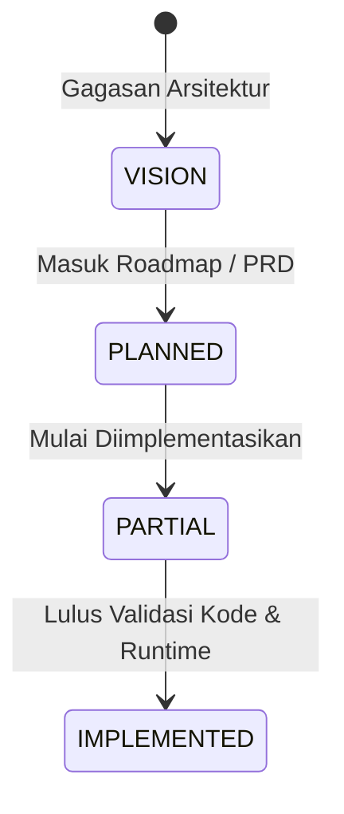

# Legenda Status Fitur

## Ringkasan 3 Baris
- Setiap klaim fitur, modul, dan arsitektur wajib mencantumkan salah satu dari empat label status resmi.
- Label `[IMPLEMENTED]` mensyaratkan bukti kode nyata yang lulus uji kompilasi dan dapat dieksekusi.
- Mencegah halusinasi status fitur antara konsep rancangan awal dengan kenyataan codebase.

---

## 1. Definisi Taksonomi Status

### Rincian Kategori

| Label Status | Kriteria Verifikasi | Tindakan Wajib pada Dokumen |
| :--- | :--- | :--- |
| **`[IMPLEMENTED]`** | Kode sudah ditulis, modul terdaftar pada router/orchestrator, dan lulus kompilasi TypeScript. | Wajib menyertakan atribut `source_of_truth` yang menunjuk ke path file spesifik. |
| **`[PARTIAL]`** | UI atau API backend sudah ada namun fitur belum tersambung utuh, atau memiliki batasan fungsionalitas. | Wajib mendeskripsikan secara eksplisit bagian yang belum lengkap atau masih berupa stub. |
| **`[PLANNED]`** | Kebutuhan sudah dirumuskan dan disepakati dalam PRD/Roadmap, namun belum ada baris kode yang ditulis. | Wajib menautkan target rilis atau nomor milestone. |
| **`[VISION]`** | Arah jangka panjang tingkat produk/ekosistem yang belum masuk jadwal pengerjaan aktif. | Dilarang diklaim sebagai kapabilitas aktif dalam materi teknis. |

---

## Terkait
- [Konvensi Dokumentasi](doc-conventions.md)
- [Log Perbedaan Kode](05-engineering/doc-drift-log.md)