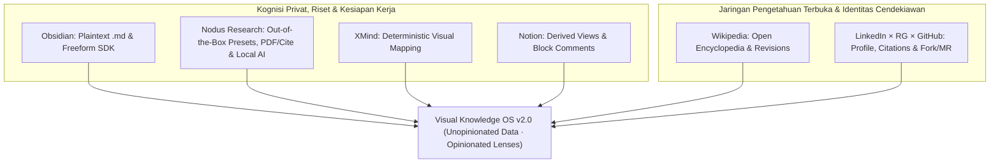

# Positioning Strategis & Matriks Kompetitif (`6-System Reference DNA`)

## Ringkasan 3 Baris
- Memosisikan produk di kuadran unik **Local-First Visual Knowledge OS & High-Signal Social Knowledge Network** berbasis fusi **6 Sistem Referensi** (**Obsidian**, **Nodus Research**, **XMind**, **Notion**, **Wikipedia**, dan **LinkedIn × ResearchGate × GitHub**).
- Menjawab ketegangan *"Fleksibilitas Kosong vs Kesiapan Pakai"*: pengguna pemula langsung produktif dalam `< 90 detik` via **Core Presets (`Atlas`, `Studio`, `Academy`)** ala Nodus Research, sementara pengguna mahir memiliki kebebasan penuh ala Obsidian via **`Freeform`**, **`.app/config.json`**, **`@app/sdk`**, dan **BYO-AI / Ollama**.
- Menegaskan batas produk menolak jalur *office-board-central* (Trello/Asana/ClickUp) agar seluruh *Derived Views* tetap ramping untuk riset, arsip, publikasi, dan pembelajaran.

---

## 1. Peta Posisi Produk Ekosistem Pengetahuan (6 Referensi)

---

## 2. Matriks Perbandingan Tujuh Kolom

| Dimensi Produk & Teknis | Obsidian | Nodus Research | Notion | XMind | Wikipedia | LinkedIn / RG / GH | **Arsitektur v2.0** |
| :--- | :---: | :---: | :---: | :---: | :---: | :---: | :--- |
| **Kedaulatan File (`.md` + `.app/config.json`)** | Tinggi | Menengah | Blok tertutup | Biner `.xmind` | Wiki markup | Terbatas / Git CLI | **Tinggi (FS API + IndexedDB + Config Tunggal)** `[IMPLEMENTED]` |
| **Zero-Friction Core Presets (`< 90s`)** | Tidak (rakit plugin) | Tinggi | Template manual | Template peta | Tidak ada | Tidak ada | **Tinggi (`Atlas` · `Studio` · `Academy` + `Freeform`)** `[PLANNED]` |
| **`Deep Explorer` (4 Lensa Visual) & Solver Deterministik** | Force 2D | Graph/Notes | Table/Board/Cal | Deterministik | Tidak ada | Tidak ada | **Graph + Diagram Deterministik + Table + Cards + Pengelompokan Dinamis** `[PARTIAL]` |
| **Native BYO-AI / Local AI & Sitasi PDF** | Plugin pihak ke-3 | AI lokal + PDF | AI berbayar | AI berbayar | Tidak ada | PDF statis | **Ollama/WebLLM + BYOK Local RAG + Zotero/PDF** `[VISION]` |
| **Essential VCS + Granular `AS & WITH`** | Eksternal | Minimal | Vault/Page share | Tidak ada | Wiki rev | Fork/PR teknis | **Snapshot/Visual Diff/Fork/KMR di Vault & Node** `[PARTIAL]`/`[VISION]` |
| **Presentation Lenses & Publik `/:username`** | Publish berbayar | Terbatas | Link acak | Ekspor file | Publik wiki | Profil terpisah | **Gratis `/:username`: `atlas`/`publication`/`course`/`template`** `[PARTIAL]` |
| **Academy Competence Tree (LMS)** | Plugin | Fokus riset | Manual | Tidak ada | Kategori | Terpisah | **3-Layer Living Competence Tree + Student Sub-Nodes** `[VISION]` |

---

## 3. Penyelarasan Workspace Mode → Presentation Lens & Target Segmen

| Workspace Mode (Input/Kerja di `/app`) | Sifat Lensa | Presentation Lens (`/:username` & `/explore`) | Fokus Segmen & Keunggulan Pembeda |
| :--- | :---: | :---: | :--- |
| **`Freeform`** | *Unopinionated* | Bebas / *Node-Level* terpilih | Arsitek pengetahuan & pengguna Obsidian mahir dengan kontrol manual 100% + **`Deep Explorer`**. |
| **`Atlas`** | *Opinionated Core* | **`atlas`** | Peneliti, pelajar, & pemikir yang mengarsip, memetakan konsep/argumen, & mengelola sitasi/PDF ala Nodus × XMind. |
| **`Studio`** | *Opinionated Core* | **`publication`** | Penulis, blogger, & pemikir publik; CMS editorial lengkap dengan **`Deep Explorer`** (4 lensa visual) untuk kurasi topik & internal link. |
| **`Academy`** | *Opinionated Core* | **`course`** | Pengurus sekolah/kampus, guru/dosen, & murid lewat **Living Pedagogical & Competence Tree** 3 lapis. |
| **`Community Presets`** | *Incubator* | **`template`** | Berbagi paket konfigurasi **`.app/config.json`** di `/explore` yang dapat dipromosikan menjadi *Core Preset* resmi. |

---

## 4. Positioning Model Komersial & Batas Fokus
1. **Gratis Sebagai Penggerak Jaringan:** Penyimpanan lokal tak terbatas, identitas root `/:username`, lisensi default `CC BY-SA 4.0`, sitasi lintas-vault, *Fork*, dan *Basic `Deep Explorer` Lenses* tersedia gratis untuk memaksimalkan *K-Factor*.
2. **Diferensiasi Berbayar (XMind + Notion + Local-First Edge):** Paket Pro berfokus pada solver analitik lanjutan (`argument-map`, `citation-tree`), *Pitch Mode*, ekspor PDF/SVG/OPML, kuota cloud & tema premium; Team/Academic berfokus pada *Admin-Locked `.app/config.json` Policies*, Teamspaces, kolaborasi CRDT Yjs, kontrol Academy Lapisan 3 (*Controlled Execution Environment*), serta gateway **Xendit/Midtrans first → Stripe**.
3. **Menolak Beban Manajemen Proyek Korporat:** Tidak memelihara fitur sprint board kompleks korporat agar seluruh produk tetap tajam, cepat, dan setia pada DNA **Visual Knowledge OS**.

---

## Terkait
- [Master Blueprint v2.0](../00-meta/00-0-master-blueprint.md)
- [Visi, Misi & Filosofi](vision-mission.md)
- [Filosofi & 6 Prinsip Inti](product-philosophy.md)
- [Lima Pilar Use-Case & Lensa](use-case-pillars.md)
- [Business Requirements Document (`brd.md`)](../02-planning/brd.md)
