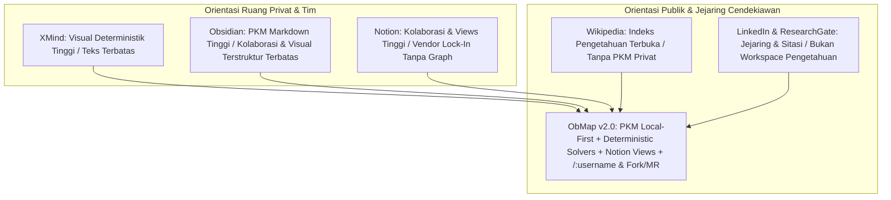

# Positioning Strategis & Matriks Kompetitif ObMap v2.0

## Ringkasan 3 Baris
- Memosisikan ObMap v2.0 di kuadran unik yang menyatukan **Topologi Pengetahuan Visual + Kedaulatan Markdown** dengan **Kolaborasi Tim & Jejaring Sosial Cendekiawan (`/:username`)**.
- Mengadopsi strategi monetisasi hibrida **XMind + Notion** yang dikelola secara dinamis oleh Admin di `/admin`, sambil menolak model berbayar Obsidian untuk publikasi dan sinkronisasi dasar.
- Mendefinisikan pembeda rute kanonik root `/:username` & `/@:username` (*hard cutover* tanpa `/p/*`) serta prioritas pembayaran lokal **Xendit/Midtrans** terlebih dahulu sebelum **Stripe**.

---

## 1. Peta Posisi Produk Ekosistem Pengetahuan

---

## 2. Matriks Perbandingan Enam Kolom

| Dimensi Produk & Teknis | Obsidian | Notion | XMind | Wikipedia | LinkedIn / RG | **ObMap v2.0** |
| :--- | :---: | :---: | :---: | :---: | :---: | :--- |
| **Kedaulatan File (`.md` Lokal)** | Tinggi | Tidak | Biner `.xmind` | Wiki markup | Tidak | **Tinggi (FS API + IndexedDB)** `[IMPLEMENTED]` |
| **Kognisi Graf Deterministik** | Force 2D saja | Tidak ada | Deterministik | Tidak ada | Tidak ada | **Multi-Solver Deterministik + Force** `[IMPLEMENTED]` |
| **Teamspace & Derived Views** | Add-on Sync | Sangat Kuat | Minimal | Diskusi wiki | Minimal | **VCS + RBAC + Views dari Frontmatter** `[PARTIAL]`/`[VISION]` |
| **Identitas Sosial Kanonik** | Publish berbayar | Link acak | Ekspor statis | Halaman user | Profil profesional | **`/:username` Gratis + Verified Scholar** `[VISION]` |
| **Sitasi & Kolaborasi Terbuka** | Eksternal | Komentar tim | Tidak ada | Referensi manual | Sitasi PDF pasif | **`[[@user/vault/note]]` + Fork & Merge Request (`CC BY-SA 4.0`)** `[VISION]` |
| **Kurikulum Interaktif (LMS)** | Plugin | Manual | Tidak ada | Kategori statis | Kursus video pasif | **Native Skill Tree DAG & Mastery State** `[VISION]` |

---

## 3. Positioning Model Komersial & Ekosistem

1. **Gratis Sebagai Penggerak Jaringan (Network-Effect Engine):** Penyimpanan lokal tak terbatas, identitas publik `/:username`, lisensi terbuka `CC BY-SA 4.0`, tombol sitasi, dan *Fork* terbuka gratis guna memaksimalkan *K-Factor* komunitas cendekiawan.
2. **Diferensiasi Berbayar ala XMind + Notion:** Fitur Pro berfokus pada produktivitas visual tingkat lanjut (semua solver analitik, *Pitch Mode*, ekspor PDF/SVG/OPML, tema premium, analitik sitasi, cloud quota lebih besar), sedangkan Team/Lab berfokus pada Teamspaces, *Admin-Locked Policies*, CRDT multi-kursor, dan manajemen kursi (*seat management*).
3. **Konfigurasi Tarif & Kuota Dinamis + Payment Lokal First:** Seluruh parameter harga dan kuota dikelola di `/admin` (`plans`, `plan_entitlements`, `plan_quotas`), dengan gerbang pembayaran utama **Xendit / Midtrans** (QRIS, VA, e-Wallet IDR) disusul adapter **Stripe**.

---

## Terkait
- [Master Blueprint v2.0](../00-meta/00-0-master-blueprint.md)
- [Visi & Misi v2.0](vision-mission.md)
- [Business Requirements Document (BRD)](../02-planning/brd.md)
- [Lima Pilar Use-Case](use-case-pillars.md)
