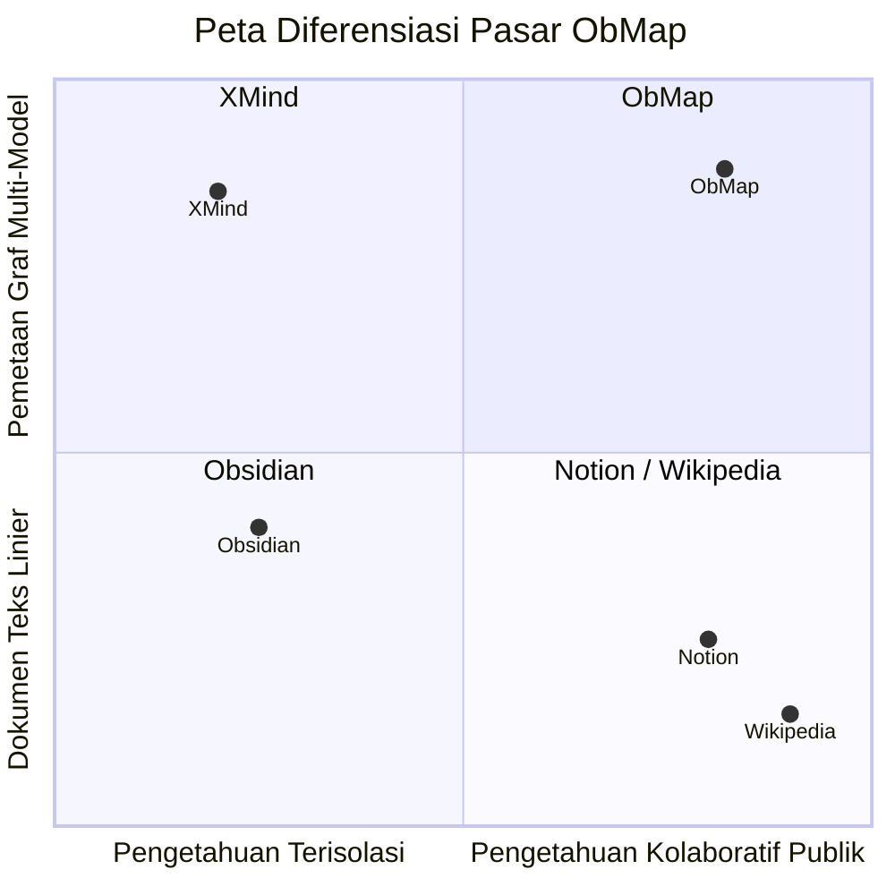

# Analisis Posisi Pasar (Market Positioning)

## Ringkasan 3 Baris
- ObMap menempati ruang persilangan unik antara Obsidian (PKM lokal), Notion (kolaborasi/publikasi), XMind (diagram visual), dan Wikipedia (akses pengetahuan terbuka).
- Keunggulan kompetitif utama terletak pada rendering graf multi-model langsung dari hierarki folder Markdown murni.
- Menyediakan mesin VCS terintegrasi di dalam peramban untuk kolaborasi tanpa merusak kedaulatan data lokal.

---

## 1. Matriks Perbandingan Fitur Jujur (Honest Comparison Matrix)

| Dimensi Evaluasi | Obsidian | Notion | XMind | Wikipedia | **ObMap (Aplikasi Ini)** |
| :--- | :--- | :--- | :--- | :--- | :--- |
| **Kedaulatan Data** | Sangat Tinggi (Lokal) | Rendah (Cloud Silo) | Tinggi (File Lokal) | Publik / Server Yayasan | **Sangat Tinggi (FS API + Local DB)** `[IMPLEMENTED]` |
| **Format Inti** | Markdown Plaintext | Blok Proprietary JSON | File Proprietary (.xmind) | MediaWiki Wikitext | **Markdown Plaintext + Frontmatter** `[IMPLEMENTED]` |
| **Visualisasi Graf** | Force-directed 2D/3D | Tidak ada | Mindmap / Tree terpisah | Hanya teks linier berpranala | **Multi-Model: Force, Tree, Fishbone, Timeline** `[IMPLEMENTED]` |
| **Kolaborasi Tim** | Berbayar (Obsidian Sync) | Sangat Kuat (Real-time) | Lemah (Share File) | Terbuka (Wiki Edit History) | **Hybrid: VCS Micro-commits + RLS** `[PARTIAL]` |
| **Publikasi Web** | Berbayar (Obsidian Publish) | Mudah (Share to Web) | Ekspor Gambar/PDF | Selalu Publik | **Gratis / Sekali Klik (`/p/*`)** `[IMPLEMENTED]` |
| **Struktur Kurikulum/LMS** | Plugin Komunitas | Template Manual | Tidak ada | Navigasi Kategori | **Native Graph Prerequisites & Tracking** `[VISION]` |

---

## 2. Parit Pertahanan Strategis (Strategic Moats)

1. **Dualitas File-Tree dan Graph Engine:** Setiap folder dan file otomatis menjadi simpul mindmap yang rapi tanpa perlu ditata ulang dari nol.
2. **In-Browser Git-like VCS:** Menghadirkan *branching*, *stashing*, dan *3-way merge* di atas Markdown tanpa mewajibkan pengguna menguasai CLI Git.
3. **Subtree Layout Overrides:** Kemampuan menerapkan algoritma tata letak berbeda (misal: Fishbone di cabang akar, Timeline di cabang implementasi) dalam satu kanvas visual yang sama.

---

## 3. Batasan dan Kompromi Sadar (Conscious Trade-offs)

- **Tidak Ada Editor WYSIWYG Blok Kompleks:** ObMap setia pada CodeMirror 6 Markdown live preview; tidak mengorbankan portabilitas Markdown demi blok database kustom ala Notion.
- **Keterbatasan File System API:** Akses native folder membutuhkan peramban modern berbasis Chromium; pengguna peramban lain beralih secara transparan ke IndexedDB.

---

## Terkait
- [Visi dan Misi](vision-mission.md)
- [Pilar Kasus Penggunaan](use-case-pillars.md)
- [Business Requirements Document (BRD)](../02-planning/brd.md)