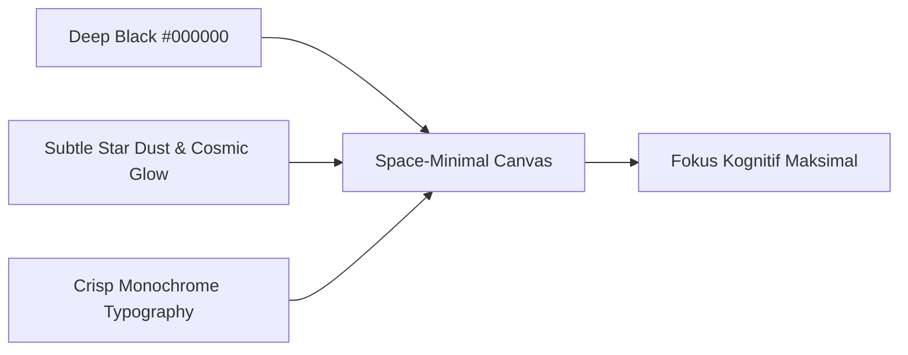

# Filosofi Desain dan Arsitektur Produk

## Ringkasan 3 Baris
- Fondasi filosofis ObMap bertumpu pada kedaulatan data lokal (*local-first*) menggunakan berkas teks Markdown murni.
- Hubungan (*edges*) dan keterkaitan data diperlakukan sebagai entitas kelas satu (*graph-native*), setara dengan isi dokumen (*nodes*).
- Desain antarmuka mengadopsi estetika *space-minimal* (Apple-style dark mode) dengan kanvas visual yang hidup (*living canvas*).

---

## 1. Lima Pilar Filosofis ObMap

### 1.1 Local-First & Data Sovereignty
Data Anda adalah milik Anda seutuhnya. ObMap dapat beroperasi 100% tanpa internet. Berkas disimpan langsung di direktori sistem operasi pengguna melalui File System Access API atau dicadangkan ke IndexedDB terenkripsi lokal. Sinkronisasi *cloud* via Supabase bersifat opsional dan selalu mengikuti isolasi *tenant* berbasis RLS.

### 1.2 Markdown-First & Open Standards
Semua pengetahuan dicatat dalam format Markdown (`.md`) standar CommonMark/GFM dengan YAML front-matter. Tidak ada format database *proprietary* biner yang mengunci teks Anda. Jika ObMap berhenti beroperasi, catatan Anda tetap dapat dibaca oleh editor teks apa pun di dunia.

### 1.3 Graph-Native & Multi-Lens Exploration
Catatan bukan sekadar daftar file linier di sidebar. Setiap tautan wikilink `[[catatan]]` atau tag `#label` menciptakan simpul (*node*) dan sisi (*link*) dalam basis pengetahuan. Pengguna bebas berganti kacamata pandang (*multi-lens*): teks linier, mindmap pohon, diagram tulang ikan, garis waktu kronologis, atau graf gaya bebas.

### 1.4 Composable & Resilient Workspace
Arsitektur antarmuka dibangun berbasis *leaves* dan *splits* modular (terinspirasi dari VS Code dan Obsidian). Setiap *leaf* memiliki siklus hidup dan store interaksi terisolasi (`useGraphInteractionStore`), mencegah regresi kaskade render dan memastikan pengalaman kerja yang stabil.

### 1.5 Frictionless Publishing & Controlled Collaboration
Membagikan karya tidak boleh membutuhkan proses *export-import* manual atau hosting terpisah. ObMap memungkinkan publikasi dokumen terpilih menjadi halaman web statis interaktif dalam satu klik, didukung oleh sistem perizinan bertingkat dan kontrol versi (*VCS micro-commits*).

---

## 2. Paradigma Estetika: Space-Minimal Aesthetic

- **Deep Black Canvas:** Meminimalkan kelelahan visual (*eye strain*) selama sesi riset intensif.
- **Atmospheric Glow:** Cahaya halus pada *nodes* dan aliran partikel pada *links* memberikan umpan balik kontekstual tanpa mengganggu fokus membaca.
- **Progressive Disclosure:** Pengaturan rumit disembunyikan di balik kendali visual dinamis (*floating contextual toolbar* dan *segmented controls*).

---

## Terkait
- [Visi dan Misi](vision-mission.md)
- [Positioning Produk](positioning.md)
- [Standar Rekayasa](../05-engineering/repository-rules.md)