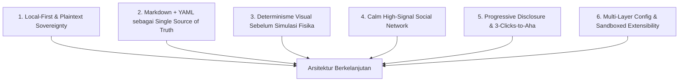

# Filosofi Produk & Prinsip Rekayasa ObMap v2.0

## Ringkasan 3 Baris
- Menjabarkan enam prinsip desain inti ObMap yang menjamin kedaulatan data pengguna, kejelasan kognitif visual, dan integritas arsitektur rekayasa perangkat lunak.
- Menolak *vendor lock-in* dan algoritma feed berbasis *vanity engagement*, menggantinya dengan berkas Markdown terbuka serta graf sitasi berbasis pembuktian pengetahuan.
- Menjadi rujukan pengambil keputusan UX dan arsitektur kode dari Workspace privat (`/app`), Dashboard (`/vaults`), hingga domain sosial (`src/domains/community/`).

---

## 1. Enam Prinsip Inti Produk & Rekayasa

| Prinsip | Implementasi Teknis | Dampak Bagi Pengguna & Komunitas |
| :--- | :--- | :--- |
| **1. Local-First & Forever Free Storage** | Driver `FileSystemService.ts` dan `IndexedDbVaultDriver.ts` menyimpan `.md` langsung di perangkat pengguna (`ADR-0004`). | Catatan lokal tak terbatas selamanya tanpa memaksa akun cloud atau biaya sewa untuk akses arsip pribadi. |
| **2. Derived Views Tanpa Proprietary Lock-In** | Seluruh Kanban, Calendar, Timeline, LMS DAG, dan sitasi diturunkan dari YAML frontmatter (`EditorPropertiesPanel.tsx`) & `.md` murni. | Berkas vault tetap 100% portabel dan terbaca oleh editor Markdown apa pun maupun mesin Git standar. |
| **3. Deterministic Visual Cognition** | Hanya `Free-Force` memakai simulasi D3 kontinu; seluruh diagram terstruktur (`Mindmap`, `Org`, `Timeline`, `Fishbone`, `Argument Map`, `Citation Tree`) bersifat deterministik (`ADR-0003`). | Tata letak stabil secara spasial (*spatial memory*); tidak bergoyang liar saat simpul diedit atau dibuka kembali. |
| **4. High-Signal, Anti-Vanity Social Graph** | Domain `src/domains/community/` menilai dampak berbasis kedalaman sitasi (`[[@user/vault/note]]`), *Merge Request* diterima, dan rasio catatan `evergreen`. | Membangun ruang wacana akademik dan profesional bebas *clickbait* dengan lisensi default **`CC BY-SA 4.0`** dan kurasi *Verified Scholar*. |
| **5. Calm UI & Guided Progressive Mastery** | *Zero Blank Slate* (Landing Sandbox `< 65KB`, template use-case), *3-Clicks-to-Aha*, serta *Progressive Coach Marks* yang dapat dilewati (*skip*). | Pengguna pemula langsung menghasilkan graf pertama dalam `< 90 detik` tanpa membebani *power user*. |
| **6. Modular Config & Zero-Trust Extensions** | Hierarki konfigurasi 6 lapis (*System → Org Locked → Vault `.obmap/` → User → Leaf → Session*) serta SDK `@obmap/sdk` dalam sandbox Worker/Iframe CSP. | Organisasi dapat menegakkan kebijakan aman, sementara pengembang komunitas leluasa memperluas UI tanpa menyentuh core codebase. |

---

## 2. Anti-Pattern yang Dilarang di ObMap
1. **Paywall Sinkronisasi & Publikasi Dasar:** Berbeda dari model Obsidian Publish/Sync yang memutus keterhubungan sosial pengguna gratis, identitas publik `/:username` dan publikasi terbuka bersifat gratis di ObMap.
2. **Hardcoded Pricing / Quota Constants:** Tidak menanam angka harga atau batas paket di kode klien; seluruh matriks kuota dan tarif dikelola dinamis dari DB via `src/domains/admin/`.
3. **Legacy Path Sub-Directory Sosial (`/p/*`):** Tidak memecah profil dan portofolio ke sub-path teknikal; identitas kanonik berada langsung di `/:username` dan `/@:username` dengan proteksi `RESERVED_SLUGS`.

---

## Terkait
- [Master Blueprint v2.0](../00-meta/00-0-master-blueprint.md)
- [Visi & Misi v2.0](vision-mission.md)
- [Positioning Strategis](positioning.md)
- [ADR-0003: Deterministic Layout Solvers](../03-architecture/adr/ADR-0003-deterministic-layout-solvers-vs-force.md)
- [ADR-0004: Multi-Strategy Storage Isolation](../03-architecture/adr/ADR-0004-multi-strategy-storage-isolation.md)
