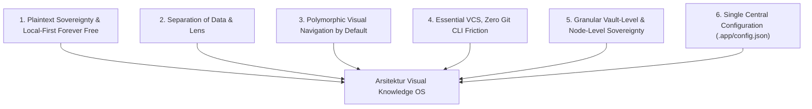

# Filosofi Produk & Enam Prinsip Inti Arsitektur v2.0

## Ringkasan 3 Baris
- Meresmikan filosofi produk **"Unopinionated Data, Opinionated Lenses, Visual by Default, Connected by Design"** serta motto **"Archive Everything. See from Above. Think, Teach, & Publish Without Lock-in."**
- Menjabarkan **6 Prinsip Inti** yang mengikat kedaulatan plaintext Markdown/YAML, pemisahan data dan lensa, navigasi polimorfik **`Deep Explorer`** (4 lensa visual), *Essential VCS* tanpa friksi CLI, granularitas Vault/Node, serta sentralisasi tunggal **`.app/config.json`**.
- Menegaskan anti-pattern produk—termasuk larangan fragmentasi berkas konfigurasi dan penolakan eksplisit terhadap *enterprise task-board bloat*.

---

## 1. Enam Prinsip Inti Produk & Rekayasa

| Prinsip Inti | Makna Konstitusional | Realisasi Teknis & Arsitektural |
| :--- | :--- | :--- |
| **1. Plaintext Sovereignty & Local-First Forever Free** | `.md` + YAML Frontmatter adalah *Single Source of Truth* yang bebas *vendor lock-in* dan gratis selamanya secara lokal. | `FileSystemService.ts` dan `IndexedDbVaultDriver.ts` membaca/menulis `.md` & media langsung di perangkat pengguna (`ADR-0004`), tetap terbuka 100% bagi editor Markdown lain dan Git standar. |
| **2. Separation of Data & Lens** | **Workspace Mode** (`Atlas`, `Studio`, `Academy`, `Freeform`) hanya mengubah proyeksi, layout, dan aksi kontekstual, bukan mengunci atau mendistorsi data. | `primary_mode` disimpan sebagai niat lensa di `.app/config.json` & tabel `vaults` sementara berkas `.md` tetap murni; pengguna bebas menukar lensa sementara per tab kapan pun. |
| **3. Polymorphic Visual Navigation by Default** | Siklus kognitif utama adalah **Archive Everything → View & Explore from Above (`Deep Explorer`) → Restructure & Reorganize → Discover Meaning**. | Menyediakan **`Deep Explorer`** dengan 4 lensa visual wajib (*Graph*, *Diagram* deterministik `ADR-0003`, *Table*, *Cards*) dan pengelompokan dinamis (*Hierarchy, Properties, Tags, Backlinks, Keywords* — *Virtual Grouping* non-destruktif maupun *Structural Refactoring* fisik), dapat dijalankan di **`Settings Hub > Workspace > Deep Explorer`** maupun sebagai **Tab Workspace**. |
| **4. Essential VCS, Zero Git CLI Friction** | Kekuatan riwayat versi, komparasi visual, *fork*, dan *merge request* hadir dengan UX manusiawi tanpa mewajibkan pemahaman CLI Git. | `src/domains/vcs/` menyediakan **Snapshot**, **Visual Diff** (Markdown + YAML + struktur node), **Fork**, serta **Knowledge Merge Request (`KMR`)** untuk riset dan tugas Academy. |
| **5. Granular Vault-Level & Node-Level Sovereignty** | Hak akses (`Give Access AS & WITH`), kebijakan Academy, dan publikasi (`Publish AS & WITH`) berlaku penuh baik di level Vault maupun spesifik Folder-Node / File-Node. | Evaluator simetris `PolicyEngine` ↔ Postgres RLS dan skema `node_overrides` memungkinkan sebuah Vault tetap `private` selagi menerbitkan atau membagikan Folder-Node/File-Node pilihan. |
| **6. Single Central Configuration (`.app/config.json`)** | Tidak ada fragmentasi berkas konfigurasi; seluruh aturan meta, mode, schema, publishing, access, academy, dan extensions berada di satu titik kontrol. | **`.app/config.json`** menyimpan 7 seksi terstruktur (*legacy* `.vk/` & `.obmap/` dilayani lewat fallback baca); ekstensi pihak ketiga berjalan lewat **`@app/sdk`** dalam sandbox Worker/Iframe CSP (`ADR-0012`). |

---

## 2. Explicit Non-Goals & Anti-Pattern yang Dilarang
1. **Penolakan *Enterprise Task-Board Bloat*:** Platform ini **BUKAN** manajemen proyek atau papan tugas kantor sekompleks Trello, Asana, Monday.com, ClickUp, atau Notion enterprise board. Seluruh *Derived Views* melayani pengarsipan, pengetahuan, riset, editorial (`Studio`), dan pembelajaran (`Academy`).
2. **Larangan Fragmentasi Berkas Konfigurasi:** Dilarang memecah konfigurasi vault menjadi berkas terpisah (`preset.json`, `lms-policy.json`, `setting.json`, dll.). Segala pengaturan vault wajib masuk ke **`.app/config.json`**.
3. **Paywall Sinkronisasi & Publikasi Pengetahuan Dasar:** Identitas kanonik `/:username`, penyimpanan lokal, sitasi lintas-vault, dan *Fork* terbuka tidak boleh dipaywall agar efek jaringan pengetahuan tetap terjaga.
4. **Hardcoded Brand / Pricing Constants & Sub-Path Social URL (`/p/*`):** Mengisolasi identitas merek (`brand.config.ts`), tarif/kuota DB via `/admin`, serta menjaga rute kanonik root `/:username` dan `/@:username` dengan `RESERVED_SLUGS`.

---

## Terkait
- [Master Blueprint v2.0](../00-meta/00-0-master-blueprint.md)
- [Glosarium Kanonik](../00-meta/glossary.md)
- [Visi, Misi & Sasaran Strategis](vision-mission.md)
- [Positioning Strategis](positioning.md)
- [Skema Data & `.app/config.json`](../03-architecture/data-and-storage.md)
