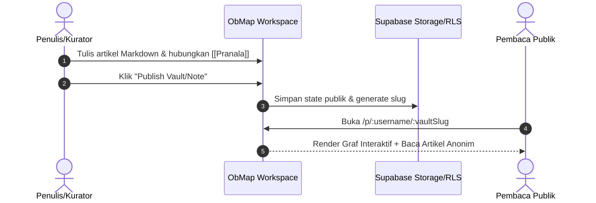

# Empat Pilar Kasus Penggunaan Produk

## Ringkasan 3 Baris
- ObMap melayani empat skenario utama: ensiklopedia pengetahuan terbuka, portofolio pengetahuan visual, pemetaan ide dan brainstorming, serta LMS modular interaktif.
- Setiap pilar memanfaatkan representasi data yang sama (Markdown + Graph Edges) dengan sudut interaksi yang disesuaikan.
- Mendukung transisi mulus dari pembuatan draf catatan pribadi di mesin lokal hingga konsumsi publik massal di peramban.

---

## 1. Pilar I: Alternatif Wikipedia Interaktif (Open Knowledge Base)

- **Masalah:** Wikipedia tradisional bersifat linier, kaku, dan sulit dinavigasi secara visual untuk topik interdisipliner yang kompleks.
- **Solusi ObMap:** Publikasi instan basis pengetahuan publik dengan graf relasi yang dapat dijelajahi, pencarian teks instan via Web Worker, dan antarmuka pembaca yang bersih (`[IMPLEMENTED]`).

---

## 2. Pilar II: Portofolio Diri & Pemetaan Hidup (Life & Portfolio Mapping)

- **Skenario:** Profesional, peneliti, dan kreator ingin memamerkan peta kompetensi, riwayat proyek, resume interaktif, dan keterkaitan keahlian mereka.
- **Fitur Terkait:**
  - Mode timeline kronologis untuk riwayat karir (`[IMPLEMENTED]`).
  - Sematan media (gambar, audio, dokumen) sebagai simpul graf kelas satu (`[IMPLEMENTED]`).
  - Domain publik kustom atau slug personal (`[PARTIAL]`).

---

## 3. Pilar III: Pemikiran Visual & Brainstorming (Visual Brainstorming Engine)

- **Skenario:** Pengguna membedah masalah rumit menggunakan metodologi terstruktur:
  - *Fishbone Diagram (Ishikawa):* Analisis akar penyebab masalah (`[IMPLEMENTED]`).
  - *Org Chart & Brace Map:* Dekomposisi struktur organisasi atau taksonomi konsep (`[IMPLEMENTED]`).
  - *Timeline Hierarchy:* Perencanaan roadmap produk atau peristiwa berurutan (`[IMPLEMENTED]`).
  - *Free-Force Network:* Menemukan kluster ide tersembunyi lewat simulasi gaya fisika (`[IMPLEMENTED]`).

---

## 4. Pilar IV: Platform LMS Disruptif (Interactive Learning Management)

- **Skenario:** Dosen atau kreator edukasi menyusun kurikulum visual berjenjang.
- **Mekanisme:**
  - Node mewakili modul pembelajaran; edge mewakili prasyarat (*prerequisites*).
  - Penandaan status kelulusan modul tersimpan secara lokal di peramban siswa.
  - Peta progres visual memudahkan siswa memahami konteks besar dari materi yang sedang dipelajari (`[VISION]`).

---

## Terkait
- [Positioning Produk](positioning.md)
- [Target Persona Pengguna](../02-planning/personas.md)
- [Product Requirements Document (PRD)](../02-planning/prd.md)