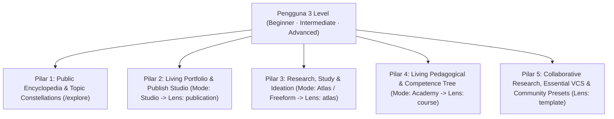

# Lima Pilar Use-Case, Workspace Modes & Inkubator Presets v2.0

## Ringkasan 3 Baris
- Memetakan lima pilar penggunaan utama lintas **6 Sistem Referensi** (**Obsidian**, **Nodus Research**, **XMind**, **Notion**, **Wikipedia**, **LinkedIn × ResearchGate × GitHub**) ke dalam **Workspace Modes** (`Freeform`, `Atlas`, `Studio`, `Academy`) dan **4 Helicopter Views**.
- Menjelaskan alur **Presentation Lenses** (`atlas`, `publication`, `course`, `template`) pada `/explore` dan `/:username`, beserta jalur inkubator **`Community Presets → Core Presets`** berbasis `.app/config.json`.
- Menjadi acuan perancangan preset Dashboard `/vaults`, pengalaman *Zero-Friction Start* pemula, dan ekstensi **`@app/sdk`**.

---

## 1. Peta Pilar Use-Case ↔ Workspace Modes & Presentation Lenses

---

## 2. Spesifikasi Detail Lima Pilar & Keselarasan Mode

| Pilar Use-Case | Referensi Utama | Workspace Mode & Helicopter Views | Presentation Lens & Aksi Granular (`AS & WITH`) | Domain Terkait |
| :--- | :--- | :--- | :--- | :--- |
| **1. Public Encyclopedia & Topic Constellations** | Wikipedia × Learn-Anything | Membaca publik lewat *Dual-Pane* (*Graph* + Markdown) | Konsumsi `/explore`, riwayat Snapshot/Diff terbuka, & penemuan topik kurasi. | `community`, `graph` |
| **2. Publishing CMS & Intellectual Portfolio (`Studio`)** | LinkedIn × Notion × XMind | **Mode `Studio`** dengan **wajib 4 Helicopter Views** (*Cards* galeri karya, *Table* SEO/status, *Graph* *internal link clusters*, *Diagram* struktur bab) | Terbit ke `/:username` *as **`publication`** baik seluruh Vault maupun spesifik Folder-Node/File-Node (`Publish AS & WITH`). | `community`, `editor`, `dashboard`, `settings` |
| **3. Archive, Ideation, Research & Study (`Atlas` / `Freeform`)** | Obsidian × Nodus Research × XMind | **Mode `Atlas`** (*core preset* riset & belajar) + **`Freeform`** (*full manual control*); *Restructure & Reorganize* (*Virtual Grouping* & *Structural Refactoring*) + BYO-AI / Ollama RAG & Zotero/PDF | Terbit *as **`atlas`** dengan sitasi lintas-vault `[[@user/vault/note]]` & ekspor APA/MLA/IEEE/BibTeX. | `workspace`, `editor`, `graph`, `metadata`, `vault` |
| **4. Interactive Academy & Competence Tree (`Academy`)** | Nodus × Roadmap.sh × Visual LMS | **Mode `Academy`**: *Diagram View* (`Competence/Skill Tree DAG`) menampilkan **Falsafah → Kurikulum → Silabus → RPS → Instruksi/Tugas** + *Living Student Sub-Nodes* (`locked → mastered`) | Terbit *as **`course`** dengan aturan 3 Lapisan Evolusi tersimpan di blok `academy` `.app/config.json`. | `graph`, `community`, `metadata`, `settings` |
| **5. Collaborative Peer Review, Essential VCS & Community Presets** | GitHub × ResearchGate × Obsidian SDK | **Drawer *"Share · Access · Versions"*** (Snapshot, Visual Diff, Fork, KMR, Give Access `AS & WITH` per Vault/Node) | Terbit paket `.app/config.json` *as **`template`** di `/explore` (**`Community Presets → Core Presets`**) & integrasi `@app/sdk`. | `vcs`, `collaboration`, `community`, `admin`, `settings` |

---

## 3. Siklus Penggunaan Lintas Tahap & Peta Konfigurasi
- **Siklus Utama Pengguna:** *Archive Everything* (Markdown `.md` + YAML + media/PDF) → *View from Above* (4 **Helicopter Views**) → *Restructure & Reorganize* (*Virtual Grouping* atau *Structural Refactoring*) → *Discover & Share Meaning* (*Visual Diff/KMR* & **Publish/Access `AS & WITH`**).
- **Stage Alignment:** Stage 1 memvalidasi `/app`, `Atlas`/`Freeform`, 4 Helicopter Views, & `.app/config.json`; Stage 2 membuka `/vaults`, `/explore`, `/:username`, *Core Presets* (`Atlas`, `Studio`, `Academy`), *Essential VCS*, dan **`Community Presets`** (`template`); Stage 3 mengaktifkan Academy Lapisan 3, BYO-AI/Ollama RAG penuh, *Teamspaces*, CRDT Yjs, dan **`@app/sdk`**.

---

## Terkait
- [Master Blueprint v2.0](../00-meta/00-0-master-blueprint.md)
- [Glosarium Kanonik](../00-meta/glossary.md)
- [Katalog Persona (`PER-01`–`PER-09`)](../02-planning/personas.md)
- [Visi & Spesifikasi Academy 3-Lapis (`lms-vision.md`)](../06-lms/lms-vision.md)
- [Peta 13 Domain Sistem](../03-architecture/domain-map.md)
