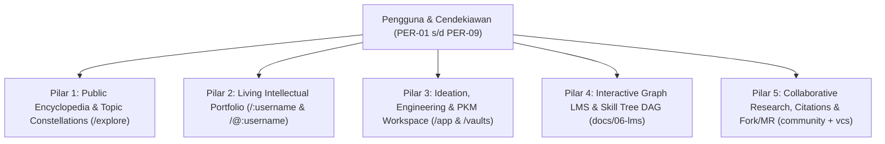

# Lima Pilar Use-Case ObMap v2.0

## Ringkasan 3 Baris
- Memetakan lima pilar penggunaan utama ObMap v2.0 dari produktivitas riset personal, ruang kerja ideasi tim, portofolio cendekiawan `/:username`, ensiklopedia publik `/explore`, hingga kurikulum DAG interaktif.
- Menghubungkan setiap pilar langsung ke domain target di `src/domains/` (termasuk domain `community` hasil refaktor `public-reader` serta domain baru `dashboard`) dan segmen persona `PER-01` s/d `PER-09`.
- Menjadi acuan utama pembuatan template vault pada Dashboard `/vaults` dan alur *Personalization Survey* saat onboarding pengguna baru.

---

## 1. Arsitektur Lima Pilar Use-Case

---

## 2. Spesifikasi Detail Per Pilar

| Pilar | Referensi Sistem | Persona Utama | Kapabilitas & Alur Inti | Domain Terkait |
| :--- | :--- | :--- | :--- | :--- |
| **1. Public Encyclopedia & Topic Constellations** | Wikipedia × Learn-Anything | `PER-05`, `PER-07`, `PER-09` | Menjelajahi indeks topik global di `/explore`, membaca catatan publik dual-pane (graf interaktif + Markdown terkurasi), memeriksa riwayat revisi VCS transparan. | `community` *(eks `public-reader`)*, `graph` |
| **2. Living Intellectual Portfolio** | LinkedIn × ResearchGate | `PER-01`, `PER-07`, `PER-02` | Profil kanonik `/:username` dan `/@:username` menampilkan bio, afiliasi/ORCID, Konstelasi Vault Publik (`CC BY-SA 4.0` default), lencana kurasi manual *Verified Scholar*, dan *Impact Index*. | `community`, `settings`, `admin` |
| **3. Ideation, Engineering & Team Workspace** | Obsidian × XMind × Notion | `PER-03`, `PER-04`, `PER-08` | Menulis `.md` *local-first*, menyusun *Mindmap / Fishbone / Timeline / Argument Map* deterministik, mengelola tugas lewat 5 view derivatif Dashboard `/vaults`, serta *Admin-Locked Config* tim. | `workspace`, `dashboard`, `editor`, `graph`, `vault`, `settings` |
| **4. Interactive Graph LMS & Skill Tree DAG** | Roadmap.sh × Khan Academy Visual | `PER-02`, `PER-08`, `PER-05` | Merancang jalur belajar berbasis dependensi YAML `prerequisites`, memvisualkan node *Locked / Available / Mastered*, serta menerbitkan modul kursus publik bagi mahasiswa/pelajar. | `lms` *(via `graph` + `community`)*, `metadata` |
| **5. Collaborative Research & Peer Review Network** | GitHub × Academic Peer Review | `PER-01`, `PER-08`, `PER-09` | Rujukan silang federated `[[@user/vault/note]]`, ekspor sitasi APA/MLA/IEEE/BibTeX, *Fork to My Vault*, komentar paragraf terikat hash, dan *Knowledge Merge Request* antar-cendekiawan. | `vcs`, `collaboration`, `community`, `metadata` |

---

## 3. Kesesuaian dengan 3-Stage Progressive Rollout
- **Stage 1 (`stage_1_partner`):** Berfokus pada **Pilar 3** dan fondasi privat **Pilar 4 & 5** bersama institusi/rekan pilot.
- **Stage 2 (`stage_2_community_beta`):** Membuka **Pilar 1, 2, dan 5** untuk publik (*read-only* `approved` vaults & profil `/:username`), dengan penerimaan akun baru dikontrol manual oleh Admin di `/admin`.
- **Stage 3 (`stage_3_commercial_ga`):** Membuka seluruh pilar beserta kuota/tarif dinamis, Teamspaces enterprise, pembayaran **Xendit/Midtrans** & Stripe, serta `@obmap/sdk`.

---

## Terkait
- [Master Blueprint v2.0](../00-meta/00-0-master-blueprint.md)
- [Katalog Persona (PER-01 s/d PER-09)](../02-planning/personas.md)
- [Visi & Spesifikasi LMS](../06-lms/lms-vision.md)
- [Peta 13 Domain Sistem](../03-architecture/domain-map.md)
