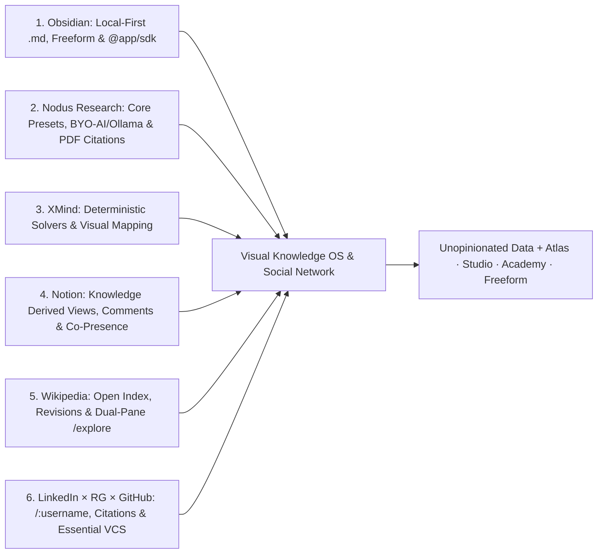

# Visi, Misi, Filosofi & Sasaran Strategis v2.0

## Ringkasan 3 Baris
- Menetapkan arah produk sebagai **Local-First Visual Knowledge OS & High-Signal Social Knowledge Network** berlandaskan **6 Sistem Referensi Inti** (**Obsidian**, **Nodus Research**, **XMind**, **Notion**, **Wikipedia**, dan **LinkedIn × ResearchGate × GitHub**).
- Mengunci filosofi *"Unopinionated Data, Opinionated Lenses, Visual by Default, Connected by Design"* dan motto *"Archive Everything. See from Above. Think, Teach, & Publish Without Lock-in"*, sekaligus menegaskan batas penolakan terhadap *office-board-central* ala Trello/Asana/Monday/ClickUp.
- Memetakan misi pemberdayaan ke **3 Level Pengguna** (*Beginner*, *Intermediate*, *Advanced*) beserta tolok ukur adopsi dan kinerja terukur.

---

## 1. Filosofi Inti, Motto, Visi & Batas Tegas Produk

- **Filosofi Inti:** *"Unopinionated Data, Opinionated Lenses, Visual by Default, Connected by Design."*
  Vault dan datanya tetap 100% *unopinionated* (murni berkas `.md` + YAML Frontmatter + konfigurasi tunggal `.app/config.json`), sedangkan **Workspace Mode** (`Atlas`, `Studio`, `Academy`, `Freeform`) adalah lensa *opinionated* yang dapat dipasang, diganti, dimodifikasi, atau dilepas kapan saja tanpa merusak struktur berkas asli.
- **Motto:** *"Archive Everything. See from Above. Think, Teach, & Publish Without Lock-in."*
- **Visi:** Menjadi **Local-First Visual Knowledge OS & High-Signal Social Knowledge Network** terbaik—seportabel **Obsidian** dalam kedaulatan data, sesiapsaji **Nodus Research** dalam riset & pembelajaran *out-of-the-box*, sekuat **XMind** dalam pemetaan visual deterministik, dan seterbuka **Wikipedia × GitHub** dalam kolaborasi serta publikasi.

### Batas Tegas Produk (*Explicit Non-Goal*)
- Aplikasi ini **BUKAN** *office-board-central / enterprise project & task management* sekompleks **Trello, Asana, Monday.com, ClickUp, atau Notion enterprise board**.
- Seluruh *Derived Views* (`Table`, `Cards`, maupun `Kanban`/`Calendar` ringan berbasis YAML) difokuskan murni untuk **manajemen pengetahuan, pengarsipan, pemetaan ide, riset, editorial publikasi (`Studio`), dan progres pembelajaran (`Academy`)**—bukan manajemen proyek korporat yang membebani fondasi aplikasi.

---

## 2. Misi & Peta Pemberdayaan 3 Level Pengguna

1. **Beginner (*Zero-Friction Start*):** Langsung produktif dalam **`< 90 detik`** lewat *Opinionated Core Presets* (**`Atlas`**, **`Studio`**, **`Academy`**) dan Landing Sandbox tanpa intimidasi kanvas kosong.
2. **Intermediate (*Modular Discovery & Mastery*):** Menikmati eksplorasi **`Deep Explorer`** (4 lensa visual: *Graph View*, *Diagram View*, *Table View*, *Cards View* dengan pengelompokan dinamis), *deterministic graph solvers* (`Mindmap`, `Org`, `Timeline`, `Fishbone`, `Argument Map`, `Competence DAG`), properti YAML, dan kustomisasi preset.
3. **Advanced (*Full Control, No Ceiling*):** Kendali penuh melalui **`Freeform` Mode**, konfigurasi tunggal **`.app/config.json`**, **Essential VCS** (*Snapshot, Visual Diff, Fork, Knowledge Merge Request*), **Vault-Level & Node-Level Granular Publishing/Access (`AS & WITH`)**, **BYO-AI / Ollama Local AI RAG**, dan **`@app/sdk`**.

---

## 3. Sintesis Enam Sistem Referensi (`6-System Reference DNA`)

---

## 4. Sasaran Strategis & Indikator Kinerja Utama (`North Star KPIs`)

| Kategori Metrik | Target v2.0 | Cara Pengukuran & Konteks Rilis |
| :--- | :--- | :--- |
| **Time-to-First-Value (`TTFV`)** | `< 90 detik` | Waktu sejak membuka Sandbox Landing (`/`) atau *Core Preset* hingga graf/peta pertama terbentuk. |
| **Activation Rate** | `>= 35%` `[ASSUMPTION]` | Konversi pengunjung Sandbox → akun `approved` → pembuatan vault pertama atau klaim `/:username`. |
| **D7 / D30 Active Retention** | `>= 40% / >= 22%` `[ASSUMPTION]` | Pengguna aktif yang kembali menyunting catatan, menata **`Deep Explorer`**, meninjau `Academy`, atau berinteraksi di `community`. |
| **Scholarly Viral K-Factor** | `>= 0.35` `[ASSUMPTION]` | Registrasi baru melalui tautan kanonik `/:username`, kartu sitasi, *Community Presets* (`template`), dan *Fork*. |
| **Core Canvas & Web Vitals** | `60 FPS` (`2.000` node) · LCP `< 2.0s` | Performa kanvas Canvas2D pada `/app` & `community`, serta LCP halaman publik `/:username`. |
| **Free-to-Paid Conversion (Stage 3)** | `>= 4%` `[ASSUMPTION]` | Konversi pengguna aktif menuju paket Pro / Team / Academic melalui gateway **Xendit/Midtrans** & Stripe. |

---

## Terkait
- [Master Blueprint v2.0 (`DOC-META-000`)](../00-meta/00-0-master-blueprint.md)
- [Quo Vadis v2.0 (`DOC-META-005`)](../00-meta/00-2-quovadis.md)
- [Filosofi Produk & 6 Prinsip Inti](product-philosophy.md)
- [Positioning Strategis (6 Referensi)](positioning.md)
- [Pilar Use-Case & Workspace Modes](use-case-pillars.md)
