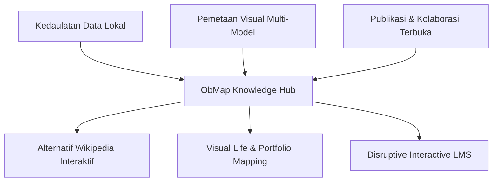

# Visi dan Misi Produk ObMap

## Ringkasan 3 Baris
- ObMap adalah workspace pengetahuan *local-first* berbasis Markdown yang memvisualisasikan isi vault sebagai peta interaktif multi-model.
- Mengintegrasikan kedaulatan data ala Obsidian, mesin diagram terstruktur ala XMind, serta kolaborasi dan publikasi instan ala Notion.
- Bertujuan mendisrupsi model ensiklopedia publik (alternatif Wikipedia), portofolio pengetahuan visual, dan kurikulum LMS interaktif.

---

## 1. Elevator Pitch (Satu Kalimat)

> **ObMap adalah workspace pengetahuan *local-first* berbasis Markdown yang memvisualisasikan isi vault sebagai peta interaktif, dengan kolaborasi berbasis kontrol versi dan publikasi web instan.**

---

## 2. Pernyataan Visi (Vision Statement)

Menjadi platform eksplorasi pengetahuan terbuka paling fleksibel di web modern, di mana pemikiran manusia tidak lagi terisolasi dalam dokumen statis atau terkunci di silo *cloud proprietary*, melainkan terhubung sebagai graf pengetahuan hidup yang dapat dimiliki secara lokal, dieksplorasi secara visual, dan dibagikan secara instan ke seluruh dunia.

---

## 3. Misi Produk (Mission Statement)

1. **Memberikan Kedaulatan Penuh atas Data:** Menjamin pengguna memiliki berkas catatannya secara fisik melalui Markdown murni dan File System Access API tanpa *vendor lock-in*.
2. **Menjembatani Teks dan Graf:** Mengubah catatan Markdown biasa menjadi struktur visual multi-model (Mind Map, Org Chart, Fishbone, Timeline, Force Graph) secara otomatis dan dua arah.
3. **Mendemokratisasi Penerbitan Pengetahuan:** Menyediakan rute publikasi instan sekali klik (`/p/:username/:vaultSlug`) yang dapat diakses publik tanpa login.
4. **Menyediakan Kolaborasi Andal Tanpa Merusak Dokumen:** Memanfaatkan sistem kontrol versi internal (VCS micro-revisions, stashing, branch, 3-way merge) untuk kerja tim yang aman.

---

## 4. Nilai-Nilai Inti (Core Values)

| Nilai | Prinsip | Wujud Nyata di Kode |
| :--- | :--- | :--- |
| **Local-First** | Data pengguna milik pengguna seutuhnya | Driver File System API + fallback IndexedDB (`src/domains/vault/`) |
| **Open Formats** | Plaintext Markdown standar terbuka | CommonMark + GFM parser + frontmatter YAML murni |
| **Visual Thinking** | Struktur graf bukan sekadar visualisasi pasif | Interactive 2D Canvas + dynamic re-layout (`src/domains/graph/`) |
| **Instant Sharing** | Publikasi web tanpa friksi setup server | Public Reader route dengan optimasi anonim (`src/domains/public-reader/`) |

---

## Terkait
- [Filosofi Produk](product-philosophy.md)
- [Positioning Produk](positioning.md)
- [Pilar Kasus Penggunaan](use-case-pillars.md)
- [Product Requirements Document (PRD)](../02-planning/prd.md)
