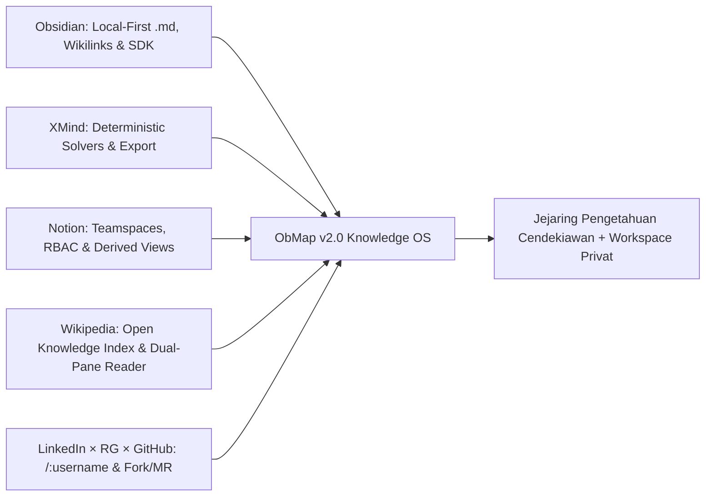

# Visi, Misi & Sasaran Strategis ObMap v2.0

## Ringkasan 3 Baris
- Mendefinisikan arah jangka panjang ObMap sebagai **Visual Knowledge Operating System** sekaligus **Social Knowledge Network** berkejelasan tinggi bagi cendekiawan, peneliti, pendidik, dan tim pengetahuan.
- Menggabungkan lima sistem referensi terbaik (**Obsidian**, **XMind**, **Notion**, **Wikipedia**, serta **LinkedIn × ResearchGate × GitHub**) di atas fondasi *local-first* Markdown dan graf Canvas2D deterministik.
- Menyelaraskan pengiriman bertahap 3 tahap rilis (*Partner Pilot → Approval-Gated Community Beta → Commercial GA*) menuju adopsi komersial dan komunitas riset terbuka.

---

## 1. Pernyataan Visi & Misi

### Visi
Menjadi infrastruktur pengetahuan terpadu dan jejaring sosial cendekiawan paling intuitif di dunia—penyeimbang ekosistem media sosial hiburan—di mana berpikir secara spasial, menyunting secara privat, berkolaborasi dalam tim, dan menerbitkan karya terverifikasi berlangsung dalam satu sistem yang berdaulat atas data.

### Misi
1. **Menyatukan Kedalaman PKM & Kognisi Visual:** Menghilangkan friksi antara editor Markdown *local-first* bergaya Obsidian dan kanvas pemetaan deterministik sekelas XMind (`Mindmap`, `Org`, `Timeline`, `Fishbone`, `Argument Map`, `Citation Tree`).
2. **Menghadirkan Kolaborasi Tanpa Lock-In:** Menyediakan Teamspaces, izin granular, komentar terstruktur, dan 5 mode *Derived Views* bergaya Notion yang diturunkan 100% dari berkas `.md` + YAML frontmatter.
3. **Membangun Jejaring Pengetahuan Terbuka & Terverifikasi:** Menjadikan identitas kanonik `/:username` / `/@:username` sebagai portofolio intelektual hidup (*Living Intellectual Portfolio*) dengan lisensi default **`CC BY-SA 4.0`**, rujukan lintas-vault `[[@user/vault/note]]`, kurasi manual *Verified Scholar*, serta alur kontribusi *Fork & Knowledge Merge Request*.
4. **Mengutamakan Kecepatan Rilis yang Terkendali:** Menerapkan **3-Stage Progressive Shipping Gate** agar sistem langsung memberi nilai nyata bagi mitra awal (Stage 1), bertumbuh aman lewat approval individual Admin di `/admin` (Stage 2), dan berkembang komersial berkelanjutan lewat tarif & kuota dinamis serta pembayaran **Xendit/Midtrans → Stripe** (Stage 3).

---

## 2. Sintesis Lima Sistem Referensi

---

## 3. Sasaran Strategis & Indikator Kinerja Utama (North Star KPIs)

| Kategori Metrik | Target v2.0 | Cara Pengukuran & Konteks Rilis |
| :--- | :--- | :--- |
| **Time-to-First-Value (`TTFV`)** | `< 90 detik` | Waktu sejak membuka Sandbox Landing (`/`) hingga pengguna menghasilkan graf visual pertama. |
| **Activation Rate** | `>= 35%` `[ASSUMPTION]` | Konversi pengunjung Sandbox → akun `approved` → pembuatan vault pertama atau klaim `/:username`. |
| **D7 / D30 Active Retention** | `>= 40% / >= 22%` `[ASSUMPTION]` | Pengguna aktif yang kembali menyunting catatan, meninjau kurikulum, atau berinteraksi di `community`. |
| **Scholarly Viral K-Factor** | `>= 0.35` `[ASSUMPTION]` | Registrasi baru melalui tautan kanonik `/:username`, kartu sitasi, dan tombol *Fork to My Vault*. |
| **Core Canvas & Web Vitals** | `60 FPS` (`2.000` node) · LCP `< 2.0s` | Performa kanvas Canvas2D pada `/app` & `community`, serta LCP halaman publik `/:username`. |
| **Free-to-Paid Conversion (Stage 3)** | `>= 4%` `[ASSUMPTION]` | Konversi pengguna aktif menuju paket Pro / Team melalui gateway **Xendit/Midtrans** & Stripe. |

---

## Terkait
- [ObMap System Architecture & Product Master Blueprint (v2.0)](../00-meta/00-0-master-blueprint.md)
- [ObMap Quo Vadis v2.0](../00-meta/00-2-quovadis.md)
- [Filosofi Produk & Prinsip Desain](product-philosophy.md)
- [Positioning Strategis](positioning.md)
- [Lima Pilar Use-Case](use-case-pillars.md)
