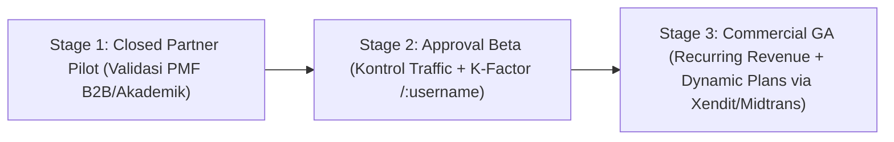

# Business Requirements Document (BRD) ObMap v2.0

## Ringkasan 3 Baris
- Menetapkan arsitektur bisnis, strategi pertumbuhan berbasis komunitas (*Product-Led & Scholarly Network Growth*), serta model monetisasi **XMind + Notion Hybrid** bagi ObMap v2.0.
- Menghilangkan angka harga dan kuota statis (`DRFT-014`): seluruh tarif, batas penyimpanan, dan hak fitur dikelola secara dinamis oleh Superadmin pada `src/domains/admin/` melalui tabel DB `plans`, `plan_entitlements`, dan `plan_quotas`.
- Mengurutkan strategi rilis komersial sejalan dengan **3-Stage Progressive Shipping Gate** serta integrasi pembayaran utama **Xendit / Midtrans** (IDR, QRIS, VA, e-Wallet) sebelum ekspansi global **Stripe**.

---

## 1. Sasaran Bisnis per Tahap Rilis (`stage_1` s/d `stage_3`)

| Tahap Rilis | Tujuan Bisnis Utama | Mekanisme Kontrol & Akuisisi | Metrik Keberhasilan Bisnis |
| :--- | :--- | :--- | :--- |
| **Stage 1 (`stage_1_partner`)** | Validasi stabilitas & nilai produk bersama rekan, peneliti, dan lembaga mitra tepercaya tanpa beban dukungan publik massal. | Provisi undangan terarah (`partner_invitations`) oleh Admin di `/admin`. | `>= 5` lembaga/tim pilot aktif menggunakan vault & VCS secara rutin. |
| **Stage 2 (`stage_2_community_beta`)** | Membangun grafik konten publik berkualitas tinggi (`/:username`, `/explore`, sitasi) sembari mencegah lonjakan trafik server tak terkendali. | Registrasi publik & klaim `username` dibuka; setiap akun masuk `pending_approval` dan disetujui **secara individual per-user di `/admin`**. | LCP `/:username` `< 2.0s`, rasio error `< 0.5%`, viral *K-Factor* `>= 0.35` `[ASSUMPTION]`. |
| **Stage 3 (`stage_3_commercial_ga`)** | Mengonversi basis pengguna komunitas & tim riset menjadi pendapatan berulang berkelanjutan tanpa mematikan adopsi gratis. | Self-serve signup aktif; penegakan kuota dinamis DB; checkout **Xendit/Midtrans** + **Stripe**. | Konversi Free → Paid `>= 4%` `[ASSUMPTION]`; retensi D30 `>= 22%`. |

---

## 2. Arsitektur Paket & Monetisasi Dinamis (`XMind + Notion Hybrid`)

ObMap menolak model Obsidian (menjual sinkronisasi dasar & publikasi publik sebagai *paywall* terpisah) karena mengunci akses publik merusak efek jaringan `/:username` dan `/explore`. Sebaliknya, ObMap memadukan:
- **Pola XMind:** Inti pencatatan Markdown lokal + publikasi `/:username` tetap **gratis penuh** (`CC BY-SA 4.0`), sementara kapabilitas visualisasi lanjutan (*Pitch Mode*, solver analitik lanjutan, ekspor PDF/SVG/OPML, tema premium) ditempatkan pada paket **Pro**.
- **Pola Notion:** Kolaborasi tim lintas-kursi (*Teamspaces*, jumlah kolaborator tak terbatas, riwayat revisi penuh, *Org-Lock Policy*, *Seat Management*, dan SSO) menjadi penggerak pendapatan utama B2B pada paket **Team / Lab** dan **Academic / Enterprise**.

### Kebijakan Dynamic Pricing & Quota Governance
> **Wajib Arsitektural:** Nilai nominal harga (`price_idr`, `price_usd`), batas vault cloud, kapasitas media MB, jumlah tamu kolaborasi, dan retensi riwayat VCS **tidak boleh di-hardcode** di aplikasi. Seluruhnya diatur Admin di `/admin` melalui `plans`, `plan_entitlements`, dan `plan_quotas`. Matriks di bawah merupakan konfigurasi diferensiasi paket (*seed baseline* awal yang dapat diubah sewaktu-waktu dari `/admin`):

| Dimensi Nilai Bisnis | **Free (`$0` / Selamanya)** | **Pro** *(Configured in `/admin`)* | **Team / Lab** *(Configured in `/admin`)* | **Academic / Enterprise** *(Custom)* |
| :--- | :--- | :--- | :--- | :--- |
| **Local Vaults (`FS API` & `IndexedDB`)** | **Tak Terbatas Selamanya** | Tak Terbatas | Tak Terbatas | Tak Terbatas |
| **Identitas Sosial `/:username` & Fork/Cite** | **Gratis Penuh** (`CC BY-SA 4.0`) | Penuh + Custom Domain + Analitik Trafik | Penuh + Branding Tim & `Public Unlisted` | Katalog Institusi + Kurasi *Verified Scholar* |
| **Cloud Vaults & Media Privat** | Kuota dasar awal (diatur Admin) | Kuota Pro ditingkatkan (diatur Admin) | Kuota Tim / Shared Pool (diatur Admin) | Kuota Khusus + Dedicated SLA |
| **Visualisasi, Tema & Ekspor** | 4 Solver inti, PNG / Markdown | Semua Solver (`argument-map`, `citation-tree`), Pitch Mode, PDF/SVG/OPML | Semua fitur Pro + Template & Tema Tim | Semua + White-label / Domain Kampus |
| **Kolaborasi, VCS & Kebijakan** | Batas tamu & retensi VCS dasar (diatur Admin) | Retensi VCS diperpanjang + PR Review personal | Unlimited Anggota, *Org-Lock Policy*, Teamspaces | SAML/SSO, Allowlist Plugin `@obmap/sdk`, Audit Logs |

---

## 3. Payment Gateway, Retensi & Siklus Penagihan

1. **Prioritas Gateway Pembayaran (`STEP-04.1`):**
   - **Fase 1 (Utama):** Integrasi **Xendit / Midtrans** untuk pasar domestik dan Asia Tenggara (QRIS, Virtual Account Bank, Kartu Kredit lokal, e-Wallet dalam mata uang IDR).
   - **Fase 2 (Ekspansi Global):** Integrasi **Stripe** untuk kartu internasional, penagihan multi-mata uang USD, dan portal pelanggan B2B.
2. **Program Beasiswa & Komunitas Akademik:** Admin di `/admin` dapat menerbitkan kupon diskon, *plan override*, atau paket bersubsidi bagi dosen, mahasiswa, dan kontributor terbuka aktif (*Open Knowledge Grants*).
3. **Non-Destructive Downgrade:** Saat langganan berakhir (`past_due` → *Grace Period* 7 hari → `downgraded_readonly`), vault/media yang melampaui kuota gratis dinamis **tidak dihapus**; sistem mengunci penulisan cloud baru sambil mempertahankan akses baca dan ekspor penuh ke ZIP / Folder Lokal.

---

## Terkait
- [Master Blueprint v2.0 §5](../00-meta/00-0-master-blueprint.md)
- [Positioning Strategis](../01-visions/positioning.md)
- [Product Requirements Document (`prd.md`)](prd.md)
- [Playbook Eksekusi (`STEP-04.1` & `STEP-04.2`)](README.md)
- [ADR-0009: Stage Gate, RBAC & Dynamic Billing](../03-architecture/adr/ADR-0009-release-stage-gate-rbac-and-dynamic-billing.md)
