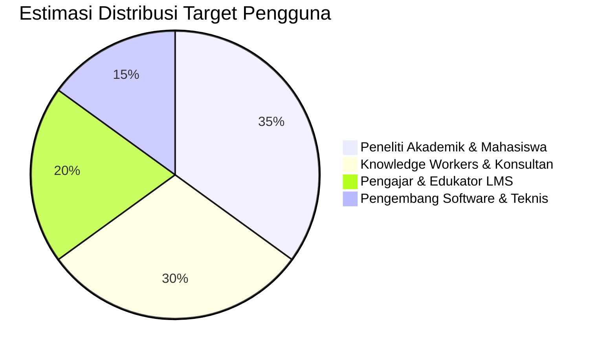

# Business Requirements Document (BRD) - ObMap

## Ringkasan 3 Baris
- Menguraikan model nilai komersial, target pasar sasaran, dan kerangka ekonomi monetisasi ObMap.
- Mengusulkan pendekatan *open-core freemium* yang mempertahankan kapabilitas lokal 100% gratis selamanya.
- Menghadirkan layanan premium berbayar pada sinkronisasi *cloud* terkelola, kolaborasi privat multi-pengguna, dan domain publik kustom.

---

## 1. Riwayat Revisi Dokumen

| Versi | Tanggal | Penulis | Perubahan Utama |
| :--- | :--- | :--- | :--- |
| 1.0.0 | 2026-11-10 | Lead Product Manager | Peletakan kerangka dasar model bisnis & unit economics |

---

## 2. Peluang Pasar dan Target Segmen



1. **Pecinta PKM & Peneliti:** Membutuhkan alat berbasis Markdown lokal tanpa biaya langganan bulanan mahal untuk basis data pribadi mereka.
2. **Kreator Portofolio & Konsultan:** Membutuhkan cara cepat memvisualisasikan metodologi kerja dan membagikannya ke klien tanpa konfigurasi server web.
3. **Institusi Edukasi Mandiri:** Mencari platform manajemen belajar visual yang interaktif tanpa kerumitan instalasi Moodle atau Canvas.

---

## 3. Model Monetisasi [ASSUMPTION]

> Seluruh angka di bawah ini berstatus `[ASSUMPTION]` dengan formula acuan, menunggu validasi pengujian pasar (`{{TBD}}`).

### 3.1 Struktur Paket Layanan

| Tier Layanan | Target Target | Harga Model [ASSUMPTION] | Kapabilitas Utama |
| :--- | :--- | :--- | :--- |
| **Community (Lokal)** | Pengguna Individu | **$0 / Selamanya** | Local storage (FS API & IndexedDB), semua layout graf, ekspor ZIP/JSON |
| **Personal Pro** | Peneliti & Profesional | **${{TBD_PRO_PRICE}}/bulan** | Sinkronisasi Supabase Cloud tanpa batas, backup otomatis, riwayat versi 90 hari |
| **Team / Edu LMS** | Instansi & Tim Riset | **${{TBD_TEAM_PRICE}}/seat/bln** | Ruang kerja kolaboratif, inherited granular permissions, custom domain `/p/` |

---

## 4. Kerangka Analisis Kelayakan Finansial (ROI Framework)

```
[FORMULA BISNIS DASAR]
LTV (Customer Lifetime Value) = (ARPU × Gross Margin) / Churn Rate
CAC (Customer Acquisition Cost) = Total Biaya Pemasaran / Jumlah Pelanggan Baru
Rasio Efisiensi Modal = LTV / CAC (Target Sehat: >= 3.0x)
```

- **Target ARPU (Average Revenue Per User) Pro:** `[ASSUMPTION]` ${{TBD_ARPU_PRO}}/tahun.
- **Target Biaya Infrastruktur per User Aktif:** Ditekan seminimal mungkin karena komputasi graf dan parsing Markdown berjalan 100% *client-side* di peramban pengguna. Server Supabase hanya menangani relai data terenkripsi dan autentikasi.

---

## 5. Analisis Risiko Bisnis (`RISK-NN`)

| ID Risiko | Deskripsi Risiko | Dampak Bisnis | Mitigasi Strategis |
| :--- | :--- | :--- | :--- |
| `RISK-01` | Kompatibilitas File System Access API terbatas pada Chromium | Pengguna Safari/Firefox merasa dianaktirikan | Fallback mulus ke IndexedDB berkualitas tinggi dengan fitur ekspor satu klik `[IMPLEMENTED]` |
| `RISK-02` | Persepsi persaingan langsung dengan Obsidian & Notion | Kesulitan akuisisi pengguna baru | Fokus penajaman keunggulan pemetaan visual multi-model otomatis dan publikasi instan gratis |
| `RISK-03` | Beban biaya bandwidth storage media publik | Lonjakan biaya infrastruktur cloud | Pembatasan kuota ukuran per media dan caching edge pada Public Reader `[PARTIAL]` |

---

## Terkait
- [Positioning Produk](../01-vision/positioning.md)
- [Product Requirements Document (PRD)](prd.md)
- [Statement of Work (SoW)](sow.md)