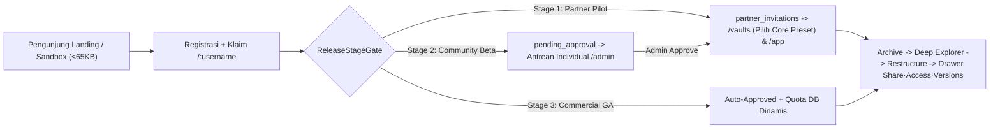

# Product Requirements Document (PRD) v2.0

## Ringkasan 3 Baris
- Mendefinisikan kebutuhan produk end-to-end berbasis **6 Sistem Referensi Inti** (**Obsidian**, **Nodus Research**, **XMind**, **Notion**, **Wikipedia**, **LinkedIn × ResearchGate × GitHub**) di atas filosofi *"Unopinionated Data, Opinionated Lenses, Visual by Default, Connected by Design"*.
- Mengunci batas produk tegas (**Non-Goal:** bukan *office-board-central* ala Trello/Asana/Monday/ClickUp), sentralisasi konfigurasi tunggal **`.app/config.json`**, **4 Workspace Modes** (`Freeform`, `Atlas`, `Studio`, `Academy` + `Community Presets`), **`Deep Explorer`**, **Unified `<SettingsHub />` (*Dual Navigator* + 3 Kategori)**, **Academy 3 Lapis**, serta **Unified Essential VCS & Granular `AS & WITH`** via **"Share · Access · Versions" Drawer**.
- Menghubungkan 3 segmen pengguna (*Beginner*, *Intermediate*, *Advanced*) & persona (`PER-01`–`PER-09`) langsung ke kriteria keberhasilan dan antrean `STEP-01.1`–`STEP-05.4`.

---

## 1. Masalah Inti Pengguna, Non-Goal & Ruang Lingkup Produk
Pengguna pengetahuan selama ini dipaksa memecah arsip, riset PDF, pemetaan visual, editorial, kurasi portofolio, dan pengajaran di alat terpisah—atau terjebak memilih antara kanvas kosong yang intimidatif (*Obsidian* tanpa plugin) dan aplikasi kaku ber-lock-in (*Notion*). Arsitektur v2.0 menyelesaikan keduanya lewat data `.md` + `.app/config.json` yang tetap bebas, dibungkus oleh *Opinionated Core Presets* siap pakai dalam `< 90 detik`.

- **Batas Tegas Produk (*Explicit Non-Goal*):** Aplikasi ini **BUKAN** *office-board-central / enterprise project management* (Trello, Asana, ClickUp, Notion enterprise board). Seluruh *Derived Views* (*Table*, *Cards*, *Kanban/Calendar* ringan) melayani **pengarsipan, pengetahuan, riset, editorial (`Studio`), dan progres belajar (`Academy`)**.

### Ruang Lingkup In-Scope v2.0
- **Core Workbench (`/app`) & Dual Navigator:** Editor CM6 + YAML terisolasi, **`Deep Explorer`** (4 lensa visual *Graph, Diagram, Table, Cards* + pengelompokan dinamis *Hierarchy/Properties/Tags/Backlinks/Keywords*; dapat dijalankan sebagai Tab Workspace maupun via `Settings Hub > Workspace > Deep Explorer`), *Virtual Grouping* & *Structural Refactoring*, tab bar bersih (tanpa tombol *Quick Share* / *Quick View Lens*), serta **"Share · Access · Versions" Drawer** (3 tab, deteksi Vault vs Node/Folder).
- **Dashboard Hub (`/vaults` — `domains/dashboard/`):** Manajemen multi-vault, *Knowledge Derived Views*, inkubator **`Community Presets` (`template`)**, serta pemilihan **Workspace Mode** (`Freeform`, `Atlas`, `Studio`, `Academy`).
- **Academy 3-Layer Competence Tree:** Hirarki **Falsafah → Kurikulum → Silabus → RPS → Instruksi/Tugas**, *Living Student Sub-Nodes* (`locked → available → in_progress → submitted → mastered`), aturan Lapisan 2 per node di `.app/config.json`, & *Focus Screen* Lapisan 3.
- **Community & Scholarly Network (`/:username`, `/@:username`, `/explore`):** Presentation Lenses (**`atlas`**, **`publication`**, **`course`**, **`template`**), *Granular Node-Level & Vault-Level Publishing*, `[[@user/vault/note]]`, *Essential VCS* (*Snapshot, Visual Diff, Fork, KMR*), Profile light controls + *"Full Account Settings →"*.
- **Unified Adaptive `<SettingsHub />` (`/settings` Full Page atau Editor Workspace Tab, bebas inline nav rail):** *Dual Navigator* (**Interactive Breadcrumb Navigator** + Floating Dropdown Outline & **Synchronized Right Sidebar**) menavigasi **3 Kategori Utama**: **`1. Account`** (`Profile Customization`, `Credentials & Security`, `Session Activity`), **`2. Workspace`** (`Workspace Preset` w/ Mini Instruction-Helps, Impact Preview & Validation; `Central .app/config.json Raw Inspector & Dynamic Editor` w/ Real-Time Validation & Help; `Deep Explorer`; `Appearance & Accessibility` + BYO-AI Ollama/WebLLM/Zotero; `Visual Engine`), dan **`3. Vault`** (`Vaults Dashboard`, `Vaults Collaborating`, `VCS, Diff, Backup & History`, `Vaults Publish`, `Import & Export Vault`).
- **Prototype Lifecycle (`/prototype` — Track 2):** Zona inkubasi UI/UX *zero-backend* di `src/prototype/` dan katalog arsip berversi `src/prototype/snapshots/<stage-id>/` sebelum migrasi 1:1 ke `src/domains/`.

---

## 2. Alur Produk Lintas Tahap (`Stage 1–3`)

---

## 3. Matriks Kebutuhan Produk per Domain Utama

| Kelompok Fitur | Spesifikasi Ringkas | Status | Target Step |
| :--- | :--- | :---: | :--- |
| **`Deep Explorer` & Solver Deterministik** | *Graph, Diagram* (Mindmap, Org+Matrix, Timeline, Fishbone, `argument-map`, `competence-dag`), *Table*, *Cards* + pengelompokan dinamis (*Hierarchy/Properties/Tags/Backlinks/Keywords*); *Virtual Grouping* & *Structural Refactoring* | `[IMPLEMENTED]` / `[PLANNED]` | Baseline + `STEP-02.1`, `05.2`, `UI-STEP-07` |
| **Workspace Modes & Dashboard (`/vaults`)** | `Freeform`, `Atlas`, `Studio` (+ **`Deep Explorer`** wajib), `Academy`, + `Community Presets` (`template`) | `[VISION]` | `STEP-02.1` |
| **Community (`/:username` & `/explore`)** | *Hard cutover* `/p/*`, Presentation Lenses (`atlas`/`publication`/`course`/`template`), Profile light UI, & kurasi *Verified Scholar* Admin | `[PARTIAL]` / `[VISION]` | `STEP-01.2`, `03.1` |
| **Essential VCS & Granular `AS & WITH`** | Drawer **"Share · Access · Versions"** (*Publish*, *Collaborate*, *Versions & Diff/MR*) sadar konteks **Vault & Node Level** + `CC BY-SA 4.0` + *Block Comments* | `[PARTIAL]` / `[VISION]` | `STEP-01.4`, `03.3` |
| **Academy 3-Layer Competence Tree** | *Falsafah → Kurikulum → Silabus → RPS → Tugas*, *Living Student Sub-Nodes*, rules per node di blok `academy` `.app/config.json` (+ kelola di `Deep Explorer`), & Focus Screen | `[VISION]` | `STEP-05.1` |
| **Single `.app/config.json` & `<SettingsHub />`** | 7 blok config sentral (anti-fragmentasi), **Single Adaptive `<SettingsHub />`** (*Dual Navigator* Breadcrumb + Right Sidebar; 3 Kategori `Account` → `Workspace` → `Vault`), Raw JSON Inspector, `@app/sdk`, & Native BYO-AI / Ollama RAG + PDF | `[IMPLEMENTED]` / `[VISION]` | `STEP-01.5`, `UI-STEP-01..02`, `UI-STEP-07`, `STEP-05.3` |
| **Dynamic Billing & Teamspaces** | Konfigurasi tarif/kuota dinamis di `/admin`, **Xendit/Midtrans first → Stripe**, *Non-Destructive Downgrade*, & CRDT Yjs | `[VISION]` | `STEP-04.1`–`04.3` |

---

## 4. Mitigasi Risiko Produk & Teknis (`RISK-01` s/d `RISK-06`)

| ID Risiko | Deskripsi Risiko | Tingkat | Strategi Mitigasi Terstruktur |
| :--- | :--- | :---: | :--- |
| **`RISK-01`** | Kebocoran node privat pada granular node-level publishing / collab | Kritis | Evaluasi simetris `PolicyEngine` ↔ Postgres RLS atas `visibility: private` & `publishing/access.node_overrides`; bucket `vault-media` hanya lewat `createSignedUrl`. |
| **`RISK-02`** | Lonjakan trafik atau beban support di tahap awal | Tinggi | `ReleaseStageGate` Stage 1 & Stage 2 `pending_approval` individual + *Core Presets* `< 90 detik` mengurangi *drop-off*. |
| **`RISK-03`** | Ruang lingkup produk melebar menjadi klon papan tugas korporat | Tinggi | Ditegakkan melalui *Explicit Non-Goal* pada Master Blueprint & PRD: Views hanya untuk pengetahuan, riset, editorial, & pembelajaran. |
| **`RISK-04`** | Tabrakan root `/:username` atau fragmentasi berkas konfigurasi | Kritis | Guard 3-lapis `RESERVED_SLUGS` + larangan memecah `.app/config.json` menjadi `preset.json`/`lms-policy.json`/`setting.json`. |
| **`RISK-05`** | Ketidakpuasan pengguna saat downgrade atau berpindah alat | Tinggi | *Local-First Forever Free*, berkas `.md` murni, & *Non-Destructive Downgrade* (`downgraded_readonly`). |
| **`RISK-06`** | Risiko XSS atau kebocoran key AI/token oleh plugin | Kritis | Isolasi **`@app/sdk`** di Web Worker / Iframe CSP, *Permission Manifest*, `rehype-sanitize`, & pemrosesan Local AI (Ollama/BYOK). |

---

## Terkait
- [Master Blueprint v2.0](../00-meta/00-0-master-blueprint.md)
- [Playbook Eksekusi Step-by-Step (`README.md`)](README.md)
- [System Requirements Specification (`srs.md`)](srs.md)
- [Visi & Arsitektur Academy 3-Lapis](../06-lms/lms-vision.md)
- [Kolaborasi Granular & Essential VCS](../03-architecture/collaboration-and-publishing.md)
