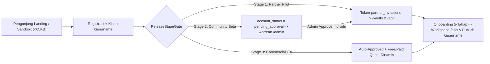

# Product Requirements Document (PRD) ObMap v2.0

## Ringkasan 3 Baris
- Mendefinisikan kebutuhan produk end-to-end ObMap v2.0 sebagai **Visual Knowledge OS** dan **Social Knowledge Network** yang menyatukan kapabilitas Obsidian, XMind, Notion, Wikipedia, dan LinkedIn × ResearchGate × GitHub.
- Mengunci seluruh keputusan produk mutakhir: domain `community` (`/:username` *hard cutover* tanpa `/p/*`), domain `dashboard` (`/vaults`), persetujuan Stage 2 per-user di `/admin`, kurasi manual *Verified Scholar*, lisensi default `CC BY-SA 4.0`, dan harga/kuota dinamis via `/admin` dengan **Xendit/Midtrans** pertama.
- Menghubungkan skenario pengguna (`PER-01`–`PER-09`) langsung ke kriteria keberhasilan terukur, mitigasi risiko, dan antrean implementasi `STEP-01.1`–`STEP-05.4`.

---

## 1. Masalah Inti Pengguna & Ruang Lingkup Produk
Pengguna pengetahuan saat ini terpaksa memecah alur kerjanya di 4–5 alat terpisah: menulis catatan Markdown privat (Obsidian), memetakan ide secara visual deterministik (XMind), berkolaborasi tim dan melihat Kanban/Kalender (Notion), membangun portofolio publik/sitasi (LinkedIn/ResearchGate), dan merancang kurikulum visual (Roadmap/LMS). ObMap v2.0 mengintegrasikan kelima alur tersebut dengan prinsip *local-first* tanpa *vendor lock-in*.

### Ruang Lingkup In-Scope v2.0
- **Core Workspace (`/app`):** Editor Markdown CM6 + YAML terisolasi, Canvas2D multi-solver deterministik + Free-Force, Aho-Corasick Web Worker, VCS lokal/cloud, 6-Layer Cascading Config + Unified Theme Engine.
- **Dashboard Hub (`/vaults` — `domains/dashboard/`):** Manajemen multi-vault + 5 mode tampilan derivatif frontmatter (Grid, Tree, Kanban, Calendar/Timeline, Analytics) + Community Feed & Template Gallery.
- **Community & Scholarly Network (`/:username`, `/@:username`, `/explore` — `domains/community/`):** Profil intelektual, konstelasi vault publik (`CC BY-SA 4.0`), *Cite this Note*, sitasi lintas-vault `[[@user/vault/note]]`, *Fork & Merge Request*, anotasi paragraf, dan lencana kurasi manual *Verified Scholar*.
- **Growth, Gate & Admin (`/` Landing Sandbox, Onboarding 5-Tahap, `/admin`):** *ReleaseStageGate* 3 tahap, antrean approval individual Stage 2, manajemen harga/kuota paket dinamis, dan gerbang pembayaran Xendit/Midtrans → Stripe.
- **Extensibility (`@obmap/sdk`):** Sandbox plugin Worker/Iframe CSP + *Scoped CSS Snippets* + Enterprise Allowlist.

---

## 2. Alur Produk Lintas Tahap (End-to-End User Journeys)

1. **Alur Akuisisi & Sandbox (`STEP-02.2`–`02.3`):** Pengunjung langsung mencoba editor outline-ke-Mindmap di `/` tanpa login; saat mendaftar, karya di memori otomatis dipindahkan menjadi vault pertamanya begitu melewati `ReleaseStageGate`.
2. **Alur Publikasi & Kolaborasi Sosial (`STEP-01.2`, `01.4`, `03.1`–`03.3`):** Pemilik memilih state visibilitas (`Private`, `Shared`, `Public Unlisted`, `Public Listed`). Catatan ber-frontmatter `visibility: private` dikecualikan dari bundle publik. Vault publik memakai `CC BY-SA 4.0` sebagai default, menampilkan tombol *Cite* dan *Fork to My Vault*, serta terbuka untuk *Knowledge Merge Request* lintas pengguna via VCS.
3. **Alur Komersial & Admin (`STEP-04.1`–`04.2`):** Admin menetapkan nominal harga, fitur, dan batas kuota tiap tier di `/admin` (`plans`, `plan_entitlements`, `plan_quotas`), mengaktifkan checkout IDR melalui Xendit/Midtrans (QRIS/VA/e-Wallet) sebelum Stripe, dan menjaga data pengguna tetap dapat dibaca/ekspor bila terjadi *downgrade* (*Non-Destructive Downgrade*).

---

## 3. Matriks Kebutuhan Fungsional per Domain Utama

| Kelompok Fitur | Spesifikasi Ringkas | Status | Target Step |
| :--- | :--- | :---: | :--- |
| **Workspace & Graph Deterministik** | CM6 + isolated YAML, 4+2 solver deterministik, *Per-Leaf Store*, *Subtree Override*, Pitch Mode & ekspor PDF/SVG/OPML | `[IMPLEMENTED]` / `[PLANNED]` | Baseline + `STEP-05.2` |
| **Dashboard (`/vaults`)** | 5 views derivatif Markdown/Frontmatter, Community Feed, Template Gallery, redirect login ke `/vaults` | `[VISION]` | `STEP-02.1` |
| **Community (`/:username` & `/explore`)** | Refaktor `public-reader` → `community`, *hard cutover* `/p/*`, `RESERVED_SLUGS`, profil `/:username`, `/explore`, *Verified Scholar* manual Admin | `[PARTIAL]` / `[VISION]` | `STEP-01.2`, `03.1` |
| **Citations, Fork/MR & Annotations** | Wikilink `[[@user/vault/note]]`, *Cite Exporter*, `CC BY-SA 4.0`, *Fork to My Vault*, MR lintas user, anotasi hash paragraf | `[PARTIAL]` / `[VISION]` | `STEP-03.2`–`03.3` |
| **Stage Gate & RBAC PolicyEngine** | `ReleaseStageGate` (Stage 1–3), approval per-user Stage 2 di `/admin`, `PolicyEngine` simetris Postgres RLS, 4 state visibilitas | `[PARTIAL]` / `[VISION]` | `STEP-01.3`–`01.4` |
| **Dynamic Billing & Teamspaces** | Konfigurasi tarif/kuota dinamis di `/admin`, **Xendit/Midtrans** first → Stripe, Teamspaces + *Org-Lock*, CRDT Yjs | `[VISION]` | `STEP-04.1`–`04.3` |
| **6-Layer Config, Theme & `@obmap/sdk`** | 6-lapis resolusi config, CSS Variables ↔ Canvas2D tokens, *Scoped CSS Snippets*, `@obmap/sdk` 12 Extension Points | `[PARTIAL]` / `[VISION]` | `STEP-01.5`, `05.3` |
| **Interactive Graph LMS** | DAG `prerequisites`, state node *Locked/Available/Mastered*, kuis & progres pelajar | `[VISION]` | `STEP-05.1` |

---

## 4. Mitigasi Risiko Produk & Teknis (`RISK-01` s/d `RISK-06`)

| ID Risiko | Deskripsi Risiko | Tingkat | Strategi Mitigasi Terstruktur |
| :--- | :--- | :---: | :--- |
| **`RISK-01`** | Kebocoran catatan privat saat vault diubah menjadi `Shared` atau `Public` | Kritis | Pengecualian ketat `visibility: private` di query Supabase RLS & generator bundle; bucket `vault-media` hanya lewat `createSignedUrl`; uji RLS otomatis (`STEP-01.4`, `05.4`). |
| **`RISK-02`** | Lonjakan trafik pendaftaran merusak stabilitas infrastruktur di tahap awal | Tinggi | Terapkan `ReleaseStageGate` Stage 1 invite-only & Stage 2 `pending_approval` dengan persetujuan individual Admin di `/admin` (`STEP-01.3`). |
| **`RISK-03`** | Pelanggaran hak akses dan konflik skema saat menambah domain `dashboard` & `community` | Tinggi | Tegakkan aturan DDD & Headless Controller (`<= 300` baris); hapuskan `/p/*` via *hard cutover* bersih (`STEP-01.2`). |
| **`RISK-04`** | Tabrakan root URL `/:username` dengan rute aplikasi (`/app`, `/vaults`, `/explore`, `/admin`) | Kritis | Validasi tiga lapis `RESERVED_SLUGS` pada urutan route `src/App.tsx`, `ProfileService.ts`, dan constraint PostgreSQL `CHECK` (`STEP-01.2`). |
| **`RISK-05`** | Kerusakan data atau ketidakpuasan saat masa berlangganan berakhir (*downgrade*) | Tinggi | Terapkan *Grace Period* 7 hari dan *Non-Destructive Downgrade* (`downgraded_readonly` — tetap bisa baca & ekspor ke lokal/ZIP). |
| **`RISK-06`** | Serangan XSS atau pencurian token oleh plugin komunitas atau CSS kustom | Kritis | Isolasi `@obmap/sdk` dalam Web Worker / Iframe CSP, *Permission Manifest* eksplisit, sanitasi `rehype-sanitize` pada HTML/CSS publik (`STEP-05.3`). |

---

## Terkait
- [Master Blueprint v2.0](../00-meta/00-0-master-blueprint.md)
- [Playbook Eksekusi Step-by-Step (`README.md`)](README.md)
- [Business Requirements Document (`brd.md`)](brd.md)
- [System Requirements Specification (`srs.md`)](srs.md)
- [Katalog Persona (`personas.md`)](personas.md)
