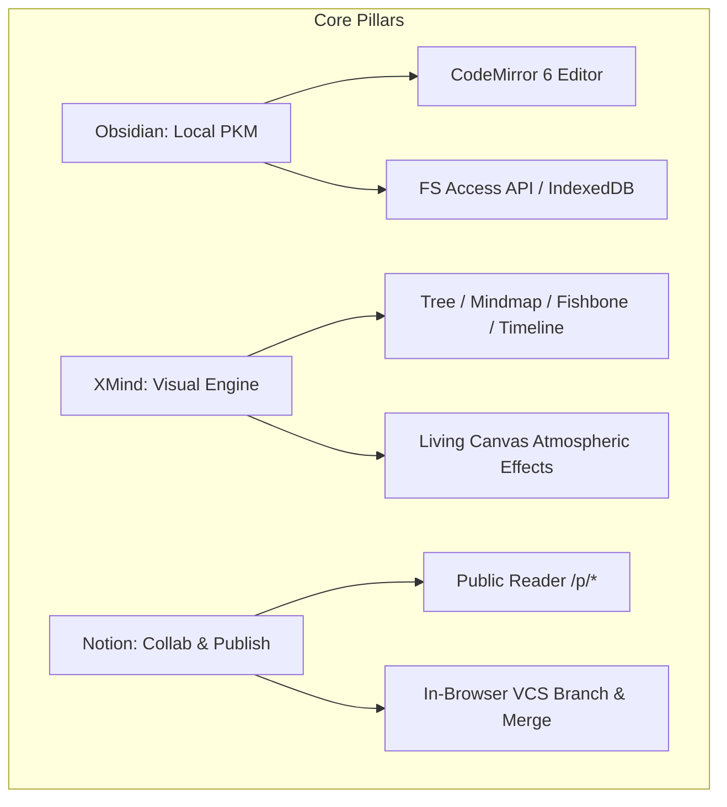

# Product Requirements Document (PRD) - ObMap

## Ringkasan 3 Baris
- Dokumen spesifikasi produk utama yang mengatur kapabilitas inti ObMap lintas 12 domain arsitektur.
- Mendefinisikan masalah pengguna, batasan teknis, fitur rilis terverifikasi, serta metrik keberhasilan produk.
- Menetapkan batasan tegas (*non-goals*) untuk menjaga performa kanvas dan kesederhanaan manipulasi teks.

---

## 1. Riwayat Revisi Dokumen

| Versi | Tanggal | Penulis | Perubahan Utama |
| :--- | :--- | :--- | :--- |
| 1.0.0 | 2026-10-15 | Principal Architect | Rilis draf awal pasca restrukturisasi Wave 1 & 2 |
| 1.1.0 | 2026-11-10 | Principal Architect | Sinkronisasi Wave 3 (12 Domain), CodeMirror 6, VCS, & Public Reader |

---

## 2. Pemangku Kepentingan (Stakeholders)

- **Sponsor Proyek:** Lead Product Manager
- **Arsitektur Teknis:** Principal Software Architect
- **Frontend & Visual Engine:** Senior Visual Performance Engineer
- **Infrastruktur & Cloud:** Supabase DevOps Specialist

---

## 3. Pernyataan Masalah

1. **Fragmentasi Alat Pengetahuan:** Pengguna terpaksa memisahkan catatan teks (Notion/Obsidian) dari diagram konseptual (XMind/Miro).
2. **Kerapuhan Sinkronisasi Kolaboratif:** Alat kolaborasi *real-time* sering menimpa modifikasi offline atau menghasilkan konflik teks yang merusak dokumen.
3. **Ketergantungan Ekosistem Tertutup:** Pengguna khawatir catatan seumur hidup mereka terdistorsi jika vendor SaaS mengubah model harga atau menghentikan layanan.

---

## 4. Ruang Lingkup Fitur Produk & Status

### 4.1 Domain Vault & Penyimpanan Data
- `FEAT-VAULT-001`: Multi-strategy storage: File System API, IndexedDB, dan Supabase Cloud Sync (`[IMPLEMENTED]`).
- `FEAT-VAULT-002`: Deteksi dan resolusi konflik impor akumulatif (Merge, Overwrite, Skip, Rename) (`[IMPLEMENTED]`).
- `FEAT-VAULT-003`: Auto-save otomatis dengan visual status indicator (`[IMPLEMENTED]`).

### 4.2 Domain Editor Markdown
- `FEAT-EDIT-001`: CodeMirror 6 dengan ekstensi Live Preview, Wikilinks `[[...]]`, dan Tags `#...` (`[IMPLEMENTED]`).
- `FEAT-EDIT-002`: Collapsible properties editor untuk YAML Frontmatter terisolasi dari teks utama (`[IMPLEMENTED]`).
- `FEAT-EDIT-003`: Heading outline navigation & folding sections (`[IMPLEMENTED]`).

### 4.3 Domain Graph & Visualisasi
- `FEAT-GRAPH-001`: Algoritma Mindmap, Org Chart, Brace Map, Fishbone, dan Timeline Hierarki (`[IMPLEMENTED]`).
- `FEAT-GRAPH-002`: Dynamic Atmosphere & Living Canvas (Stardust particles, link glow flow) (`[IMPLEMENTED]`).
- `FEAT-GRAPH-003`: Floating contextual gear toolbar dengan hit-test klik kanan / double tap (`[IMPLEMENTED]`).
- `FEAT-GRAPH-004`: Anti-collision layout bounding box untuk teks panjang (`[PARTIAL]`).
- `FEAT-GRAPH-005`: Mode visualisasi Tree Table spreadsheet (`[PLANNED]`).

### 4.4 Domain Kolaborasi, VCS, & Publikasi
- `FEAT-COLLAB-001`: Portal pembaca publik `/p/:username/:vaultSlug` terisolasi anonim (`[IMPLEMENTED]`).
- `FEAT-VCS-001`: Sistem cabang mikro (*branching*), penampungan (*stashing*), dan *3-way merge* lokal (`[IMPLEMENTED]`).
- `FEAT-COLLAB-002`: Granular folder & note permission inheritance via Supabase RLS (`[PARTIAL]`).
- `FEAT-COLLAB-003`: Real-time multiplayer CRDT (Yjs integration) (`[PLANNED]`).

---

## 5. Non-Goals (Batasan Tegas Luar Lingkup)

- **Bukan Editor WYSIWYG Berbasis Blok Kompleks:** Tidak akan menerapkan model blok seperti Notion yang mengorbankan integritas plaintext Markdown murni.
- **Bukan Pengganti Database Relasional:** Metadata frontmatter tidak dirancang untuk menangani jutaan baris transaksi perbankan atau kueri SQL berat.
- **Bukan Cloud File Storage Tanpa Batas:** Media yang diunggah tunduk pada batas kuota per vault pengguna.

---

## 6. Metrik Keberhasilan (Success Metrics)

| Indikator (KPI) | Target Kinerja | Status Saat Ini |
| :--- | :--- | :--- |
| **FPS Rendering Kanvas** | Stabil di 60 FPS pada 1.000 nodes | Terverifikasi pada d3 force & tree solvers `[IMPLEMENTED]` |
| **Waktu Muat Vault Dingin** | < 1,5 detik dari IndexedDB lokal | ~800ms rata-rata pada 500 catatan `[IMPLEMENTED]` |
| **Zero Data Loss Rate** | 100% data terselamatkan saat crash peramban | Mekanisme IndexedDB Journaling aktif `[IMPLEMENTED]` |
| **Latensi Web Worker Mention** | < 50ms untuk pencarian indeks 2.000 files | Aho-Corasick Web Worker aktif `[IMPLEMENTED]` |

---

## Terkait
- [Spesifikasi Persyaratan Perangkat Lunak (SRS)](srs.md)
- [Target Persona Pengguna](personas.md)
- [Roadmap Produk](roadmap.md)