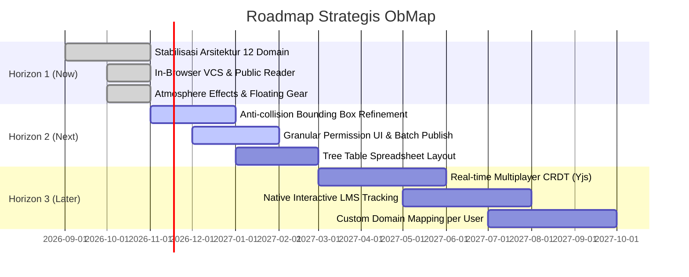

# Peta Jalan Pengembangan Produk (Product Roadmap)

## Ringkasan 3 Baris
- Menjabarkan lintasan evolusi produk lintas tiga horizon strategis: Now (Horizon 1), Next (Horizon 2), dan Later (Horizon 3).
- Mengintegrasikan status implementasi aktual dari kode sumber untuk memastikan transparansi teknis.
- Memprioritaskan stabilitas kanvas visual dan pematangan kolaborasi sebelum ekspansi fitur LMS tingkat lanjut.

---

## 1. Gambaran Tiga Horizon Strategis

---

## 2. Rincian Milestone per Horizon

### 2.1 Horizon 1: Now (Stabilisasi Fondasi & Wave 3) - `[IMPLEMENTED]`
- [x] Restrukturisasi tuntas 12 domain DDD (`admin`, `auth`, `collab`, `editor`, `graph`, `metadata`, `reader`, `settings`, `sync`, `vault`, `vcs`, `workspace`).
- [x] Integrasi CodeMirror 6 dengan Live Preview, wikilink completion, dan properties folding.
- [x] Algoritma visualisasi XMind (Mindmap, Org Chart, Brace Map, Fishbone, Timeline).
- [x] Efek atmosfer Living Canvas (Star dust, Link Dynamic Glow, Elevation shadows).
- [x] Sistem VCS mikro di peramban (branch, stash, micro-commits, 3-way merge).
- [x] Portal pembaca publik anonim di `/p/:username/:vaultSlug`.

### 2.2 Horizon 2: Next (Pematangan Interaksi & Fitur Lanjutan) - `[PARTIAL]`
- [ ] **Penyempurnaan Anti-Collision:** Algoritma pembatas bounding box dinamis agar simpul dengan teks panjang tidak saling bertubrukan pada layout padat (`[PARTIAL]`).
- [ ] **UI Granular Permission:** Antarmuka pemetaan izin turunan (*inherited permissions*) folder/file di dialog kolaborasi (`[PARTIAL]`).
- [ ] **Tree Table Layout Mode:** Kacamata visual berbentuk tabel hierarkis bertingkat ala spreadsheet analitik (`[PLANNED]`).
- [ ] **PWA Offline Asset Caching:** Peningkatan *service worker* untuk pemuatan aset kanvas saat offline total (`[PARTIAL]`).

### 2.3 Horizon 3: Later (Kolaborasi Bersama & Modul LMS) - `[VISION]`
- [ ] **Multiplayer CRDT Engine:** Kolaborasi multi-kursor real-time menggunakan pustaka Yjs yang terintegrasi dengan RLS Supabase (`[PLANNED]`).
- [ ] **LMS Interactive Curriculum Engine:** Pelacakan progres belajar per simpul graf modul materi dengan sertifikasi lokal (`[VISION]`).
- [ ] **Custom Domain Routing:** Penyediaan domain kustom mandiri untuk basis pengetahuan publik pengguna (`[VISION]`).

---

## Terkait
- [Product Requirements Document (PRD)](prd.md)
- [Software Requirements Specification (SRS)](srs.md)
- [Statement of Work (SoW)](sow.md)