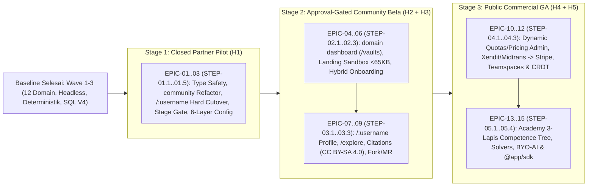

# Roadmap Pengembangan Inkremental ObMap v2.0 (`H1`–`H5`)

## Ringkasan 3 Baris
- Memvisualkan peta jalan pengembangan dari fondasi arsitektur saat ini (Wave 1–3 selesai) menuju platform penuh ObMap v2.0 dalam **3 Stage Rilis** dan **5 Horizon (`H1`–`H5`)**.
- Menggantikan bagan linimasa statis v1.0 menjadi ketergantungan antrean epik (`EPIC-01` s/d `EPIC-15`) yang selaras 1:1 dengan `STEP-01.1` s/d `STEP-05.4` pada [Playbook Eksekusi Step-by-Step](README.md).
- Memastikan pengiriman produk berlangsung inkremental (*shipping while developing*) lintas **3 Jalur Development Resmi** (*Track 1 Spec-Driven*, *Track 2 Zero-Backend Prototype `src/prototype/` → 1:1 Migration → Archived Snapshot `/prototype`*, *Track 3 Direct Rapid Experiment → docs Sync*), dimulai dari Stage 1 Partner Pilot (`H1`) hingga Commercial GA (`H4`–`H5`).

---

## 1. Aliran Stage Rilis & Ketergantungan Horizon

---

## 2. Pemetaan Horizon, Epik & Step Eksekusi

| Stage Rilis | Horizon | Epik | Langkah Antrean | Fokus Utama & Exit Gate |
| :--- | :---: | :--- | :--- | :--- |
| **Stage 1 (`stage_1_partner`)** | **H1** | `EPIC-01`–`03` | `STEP-01.1`–`01.5` | Hapus `untypedSupabase.ts`, refaktor `public-reader` → `community`, *hard cutover* `/p/*` → `/:username`, `ReleaseStageGate`, `PolicyEngine`, 6-Layer Config + Theme sync. |
| **Stage 2 (`stage_2_community_beta`)** | **H2** | `EPIC-04`–`06` | `STEP-02.1`–`02.3` + `UI-STEP-07` | Domain ke-13 `dashboard` (`/vaults`: **`Deep Explorer`**, **Core Presets** `Atlas`/`Studio`/`Academy`/`Freeform`, `.app/config.json`), Landing Live Sandbox (`< 65KB`, 6 Referensi), Hybrid Onboarding 5 tahap, & migrasi 1:1 Track 2 **Unified `<SettingsHub />`** (*Dual Navigator* + 3 Kategori `Account → Workspace → Vault` + Snapshot `/prototype`). |
| **Stage 2 (`stage_2_community_beta`)** | **H3** | `EPIC-07`–`09` | `STEP-03.1`–`03.3` | Profil `/:username`, `/explore` (+ `Community Presets`), kurasi *Verified Scholar*, rujukan `[[@user/vault/note]]` (`CC BY-SA 4.0`), *Essential VCS*, & **Unified `"Share · Access · Versions"` Drawer (Vault & Node `AS & WITH`)**. |
| **Stage 3 (`stage_3_commercial_ga`)** | **H4** | `EPIC-10`–`12` | `STEP-04.1`–`04.3` | Paket/kuota dinamis di `/admin`, **Xendit/Midtrans first** lalu Stripe, Teamspaces + Org-Lock `.app/config.json`, sinkronisasi lanjutan **Unified `<SettingsHub />`**, & CRDT Yjs real-time. |
| **Stage 3 (`stage_3_commercial_ga`)** | **H5** | `EPIC-13`–`15` | `STEP-05.1`–`05.4` | **Academy 3-Layer Living Competence Tree** + *Living Student Sub-Nodes*, solver `argument-map`/`citation-tree`, Pitch Mode & PDF/SVG/OPML, **BYO-AI / Ollama RAG**, & **`@app/sdk` ber-sandbox**, audit GA & WCAG 2.2 AA. |

---

## Terkait
- [Playbook Eksekusi Step-by-Step (`README.md`)](README.md)
- [ObMap Quo Vadis v2.0](../00-meta/00-2-quovadis.md)
- [Matriks Keterlacakan (`traceability-matrix.md`)](traceability-matrix.md)
- [Register Risiko & Product Requirements (`prd.md`)](prd.md)
