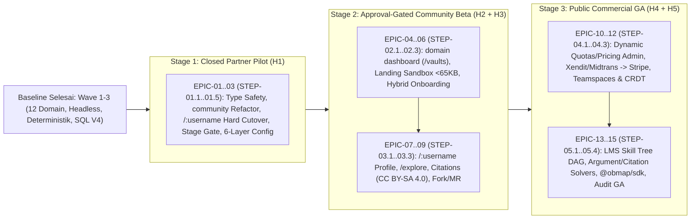

# Roadmap Pengembangan Inkremental ObMap v2.0 (`H1`–`H5`)

## Ringkasan 3 Baris
- Memvisualkan peta jalan pengembangan dari fondasi arsitektur saat ini (Wave 1–3 selesai) menuju platform penuh ObMap v2.0 dalam **3 Stage Rilis** dan **5 Horizon (`H1`–`H5`)**.
- Menggantikan bagan linimasa statis v1.0 menjadi ketergantungan antrean epik (`EPIC-01` s/d `EPIC-15`) yang selaras 1:1 dengan `STEP-01.1` s/d `STEP-05.4` pada [Playbook Eksekusi Step-by-Step](README.md).
- Memastikan pengiriman produk berlangsung inkremental (*shipping while developing*) dimulai dari Stage 1 Partner Pilot (`H1`) hingga Commercial GA (`H4`–`H5`).

---

## 1. Aliran Stage Rilis & Ketergantungan Horizon

---

## 2. Pemetaan Horizon, Epik & Step Eksekusi

| Stage Rilis | Horizon | Epik | Langkah Antrean | Fokus Utama & Exit Gate |
| :--- | :---: | :--- | :--- | :--- |
| **Stage 1 (`stage_1_partner`)** | **H1** | `EPIC-01`–`03` | `STEP-01.1`–`01.5` | Hapus `untypedSupabase.ts`, refaktor `public-reader` → `community`, *hard cutover* `/p/*` → `/:username`, `ReleaseStageGate`, `PolicyEngine`, 6-Layer Config + Theme sync. |
| **Stage 2 (`stage_2_community_beta`)** | **H2** | `EPIC-04`–`06` | `STEP-02.1`–`02.3` | Domain ke-13 `dashboard` (`/vaults`, 5 derived views), Landing Live Sandbox (`< 65KB`), Hybrid Onboarding 5 tahap + approval per-user di `/admin`. |
| **Stage 2 (`stage_2_community_beta`)** | **H3** | `EPIC-07`–`09` | `STEP-03.1`–`03.3` | Profil `/:username`, `/explore`, kurasi manual *Verified Scholar*, rujukan `[[@user/vault/note]]` (`CC BY-SA 4.0`), *Fork & Knowledge Merge Request*, anotasi paragraf. |
| **Stage 3 (`stage_3_commercial_ga`)** | **H4** | `EPIC-10`–`12` | `STEP-04.1`–`04.3` | Paket/kuota dinamis di `/admin` (`plans`, `plan_quotas`), gateway **Xendit/Midtrans first** lalu Stripe, Teamspaces + Org-Lock, CRDT Yjs real-time. |
| **Stage 3 (`stage_3_commercial_ga`)** | **H5** | `EPIC-13`–`15` | `STEP-05.1`–`05.4` | Interactive LMS Skill Tree DAG, solver `argument-map` & `citation-tree`, Pitch Mode & PDF/SVG/OPML, `@obmap/sdk` ber-sandbox, audit GA & WCAG 2.2 AA. |

---

## Terkait
- [Playbook Eksekusi Step-by-Step (`README.md`)](README.md)
- [ObMap Quo Vadis v2.0](../00-meta/00-2-quovadis.md)
- [Matriks Keterlacakan (`traceability-matrix.md`)](traceability-matrix.md)
- [Register Risiko & Product Requirements (`prd.md`)](prd.md)
