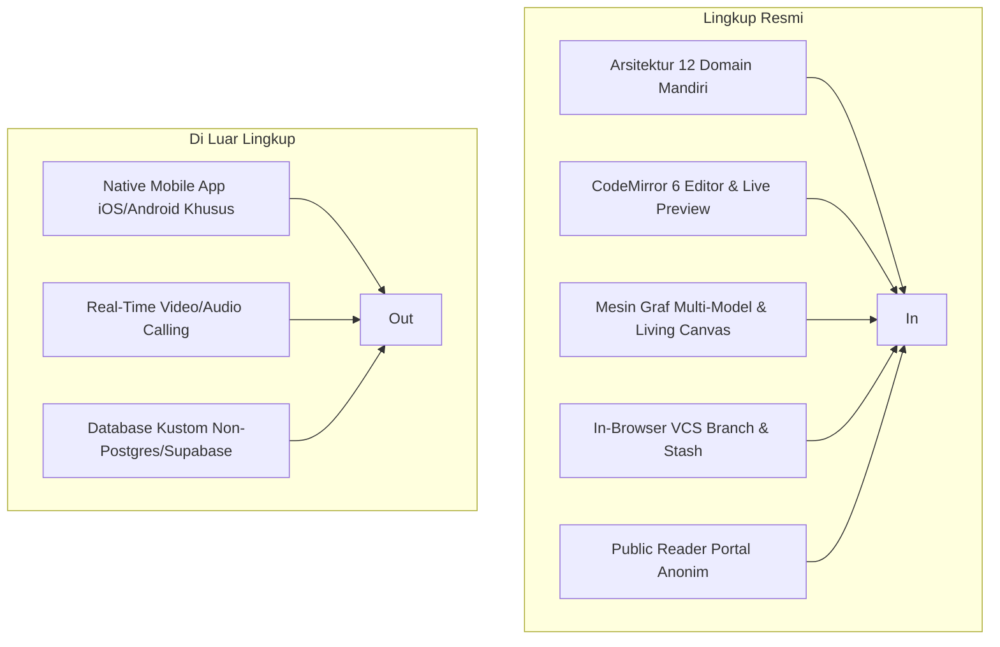

# Statement of Work (SoW) - ObMap Platform

## Ringkasan 3 Baris
- Menegaskan batasan pekerjaan formal, kriteria penyelesaian (*Definition of Done*), dan tanggung jawab tim.
- Mengklasifikasikan pekerjaan yang termasuk dalam lingkup (*In-Scope*) versus yang dikecualikan (*Out-of-Scope*).
- Menjadi kontrak kerja acuan dalam mengukur keberhasilan pengiriman fitur lintas gelombang pengembangan.

---

## 1. Riwayat Revisi Dokumen

| Versi | Tanggal | Penulis | Perubahan Utama |
| :--- | :--- | :--- | :--- |
| 1.0.0 | 2026-11-10 | Principal Architect | Formalisasi deliverable pasca-Wave 3 DDD Restructuring |

---

## 2. Lingkup Pekerjaan (In-Scope vs Out-of-Scope)

### 2.1 Pekerjaan Termasuk (In-Scope)
1. **Refaktorisasi Modular Domain-Driven Design:** Pemisahan tuntas 12 domain di `src/domains/*` dengan pola `<Domain>Orchestrator.tsx`.
2. **Editor CodeMirror 6 Modern:** Penyuntingan Markdown murni dengan autocompletion slash command, wikilinks, tags, dan properties panel.
3. **Mesin Diagram XMind-Grade:** Tata letak deterministik pohon (Mindmap, Org, Brace, Fishbone, Timeline) dan force-directed graph.
4. **Sistem VCS Terpadu di Peramban:** Pelacakan modifikasi baris demi baris, riwayat versi mikro, dan penggabungan cabang lokal.
5. **Portal Publikasi Web Terbuka:** Render dokumen dan graf publik melalui rute `/p/:username/:vaultSlug`.

### 2.2 Pekerjaan Dikecualikan (Out-of-Scope)
1. **Aplikasi Native Biner Tersendiri:** Fokus platform adalah Web / Progressive Web App (PWA) terpasang; tidak ada kompilasi Swift/Kotlin mandiri saat ini.
2. **Editor Tabel WYSIWYG Relasional:** Tidak membangun tiruan penuh database Notion; tabel tetap mematuhi format GFM Markdown standar.
3. **Penyimpanan Berkas Mandiri Tanpa Batas:** Hosting file besar (video > 100MB) dialihkan ke storage eksternal atau konfigurasi mandiri pengguna.

---

## 3. Asumsi Proyek dan Ketergantungan Eksternal

- **Ketergantungan Browser Modern:** Pengguna diasumsikan menggunakan peramban modern yang mendukung ES2022, Web Workers, dan IndexedDB v2+.
- **Infrastruktur Backend:** Layanan sinkronisasi *cloud* bergantung pada ketersediaan API Supabase (PostgreSQL 15+, Auth GoTrue, Storage S3-compatible).
- **Integritas Skema Migrasi:** Seluruh struktur tabel harus dibuat melalui migrasi berurutan di `supabase/migrations/` tanpa modifikasi manual di konsol database.

---

## 4. Kriteria Penyelesaian Resmi (Definition of Done)

1. **Integritas Kode (Clean Build):** Perintah `npm run build` (Vite) dan kompilasi TypeScript `tsc --noEmit` lulus 100% tanpa error.
2. **Kepatuhan Uji Regresi:** Rangkaian pengujian unit di `vitest run` mencapai tingkat kelulusan minimal > 98% (termasuk mock IndexedDB dan D3 solver).
3. **Tidak Ada God Component Baru:** Komponen antarmuka baru tidak boleh melebihi 400 baris kode tanpa dekomposisi modular.
4. **Dokumentasi Selaras Kode:** Setiap penambahan fitur baru wajib memperbarui katalog fitur dan dokumen arsitektur terkait.

---

## Terkait
- [Product Requirements Document (PRD)](prd.md)
- [Spesifikasi Persyaratan Perangkat Lunak (SRS)](srs.md)
- [Roadmap Pengembangan Produk](roadmap.md)