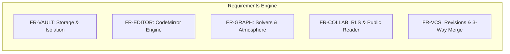

# Software Requirements Specification (SRS) - ObMap

## Ringkasan 3 Baris
- Spesifikasi teknis terperinci yang memuat daftar kebutuhan fungsional (`FR`) dan non-fungsional (`NFR`).
- Setiap kebutuhan ditautkan secara ketat ke domain kode sumber aktual dan status implementasinya.
- Menjadi tolok ukur pengujian otomatis, audit keamanan RLS, dan kepatuhan performa antarmuka.

---

## 1. Riwayat Revisi Dokumen

| Versi | Tanggal | Penulis | Perubahan Utama |
| :--- | :--- | :--- | :--- |
| 1.0.0 | 2026-10-18 | Principal Architect | Spesifikasi dasar arsitektur domain |
| 1.1.0 | 2026-11-10 | Principal Architect | Kodifikasi ID FR/NFR stabil dan batasan konkurensi |

---

## 2. Kebutuhan Fungsional (Functional Requirements)

### 2.1 Domain Vault & Storage (`FR-VAULT`)

| ID Kebutuhan | Deskripsi Kebutuhan | File Sumber Pembuktian | Status |
| :--- | :--- | :--- | :--- |
| `FR-VAULT-001` | Sistem wajib mendukung 3 strategi penyimpanan data: Memory/IndexedDB, Supabase Cloud, dan File System API lokal. | `src/domains/vault/shared/types/` | `[IMPLEMENTED]` |
| `FR-VAULT-002` | Sistem wajib melakukan isolasi total antar-vault lokal dan cloud untuk mencegah kebocoran data multi-tenant. | `src/domains/vault/shared/stores/useVaultStore.ts` | `[IMPLEMENTED]` |
| `FR-VAULT-003` | Sistem wajib menyediakan mekanisme impor akumulatif dengan resolusi konflik: overwrite, merge, skip, dan rename. | `src/domains/vault/shared/services/ImportExportService.ts` | `[IMPLEMENTED]` |
| `FR-VAULT-004` | Sistem wajib membersihkan token dan session cache lokal saat pengguna logout demi kepatuhan keamanan. | `src/domains/auth/shared/hooks/useAuth.tsx` | `[IMPLEMENTED]` |

### 2.2 Domain Editor Markdown (`FR-EDITOR`)

| ID Kebutuhan | Deskripsi Kebutuhan | File Sumber Pembuktian | Status |
| :--- | :--- | :--- | :--- |
| `FR-EDIT-001` | Editor wajib menggunakan CodeMirror 6 dengan syntax highlighting Markdown, wikilink `[[]]`, dan tag `#`. | `src/domains/editor/shared/cm/` | `[IMPLEMENTED]` |
| `FR-EDIT-002` | Properti YAML Frontmatter wajib disunting melalui panel collapsible terpisah tanpa mengotori kanvas teks utama. | `src/domains/editor/components/PropertiesPanel.tsx` | `[IMPLEMENTED]` |
| `FR-EDIT-003` | Sistem wajib mendukung pelipatan heading (*heading folding*) dan floating Table of Contents interaktif. | `src/domains/editor/headings/` | `[IMPLEMENTED]` |

### 2.3 Domain Graph & Visualisasi (`FR-GRAPH`)

| ID Kebutuhan | Deskripsi Kebutuhan | File Sumber Pembuktian | Status |
| :--- | :--- | :--- | :--- |
| `FR-GRAPH-001` | Graf wajib mendukung mode tata letak multi-model: Free-force, Mindmap, Org Chart, Brace Map, Fishbone, Timeline. | `src/domains/graph/shared/layout/` | `[IMPLEMENTED]` |
| `FR-GRAPH-002` | Kanvas wajib mendukung efek partikel atmosfer (*star dust*) dan animasi aliran partikel relasi (*link flow*). | `src/domains/graph/shared/atmosphereConfig.ts` | `[IMPLEMENTED]` |
| `FR-GRAPH-003` | Toolbar floating kontekstual wajib tertrigger oleh klik kanan atau ketukan dua jari (touchpad/layar). | `src/domains/graph/components/ContextualToolbar.tsx` | `[IMPLEMENTED]` |
| `FR-GRAPH-004` | Sistem wajib mengisolasi state interaksi graf per *leaf* workspace untuk mencegah putaran render tak terhingga. | `src/domains/graph/shared/stores/useGraphInteractionStore.ts` | `[IMPLEMENTED]` |
| `FR-GRAPH-005` | Tata letak wajib mencegah tumpang tindih simpul secara otomatis menggunakan kalkulasi kotak pembatas dinamis. | `src/domains/graph/shared/layout/treeLayouts.ts` | `[PARTIAL]` |

### 2.4 Domain Kolaborasi, VCS, & Publikasi (`FR-COLLAB` / `FR-VCS`)

| ID Kebutuhan | Deskripsi Kebutuhan | File Sumber Pembuktian | Status |
| :--- | :--- | :--- | :--- |
| `FR-VCS-001` | Sistem wajib menyediakan kontrol versi internal di peramban: commit mikro, pembuatan cabang, stashing, dan penggabungan 3-arah. | `src/domains/vcs/` | `[IMPLEMENTED]` |
| `FR-COLLAB-001`| Sistem wajib menyediakan rute pembaca publik anonim `/p/:username/:vaultSlug/:noteSlug` dengan performa rendering instan. | `src/domains/public-reader/components/PublicReaderView.tsx` | `[IMPLEMENTED]` |
| `FR-COLLAB-002`| Akses database cloud wajib dilindungi RLS berjenjang (vault level, folder level, note level). | `supabase/migrations/20261031000000_v4_collaboration_and_publishing.sql` | `[IMPLEMENTED]` |
| `FR-COLLAB-003`| Sistem wajib mendukung kolaborasi konkuren real-time berbasis CRDT/Yjs dengan penanda kursor multi-pengguna. | `src/domains/collaboration/` | `[PLANNED]` |

---

## 3. Kebutuhan Non-Fungsional (Non-Functional Requirements)

| ID NFR | Kategori | Kriteria Pengujian / Standar | Status |
| :--- | :--- | :--- | :--- |
| `NFR-001` | **Performa Graf** | Animasi kanvas mempertahankan minimal 55-60 FPS pada 1.000 simpul graf aktif. | `[IMPLEMENTED]` |
| `NFR-002` | **Latensi Parser** | Pengindeksan penyebutan tautan (*backlinks*) selesai dalam < 100ms menggunakan Aho-Corasick Web Worker. | `[IMPLEMENTED]` |
| `NFR-003` | **Isolasi Memori** | Pergantian tab graf melepaskan store instans sebelumnya tanpa kebocoran memori (*detached DOM/Store*). | `[IMPLEMENTED]` |
| `NFR-004` | **Integritas RLS** | Pengguna non-autentikasi tidak dapat membaca tabel privat vault atau metadata pengguna lain di Supabase. | `[IMPLEMENTED]` |
| `NFR-005` | **Aksesibilitas** | Navigasi dokumen mendukung pembaca layar dasar dan kontras warna memenuhi standar WCAG AA (Deep Black Theme). | `[PARTIAL]` |

---

## Terkait
- [Product Requirements Document (PRD)](prd.md)
- [Aturan Repositori Rekayasa](../05-engineering/repository-rules.md)
- [Peta Domain Arsitektur](../03-architecture/domain-map.md)