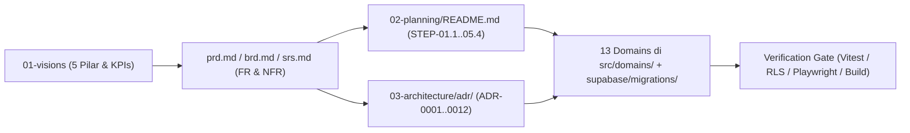

# Matriks Keterlacakan End-to-End (`Traceability Matrix`) ObMap v2.0

## Ringkasan 3 Baris
- Menghubungkan secara deterministik setiap sasaran visi dan pilar produk hingga kebutuhan fungsional/non-fungsional (`FR`/`NFR`), keputusan arsitektur (`ADR`), epik (`EPIC`), langkah eksekusi (`STEP`), domain kode, serta gerbang verifikasi.
- Memastikan tidak ada fitur yatim (*orphan requirement*) maupun perubahan kode yang keluar dari spesifikasi yang disetujui.
- Dirancang sebagai rujukan audit kesiapan rilis pada Stage 1, Stage 2, dan Stage 3.

---

## 1. Peta Hubungan Strategis ke Implementasi

---

## 2. Tabel Keterlacakan Lengkap

| Pilar / Sasaran | PRD / SRS / NFR | Epik & Step | ADR Terkait | Domain & Target Implementasi | Verification Gate |
| :--- | :--- | :--- | :--- | :--- | :--- |
| Fondasi Kode & Type Safety | `FR-SYS-001`, `NFR-005`, `NFR-006` | `EPIC-01` / `STEP-01.1` | `ADR-0001`, `ADR-0006` | `global`, hapus `src/global/api/untypedSupabase.ts` | `tsc --noEmit`, `npx vitest run`, `npm run build` |
| Pilar 1 & 2 (`/:username` Kanonik) | `FR-COMM-001`, `NFR-002` | `EPIC-01` / `STEP-01.2` | `ADR-0007` | `public-reader` → `src/domains/community/`, `App.tsx`, `ProfileService.ts`, `RESERVED_SLUGS` | Uji collision `RESERVED_SLUGS`, rute `/p/*` mati (*hard cutover*) |
| Tata Kelola Rilis & Traffic Stage 1–2 | `FR-STAGE-001`–`003` | `EPIC-02` / `STEP-01.3` | `ADR-0009` | `auth`, `admin`, migrasi `platform_settings`, `partner_invitations`, `account_status` | Uji gating Stage 1 & antrean approval individual `/admin` |
| Keamanan Data & Kolaborasi Dasar | `FR-AUTH-010`, `FR-VAULT-010`, `NFR-003` | `EPIC-02` / `STEP-01.4` | `ADR-0009`, `ADR-0010` | `auth`, `vault`, `collaboration`, `PolicyEngine`, `can_access_resource()`, `CC BY-SA 4.0` | Uji RLS 4 state visibilitas & `visibility: private` |
| Kustomisasi Berlapis & Konsistensi Visual | `FR-SET-001`, `FR-SET-002` | `EPIC-03` / `STEP-01.5` | `ADR-0011`, `ADR-0006` | `settings` (`configRegistry`, `LocalConfigStore`, `useThemeStore`), `graph` (`theme.ts`) | Uji prioritas 6-lapis & *Canvas Frame Invalidation* |
| Pilar 3 (Home Hub & Derived Views) | `FR-DASH-001`, `FR-DASH-002` | `EPIC-04` / `STEP-02.1` | `ADR-0008` | Domain ke-13 `src/domains/dashboard/` (`/vaults`), redirect `Landing.tsx` | Uji render 5 view derivatif dari YAML `.md` |
| Akuisisi Cepat (`TTFV < 90s`) | `FR-GROWTH-001`, `FR-GROWTH-002`, `NFR-002` | `EPIC-05`–`06` / `STEP-02.2`–`02.3` | `ADR-0004` | `Landing.tsx`, `InMemoryVaultDriver`, `auth`, `workspace` | Chunk sandbox `< 65KB`, E2E migrasi karya Sandbox |
| Pilar 2 & 1 (Profil Publik & Kurasi) | `FR-COMM-002`–`004` | `EPIC-07` / `STEP-03.1` | `ADR-0007` | `community`, `admin` (kurasi *Verified Scholar*), `/explore` | Uji OG tags dinamis & kurasi manual Admin |
| Pilar 5 (Sitasi & Epistemic Graph) | `FR-COMM-005` | `EPIC-08` / `STEP-03.2` | `ADR-0010` | `metadata` (`mentions.worker.ts`), `editor`, `community` | Uji parser `[[@user/vault/note]]` `< 100ms` |
| Pilar 5 (Fork, Merge Request & Anotasi) | `FR-COMM-006` | `EPIC-09` / `STEP-03.3` | `ADR-0005`, `ADR-0010` | `vcs` (`vcsDiffEngine.ts`), `community`, SQL `vault_forks` | Uji E2E Fork → Edit → MR → Merge lintas user |
| Monetisasi Berkelanjutan (Stage 3 GA) | `FR-BILL-001`–`003`, `FR-ADM-010`, `NFR-008` | `EPIC-10`–`11` / `STEP-04.1`–`04.2` | `ADR-0009` | `admin` (harga & kuota dinamis DB), Supabase Edge Functions (**Xendit/Midtrans first** → Stripe), `org_teamspaces` | Uji webhook idempoten, kuota dinamis & *Non-Destructive Downgrade* |
| Kolaborasi Sinkron Real-Time | `FR-COLLAB-003` | `EPIC-12` / `STEP-04.3` | `ADR-0004`, `ADR-0005` | `collaboration`, `sync`, `vcs` | Uji rekonsiliasi offline → online CRDT Yjs |
| Pilar 4 (Interactive Graph LMS) | `FR-LMS-001` | `EPIC-13` / `STEP-05.1` | `ADR-0003` | `graph`, `metadata`, `community`, `docs/06-lms/` | Uji deteksi siklus DAG & state mastery |
| Pilar 3 (Solver Lanjut & Pitch/Export) | `FR-GRAPH-010`, `FR-GRAPH-011`, `NFR-001` | `EPIC-14` / `STEP-05.2` | `ADR-0003` | `graph/shared/utils/layoutCategory.ts`, modul ekspor | Determinisme `argument-map`/`citation-tree` & `60 FPS` |
| Ekosistem Pengembang Eksternal | `FR-EXT-001` | `EPIC-15` / `STEP-05.3` | `ADR-0012` | `settings/shared/api/pluginRegistry.ts`, `docs/07-developers/` | Uji sandbox permission manifest & `rehype-sanitize` |
| Hardening GA (A11y, i18n, Security) | `NFR-003`, `NFR-004`, `NFR-007`, `NFR-008` | `STEP-05.4` | Seluruh ADR | Seluruh 13 domain | Vitest + Playwright E2E + RLS Audit + WCAG 2.2 AA |

---

## Terkait
- [Playbook Eksekusi Step-by-Step (`README.md`)](README.md)
- [Product Requirements Document (`prd.md`)](prd.md)
- [System Requirements Specification (`srs.md`)](srs.md)
- [Indeks ADR (`../03-architecture/adr/README.md`)](../03-architecture/adr/README.md)
