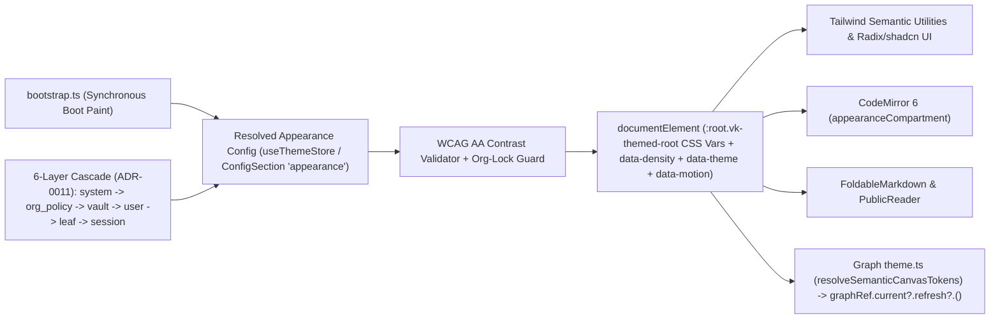
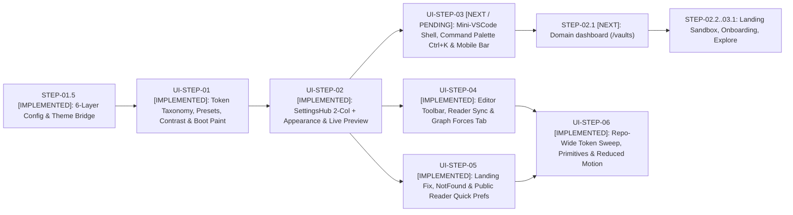

# Master Plan Audit UI/UX, Standar Desain Frontend & Universal Dynamic Settings Engine ObMap v2.0 (`DOC-PLAN-008`)

## Ringkasan 3 Baris
- Menyajikan hasil audit menyeluruh UI/UX & konsistensi token across `251` berkas `.tsx` di `12` domain aktif dan seluruh rute `src/App.tsx`, dinilai menggunakan lensa filosofi **"Mini-VSCode Desktop-First, Navigation-First, Simplicity is Key"** (dengan penolakan tegas terhadap kompromi *Obsidian Mobile* yang mengebiri kekuatan desktop).
- Merancang evolusi penuh dari fondasi `STEP-01.5` (`ADR-0011`, `useThemeStore.ts`) menjadi **Universal Dynamic Frontend Engine** yang mengatur tema, preset palet, warna semantik, tipografi UI/Prose/Mono, skala ukuran teks, densitas spasial, radius, dan motion secara runtime lintas DOM, CodeMirror 6, Markdown Reader, dan Canvas2D (`graphRef.current?.refresh?.()`).
- Menetapkan **ObMap UI Constitution (Standar Desain Frontend Lintas Aplikasi)** dan memecah implementasinya ke dalam **6 langkah atomik (`UI-STEP-01` s/d `UI-STEP-06`)** yang terintegrasi dengan antrean `STEP-02.1` s/d `STEP-05.4` di [Playbook Eksekusi (`README.md`)](README.md).

---

## 1. Executive Summary, Filosofi Desain & Audit Scorecard

### 1.1 Baseline Kuantitatif Codebase Aktual
Pengukuran statis pada `src/` (`251` berkas `.tsx` non-test) mengungkap kesenjangan sistem desain yang nyata di balik fondasi arsitektur domain yang sudah rapi:

| Indikator Audit | Nilai Terukur di `src/` | Dampak pada UI/UX & Dinamika Frontend |
| :--- | :---: | :--- |
| Total berkas komponen `.tsx` | `251` berkas | Tersebar di 12 domain, `src/pages/`, `src/global/ui/`, `src/app/preloader/` |
| Ukuran teks arbitrer (`text-[9px]`/`10px`/`11px`) | `343` kemunculan | Mengabaikan skala tipografi & tidak ikut membesar saat *UI Scale* diubah (`graph`: 81, `collaboration`: 38, `vcs`: 37, `vault`: 35, `admin`: 34, `editor`: 27, `settings`: 26, `community`: 22) |
| Warna palet Tailwind mentah (`bg-emerald-*`, `text-amber-*`, `text-rose-*`, dll.) | `292` kemunculan | Merusak adaptasi Light/Sepia/High-Contrast mode (`vault`: 59, `graph`: 45, `collaboration`: 40, `vcs`: 35, `preloader`: 25, `admin`: 23, `workspace`: 18, `settings`: 15) |
| Variasi mode tema di `src/index.css` | `1` `:root` gelap saja | Belum ada Light mode, Sepia, OLED, atau High Contrast; utilitas `dark:` hanya dipakai `12` kali |
| Kelas `motion-reduce` / `prefers-reduced-motion` | `0` kemunculan | Belum ada dukungan aksesibilitas pengurangan gerak |
| `aria-label` vs `title=` vs `<Tooltip>` | `66` / `118` / `27` | Banyak tombol ikon memakai atribut native `title=` (lambat muncul, tidak mendukung keyboard/shortcut badge) atau tanpa label aksesibilitas |
| Referensi font eksternal di `index.html` | `0` stylesheet font | `index.html:48-49` hanya memasang `preconnect` ke Google Fonts, sementara `src/index.css:89-94` meng-hardcode `"Inter"` tanpa memuat aset font-nya |

### 1.2 Lensa Penilaian Filosofi Desain ("Mini-VSCode Desktop-First")
Seluruh evaluasi UI/UX dalam dokumen ini menggunakan tiga pilar filosofi desain pemilik produk sebagai parameter utama:

1. **Navigation-First & Calm Simplicity:** Pengguna harus selalu langsung mengetahui konteks posisi, jalur kembali, dan aksi utama tanpa *visual clutter*. Prinsip *progressive disclosure* memastikan hanya kontrol esensial yang tampil di permukaan; kontrol lanjutan dibuka saat dibutuhkan.
2. **"Mini-VSCode" Desktop-First Workbench:** Produktivitas pemetaan pengetahuan (*knowledge mapping*) dan penulisan Markdown memerlukan ergonomi *workbench* desktop yang kuat: *Activity Icon Ribbon*, *Resizable Collapsible Sidebar*, *Drag-and-Drop Multi-Tab & Split Panes*, *Command Palette + Quick Switcher*, *Status Bar* yang hidup, dan navigasi *keyboard-first* — namun tetap terasa **ringan, modern, bersih, dan jauh lebih sederhana daripada VSCode penuh**.
3. **Anti-"Obsidian Mobile" Constraint:** Kekuatan, kepadatan informasi yang sehat, presisi kontrol pointer, dan workflow multi-pane di desktop adalah **prioritas P0** yang tidak boleh dilemahkan oleh penyederhanaan ala mobile. Untuk layar sempit (`< 768px`), aplikasi beradaptasi secara anggun (*graceful adaptation*) menjadi **Companion Reader, Quick Navigator & Quick Capture** yang rapi, bukan memaksa seluruh kompleksitas IDE desktop ke layar `375px`.

### 1.3 Master Audit Scorecard (7 Dimensi + Desktop Ergonomics, Skala 1–5)

Legenda dimensi: `Func` (Kejelasan & Kelengkapan Fungsi), `Resp` (Responsivitas & Adaptasi), `Intuit` (Intuitivitas & Kemudahan Pakai), `Simple` (Simplicity & Beban Kognitif), `Craft` (Kerapian Visual & Konsistensi Token), `IA/Nav` (Arsitektur Informasi & Navigasi), `A11y` (WCAG 2.2 AA), `Mini-VSCode` (Ergonomi Workbench Desktop).

| Permukaan / Modul | Lokasi Utama | `Func` | `Resp` | `Intuit` | `Simple` | `Craft` | `IA/Nav` | `A11y` | `Mini-VSCode` | Rata² |
| :--- | :--- | :---: | :---: | :---: | :---: | :---: | :---: | :---: | :---: | :---: |
| **Landing (`/`)** | `src/pages/Landing.tsx` | 3.5 | 3.8 | 3.8 | 4.2 | 3.6 | 3.5 | 3.0 | N/A | **3.6** |
| **Auth (`/auth`)** | `src/domains/auth/components/AuthView.tsx` | 4.0 | 4.2 | 4.0 | 4.5 | 3.8 | 3.8 | 3.5 | N/A | **4.0** |
| **Install & PWA (`/install`)** | `src/pages/Install.tsx`, `SyncPWAInstallPrompt.tsx` | 3.8 | 4.0 | 3.8 | 4.0 | 3.5 | 3.5 | 3.2 | N/A | **3.7** |
| **Explore (`/explore`)** | `src/pages/PublicReader.tsx:196-220` | 1.5 | 4.0 | 2.5 | 4.0 | 3.0 | 2.0 | 3.0 | N/A | **2.9** |
| **Public Reader (`/:username/*`)** | `src/pages/PublicReader.tsx`, `src/domains/community/*` | 3.8 | 4.0 | 3.8 | 4.0 | 3.7 | 3.8 | 3.2 | 3.5 | **3.7** |
| **NotFound (`*`)** | `src/pages/NotFound.tsx` | 2.5 | 4.0 | 2.5 | 4.0 | 2.0 | 2.0 | 3.0 | N/A | **2.9** |
| **Preloader Screen** | `src/app/preloader/AppPreloaderScreen.tsx` | 4.0 | 4.2 | 3.8 | 3.5 | 4.0 | 3.5 | 3.0 | 3.2 | **3.7** |
| **Dashboard Route (`/vaults`)** | `src/App.tsx:130-137`, `src/pages/Index.tsx` | 1.5 | 3.0 | 2.0 | 3.0 | 3.0 | 1.5 | 3.0 | 2.0 | **2.4** |
| **Activity Icon Ribbon** | `WorkspaceIconRibbon.tsx`, `WorkspaceRibbon.tsx` | 2.8 | 2.2 | 2.5 | 4.2 | 3.5 | 2.8 | 2.5 | 3.0 | **2.9** |
| **Sidebar & File Explorer** | `WorkspaceSidebarPanel.tsx`, `WorkspaceFileExplorerTree.tsx` | 4.0 | 3.5 | 3.8 | 3.8 | 3.6 | 3.8 | 3.0 | 4.0 | **3.7** |
| **Tab Strip, Splits & Empty Leaf** | `WorkspaceGroup.tsx`, `WorkspaceTree.tsx`, `WorkspaceEmptyLeaf.tsx` | 4.0 | 3.4 | 3.6 | 4.0 | 3.8 | 3.8 | 3.0 | 4.2 | **3.7** |
| **Status Bar** | `WorkspaceStatusBar.tsx` | 3.0 | 3.5 | 3.0 | 4.2 | 3.5 | 2.5 | 3.0 | 2.8 | **3.2** |
| **Command Palette** | `SettingsCommandPalette.tsx`, `CommandRegistry.ts` | 3.2 | 4.0 | 3.0 | 4.2 | 3.8 | 3.0 | 3.8 | 3.2 | **3.5** |
| **Markdown Editor & Node Header** | `GraphNodePanel.tsx`, `EditorMarkdownView.tsx`, `cmTheme.ts` | 3.6 | 3.8 | 3.7 | 3.8 | 3.8 | 3.7 | 3.2 | 3.8 | **3.7** |
| **Graph Canvas & Floating HUD** | `GraphOrchestrator.tsx`, `GraphWorkspaceControls.tsx`, `GraphConfigPanel.tsx` | 3.5 | 3.5 | 3.2 | 2.8 | 3.7 | 3.4 | 3.0 | 3.8 | **3.4** |
| **Collab, VCS & Sync Panels** | `CollabDocumentSharePopover.tsx`, `VcsSidebarPanel.tsx`, `SettingsSyncPanel.tsx` | 4.0 | 3.5 | 3.6 | 3.4 | 3.3 | 3.5 | 3.0 | 3.6 | **3.5** |
| **SettingsHub & Configuration** | `SettingsHub.tsx`, `settingsNavigation.ts`, `SettingsConfigurationSection.tsx` | 2.8 | 3.6 | 2.8 | 3.8 | 3.5 | 2.5 | 3.2 | 3.0 | **3.2** |
| **Superadmin Cockpit (`/admin`)** | `src/pages/Admin.tsx`, `src/domains/admin/*` | 4.2 | 3.4 | 4.0 | 3.8 | 3.6 | 3.8 | 3.0 | 3.8 | **3.7** |

### 1.4 Top 10 Critical UI/UX & Design System Bottlenecks

| ID | Prioritas | Masalah & Bukti Nyata (`file:line`) | Dampak ke Pengguna |
| :--- | :---: | :--- | :--- |
| **B-01** | `P0` | **Tidak ada UI Appearance/Theme/Typography/Density di Settings:** `useThemeStore.ts` & seksi `"theme"` di `registerConfigSections.ts:75-87` sudah ada di state, tetapi `SETTINGS_SECTIONS` (`settingsNavigation.ts:38-88`) dan `SettingsHub.tsx:55-63` tidak menyediakan panel Appearance sama sekali. | Pengguna sama sekali tidak bisa mengganti tema, warna, font UI, skala ukuran, atau densitas dari antarmuka. |
| **B-02** | `P0` | **Navigasi `SettingsHub` terputus (Stranded Tab):** `SettingsHub.tsx:33-68` tidak memiliki navigasi internal; ia bergantung penuh pada `WorkspaceSettingsNavList.tsx` di sidebar kiri (`WorkspaceSidebarPanel.tsx:216`). Jika sidebar beralih ke `files` atau ditutup, pengguna terjebak di 1 halaman settings. | Melanggar prinsip *Navigation-First*; berpindah antar-bagian Settings terasa tersembunyi dan mudah tersesat. |
| **B-03** | `P0` | **Kontrol UI Mati (*Dead Controls*) di Graph & Editor:** (1) `GraphConfigPanel.tsx:60` mendaftarkan tab `'forces'` (`Forces`), namun di `lines 158-183` tidak ada `<TabsContent value="forces">`; (2) `EditorSettingsTabs.tsx:244-258` punya sakelar *Formatting toolbar* & 4 grupnya, tetapi `EditorMarkdownView.tsx:23-98` tidak pernah merender bilah alat format tersebut; (3) `SettingsGraphEngineSection.tsx` ada di repo, namun belum terdaftar di `SETTINGS_SECTIONS`. | Pengguna mengklik tab `Forces` dan mendapat panel kosong, atau menyalakan toolbar editor namun tidak muncul apa-apa. |
| **B-04** | `P0` | **Ikon Duplikat di Ribbon & Penguncian Mobile:** `WorkspaceIconRibbon.tsx:66` (`Version Control`) & `:98` (`Open Mindmap View`) memakai ikon identik `<GitBranch />`; `<Tooltip>` diimpor di baris `3` tetapi **tidak pernah dipakai**. Pada `< 768px`, `WorkspaceRibbon.tsx:125` menyembunyikan ribbon (`hidden md:flex`) sementara `WorkspaceGroup.tsx:84-97` hanya membuka `files` — mengunci akses VCS, Settings, Graph, dan Mindmap di tablet/mobile. | Pengguna desktop bingung membedakan ikon VCS vs Mindmap tanpa tooltip; pengguna mobile tidak bisa membuka Graph/Settings. |
| **B-05** | `P1` | **Bridge Token `--vk-*` Tidak Lengkap & Tipografi Terpecah:** `theme-authoring-guide.md:38-42` menjanjikan `--vk-bg-surface`, `--vk-bg-elevated`, `--vk-border-subtle`, `--vk-text-muted`, `--vk-font-sans`, `--vk-font-mono`, `--vk-radius-md`, namun `useThemeStore.ts:140-148` baru mengisi 7 variabel. `useEditorSettingsStore.ts` hanya mengatur CodeMirror 6 dan tidak menyentuh mode Reading (`FoldableMarkdown`) maupun `PublicReader`. | Mengganti pengaturan tema/font hanya berefek parsial dan tidak bersifat universal lintas aplikasi. |
| **B-06** | `P1` | **Command Palette Terbatas (`Ctrl/Cmd+P` Saja):** `SettingsCommandPalette.tsx:39` belum mendukung `Ctrl/Cmd+K`, tidak memiliki pemicu visual yang mudah dilihat di header/ribbon/status bar, dan belum memiliki **Quick File/Note Switcher** maupun **Quick Theme/Layout Switcher**. | Ergonomi "Mini-VSCode" tertahan karena pengguna harus mengklik tree explorer secara manual untuk berpindah catatan cepat. |
| **B-07** | `P1` | **Friksi Rute `/vaults` & Re-Trigger Preloader:** `/vaults` (`src/App.tsx:130-137`) merender `<Index />` identik dengan `/app`, sementara `Landing.tsx:30` & `AuthView.tsx:22` masih mengarahkan ke `/app` (belum `/vaults` per `STEP-02.1`). Selain itu, `WorkspaceOrchestrator.tsx:66` menyimpan `isPreloaded` di `useState(false)` lokal, memicu `AppPreloaderScreen` berulang setiap pindah rute ke `/admin` lalu kembali. | Perpindahan antar rute terasa berat/berkedip ulang dan `/vaults` belum berfungsi sebagai hub vault. |
| **B-08** | `P1` | **Bypass Token Massal (`343` `text-[Npx]` & `292` Palet Mentah):** Banyak komponen memakai `text-[10px]`/`text-[11px]` dan kelas warna mentah (`bg-emerald-500/10`, `text-amber-600`, `text-rose-500`). | Tidak responsif terhadap *Global UI Scale* dan akan kontras buruk saat Light/Sepia theme diaktifkan. |
| **B-09** | `P2` | **Fragmentasi Kontrol Graph:** Pengaturan graf terpecah antara `GraphWorkspaceControls.tsx` (HUD melayang / toolbar horizontal), `GraphConfigPanel.tsx` (Sheet), dan `SettingsGraphEngineSection.tsx` dengan kontrol berulang dan kepadatan tinggi tanpa pemisahan Basic vs Advanced. | Beban kognitif tinggi saat pengguna baru hanya ingin mengganti tata letak atau memfilter node. |
| **B-10** | `P2` | **Inkonsistensi Branding, Bahasa Campuran & Grid Kosong:** `index.html:8` masih bertuliskan `VaultGraph - Knowledge Network Manager`; `GraphNodePanelHeader.tsx:97-158` mencampur label Inggris (`Narrow`, `Full Width`, `Reading`) dan Indonesia (`Tampilan & Format`, `Simpan Perubahan`); `Landing.tsx:225` memakai `md:grid-cols-3` untuk 2 kartu `storageOptions`. | Menurunkan kesan profesionalisme dan konsistensi produk ObMap. |

---

## 2. Detailed UI/UX Audit & Enhancement Matrix

### 2.1 Grup A — Permukaan Publik, Pertumbuhan & Entry (`src/pages/`, `auth/`, `community/`)

| Permukaan & Lokasi | Fungsi Saat Ini | Masalah Teridentifikasi | Usulan Layout & Interaksi Baru |
| :--- | :--- | :--- | :--- |
| **Landing** (`src/pages/Landing.tsx`) | Halaman pemasaran, fitur grid, opsi storage, PWA CTA, redirect user login ke `/app`. | **1)** `storageOptions` (`lines 73-87`) berisi 2 item, tetapi container memakai `md:grid-cols-3` (`line 225`) sehingga 1 kolom kanan kosong. **2)** `useEffect` (`lines 28-32`) redirect ke `/app` alih-alih `/vaults`. **3)** Belum ada navigasi link ke `/explore` atau demo interaktif (`STEP-02.2`). | Ubah grid opsi storage menjadi `md:grid-cols-2 max-w-3xl`, perbaiki header nav agar punya tautan langsung ke `/explore` + quick theme preview toggle, dan arahkan redirect pasca-login ke `/vaults` pada `STEP-02.1`. |
| **Auth** (`src/pages/Auth.tsx`, `AuthView.tsx`) | Login, register, reset & update password (`max-w-md`). | Masih redirect ke `/app` (`Auth.tsx:22,46`). Belum ada tombol kembali ke beranda `/` di header card. | Tambah breadcrumb/back-link ke `/` yang jelas di atas card auth serta integrasi wait-state onboarding (`STEP-02.3`) & redirect `/vaults`. |
| **Preloader** (`AppPreloaderScreen.tsx`, `WorkspaceOrchestrator.tsx:66`) | Memanaskan modul dan menampilkan metrik diagnostik kecepatan & ukuran modul. | Flag `isPreloaded` lokal per mount menyebabkan animasi preloader + jeda `350ms` (`line 68`) berjalan ulang setiap kembali dari `/admin` atau `/:username`. | Promosikan status `modulesPreloaded` ke singleton/session store (`modulePreloader.ts`), dan hormati `--vk-motion-scale` / `prefers-reduced-motion`. |
| **Explore** (`PublicReader.tsx:196-220`) | Halaman pengantar statis untuk mengarahkan pengguna ke `/@username`. | Tidak ada input pencarian handle/topik atau daftar vault kurasi (`STEP-03.1`), sehingga terkesan buntu (*dead-end*). | Di `STEP-03.1`, ubah menjadi direktori kurasi dengan search bar instan, filter topik, dan kartu profil *Verified Scholar* memakai token `--vk-*`. |
| **Public Reader** (`PublicReader.tsx`, `domains/community/*`) | Membaca vault/catatan publik & graf interaktif di `/:username/:vaultSlug/:noteSlug`. | Header `h-14` sudah rapi dengan drawer mobile (`line 251`), namun `PublicReaderMarkdownReader.tsx` belum membaca token tipografi/reading width universal (`--vk-prose-*`) dan tema Light/Sepia. | Suntikkan kontrol *Reader Quick Preferences* (Theme Daylight/Sepia/Dark, Font Serif/Sans, Text Size) di header reader yang terhubung ke token `--vk-*`. |
| **NotFound** (`src/pages/NotFound.tsx`) | Halaman error 404 generik. | Memakai `<a href="/">` (`line 16`, full page reload), latar `bg-muted` berbeda dengan halaman lain, teks bahasa Inggris statis tanpa tombol "Buka Workspace" / "Jelajahi". | Gunakan `<Link>` React Router, desain calm selaras token `--vk-*`, tombol ganda (`Beranda` & `Kembali`), dan bantuan rute `/:username`. |

### 2.2 Grup B — Core "Mini-VSCode" Workbench (`/app`, `workspace/`, `editor/`, `graph/`, `metadata/`, `vcs/`, `collaboration/`)

| Zona Workbench & Lokasi | Fungsi Saat Ini | Masalah Teridentifikasi | Usulan Layout & Interaksi Baru |
| :--- | :--- | :--- | :--- |
| **Activity Icon Ribbon** (`WorkspaceIconRibbon.tsx`, `WorkspaceRibbon.tsx`) | Bilah ikon vertikal kiri (`w-9`) untuk `Files`, `VCS`, `Graph`, `Mindmap`, `Settings`. | **1)** `VCS` (`:66`) dan `Mindmap` (`:98`) memakai ikon sama (`GitBranch`). **2)** `<Tooltip>` tidak dipasang sehingga fungsi & shortcut tidak terlihat. **3)** Tersembunyi di `< 768px` (`WorkspaceRibbon.tsx:125`) tanpa pengganti untuk VCS/Graph/Settings. **4)** Tidak ada tombol Command Palette / Search & tautan cepat ke `/vaults` Dashboard. | Gunakan ikon unik (`GitCommitHorizontal`/`History` untuk VCS, `BrainCircuit`/`Waypoints` untuk Mindmap); bungkus tiap tombol dengan `<Tooltip>` berisi label + shortcut badge (`Ctrl+Shift+E`, `Ctrl+Shift+G`, `Ctrl+K`); tambah tombol **Dashboard (`/vaults`)** di atas & **Command Palette** di bawah; sediakan `WorkspaceMobileBottomBar.tsx` di `< md` dengan 5 aksi utama (*Files, Graph, Search/Cmd, VCS, Settings*). |
| **Sidebar & File Explorer** (`WorkspaceSidebarPanel.tsx`, `WorkspaceFileExplorerTree.tsx`) | Panel kiri resizable dengan toolbar *Add Folder/File, Upload, Sort, Collapse* + Vault Footer. | **1)** `SidebarPanel.tsx:70` membaca `window.innerWidth < 768` langsung di render (tidak reaktif ke resize tanpa re-render). **2)** Tidak ada kotak *Filter/Search files* cepat di atas tree explorer. **3)** `SidebarPanel.tsx:120-130` memakai warna ikon hardcoded (`text-emerald-500`, `text-purple-500`, `text-rose-500`). | Ganti cek lebar dengan `useIsMobile()`, tambah *inline quick filter* opsional (`Ctrl+F` di explorer), dan petakan lebar default + kerapatan baris tree ke `--vk-row-h-sm` & token semantik. |
| **Tab Strip, Split Panes & Empty Leaf** (`WorkspaceGroup.tsx`, `WorkspaceTree.tsx`, `WorkspaceEmptyLeaf.tsx`) | Multi-tab drag-and-drop, pin tab, edge-drop split horizontal/vertikal, konteks menu, serta Empty Leaf. | **1)** `WorkspaceGroup.tsx:81` membalik urutan tab strip ke bawah pada `< lg` (`order-2 lg:order-1`), namun tombol tutup `X` tab (`:154`) memakai `opacity-0 group-hover:opacity-100` sehingga di perangkat sentuh/tablet tombol tutup tab tersembunyi. **2)** Empty Leaf (`WorkspaceEmptyLeaf.tsx:20-30`) hanya punya 2 tombol tanpa shortcut hint (`Ctrl+P` / `Ctrl+N`) atau daftar *Recent Notes*. | Tampilkan tombol close `X` pada tab aktif secara permanen (`leaf.id === activeLeaf?.id && "opacity-100"`), perkaya `WorkspaceEmptyLeaf.tsx` dengan *Recent Notes* + daftar *Keyboard Shortcuts* ringkas ala VSCode Empty Editor Group. |
| **Status Bar** (`WorkspaceStatusBar.tsx`) | Menampilkan notifikasi dinamis/Time-Lapse, jumlah kata, status simpan, dan Online/Offline. | Masih pasif (non-interaktif); belum menampilkan **Nama Vault aktif**, **posisi/mode editor** (`Live` vs `Reading`), **Quick Theme/Density Toggle**, atau pemicu **Command Palette**. | Jadikan Status Bar interaktif (`h-[var(--vk-statusbar-h)]`): Kiri = Vault Pill (klik → `/vaults` atau switcher) + Notifikasi/Time-Lapse; Kanan = Word Count + Mode Toggle (`Live`/`Reading`) + Save/Sync Status + Quick Appearance Popover (Theme & Scale) + Online/Offline badge. |
| **Command Palette** (`SettingsCommandPalette.tsx`, `CommandRegistry.ts`) | Dialog `Ctrl/Cmd+P` menjalankan command terdaftar (`format`, `editor`, `graph`). | **1)** Belum mendengarkan `Ctrl/Cmd+K`. **2)** Tidak mengindeks daftar **Notes/Folders** aktif untuk *Quick Open* (inti navigasi Mini-VSCode). **3)** Tidak ada command cepat untuk ganti Theme Preset atau UI Density. | Dukung `Ctrl/Cmd+K` dan `Ctrl/Cmd+P`; tambahkan mode/section **"Switch Note / Jump to File"** dari `useNodeStore`, **"Switch Theme Preset"**, dan **"Switch View / Split Pane"** langsung di `CommandPalette`. |
| **Editor, Header & Properties** (`GraphNodePanel.tsx`, `GraphNodePanelHeader.tsx`, `EditorMarkdownView.tsx`, `EditorSettingsTabs.tsx`) | Breadcrumb, Share popover, Menu aksi, YAML Properties collapsible, CM6 Live Preview, Folding Reading mode. | **1)** *Dead feature:* `EditorSettingsTabs.tsx:244-258` punya opsi `Formatting toolbar`, tapi tidak dirender di `EditorMarkdownView.tsx`. **2)** Bahasa campur di `GraphNodePanelHeader.tsx` (`Narrow`/`Full Width` vs `Simpan Perubahan`). **3)** `GraphNodePanel.tsx:97` memakai `text-xl sm:text-2xl md:text-3xl lg:text-[2rem]` statis; `EditorFoldableMarkdown.tsx` tidak ikut skala `--vk-prose-size` & `--vk-font-prose`. | Implementasikan `EditorFormatToolbar.tsx` yang ringan & dikendalikan penuh oleh `useEditorSettingsStore.toolbar`; sinkronkan `cmTheme.ts` + `EditorFoldableMarkdown.tsx` ke token `--vk-prose-*`; seragamkan bahasa UI header panel. |
| **Graph Canvas & Controls** (`GraphWorkspaceControls.tsx`, `GraphConfigPanel.tsx`, `GraphSettingContent.tsx`) | Kontrol mode (Graph/Mindmap), layout deterministik (Mindmap, Org, Timeline, Fishbone), filter, color engine, atmosphere, stats. | **1)** `GraphConfigPanel.tsx:60` mendeklarasikan tab `forces` tanpa isi `<TabsContent value="forces">` (panel kosong saat diklik). **2)** Floating HUD + `GraphConfigPanel` + `SettingsGraphEngineSection` tumpang tindih fungsinya. **3)** Semua 6 panel kontrol tampil rata tanpa pemisahan opsi harian (Layout/Filter/Zoom) vs tuning lanjutan (Physics/Hierarchy/Atmosphere). | Lengkapi `<TabsContent value="forces">` dengan `GraphFreeForceControls` di `GraphConfigPanel.tsx`; kelompokkan kontrol di `GraphWorkspaceControls.tsx` ke mode *Quick Bar* (Mode, Layout, Search, Zoom Fit) + *Inspector Drawer* (Color Engine, Atmosphere, Forces, Stats); pastikan seluruh palet kanvas membaca `resolveSemanticCanvasTokens()` yang diperluas. |
| **Collaboration, VCS & Sync** (`CollabDocumentSharePopover.tsx`, `VcsSidebarPanel.tsx`, `VcsDocumentHistoryModal.tsx`) | Popover bagikan & riwayat versi catatan, panel VCS sidebar, modal diff/restore. | Menggunakan `35`–`40` kelas warna mentah (`emerald`, `amber`, `rose`, `blue`) dan ukuran `text-[10px]`/`text-[11px]` untuk badge status (`private`, `shared`, `public_unlisted`, `public_listed`, diff +/-). | Migrasi seluruh indikator status visibilitas & diff +/- ke token semantik (`--vk-success`, `--vk-warning`, `--vk-danger`, `--vk-info`) agar tetap terbaca tajam di Light, Sepia, Dark, dan High Contrast. |

### 2.3 Grup C — Management, Settings & System (`settings/`, `admin/`, `dashboard/`)

| Permukaan & Lokasi | Fungsi Saat Ini | Masalah Teridentifikasi | Usulan Layout & Interaksi Baru |
| :--- | :--- | :--- | :--- |
| **SettingsHub & Navigation** (`SettingsHub.tsx`, `settingsNavigation.ts`, `WorkspaceSettingsNavList.tsx`) | Menampilkan konten dari `7` seksi (`account`, `vaults`, `system`, `features`, `configuration`, `editor`, `schema`). | **1)** Tidak ada nav internal di `SettingsHub.tsx` (terputus bila sidebar workspace tertutup). **2)** Seksi `Appearance & Theme` **belum ada** di `SETTINGS_SECTIONS`. **3)** `SettingsGraphEngineSection.tsx` ada, tapi tidak masuk `SETTINGS_SECTIONS`. **4)** `SettingsConfigurationSection.tsx:163` memakai warna amber mentah untuk badge *Locked by Admin*. | Bangun layout **Self-Contained 2-Kolom + Sticky Preview** di `SettingsHub.tsx`: rel kategori kiri terintegrasi + search bar pengaturan (sinkron dua arah dengan `WorkspaceSettingsNavList`), tambahkan seksi **`Appearance & Accessibility`** di urutan teratas grup workspace, daftarkan **`Graph Engine`**, dan ubah badge *Locked by Admin* ke token `--vk-warning`. |
| **Dashboard `/vaults`** (`src/App.tsx:130`, `STEP-02.1`) | Saat ini hanya alias rute ke `<Index />` (`WorkspaceRoot`). | Belum membedakan pengalaman manajemen portofolio vault vs editor aktif `/app`. | Pada `STEP-02.1`, bangun `src/domains/dashboard/` menggunakan token `--vk-*`, densitas dinamis, dan navigasi satu-klik ke `/app` (buka vault di workbench) serta `/:username` (lihat publik). |
| **Superadmin Cockpit (`/admin`)** (`src/pages/Admin.tsx`, `src/domains/admin/*`) | 4 tab (`users`, `health`, `audit`, `architecture`), bar switch Release Stage, approval per-user. | `TabsList` di `Admin.tsx:127` memakai `grid-cols-4` dengan teks label tetap; di mobile `< 480px` label 4 tab berdesakan; `AdminUserManagementTab` & kartu telemetri memakai `34` `text-[Npx]` & `23` warna mentah. | Jadikan `TabsList` scrollable horizontal rapi di mobile (`overflow-x-auto`), standarkan tabel ke komponen `Table` dengan token semantik, dan pertahankan kepadatan ergonomis di desktop `max-w-7xl`. |

---

## 3. Universal Dynamic Frontend Settings & App-Wide Design System Standard

### 3.1 Arsitektur "Universal Dynamic Frontend Engine" (Evolusi `ADR-0011`)
Memperluas `useThemeStore.ts` (`STEP-01.5`) dan `configRegistry.ts` sehingga **tidak ada lagi properti visual statis** di frontend. Seluruh tampilan (DOM UI, Radix/shadcn, CodeMirror 6, Markdown Reader, dan Canvas2D Graph) digerakkan oleh 1 set token semantik CSS `--vk-*` yang disuntikkan secara sinkron saat boot (`bootstrap.ts`) maupun saat pengguna mengubah pengaturan.

### 3.2 Taksonomi Lengkap Token Semantik `--vk-*` (DOM ↔ Editor ↔ Canvas2D)

| Kategori Token | Token CSS Wajib (`--vk-*`) | Kondisi Saat Ini (`useThemeStore.ts` / `index.css`) | Target Perilaku Dinamis |
| :--- | :--- | :--- | :--- |
| **1. Surface & Elevation** | `--vk-bg-canvas`, `--vk-bg-base`, `--vk-bg-surface`, `--vk-bg-elevated`, `--vk-bg-muted`, `--vk-bg-sidebar`, `--vk-bg-overlay`, `--vk-glass-blur` | Baru ada `--vk-bg-canvas` & `--vk-surface`; `--card`, `--popover`, `--muted`, `--sidebar-background` statis di `index.css` | Memetakan langsung ke Tailwind (`bg-background`, `bg-card`, `bg-popover`, `bg-sidebar`) sehingga Light, Dark, OLED, Sepia, dan Nord berganti utuh 100%. |
| **2. Text & Foreground** | `--vk-text-primary`, `--vk-text-secondary`, `--vk-text-muted`, `--vk-text-subtle`, `--vk-text-on-primary` | Baru ada `--vk-text-primary`; `--muted-foreground` statis | Menjamin rasio kontras minimum `>= 4.5:1` pada seluruh tema. |
| **3. Border & Focus** | `--vk-border-subtle`, `--vk-border-default`, `--vk-border-strong`, `--vk-ring-focus`, `--vk-border-width` | Statis `--border`, `--ring` | Mendukung tema High Contrast dengan ketebalan border & focus ring lebih tegas. |
| **4. Brand & Semantic State** | `--vk-primary`, `--vk-accent`, `--vk-success`, `--vk-success-subtle`, `--vk-warning`, `--vk-warning-subtle`, `--vk-danger`, `--vk-danger-subtle`, `--vk-info`, `--vk-info-subtle` | **Belum ada** (terpaksa pakai `emerald`, `amber`, `rose`, `blue` mentah di `292` tempat) | Menyeragamkan seluruh badge status, alert, toast, VCS diff, dan indikator sync di Light maupun Dark mode. |
| **5. Typography & Scale** | `--vk-font-ui`, `--vk-font-prose`, `--vk-font-mono`, `--vk-font-display`, `--vk-ui-scale` (`0.85`–`1.25`), `--vk-prose-size` (`12px`–`24px`), `--vk-prose-line-height`, `--vk-prose-letter-spacing`, `--vk-prose-max-width` | `index.css:89` hardcode `"Inter"`; `useEditorSettingsStore` hanya untuk CM6 | `html { font-size: calc(16px * var(--vk-ui-scale)) }` menggerakkan seluruh `rem` Tailwind; Reading & Public Reader memakai `--vk-font-prose` & `--vk-prose-*`. |
| **6. UI Density & Rhythm** | `--vk-density` (`compact` \| `comfortable` \| `spacious`), `--vk-row-h-sm`, `--vk-row-h-md`, `--vk-tab-h`, `--vk-statusbar-h`, `--vk-panel-pad`, `--vk-card-pad`, `--vk-gap-unit` | Statis (`h-7`, `h-8`, `h-10`, `h-6`, `p-4`) | Mengubah kepadatan IDE secara global: *Compact* (padat ala VSCode), *Comfortable* (default), *Spacious* (lega untuk baca/eksplorasi). |
| **7. Shape & Geometry** | `--vk-radius-sm`, `--vk-radius-md` (`--radius`), `--vk-radius-lg`, `--vk-radius-panel` | Statis `--radius: 0.5rem` | Preset bentuk sudut: `sharp` (`0px`), `subtle` (`0.25rem`), `rounded` (`0.5rem`), `soft` (`0.75rem`). |
| **8. Motion & Graph Canvas2D** | `--vk-motion-scale` (`0` \| `0.6` \| `1`), `--vk-graph-node-file`, `--vk-graph-node-folder`, `--vk-graph-node-evergreen`, `--vk-graph-node-locked`, `--vk-graph-edge-default`, `--vk-graph-edge-citation`, `--vk-graph-glow`, `--vk-graph-label-bg` | Baru 4 token graf di `useThemeStore.ts`; `0` dukungan reduced-motion | Sinkron otomatis dengan `prefers-reduced-motion` OS + toggle manual di Settings; `resolveSemanticCanvasTokens()` membaca seluruh token graf & memicu `graphRef.current?.refresh?.()`. |

### 3.3 Enam Preset Tema Bawaan & Mekanisme Kontras WCAG
1. **`vk-midnight` (Default Dark Workbench, alias legacy `obmap-midnight`):** Permukaan indigo gelap tenang (`240 15% 6%`), aksen violet lembut (`270 70% 65%`), border halus yang nyaman berjam-jam.
2. **`obsidian-oled` (True Black OLED):** Latar `0 0% 2%` dengan permukaan `0 0% 6%`, memaksimalkan kontras simpul graf berpendar & hemat daya layar OLED.
3. **`daylight-paper` (Crisp Academic Light):** Latar kertas netral terang (`220 20% 98%`), kartu putih murni, teks slate gelap (`222 47% 11%`), border tegas untuk kerja siang hari.
4. **`warm-sepia` (Low-Strain Parchment):** Nuansa krem hangat (`38 35% 94%`), teks cokelat arang lembut, dirancang untuk membaca & menulis jangka panjang di *Public Reader* maupun *Reading Mode*.
5. **`nord-scholar` (Arctic Slate):** Palet abu-biru dingin bernuansa editorial/kode yang menenangkan.
6. **`high-contrast-aaa` (WCAG AAA Accessibility):** Rasio kontras teks `>= 7:1`, menonaktifkan transparansi/blur (`--vk-glass-blur: 0px`), mempertebal border & *focus ring*.

Di `src/global/utils/color-utils.ts`, tambahkan fungsi murni `computeContrastRatio(fgHsl, bgHsl)` untuk memvalidasi setiap warna kustom pengguna secara real-time di UI Settings (memberikan lencana peringatan `< 4.5:1` dan tombol *"Auto-adjust contrast"*).

### 3.4 Struktur Config Section `"appearance"` & UX Live Preview di `SettingsHub.tsx`
- **Registrasi State (`registerConfigSections.ts`):** Tambah seksi `"appearance"` (menyimpan `presetId`, `mode: 'system' | 'light' | 'dark'`, `colors` override opsional, `typography: { uiFont, proseFont, monoFont, uiScale, proseSize, lineHeight, letterSpacing, readableWidth }`, `layout: { density, radiusPreset, showStatusBar, ribbonPosition }`, `motion: { reducedMotion, glassEffects }`, `customCssSnippet`), sambil mempertahankan bridge kompatibilitas ke `"theme"` dan `"editor"` yang sudah ada di `STEP-01.5`.
- **Desain Layout `SettingsHub.tsx` (Desktop & Mobile):**
  - **Desktop (`>= 1024px`):** Layout 3-area yang terintegrasi rapi di dalam tab Settings:
    1. **Left Category Rail (`220px`):** Pencarian instan pengaturan + daftar kategori (langsung sinkron dengan `WorkspaceSettingsNavList` agar tidak pernah terjebak walau sidebar tertutup).
    2. **Center Settings Form (`flex-1`, `max-w-2xl`):** Kontrol terstruktur dengan badge *Inherited from Org / Vault* atau *Locked by Admin* (`ADR-0011`), sakelar *Preset Picker* visual (kartu mini berwarna, **bukan input teks HSL mentah**), dropdown font dengan pratinjau langsung, slider `UI Scale` & `Prose Size`, segmented control `Density` & `Border Radius`, serta editor *Scoped CSS Snippets* dengan indikator baris CSS yang ditolak sanitizer.
    3. **Right Sticky Live Preview Dock (`300px` pada `>= 1280px`, collapse ke banner atas pada layar lebih kecil):** Menampilkan 3 pratinjau hidup secara bersamaan saat slider digeser: *(a) Mini Workbench Card & Status Badge, (b) Mini Markdown & Code Block Snippet, (c) Mini SVG/Canvas Node-Link Graph + Skor Kontras WCAG AA*.

### 3.5 Standar Desain Frontend Lintas Aplikasi (*The ObMap UI Constitution*)
Aturan baku yang wajib diikuti di seluruh `src/domains/` dan `src/pages/`:

1. **Standar Skala Tipografi (Melarang `text-[Npx]` baru):**
   - `vk-text-2xs` (`0.6875rem` / `11px` @ scale 1): Hanya untuk badge metadata tabular, timestamp, dan shortcut `<kbd>` (dilarang di bawah `11px`).
   - `vk-text-xs` (`0.75rem` / `12px`): Chrome *workbench* (tab strip, tree explorer item, status bar, label toolbar).
   - `vk-text-sm` (`0.875rem` / `14px`): Label form, item menu dropdown, teks kontrol standar.
   - `vk-text-base` (`var(--vk-prose-size)`): Isi catatan Markdown, *Public Reader*, artikel.
   - `vk-text-lg` / `vk-text-xl` / `vk-text-display`: Heading seksi panel, judul halaman/dialog, judul catatan utama.
2. **Standar Margin, Padding & Ritme Spasi (Berbasis `--vk-density`):**
   - **Workbench Chrome (Ribbon, Sidebar, Tabs, StatusBar):** Padding horizontal selaras `--vk-panel-pad`, tinggi baris mengikuti `--vk-row-h-sm`/`md` & `--vk-tab-h`.
   - **Page Shell (`/vaults`, `/explore`, `/admin`, `SettingsHub`):** Padding container `p-4 md:p-6`, jarak antar seksi `space-y-6`, padding kartu `p-[var(--vk-card-pad)]`, jarak antar form field `space-y-4`, jarak kontrol inline `gap-2`.
   - **Modal / Dialog / Sheet:** Header `px-5 py-3.5 border-b`, Body `p-5`, Footer `px-5 py-3 border-t flex justify-end gap-2`.
3. **Standar Pemilihan Wadah Interaksi (Dialog vs Sheet vs Popover):**
   - **Popover:** Aksi cepat kontekstual 1–3 kontrol (*Document Share*, *Quick Filter*, *Quick Theme*).
   - **Sheet / Drawer:** Inspektor konfigurasi persisten atau riwayat yang tetap berinteraksi dengan kanvas (*Graph Config*, *Version History*).
   - **Dialog / AlertDialog:** Konfirmasi destruktif, form pembuatan resource baru, atau *Command Palette*.
4. **Standar Komponen & Aksesibilitas (`src/global/ui/`):**
   - Setiap tombol ikon-saja (*icon-only button*) **wajib** memiliki `aria-label` dan dibungkus `<Tooltip>` (desktop menampilkan teks label + shortcut `<kbd>` jika ada).
   - Ukuran tombol ikon minimum `h-7 w-7` (`28px`) di toolbar desktop padat dan otomatis membesar menjadi minimum `h-10 w-10` (`40px–44px`) pada breakpoint `< md` melalui varian terpusat di `src/global/ui/button.tsx`.
   - Setiap permukaan berdata async **wajib** memiliki 3 state standar yang seragam: *Skeleton Loading* (bukan spinner kosong jika berbentuk daftar/kartu), *Actionable Empty State* (ikon + penjelasan + CTA utama), dan *Recoverable Error Banner* (pesan jelas + tombol `Coba Lagi`).
5. **Daftar Larangan (*Anti-Patterns Checklist*):**
   - Dilarang menulis warna hex (`#...`) atau kelas palet mentah Tailwind (`bg-emerald-500`, `text-zinc-400`, `border-amber-500`) di komponen UI; wajib gunakan semantic tokens (`bg-success/10 text-success`, `bg-warning/10 text-warning`, `bg-surface`, `text-muted-foreground`).
   - Dilarang menambah kelas `text-[9px]` / `text-[10px]` / `text-[11px]`.
   - Dilarang mencampur Bahasa Indonesia dan Bahasa Inggris dalam satu komponen yang sama.
   - Dilarang memanggil `window.innerWidth` langsung di render JSX; gunakan hook reaktif atau CSS media/container query.

---

## 4. Prioritized Implementation Roadmap (`UI-STEP-01` s/d `UI-STEP-06`)

Peta jalan ini dirancang agar selaras dengan antrean `STEP-02.1` s/d `STEP-05.4` di [Playbook Eksekusi (`README.md`)](README.md), dengan seluruh komponen baru mematuhi pola **Headless Controller (`<= 300` baris)** (`AGENTS.md` Rule 7).

| Step ID | Prioritas | Ketergantungan | Target Berkas / Domain | Cakupan Kerja & Batasan Arsitektur (`AGENTS.md`) |
| :--- | :---: | :--- | :--- | :--- |
| **`UI-STEP-01`** `[IMPLEMENTED]` | `P0` | `STEP-01.5` (`[IMPLEMENTED]`) | `src/index.css`, `tailwind.config.ts`, `index.html`, `src/global/utils/color-utils.ts`, `src/domains/settings/shared/{stores/useThemeStore.ts,utils/themePresets.ts,api/registerConfigSections.ts}`, `src/app/bootstrap.ts` | Perluas token `--vk-*` (surface, semantic states, font UI/Prose/Mono, scale, density, radius, motion); tambah 6 preset tema + `computeContrastRatio`; muat font & injeksikan `<title>`/meta dari `brand.config.ts` via `viteBrandHtmlPlugin` (`DRFT-017`, `ADR-0013`); dukung `.vk-themed-root` + alias `.obmap-themed-root`; sinkronkan hidrasi awal sebelum render pertama untuk mencegah *flash of unthemed content*. |
| **`UI-STEP-02`** `[IMPLEMENTED]` | `P0` | `UI-STEP-01` | `src/domains/settings/shared/utils/settingsNavigation.ts`, `src/domains/settings/components/{SettingsHub,SettingsAppearanceSection,SettingsAppearancePreviewCard}.tsx`, `src/domains/settings/shared/hooks/useSettingsAppearanceController.ts`, `src/domains/settings/components/SettingsConfigurationSection.tsx` | Tambah nav internal di `SettingsHub.tsx` (hilangkan *stranded tab*); daftarkan `appearance` & `graph-engine` ke `SETTINGS_SECTIONS`; bangun `SettingsAppearanceSection.tsx` (`<= 250` baris) + `useSettingsAppearanceController.ts` + Sticky Live Preview (DOM + Markdown + Canvas2D + skor WCAG AA) + indikator *Locked by Admin*. |
| **`UI-STEP-03`** `[NEXT]` | `P0` | `UI-STEP-01` | `src/domains/workspace/WorkspaceOrchestrator.tsx`, `src/domains/workspace/components/{WorkspaceIconRibbon,WorkspaceMobileBottomBar,WorkspaceStatusBar,WorkspaceEmptyLeaf,WorkspaceGroup,WorkspaceSidebarPanel}.tsx`, `src/domains/settings/components/SettingsCommandPalette.tsx`, `src/app/preloader/modulePreloader.ts` | Perbaiki ikon duplikat di Ribbon & tambah `<Tooltip>` + shortcut badges; buat `WorkspaceMobileBottomBar.tsx` (`< md`); buat Status Bar interaktif + quick theme/density switcher; tambah `Ctrl/Cmd+K` + **Quick File/Note Switcher** di `CommandPalette`; pindahkan flag `isPreloaded` ke level modul/sesi agar tidak berulang saat navigasi rute. |
| **`UI-STEP-04`** `[IMPLEMENTED]` | `P1` | `UI-STEP-01`, `UI-STEP-02` | `src/domains/editor/components/{EditorMarkdownView,EditorFormatToolbar,EditorFoldableMarkdown}.tsx`, `src/domains/editor/shared/{hooks/useEditorMarkdownViewController.ts,stores/useEditorSettingsStore.ts,utils/cmSetup.ts,utils/cmTheme.ts}`, `src/domains/graph/components/{GraphConfigPanel,GraphFreeForceControls,GraphWorkspaceControls,GraphNodePanelHeader}.tsx`, `src/domains/settings/components/SettingsGraphEngineSection.tsx` | Hidupkan `EditorFormatToolbar.tsx` (`<= 160` baris) sesuai setting `useEditorSettingsStore.toolbar`; sinkronkan `EditorFoldableMarkdown`, `cmSetup.ts`, & `cmTheme.ts` ke `--vk-prose-*` / `--vk-font-*`; lengkapi `<TabsContent value="forces">` di `GraphConfigPanel.tsx` & `SettingsGraphEngineSection.tsx` memakai `FreeForceControls`; seragamkan label dropdown bahasa Indonesia di `GraphNodePanelHeader.tsx` & `GraphWorkspaceControls.tsx`. |
| **`UI-STEP-05`** `[IMPLEMENTED]` | `P1` | `UI-STEP-02` (dan `STEP-02.1` untuk `/vaults` penuh) | `src/pages/{Landing,NotFound,PublicReader}.tsx`, `src/domains/community/components/{PublicReaderQuickPreferencesPopover,PublicReaderMarkdownReader}.tsx` | Perbaiki `md:grid-cols-2` & CTA `/explore` di `Landing.tsx` serta arahkan redirect terautentikasi ke `/vaults`; modernisasi `NotFound.tsx` (`<Link>` ke `/`, `/vaults`, `/explore`); pasang `PublicReaderQuickPreferencesPopover.tsx` + binding `--vk-prose-*` di `PublicReaderMarkdownReader.tsx` *(halaman `/vaults` penuh tetap mengikuti `STEP-02.1`)*. |
| **`UI-STEP-06`** `[IMPLEMENTED]` | `P2` | `UI-STEP-04`, `UI-STEP-05` | `src/global/ui/{button,badge}.tsx`, `tailwind.config.ts`, `src/app/preloader/AppPreloaderScreen.tsx`, `src/domains/*/components/*.tsx`, `src/pages/*.tsx` | Tambah varian semantik `Badge` (`success`, `warning`, `danger`, `info`), `Button` `icon-sm`, & dukungan `<alpha-value>` `color-mix` di `tailwind.config.ts`; sapu bersih kelas `text-[9|10|11px]` → `vk-text-*` & warna palet mentah ke semantic tokens across `99` berkas + `AppPreloaderScreen.tsx`, serta tambah `motion-reduce` utilities. |

---

## 5. Verification & Quality Gates + Keputusan Untuk Pemilik Proyek

### 5.1 Verification Gates Wajib per Langkah Implementasi
Setiap `UI-STEP-*` hanya boleh dinyatakan `[IMPLEMENTED]` bila seluruh gerbang berikut lulus tanpa kelonggaran:
1. **Type-Safety & Build Gate:** `npx tsc --noEmit` (`0` error) dan `npm run build` (`exit 0`).
2. **Automated Test Gate:** `npx vitest run` seluruh suite eksisting (`119+` test) lulus, ditambah unit test baru untuk `themePresets`, `computeContrastRatio`, DOM↔Canvas2D token sync, `SettingsAppearanceSection`, dan shortcut `CommandPalette` (`Ctrl+K` / `Ctrl+P`).
3. **Rule 7 Line-Count Gate (`AGENTS.md`):** Skrip pengecekan memastikan `0` komponen presentasi di `src/domains/*/components/*.tsx` melebihi `300` baris (`OVER_300=0`).
4. **Design Token Hygiene Gate:** Tidak ada penambahan kelas `text-[9px]`/`10px`/`11px` atau warna palet mentah (`bg-emerald-*`, `text-amber-*`, dll.) pada berkas yang disentuh; setiap perubahan tema pada graf statis (`cooldownTicks === 0`) terverifikasi memicu `graphRef.current?.refresh?.()`.
5. **Responsive & Contrast Check:** Verifikasi visual di viewport Desktop (`1440×900`, `1280×800`), Tablet (`768×1024`), dan Mobile (`375×812`) untuk memastikan tidak ada *horizontal overflow*, tombol tab/navigasi selalu terjangkau, dan kontras teks memenuhi WCAG 2.2 AA (`>= 4.5:1`).

### 5.2 Daftar Keputusan Produk & Desain untuk Anda Tetapkan
Sebelum eksekusi kode dimulai, mohon putuskan 6 poin arah pengembangan berikut:

1. **Urutan Prioritas terhadap `STEP-02.1` (`/vaults` Dashboard):**
   - *Opsi A (Direkomendasikan):* Jalankan `UI-STEP-01` s/d `UI-STEP-03` lebih dulu sebelum `STEP-02.1` agar domain baru `dashboard` (`/vaults`) dan seluruh rute baru v2.0 langsung lahir di atas *Design System Token Engine* & *Workbench Shell* yang sudah matang (nol kerja ulang).
   - *Opsi B:* Jalankan `STEP-02.1` terlebih dahulu dengan sistem styling saat ini, baru di-refactor di track UI terpisah.
2. **Strategi Mobile (`< 768px`) vs Desktop Workbench:**
   - *Opsi A (Direkomendasikan):* Terapkan **Companion Bottom Bar + Reader/Quick-Capture Mode** di `< 768px` (fokus baca catatan, cari node, edit cepat, tanpa memaksakan split-pane kompleks agar ergonomi desktop Mini-VSCode tetap optimal).
   - *Opsi B:* Tetap paksakan seluruh fitur multi-pane desktop di layar mobile.
3. **Katalog Font Bawaan (Universal Typography):**
   - *Opsi A (Direkomendasikan):* Muat 3 keluarga font terkurasi secara efisien via stylesheet/self-host: **UI Sans** (`Inter`, `Plus Jakarta Sans`, `System`), **Reading/Prose** (`Inter`, `Newsreader`, `Source Serif 4`), dan **Monospace** (`JetBrains Mono`, `Fira Code`, `System Mono`).
   - *Opsi B:* Gunakan font sistem OS saja tanpa font web tambahan (lebih ringan, namun tampilan antar-OS kurang seragam).
4. **Daftar 6 Preset Tema Awal:**
   - Apakah Anda menyetujui 6 preset bawaan (`${brand.name} Midnight`, `Obsidian OLED`, `Daylight Paper`, `Warm Sepia`, `Nord Scholar`, `High Contrast AAA` dengan label nama merek dinamis dari `brand.config.ts` per `ADR-0013`), atau ada preset spesifik lain yang ingin diprioritaskan/dihapus?
5. **Standarisasi Bahasa Antarmuka Default:**
   - Saat ini UI mencampur Inggris dan Indonesia bahkan dalam satu dropdown yang sama (`GraphNodePanelHeader.tsx`). Apakah standar utama sebelum kamus i18n penuh (`STEP-05.4`) dibuat **English-First** (konsisten untuk ekosistem global/developer) atau **Bahasa Indonesia-First**?
6. **Lingkup Penyimpanan Pengaturan Appearance (`ADR-0011`):**
   - *Opsi A (Direkomendasikan):* Disimpan sebagai preferensi **User-Global** (`Layer 4`) sebagai default di seluruh aplikasi, dengan opsi opsional **Override per-Vault** (`.vk/config.json` / fallback `.obmap/config.json`, `Layer 3`) dan tetap tunduk pada **Org Lock** (`Layer 2`).
   - *Opsi B:* Murni global per-user tanpa izin override per-vault.

---

## Terkait
- [Playbook Eksekusi Step-by-Step (`README.md`)](README.md)
- [Peta Roadmap & Horizon (`roadmap.md`)](roadmap.md)
- [ObMap Quo Vadis v2.0](../00-meta/00-2-quovadis.md)
- [ADR-0011: Six-Layer Config & Unified Theme Engine](../03-architecture/adr/ADR-0011-six-layer-cascading-config-and-unified-theme-engine.md)
- [ADR-0013: Brand-Agnostic Infrastructure & Dynamic Branding](../03-architecture/adr/ADR-0013-brand-agnostic-infrastructure-and-dynamic-branding.md)
- [Panduan Pembuatan Tema & Scoped CSS Snippets](../07-developers/theme-authoring-guide.md)
- [Standar Penulisan Kode (`coding-standards.md`)](../05-engineering/coding-standards.md)
