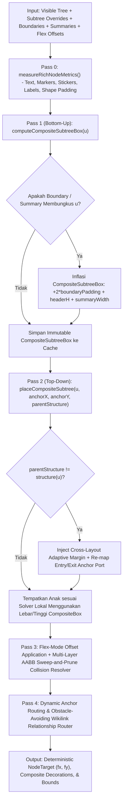
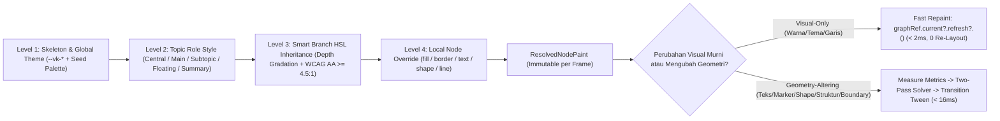

# Master Plan XMind-Grade Visual Layout Engine, Rich Mindmap Customization & Obsidian Vault Synthesis ObMap v2.0 (`DOC-PLAN-009`)

## Ringkasan 3 Baris
- Menjadikan **algoritma visual & sistem kustomisasi setara XMind** (zero-collision *Two-Pass Composite Layout Engine*, multi-struktur per-subtree, *Boundary*, *Summary*, *Relationship*, serta pewarisan gaya 4-lapis) sebagai kekuatan inti ObMap yang menyatu langsung dengan **ekosistem local-first Markdown + YAML ala Obsidian** (`CodeMirror 6`, *File Explorer*, dan `[[wikilinks]]` *Knowledge Graph*).
- Membedah akar masalah *overlap*, fitur UI yang terkomentari/terfragmentasi, dan keterbatasan *node box model* pada mesin graf saat ini (`subtreeCompose.ts`, `mindmap.ts`, `fishbone.ts`, `textLayout.ts`, `drawNode.ts`, `drawLink.ts`, `drawDecorations.ts`, `hierarchyColors.ts`, dan `useGraphCanvasController.ts`) tanpa melanggar satu pun dari 11 *Absolute Architectural Rules* (`AGENTS.md`).
- Menyajikan arsitektur terpadu dan peta implementasi bertahap **`XMIND-STEP-01` s/d `XMIND-STEP-06`** yang selaras dengan jalur utama `STEP-02.1`–`05.4` dan jalur `UI-STEP-01`–`06` (`DOC-PLAN-008`), lengkap dengan spesifikasi tipe TypeScript, kontrak algoritma bebas-tabrakan, dan gerbang verifikasi matematis (`Vitest` & benchmark FPS).

---

## 1. Executive Summary & Codebase Gap Analysis

### 1.1 North Star Product Synthesis: *"XMind Visual Precision × Obsidian Local-First Knowledge"*
Kekuatan masing-masing kategori alat pengetahuan saat ini terpisah:
- **XMind** unggul luar biasa pada presisi tata letak hierarkis bebas-tumpuk (*Mindmap, Logic Chart, Brace Map, Org Chart, Tree Chart, Timeline, Fishbone*), komposisi multi-struktur di dalam satu peta, keterbacaan tipografi melalui pewarisan warna cabang otomatis (*Smart Color Theme*), serta pengayaan semantik per topik (*Markers, Stickers, Labels, Boundary, Summary, Relationship*). Namun, XMind **bukan** editor Markdown, tidak memiliki *sidebar file explorer* lokal, dan tidak membangun graf pengetahuan bi-direksional antar berkas (`[[wikilinks]]`).
- **Obsidian** unggul sebagai *local-first Markdown + YAML knowledge vault* dengan editor teks cepat, *Backlinks*, dan *Knowledge Graph*. Namun, kanvas visualnya mengandalkan simulasi gaya fisika bebas (*free-force*) atau papan bebas manual (*Canvas*) yang tidak memiliki algoritma pemetaan terstruktur otomatis bebas-tabrakan layaknya XMind.

**ObMap v2.0** menyatukan keduanya secara native sebagai **Diagram View** dan **Graph View** di dalam **`Deep Explorer`** (4 lensa visual + pengelompokan dinamis *Hierarchy, Properties, Tags, Backlinks, Keywords* — dapat dibuka di `Settings Hub > Workspace > Deep Explorer` atau sebagai Tab Workspace mandiri): setiap Folder-Node/File-Node `.md` **dan** garis besar struktur di dalam satu catatan (`# H1 / ## H2 / ### H3 / - [ ] Task`) dapat divisualisasikan dengan mesin tata letak deterministik kelas XMind (`cooldownTicks === 0`, `AGENTS.md` Rule 2) sekaligus bertransisi ke *Knowledge Graph*, *Table View*, dan *Cards View* dalam mode **`Atlas`**, **`Studio`**, **`Academy`**, atau **`Freeform`**.

### 1.2 Baseline Audit Berkas Aktual & Akar Masalah Visual
Inspeksi langsung pada codebase `src/domains/graph/`, `src/domains/editor/`, dan `src/domains/workspace/` menunjukkan bahwa ObMap sudah memiliki fondasi deterministik yang solid (*Dual Canvas* via `layoutCategory.ts`, referensi `measureBox` di `timeline.ts`, dan token `--vk-*` di `theme.ts`), namun memiliki **9 kesenjangan struktural** berikut:

| ID Gap | Lokasi Kode Terverifikasi (`file:line`) | Kondisi Aktual di Codebase | Dampak Visual & UX ke Pengguna |
| :--- | :--- | :--- | :--- |
| **`GAP-X01`** | `subtreeCompose.ts:100-170`, `useLayoutEngine.ts:116-129` | **One-Pass Post-Hoc Composition:** `computeLayout` menghitung `baseGeometry` dengan asumsi seluruh pohon memakai mode root. Setelah itu `composeSubtreeLayouts` menjalankan `runSubtreeLayout` secara terisolasi dan menempelkan offset anak langsung ke `anchorTarget.x/y` **tanpa mengembalikan ukuran `Composite Bounding Box` subtree ke `spanOf` parent**. | Ketika cabang di-override ke `org-chart`, `fishbone`, atau `timeline`, kotak cabang baru **langsung menabrak/menumpuk** cabang saudara di atas/bawahnya. |
| **`GAP-X02`** | `GraphContextualToolbar.tsx:112-151` | Blok UI *Structure Override Dropdown* (`onSetStructure`) **dikomentari seluruhnya** (`/* {canvasMode === "mindmap" && ...} */`). | Fitur multi-struktur di dalam satu mindmap tidak dapat diakses pengguna sama sekali melalui antarmuka kanvas. |
| **`GAP-X03`** | `mindmap.ts:161-204` (`layoutRadial`) | Alokasi sudut hanya memakai bobot jumlah daun (`slice = 2 * Math.PI * weight / total`) pada radius tetap `r = depth * radius` (`line 175`), mengabaikan `context.nodeMetrics` (`width, height`). | Pada cincin dalam (*depth 1–2*) atau node berlabel panjang, kartu bertabrakan melingkar (*circumferential overlap*). |
| **`GAP-X04`** | `fishbone.ts:117-150` (`placeSubBranch`) | Sub-cabang `depth >= 2` memakai offset linier datar `siblingIndex * (metric.width + metric.height * 0.5 + context.siblingGap) * 0.65` sepanjang vektor tulang rusuk tanpa akumulasi bounding-box rekursif. | Sub-cabang bercabang dalam di mode Fishbone saling silang dengan rusuk kategori di sebelahnya. |
| **`GAP-X05`** | `textLayout.ts:87-140` (`cardLayout`), `drawNode.ts:125-231` | `cardLayout` hanya mengukur teks judul + lebar opsional collapse badge (`20px`) dengan font hardcoded `'IBM Plex Sans'`. `drawShape` hanya mendukung bentuk dasar (`circle`, `square`, `diamond`, `triangle`, `hexagon`, atau `roundedRect`). | Tidak ada slot metrik maupun renderer untuk **Markers** (Priority `1–7`, Progress ring, Flag/Star, Checkbox), **Stickers/Format Icon**, **Tag Pills**, maupun bentuk khas XMind (`pill`, `underline-only`, `cloud`, `parallelogram`). |
| **`GAP-X06`** | `drawDecorations.ts:7-53`, `graph.types.ts:45-78` | `drawDecorations` baru menggambar `fishbone-spine` dan `fishbone-rib` (`TimelineAxis` bahkan belum dirender di `drawDecorations`). Belum ada tipe dan algoritma penampung **Boundary** maupun **Summary Brace `{`**. | Pengguna tidak bisa mengelompokkan subtopik dengan kurva batas (*Boundary*) atau menarik kesimpulan cabang (*Summary*). |
| **`GAP-X07`** | `drawLink.ts:91-180`, `useGraphCanvasController.ts:307-309` | `drawLink` mendukung S-curve (`k = 0.42`), elbow, & straight, tetapi belum mendukung **Tapered XMind Branch Trunk** (pangkal tebal menyempit ke ujung) dan **Dynamic Cross-Structure Anchor**. Selain itu, `useGraphCanvasController.ts:307-309` membuang seluruh link `l.type !== 'hierarchy'` saat `canvasMode === 'mindmap'`. | Garis mindmap terasa seragam/kaku di root, dan relasi `[[wikilink]]` antar-cabang menghilang total saat masuk Mode Mindmap alih-alih tampil sebagai *Relationship Arrow* opsional. |
| **`GAP-X08`** | `hierarchyColors.ts:46-150`, `theme.ts:96-125`, `useLayoutEngine.ts:138-154` | `accentFor` mendukung hash `branch` dasar, tetapi belum ada **4-Level Cascading Style Resolver** + modulasi HSL adaptif + *WCAG Contrast Guard*. Selain itu, `signature` di `useLayoutEngine.ts:138-151` belum memisahkan metrik node (`metricSignature`) dari perubahan visual murni. | Mengubah warna tidak konsisten meredup/menerang antar kedalaman di Dark vs Light canvas, dan potensi re-layout berlebih vs metrik tidak tersinkron. |
| **`GAP-X09`** | `GraphWorkspaceControls.tsx`, `GraphConfigPanel.tsx`, `GraphSettingContent.tsx`, `settingsNavigation.ts` | Pengaturan graf terpecah di **3 panel kanvas** yang tumpang-tindih (Floating Gear 6 tab, Sheet 4 tab di mana tab `forces` kosong body-nya di `GraphConfigPanel.tsx:158-183`, & Contextual Pill), sementara `SettingsHub` (`settingsNavigation.ts:38-88`) belum menyambungkan preferensi graf ke 6-Layer Config (`ADR-0011`). | Kurva belajar tinggi, bingung mencari letak pengaturan garis vs warna vs struktur, melanggar prinsip *"Simplicity is Key"*. |

> **Temuan Aset Referensi Positif di Codebase:**
> - `src/domains/graph/shared/utils/timeline.ts:77-118` (`measureBox`) **sudah mengimplementasikan pola Two-Pass `SubtreeBox` cache** yang menghitung `spanY` & `spanX` secara rekursif dari daun ke akar. Pola inilah yang akan kita generalisasi untuk **seluruh struktur XMind** termasuk komposisi campuran.
> - `src/domains/graph/shared/utils/layoutCategory.ts:13-23` memisahkan tegas antara `free-force` (fisika) dan seluruh mode deterministik (`fx/fy` terkunci) — **seluruh ekstensi XMind mematuhi aturan ini (`Rule 2`)**.

---

## 2. Pilar A & B — Two-Pass Zero-Collision Layout Engine, Multi-Structure Composition & Rich Box Model

### 2.1 Arsitektur Pipeline Tata Letak 4-Pass (Zero-Collision Guarantee)
Agar **semua struktur dapat dicampur di subtree mana pun tanpa pernah bertabrakan, bertumpuk, atau garis memotong teks**, seluruh mesin deterministik (`mindmap`, `logic-right`, `logic-left`, `brace-map`, `org-down`, `tree-chart`, `timeline-horizontal`, `timeline-vertical`, `fishbone`, `radial`) disatukan oleh **Composite Two-Pass Engine** (`compositeLayoutEngine.ts`):



### 2.2 Algoritma Komposisi Multi-Struktur (Per-Subtree `structure_class`)
Setiap node $u$ mewarisi `structureClass` dari induknya kecuali memiliki entri di `subtreeOverrides[u.id]`. Pada **Pass 1 (Bottom-Up)**:
1. Setiap solver struktur mengekspos kontrak seragam `StructureSolver`:
   - `measureCompositeBox(rootId, childBoxes, ownMetric, ctx) -> CompositeSubtreeBox`
   - `placeWithinBox(rootId, childBoxes, anchor, side, ctx) -> LocalPlacementResult`
2. Saat sebuah **Main Topic** di Mindmap Horizontal di-override menjadi **`org-down` (Org Chart)** atau **`fishbone`**, Pass 1 menghitung lebih dulu ukuran total kotak komposit Org Chart/Fishbone tersebut (`width`, `height`, serta titik relatif akar `anchorOffsetX, anchorOffsetY` terhadap sisi kiri/kanan/atas bounding box-nya).
3. Solver **Balanced Mindmap** di level root menerima `CompositeSubtreeBox` tersebut — **bukan sekadar tinggi 1 kartu (`metric.height`)** — sehingga jarak vertikal antar-saudara di sebelah cabang Org Chart/Fishbone tersebut otomatis melonggar secara presisi agar bounding box tidak pernah bersinggungan.

#### Transisi Port Jangkar & Margin Adaptif Lintas-Struktur (`computeCrossStructureMargin`)
Saat struktur induk $S_p$ berbeda dengan struktur anak $S_c$:
- **Perpindahan Poros (Axis Handoff):** Jika $S_p$ berorientasi horizontal (`mindmap-balanced` / `logic-right`) dan $S_c$ berorientasi vertikal (`org-down` / `tree-chart`), garis keluar dari induk di port timur/barat `(±w_p/2, 0)` masuk secara halus (*cubic anchor bezier*) ke port **utara** `(0, -h_c/2)` pada akar $S_c$ — bukan dari samping kartu agar anak-anak Org Chart di kiri-kanan tidak tertabrak garis cabang.
- **Margin Jarak Adaptif:** Tambahan jarak orthogonal minimum disuntikkan otomatis:
  $$\Delta_{cross}(S_p, S_c) = \begin{cases} 0 & \text{jika } \text{axis}(S_p) = \text{axis}(S_c) \\ \max(\text{levelGap} \times 0.35,\; 28\text{px}) & \text{jika } \text{axis}(S_p) \neq \text{axis}(S_c) \end{cases}$$

### 2.3 Perbaikan Matematis Zero-Collision pada Radial & Fishbone
1. **Adaptive Circumference Radial Mindmap (`mindmap.ts` Pass Baru):**
   - Menghilangkan radius tetap `r = depth * radius` (`mindmap.ts:175`).
   - Untuk setiap cincin kedalaman $d \ge 1$, diameter efektif tiap node pada cincin dihitung dari diagonal kotaknya: $D(u) = \sqrt{w_u^2 + h_u^2} + \text{siblingGap}$.
   - Radius minimum cincin $d$ menjamin keliling lingkaran selalu memuat seluruh node di kedalaman $d$ tanpa irisan sudut:
     $$R_d = \max\left(R_{d-1} + \frac{\max_{u \in L_{d-1}} D(u) + \max_{v \in L_d} D(v)}{2} + \text{levelGap},\; \frac{\sum_{v \in L_d} D(v)}{2\pi}\right)$$
   - Alokasi sektor sudut $\theta(u)$ proporsional terhadap *angular span* subtree-nya, bukan sekadar jumlah daun mentah.
2. **Recursive Rib Bounding-Box Fishbone (`fishbone.ts` Pass Baru):**
   - Mengganti rumus linier `siblingIndex * (...) * 0.65` (`fishbone.ts:134`) dengan `RibSubtreeBox` rekursif sepanjang vektor tangen tulang rusuk `(-cos(alpha), sign * sin(alpha))` dan vektor luar `(sin(alpha), sign * cos(alpha))`.
   - Jarak sepanjang tulang belakang (*spine*) antar-kategori atas maupun bawah dihitung dari proyeksi horizontal `RibSubtreeBox` maksimum di rusuk tersebut + `siblingGap`, sehingga sub-cabang hingga kedalaman berapa pun tidak pernah memotong rusuk kategori sebelah.
3. **Final Safety Guard — Sweep-and-Prune AABB Collision Resolver (`collisionResolver.ts`):**
   - Meskipun Pass 1 & Pass 2 bersifat deterministik bebas-tabrakan secara konstruktif, penambahan **Flex Mode** (*manual offset*), **Boundary**, atau **Summary Node** dapat menggeser kotak berdekatan.
   - Pass 3 menjalankan *axis-aligned bounding box (AABB) Sweep-and-Prune* cepat ($O(N \log N)$ dengan padding minimum `10px`) untuk memverifikasi dan mendorong (*minimal displacement vector* mengikuti arah ekspansi cabang) bila terdapat dua sub-pohon atau *Floating Topic* yang bersentuhan.

### 2.4 Auto-Layout (`Strict Mode`) vs Free-Positioning (`Flex Mode`)
ObMap menyediakan dua mode tata letak kanvas yang dapat diganti per-peta (*1-click toggle*):
- **`Auto-Layout (Strict Mode)` — Default:** Seluruh topik tersusun penuh oleh Two-Pass Engine. Menambah, mengedit panjang teks, menempelkan stiker, atau mengubah struktur otomatis me-reflow peta dengan jaminan nol-tabrakan.
- **`Free-Positioning (Flex Mode)` — Eksplorasi Bebas Terproteksi:**
  - Pengguna dapat menyeret **Main Topic** (kedalaman 1) atau **Floating Topic** ke koordinat bebas (`manualOffset: { dx, dy }`).
  - Subtree di bawah topik tersebut tetap diformat otomatis oleh solver XMind-nya sehingga cabang internalnya tetap rapi, sementara Sweep-and-Prune AABB memastikan jika posisi manual mulai menyentuh cabang saudara lain, hanya perpindahan minimum aman (*soft push-away*) yang diterapkan.
  - Tombol **"Tidy / Snap All to Auto-Layout"** mengembalikan seluruh node ber-offset manual ke posisi optimal tanpa kehilangan isi maupun gaya.

### 2.5 Internal Flexbox Node Box Model & 8 Bentuk Topik XMind
Memperluas `textLayout.ts` dan `drawNode.ts` dari sekadar kotak teks datar menjadi **Internal Flexbox Bounding-Box** yang diukur penuh pada Pass 0 (`measureRichNodeMetrics`):

```text
+-------------------------------------------------------------------+
| [Collapse/Check] [M1][M2] [Sticker/Icon]  Judul Topik Multi-baris | [Note/Link Badge]
|                                           Baris Kedua Judul...    |
|                  [#tag-pill] [@owner] [Label Status]              |  <-- Row 2 (opsional)
+-------------------------------------------------------------------+
```

1. **Elemen Internal yang Diukur dalam Metric `(width, height)`:**
   - **Left Slot (`Markers & Checkboxes`):** Checkbox tugas (`- [ ]` / `- [x]`), Priority badge (`1–7`), Progress Ring / Pie (`0%..100%`), Star, Flag, Emoji (*maksimal 3 ikon di baris 1 agar rapi; berlebih dibungkus ke baris indikator*).
   - **Icon / Sticker Slot:** Ikon format file (`folder`, `.md`, `image`, `pdf`, `audio`) atau stiker kustom vektor SVG/Emoji (`20×20px` atau `28×28px`).
   - **Body Slot (`Multi-line Title`):** Teks terbungkus cerdas (*word-wrap* hingga `maxWidth: 220px`, font & ukuran mengikuti `--vk-font-*` + Cascading Style Level).
   - **Right Badge Slot:** Jumlah anak terlipat (`+12`), indikator *Note Attachment*, dan indikator *Wikilink Count* (`↗ 4`).
   - **Footer Row (`Labels / Tags`):** *Pill badge* kecil di bawah judul (`#riset`, `#draft`, `@tim`) dengan padding internal `4px` yang menambah tinggi AABB kartu di Pass 0 sebelum Pass 1 dijalankan!
2. **8 Bentuk Topik (`TopicShape`) di `drawNode.ts`:**
   - `rounded-rect` (kotak membulat standar), `pill` (kapsul penuh `r = h/2`), **`underline`** (ikonik subtopik XMind: tanpa kotak latar penuh, garis cabang menerus membentuk garis bawah teks!), `circle` / `ellipse`, `diamond`, `hexagon`, `cloud` (callout/awan pemikiran), dan `parallelogram`.

### 2.6 Komponen Eksternal (`Boundary`, `Summary`, `Tapered Trunk` & `Relationship`)
1. **`BoundaryGroup` (Poligon Pembungkus Kelompok):**
   - Membungkus 1 node beserta seluruh keturunannya **atau** rentang saudara berurutan `[startSiblingId..endSiblingId]`.
   - Gaya pembungkus: `rounded-rect`, `scalloped-cloud` (pinggir bergelombang ala XMind), `dashed-hull`, atau `bracket-box`, disertai opsi *Header Title Pill* di sudut kiri-atas.
   - **Integrasi Anti-Tabrakan:** Saat node/rentang memiliki `BoundaryGroup`, Pass 1 menggelembungkan `CompositeSubtreeBox` grup tersebut sebesar `2 * boundaryPadding + headerBadgeHeight` (default `16px` tiap sisi), sehingga cabang saudara di luar Boundary **otomatis terdorong menjauh** dan garis penghubung lain tidak menyentuh garis Boundary.
2. **`SummaryGroup` (Kurung Kurawal Ringkasan `{` + Summary Topic):**
   - Menyatukan beberapa topik saudara berurutan `[startSiblingId..endSiblingId]` dalam satu kurung kurawal `{` (atau `[`) pada tepi luar `max(x_i + w_i/2) + braceGap` (untuk cabang kanan; simetris terbalik untuk cabang kiri/atas/bawah).
   - Memasang **Summary Topic Node** di puncak kurung kurawal. Summary Topic Node adalah node kelas-satu (*first-class node*): ia bisa memiliki teks, warna, Marker, dan bahkan sub-cabang lanjutan di belakangnya, serta ikut terhitung dalam `CompositeSubtreeBox` induk!
3. **6 Gaya Garis Cabang (`BranchLineStyle`) & Tapered Trunk (`drawLink.ts`):**
   - **`tapered-bezier`:** Gaya khas XMind di mana pangkal garis di Central Topic tebal (`6–10px` bergantung pada jumlah anak / kedalaman) lalu mengecil mulus menuju anak (`1.5–2px`) menggunakan poligon kurva Bezier terisi (*filled dual-bezier envelope*).
   - `cubic-bezier` (kurva S-curve halus), `rounded-elbow` (siku membulat `r = 8px`), `orthogonal` (siku tegas), `brace-bracket`, dan `straight`.
4. **Obstacle-Avoiding `Relationship` Edge (Hubungan Lintas-Cabang & `[[Wikilinks]]`):**
   - Menghubungkan dua node mana pun lintas cabang (baik relasi kustom pengguna maupun `[[wikilinks]]` Obsidian saat berada di Mindmap Mode).
   - Router (`relationshipRouter.ts`) memeriksa apakah kurva Bezier langsung memotong AABB node perantara; bila ya, ia membelokkan titik kendali `(c1, c2)` keluar dari koridor bebas-rintangan terdekat (`+clearance = 24px`), menggambar garis putus-putus/titik panah tunggal/ganda, dan menempatkan label hubungan di titik tengah `pointAt(0.5)`.

### 2.7 Kontrak Tipe TypeScript Inti (`src/domains/graph/shared/utils/graph.types.ts`)

```ts
export type StructureClass =
  | 'mindmap-balanced'
  | 'mindmap-radial'
  | 'logic-right'
  | 'logic-left'
  | 'brace-map'
  | 'org-down'
  | 'tree-chart'
  | 'timeline-horizontal'
  | 'timeline-vertical'
  | 'fishbone';

export type TopicShape =
  | 'rounded-rect'
  | 'pill'
  | 'underline'
  | 'ellipse'
  | 'diamond'
  | 'hexagon'
  | 'cloud'
  | 'parallelogram';

export type BranchLineStyle =
  | 'tapered-bezier'
  | 'cubic-bezier'
  | 'rounded-elbow'
  | 'orthogonal'
  | 'brace-bracket'
  | 'straight';

export interface NodeMarker {
  kind: 'priority' | 'progress' | 'checkbox' | 'flag' | 'star' | 'emoji';
  value: string | number; // misal: priority 1..7, progress 0..100, checkbox 'todo'|'done'
}

export interface NodeAttachments {
  markers: NodeMarker[];
  sticker?: { iconId: string; position: 'left' | 'top'; size: 20 | 28 };
  labels: string[]; // pill badges di Footer Row (selain tag sistem)
  notePreviewCount?: number;
  wikilinkCount?: number;
}

export interface RichNodeMetric {
  width: number;
  height: number;
  lines: string[];
  textWidth: number;
  headerHeight: number;
  footerLabelsHeight: number;
  leftSlotWidth: number;
  rightBadgeWidth: number;
  shape: TopicShape;
}

export interface CompositeSubtreeBox {
  nodeId: string;
  structureClass: StructureClass;
  width: number;
  height: number;
  /** Jarak pusat node akar subtree terhadap tepi atas-kiri CompositeSubtreeBox */
  anchorOffsetX: number;
  anchorOffsetY: number;
  boundaryPadding: { top: number; right: number; bottom: number; left: number };
  summaryReserveWidth: number;
}

export interface BoundaryGroup {
  id: string;
  title?: string;
  nodeIds: string[]; // 1 parent subtree atau rentang sibling berurutan
  shape: 'rounded' | 'cloud' | 'dashed';
  padding: number;
  fillColor?: string;
  strokeColor?: string;
}

export interface SummaryGroup {
  id: string;
  parentId: string;
  rangeNodeIds: [string, string]; // startSiblingId..endSiblingId
  summaryNodeId: string;
  braceStyle: 'curly' | 'square' | 'round';
  color?: string;
}

export interface RelationshipEdge {
  id: string;
  sourceId: string;
  targetId: string;
  origin: 'manual' | 'wikilink' | 'tag';
  label?: string;
  curvatureOffset?: { x: number; y: number };
  arrowMode: 'forward' | 'both' | 'none';
  dashStyle: 'dashed' | 'dotted' | 'solid';
  color?: string;
}
```

---

## 3. Pilar C & D — Cascading Style Inheritance, Dual Update Pipeline & XMind × Obsidian Synthesis

### 3.1 Sistem Pewarisan Gaya 4-Lapis (`CascadingStyleResolver`) & Mesin Warna HSL Cerdas



Aturan resolusi gaya berjenjang pada `cascadingStyleResolver.ts`:
1. **Level 1 — Skeleton & Global Canvas Theme (`SkeletonTheme`):**
   - Menentukan warna kanvas dasar (`--vk-bg-canvas`), pola atmosfer/grid, keluarga huruf utama (`--vk-font-sans` dari `DOC-PLAN-008`), gaya garis cabang standar (`BranchLineStyle`), dan **6–8 Warna Induk Harmonis (*Branch Seed Palette*)**. Terintegrasi penuh dengan 6 Preset Tema Universal (`${brand.name} Midnight`, `Obsidian OLED`, `Daylight Paper`, `Warm Sepia`, `Nord Scholar`, `High Contrast AAA`).
2. **Level 2 — Level-Based Role Style (`TopicRoleStyle`):**
   - **`central` (Kedalaman 0):** Ukuran font besar (`+3px` / `600–700` weight), bentuk `pill` atau `rounded-rect` bertepi tegas, isian warna primer `--vk-accent`, tebal garis keluar terbesar.
   - **`main` (Kedalaman 1):** Ukuran font menengah (`+1px` / `600` weight), bentuk `rounded-rect`, latar isian penuh menggunakan warna cabang induk ke-$k$.
   - **`subtopic` (Kedalaman $\ge 2$):** Ukuran font standar (`12px` *scalable*), bentuk bawaan Skeleton (misalnya **`underline`** pada skeleton klasik XMind atau kotak tinted tipis pada skeleton modern), garis cabang menipis bertahap (`lineWidth = max(1.25, 3.0 - depth * 0.35)`).
   - **`floating` & `summary`:** Garis tepi terputus (*dashed*) untuk *floating topic*, atau aksen kurung & huruf miring ringan untuk *summary topic*.
3. **Level 3 — Smart Branch HSL Inheritance + WCAG AA Contrast Guard (`hierarchyColors.ts`):**
   - Setiap Main Topic ke-$k$ memperoleh warna cabang dasar $(H_k, S_k, L_k)$ dari palet Skeleton (atau warna kustom yang dipilih pengguna pada Main Topic tersebut).
   - Seluruh keturunan pada kedalaman $d \ge 2$ **secara otomatis mewarisi hue $H_k$ yang sama** namun dengan pergeseran luminositas & saturasi deterministik agar cabang tetap serasi namun hierarkis:
     - **Pada Kanvas Gelap (`isDark === true`):**
       - Latar isian kartu: $S_{fill} = \max(28, S_k - d \times 4)\%$, $L_{fill} = \text{clamp}(16 + (d - 2) \times 3,\; 14,\; 28)\%$.
       - Garis tepi & garis cabang: $L_{line} = \text{clamp}(L_k + (d - 1) \times 4,\; 52,\; 80)\%$.
     - **Pada Kanvas Terang (`isDark === false`):**
       - Latar isian kartu: $S_{fill} = \min(75, S_k)\%$, $L_{fill} = \text{clamp}(91 + (d - 2) \times 2,\; 88,\; 97)\%$.
       - Garis tepi & garis cabang: $L_{line} = \text{clamp}(L_k - (d - 1) \times 5,\; 30,\; 58)\%$.
   - **WCAG AA Contrast Guard:** Setelah `fillColor` terselesaikan (pada mode kotak terisi), fungsi `pickContrastTextColor(fillHex)` menghitung luminansi relatif $Y$ dan memastikan rasio kontras teks terhadap latar minimal **`4.5:1`** (`#F8FAFC` vs `#0F172A` atau tinta semantik tema). Pada bentuk `underline` atau `none`, teks kontras langsung diukur terhadap `--vk-bg-canvas`.
4. **Level 4 — Local / Inline Node Override (`NodeStyleOverride`):**
   - Pengguna dapat menimpa warna latar, warna garis, warna teks, bentuk topik (`TopicShape`), atau ketebalan font pada **1 topik saja** atau **"Terapkan ke Seluruh Cabang Ini"** (*promote override* ke Level 3 cabang tersebut), serta melakukan **"Reset to Skeleton/Branch Style"** kapan saja.

### 3.2 Dual Update Pipeline (Pemisahan Ketat Repaint vs Re-Layout)
Sesuai `AGENTS.md` Rule 10 (*Canvas2D Frame Invalidation*), `useLayoutEngine.ts` dan `useGraphCanvasController.ts` memisahkan dua jalur pembaruan:
- **Jalur A — Visual-Only Update (`< 2ms`, Nol Komputasi Layout):**
  - Pemicu: perubahan preset warna, ganti warna cabang, ubah gaya garis (`tapered` ↔ `cubic`), ubah warna border/text, ubah *Living Canvas Atmosphere*, hover, atau selection.
  - Mekanisme: `layoutSignature` di `useLayoutEngine.ts` **tidak menyentuh** properti warna/style. Perubahan hanya memperbarui `ResolvedNodePaint` memo dan langsung memanggil `graphRef.current?.refresh?.()`.
- **Jalur B — Geometry-Altering Update (`< 16ms` pada 2.000 node):**
  - Pemicu: perubahan judul/teks, penambahan/penghapusan **Marker/Sticker/Tag Pill**, ubah `TopicShape` (jika padding berubah seperti `pill`/`cloud`/`underline`), override `structureClass`, toggle **Boundary/Summary**, collapse/expand, atau ubah ukuran font.
  - Mekanisme: Memperbarui `metricSignature` → memanggil `measureRichNodeMetrics` → menjalankan **Two-Pass Composite Layout Engine** → menganimasikan perpindahan koordinat via `transitionController.ts` (`180ms` cubic-out, atau `0ms` bila `prefers-reduced-motion`).

### 3.3 Sintesis XMind × Obsidian (`Local-First Markdown + YAML + Bidirectional Bridge`)
Mengubah ObMap dari "dua fitur terpisah" menjadi satu mesin pemetaan pengetahuan terpadu dengan **dua mode tampilan kanvas bi-direksional** dan **strategi penyimpanan bersih (`AGENTS.md` Rule 6)**:

1. **Mode 1 — Vault & Folder Mindmap ↔ Free-Force Knowledge Graph:**
   - **Sumber Struktur:** Folder & catatan `.md` (atau relasi hierarkis YAML `parent: [[Nota Induk]]`) membentuk tulang punggung pohon deterministik XMind.
   - **Integrasi `[[Wikilinks]]` di Mindmap Mode:** Memperbaiki `useGraphCanvasController.ts:307-309` yang selama ini membuang seluruh link non-hierarki. Di mode XMind baru, tombol filter **"Show `[[Wikilinks]]` as Relationships"** merender referensi silang antar-catatan sebagai **Obstacle-Avoiding Relationship Arrows** yang melengkung lembut menghindari kartu topik!
   - **Sinkronisasi Live dengan Workbench:** Menambah *Subtopic* (`Tab`) atau *Sibling* (`Enter`) dari Mindmap langsung menciptakan berkas `.md` baru di folder yang tepat melalui `vaultSessionActions.ts` dan memperbarui `WorkspaceSidebarPanel.tsx` (`File Explorer`) tanpa me-reload halaman. Menyeret cabang untuk *reparent* di kanvas langsung memindahkan catatan atau memperbarui YAML `parent` secara aman.
2. **Mode 2 — In-Note Outline-to-Mindmap (`AST Bridge` untuk Catatan Tunggal):**
   - Pengguna dapat membuka catatan `.md` mana pun dalam tampilan **Split Pane (`CodeMirror 6` Kiri | `XMind Canvas` Kanan)** atau penuh sebagai *Note Mindmap*.
   - Parser (`markdownOutlineMindmapBridge.ts`) memetakan struktur Markdown secara deterministik:
     - `# Heading 1` (atau judul file bila tidak ada H1) → **Central Topic**
     - `## Heading 2` → **Main Topics** (otomatis mendapat warna cabang Level 3!)
     - `### Heading 3` s/d `###### H6` + Nested Bullet List (`- item`) → **Subtopics**
     - Task List (`- [ ]` / `- [x]`) → **Topik dengan Marker Checkbox Interaktif** (klik centang di Mindmap langsung mengubah `- [ ]` menjadi `- [x]` di CodeMirror 6!).
     - Paragraf narasi/blok kode di bawah tiap heading disimpan sebagai *Topic Note Attachment* (ditampilkan dengan badge catatan & pratinjau hover, tetap utuh saat outline diubah!).
   - Menekan `Tab` / `Enter` / mengedit judul / drag-reorder di kanvas Mindmap melakukan **AST Range Patch** yang presisi ke dokumen CodeMirror 6 aktif tanpa merusak teks paragraf lain.
3. **Strategi Penyimpanan Bersih (`AGENTS.md` Rule 6 Compliant — Anti-Kotor Markdown):**
   - **Markdown Body (`.md`):** **100% Markdown murni standar industri** — dilarang keras menyisipkan tag HTML rahasia, komentar `<!-- xmind:... -->`, atau JSON base64 ke dalam teks catatan sehingga vault tetap portabel penuh dengan Obsidian/Git/VSCode.
   - **YAML Frontmatter Terisolasi (`EditorPropertiesPanel.tsx`):** Menyimpan atribut semantik per-catatan yang bermakna bagi manusia:
     ```yaml
     icon: rocket
     priority: 1
     progress: 65
     structure_class: org-down
     branch_color: "#3B82F6"
     topic_shape: pill
     ```
     Semua properti ini dapat disunting baik lewat Inspector Mindmap **maupun** langsung di `EditorPropertiesPanel.tsx` secara sinkron dua arah.
   - **Single Central Spatial Block (`.app/config.json` `mode.layout` | fallback `.vk/mindmap-layout.json` & `.obmap/mindmap-layout.json` per `ADR-0013`):** Menyimpan data spasial murni di dalam konfigurasi tunggal vault agar frontmatter YAML tetap ringkas dan tidak memecah file konfigurasi: daftar `boundaries`, `summaries`, `flex_offsets` (`dx, dy` pada *Flex Mode*), titik kendali lengkung *Manual Relationship*, dan *Heading ID overrides* untuk *In-Note Outline Mindmap*. Berkas konfigurasi tunggal ini ikut ter-versioning oleh domain `src/domains/vcs/`.

---

## 4. Pilar E — Arsitektur UX Pengaturan 3-Lapis (*"Simple by Default, Powerful on Demand"*)

Untuk menyelesaikan fragmentasi antara `GraphWorkspaceControls.tsx`, `GraphConfigPanel.tsx` (termasuk tab `forces` yang kosong body-nya), `GraphContextualToolbar.tsx`, dan `SettingsHub` (`GAP-X09`), serta memastikan pengguna baru bisa langsung produktif dalam `< 30 detik` sementara *power user* mendapatkan kendali penuh ala XMind, seluruh kontrol dikonsolidasikan ke dalam **Model Pengaturan 3-Lapis (*Progressive Disclosure*)**:

### 4.1 Lapisan 1 — Top/Floating Quick Canvas Bar (`GraphQuickCanvasBar.tsx`, Maksimal 5 Kontrol Harian)
Bilah kaca (*glassmorphic compact bar*, tinggi `38px`) yang mengambang rapi di bagian atas kanvas:
1. **Canvas Mode Switcher (`Mindmap` | `Knowledge Graph` | `Note Outline`):** Pemindahan instan antara struktur pohon XMind vault, graf jaringan fisika `[[wikilinks]]`, dan Mindmap struktur internal catatan aktif.
2. **Global Structure Picker:** Dropdown dengan **ikon pratinjau geometris SVG mini** (*Balanced Mindmap*, *Logic Right*, *Brace Map*, *Org Chart*, *Tree Chart*, *Timeline H/V*, *Fishbone*, *Radial*, *Free-Force*).
3. **1-Click Theme & Skeleton Swatches:** Galeri cepat kombinasi Skeleton Tema + Palet Warna Cabang (*Classic Rainbow, Deep Midnight, Academic Paper, Neon Flow, Mono Slate*) yang mengubah tampilan seluruh peta dalam 1 klik (`< 2ms` Visual-Only Refresh).
4. **Search & Layer Toggles:** Pencarian cepat topik + tombol toggle ringkas untuk `Boundaries`, `Summaries`, `[[Wikilink]] Relationships`, dan sakelar **`Auto (Strict)` / `Flex`**.
5. **Viewport & Depth Control:** `Fit View`, `Center Root`, tombol lipat kedalaman cepat (`L1`, `L2`, `L3`, `All`), dan tombol toggle **Smart Inspector**.

### 4.2 Lapisan 2 — Contextual Smart Inspector & Floating Pill (`GraphContextualInspector.tsx` + `GraphContextualToolbar.tsx`)
Menggantikan panel 6-tab yang statis (`GraphSettingContent.tsx`) dengan inspektor kontekstual selebar `280px` (dapat di-collapse total) + kapsul aksi melayang di atas node terpilih:
- **Reaktivasi `GraphContextualToolbar.tsx`:** Membuka kembali blok `Subtree Structure Override` yang terkomentari pada `lines 112-151`, lalu melengkapinya dengan tombol ikon satu klik: `+ Subtopic (Tab)`, `+ Sibling (Enter)`, `Markers/Priority`, `Style/Shape`, `+ Boundary`, `+ Summary`, dan `+ Link Relationship`.
- **Smart Inspector yang Berubah Otomatis Mengikuti Konteks Seleksi:**
  - **Saat Tidak Ada yang Dipilih (*Canvas / Skeleton Scope*):** Menampilkan Theme Skeleton, latar & grid kanvas, *Default Branch Line Style* (`Tapered` / `Bezier` / `Elbow`), sakelar `Strict vs Flex`, dan preferensi visibilitas *Markers/Tags*.
  - **Saat 1 Topik Dipilih (*Topic & Branch Scope*):**
    - *Structure:* Pilih struktur untuk sub-pohon topik ini (`Inherit` atau override ke 10 `StructureClass` XMind).
    - *Topic Appearance:* Pilih dari 8 `TopicShape`, warna isian/border/teks, ketebalan garis, serta aksi **"Apply Color to This Branch"** (Level 3) vs **"This Topic Only"** (Level 4) vs **"Reset Override"**.
    - *Attachments:* Pemilih cepat **Priority `1–7`**, **Progress Ring `0%–100%`**, **Checkbox**, **Sticker/Emoji**, dan **Tag Pills** (sinkron ke YAML frontmatter).
  - **Saat Beberapa Topik Saudara Dipilih (*Multi-Select Batch Scope*):** Tombol hero 1-klik **"Wrap in Boundary"**, **"Create Summary Brace `{`"**, dan penyuntingan gaya massal (*Batch Shape / Batch Color*).
  - **Saat Boundary / Summary / Relationship Dipilih (*Decoration Scope*):** Bentuk Boundary (`Rounded` / `Cloud` / `Dashed`), tingkat transparansi isian, jenis kurung `{` / `[`, warna garis hubungan, arah panah, dan penyuntingan label inline.

### 4.3 Lapisan 3 — Advanced Engine Tuning (`<Collapsible>` + Integrasi `ADR-0011` `Layer 3/4/5`)
Tersembunyi rapi di bawah seksi lipat *"Engine & Physics Tuning"* di dalam Inspector (hanya dibuka saat diperlukan) dan disinkronkan lewat **Hierarchical Store Bridge (`AGENTS.md` Rule 9)**:
- Slider jarak presisi piksel (`siblingGap`, `levelGap`, `laneGap`, `boundaryPadding`, `curveTension`, `taperRootWidth`).
- Pengaturan **D3 Physics Forces** (dipindahkan ke sini sekaligus menuntaskan celah tab `forces` kosong pada `GraphConfigPanel.tsx:158-183`, dan **hanya muncul saat mode `free-force` aktif**).
- Kontrol cakupan persistensi: **"Simpan untuk Tab Ini"** (`LeafGraphConfigStore`, `Layer 5`) vs **"Jadikan Default Vault"** (`.app/config.json` blok `mode.layout`, fallback `.vk/` / `.obmap/`, `Layer 3`) vs **"Jadikan Default User"** (`Layer 4`) tanpa menimpa aturan `org_policy` (`Layer 2`) yang terkunci Admin.

---

## 5. Phased Implementation Roadmap (`XMIND-STEP-01` s/d `XMIND-STEP-06`)

### 5.1 Rincian 6 Langkah Eksekusi Bertahap
Seluruh pengembangan dipecah agar tetap stabil, teruji per tahap, dan mematuhi batas **Headless Controller `<= 300` baris per berkas `.tsx` (`AGENTS.md` Rule 7)**:

| Step ID | Prioritas & Prasyarat | Target Berkas & Arsitektur Headless Controller | Spesifikasi Deliverables & Verification Gate |
| :--- | :---: | :--- | :--- |
| **`XMIND-STEP-01`** | `P0` · Siap Mulai Segera (`STEP-01.5` Selesai) | **Baru:** `src/domains/graph/shared/utils/compositeLayoutEngine.ts`, `collisionResolver.ts`, `structureSolvers.ts`.<br>**Modifikasi:** `subtreeCompose.ts`, `mindmap.ts`, `fishbone.ts`, `treeLayouts.ts`, `timeline.ts`, `useLayoutEngine.ts`, `GraphContextualToolbar.tsx` (`lines 112-151`). | **Two-Pass Composite Layout Engine & Zero-Collision Solver:** Generalisasi pola `measureBox` ke seluruh `StructureClass` (Pass 1 Bottom-Up `CompositeSubtreeBox` + Pass 2 Top-Down + Cross-Structure Margin/Anchor). Perbaiki `layoutRadial` (*adaptive circumference*) dan `fishbone.ts` (*recursive rib box*). Tambahkan `resolveAABBCollisions` Sweep-and-Prune ($O(N \log N)$). Aktifkan kembali UI `Subtree Structure Override` di `GraphContextualToolbar.tsx`.<br>**Gate:** Property-based Vitest 100 pohon campuran lulus dengan **0 AABB overlaps**. |
| **`XMIND-STEP-02`** | `P0` · Prasyarat: `XMIND-STEP-01` | **Modifikasi:** `graph.types.ts`, `textLayout.ts` (`measureRichNodeMetrics`), `drawNode.ts`, `drawLink.ts`, `useGraphCanvasController.ts`.<br>**Baru:** `src/domains/graph/shared/utils/drawAttachments.ts`. | **Internal Flexbox Node Box Model, 8 Topic Shapes & Tapered Connectors:** Ukur & render **Markers** (Priority `1–7`, Progress Ring, Checkbox, Flag/Star), **Stickers/Format Icons**, **Footer Tag Pills**, dan **Note/Wikilink Badge** di dalam AABB kartu sebelum Pass 1 dijalankan. Implementasi 8 `TopicShape` (termasuk **`underline`** dan **`cloud`**), **`tapered-bezier`** trunk, dan **Dynamic Anchor Routing** antar-struktur.<br>**Gate:** Teks/ikon/pills tidak pernah terpotong dan bounding box sinkron 100% dengan `measureRichNodeMetrics`. |
| **`XMIND-STEP-03`** | `P1` · Prasyarat: `UI-STEP-01`, `XMIND-STEP-02` | **Baru:** `src/domains/graph/shared/utils/cascadingStyleResolver.ts`.<br>**Modifikasi:** `hierarchyColors.ts`, `theme.ts`, `useGraphStore.ts`, `useLeafGraphConfigStore.ts`, `useLayoutEngine.ts`, `useGraphCanvasController.ts`. | **4-Level Cascading Style Inheritance, Smart HSL Engine & Dual Update Pipeline:** Implementasi Level 1 (Skeleton + `--vk-*`) → Level 2 (Central/Main/Subtopic/Floating/Summary) → Level 3 (Smart HSL branch gradation + WCAG AA `>= 4.5:1` contrast guard) → Level 4 (Local Override + Reset). Pisahkan `layoutSignature` (geometri) vs `paintSignature` (visual-only `refresh()` `< 2ms`).<br>**Gate:** Tes unit `0` eksekusi solver saat warna/tema berubah + uji rasio kontras $\ge 4.5:1$ di Dark & Light mode. |
| **`XMIND-STEP-04`** | `P1` · Prasyarat: `XMIND-STEP-02` | **Baru:** `src/domains/graph/shared/utils/boundarySummarySolver.ts`, `relationshipRouter.ts`.<br>**Modifikasi:** `drawDecorations.ts`, `useGraphInteractionStore.ts`, `useCanvasDragReparent.ts`, `useGraphCanvasController.ts`. | **Boundary, Summary Braces, Obstacle-Avoiding Relationships & Flex Mode:** Implementasi `BoundaryGroup` (`rounded`/`cloud`/`dashed` hull + padding yang menginflasi `CompositeSubtreeBox`), `SummaryGroup` (kurung `{` + first-class Summary Topic Node), **Obstacle-Avoiding Bezier Router** untuk relasi manual & `[[wikilinks]]` di Mindmap Mode (cabut filter pembuang di `useGraphCanvasController.ts:307-309`), dan `Strict` vs `Flex Mode` manual offset + tombol *Tidy Up*.<br>**Gate:** Boundary & Summary node lolos uji Zero-AABB Overlap terhadap seluruh cabang luar. |
| **`XMIND-STEP-05`** `[IMPLEMENTED]` | `P1` · Prasyarat: `XMIND-STEP-03`, `XMIND-STEP-04`, `UI-STEP-02` | **Baru:** `GraphQuickCanvasBar.tsx`, `useGraphQuickCanvasBarController.ts`, `GraphContextualInspector.tsx`, `GraphInspectorTopicSection.tsx`, `useGraphContextualInspectorController.ts`, `useGraphOrchestratorController.ts`.<br>**Modifikasi:** `GraphContextualToolbar.tsx`, `GraphContextualToolbarOverlay.tsx`, `GraphCanvas.tsx`, `GraphOrchestrator.tsx`. | **3-Layer Settings UX Consolidation:** Konsolidasi kontrol menjadi **Layer 1 Quick Canvas Bar (5 kluster kontrol harian)**, **Layer 2 Contextual Smart Inspector** (berubah otomatis per seleksi: Canvas / Topic & Branch / Boundary-Summary Decorations), dan **Layer 3 Advanced Engine Tuning** (`FreeForceControls` kontekstual hanya saat `free-force`). Mematuhi `<= 300` baris per `.tsx` dan bridge `LeafGraphConfigStore` (`Rule 7`, `Rule 9`).<br>**Gate:** `xmind3LayerUx.test.tsx`, `OVER_300=0`, & `eslint 0 err` lulus. |
| **`XMIND-STEP-06`** `[IMPLEMENTED]` | `P2` · Prasyarat: `XMIND-STEP-05` | **Baru:** `src/domains/graph/shared/utils/{markdownOutlineMindmapBridge,mindmapLayoutManifest,frontmatterMindmapSync}.ts`.<br>**Modifikasi:** `src/global/types/graph.types.ts`, `buildGraphProjection.ts`, `useGraphCanvasController.ts`, `useEditorPropertiesController.ts`, `useGraphOrchestratorController.ts`. | **Obsidian × XMind Bidirectional Vault & In-Note Outline Bridge:** (1) Persistensi bersih YAML frontmatter (`icon`, `priority`, `progress`, `checkbox`, `structure_class`, `branch_color`, `topic_shape`) + manifest spasial menuju standar tunggal `.app/config.json` blok `mode.layout` (didukung pembacaan *zero-loss* dari `.vk/mindmap-layout.json` & `.obmap/mindmap-layout.json` per `ADR-0013`) tanpa mengotori body `.md` (`Rule 6`); (2) Mode **In-Note Outline-to-Mindmap** (`Note AST`) 2-arah lossless untuk heading `#..######`, list, & task `- [ ]` dengan code-fence guard; (3) Reparent & tambah topik tersinkron dengan `vaultSessionActions.ts` (`File Explorer`).<br>**Gate:** `markdownOutlineMindmapBridge.test.ts` (round-trip AST lossless & sidecar fallback), 27 file / 163 Vitest lulus. |

### 5.2 Sinkronisasi Lintas-Jalur (`STEP-02.1`–`05.4` & `UI-STEP-01`–`06`)
Agar pengembangan berjalan paralel tanpa konflik file atau *rework*:

| Jalur Fitur Produk (`README.md`) | Jalur Design System (`DOC-PLAN-008`) | Jalur XMind Visual Engine (`DOC-PLAN-009`) | Titik Temu & Integrasi |
| :--- | :--- | :--- | :--- |
| `STEP-01.5` `[IMPLEMENTED]` | `UI-STEP-01` (`P0`, `--vk-*` Tokens & Presets) | `XMIND-STEP-01` & `XMIND-STEP-02` (`P0`, Two-Pass Engine & Rich Shapes) | `XMIND-STEP-01/02` dapat dikerjakan paralel segera tanpa menunggu UI overhaul; font & token dasar akan otomatis diwarisi saat `UI-STEP-01` masuk. |
| `STEP-02.1` (`[NEXT]` `/vaults` Dashboard) | `UI-STEP-02` & `UI-STEP-03` (`P0`, Appearance & Workbench Shell) | `XMIND-STEP-03` (`P1`, 4-Level Style & `--vk-*` Graph Bridge) | `CascadingStyleResolver` (`XMIND-STEP-03`) langsung membaca 6 Preset Tema & kalkulator kontras WCAG AA dari `UI-STEP-01/02`. |
| `STEP-02.2` (`Landing` + Live Sandbox `< 65KB`) | `UI-STEP-04` (`Editor Toolbar` + `Forces Tab`) | `XMIND-STEP-04` & `XMIND-STEP-05` (`P1`, Boundaries/Summaries & 3-Layer Inspector) | Embedded Live Sandbox di `STEP-02.2` langsung memakai Two-Pass Zero-Collision Engine (tanpa panel berat) untuk demonstrasi instannya (*outline → Mindmap/Fishbone*). |
| `STEP-05.1` & `STEP-05.2` (Academy Competence DAG, `argument-map`, `citation-tree`, Pitch/SVG/PDF) | `UI-STEP-06` (`P2`, Token Sweep & WCAG AAA) | `XMIND-STEP-06` (`P2`, sinkron `.app/config.json` `mode.layout` / fallback `.vk/`/`.obmap/` & Note AST Bridge) | Dua solver baru di `STEP-05.2` dibangun di atas antarmuka `StructureSolver` dari `XMIND-STEP-01`, sehingga otomatis mendukung Markers, Boundary, Summary, dan ekspor SVG berpresisi tinggi. |

---

## 6. Verification Matrix, Benchmark Performa & Keputusan Untuk Pemilik Proyek

### 6.1 Suite Pengujian Otomatis (`npx vitest run`)
Setiap langkah `XMIND-STEP-*` wajib meluluskan suite pengujian berikut di `src/domains/graph/shared/utils/__tests__/`:
1. **`compositeLayoutEngine.test.ts` (Invariant Zero-AABB Overlap & Determinisme):**
   - Uji *property-based* terhadap **100+ graf sintetis** (ukuran 10 s/d 2.000 node, kedalaman 1 s/d 12, label bervariasi panjang 1–4 baris, dengan campuran acak `structureClass` per cabang: `mindmap-balanced` + `org-down` + `fishbone` + `timeline-horizontal` + `mindmap-radial`).
   - Memverifikasi ketimpangan AABB mutlak untuk seluruh pasangan node aktif:
     $$\forall u \neq v \in V_{visible}:\quad |x_u - x_v| \ge \frac{w_u + w_v}{2} \;\lor\; |y_u - y_v| \ge \frac{h_u + h_v}{2}$$
   - Memverifikasi 100% **determinisme**: pemanggilan berulang dengan input identik menghasilkan delta koordinat `0.000px`.
2. **`boundarySummarySolver.test.ts`:**
   - Memverifikasi bahwa setiap node di luar `BoundaryGroup` memiliki jarak minimum $\ge \text{boundaryPadding}$ terhadap garis batas poligon pembungkus, dan setiap `SummaryTopic` + anak-anak lanjutannya tidak menabrak cabang saudara sebelah.
3. **`cascadingStyleResolver.test.ts`:**
   - Memverifikasi prioritas Level 1 → Level 2 → Level 3 → Level 4, memastikan rasio kontras WCAG AA ($\ge 4.5:1$) pada seluruh 6 preset tema (`${brand.name} Midnight` s/d `High Contrast AAA`), dan memverifikasi **0 pemanggilan `computeLayout`** saat mutasi *Visual-Only* dijalankan (hanya `refreshSpy` yang terpanggil).
4. **`markdownOutlineMindmapBridge.test.ts`:**
   - Uji *round-trip lossless* (`Markdown + YAML + Prosa -> Outline Mindmap -> Tambah Subtopic + Centang Task + Reparent Branch -> Markdown AST`): memastikan teks paragraf, blok kode, dan properti YAML lain tidak hilang maupun berubah format secara liar, serta body `.md` bebas dari komentar JSON proprietary.

### 6.2 Target Benchmark Performa (`60 FPS` Desktop Target)

| Skenario Operasi | Budget Latensi Target | Verifikasi Mekanisme |
| :--- | :---: | :--- |
| **Visual-Only Update** (ganti warna, preset skeleton, gaya garis, hover/select) | **`< 2 ms`** | `0` kalkulasi layout; hanya invalidasi cache warna + `graphRef.current?.refresh?.()` (`Rule 10`). |
| **Geometry-Altering Update (`500` node)** (edit teks, tambah marker, toggle boundary) | **`< 4 ms`** | Re-measure node terdampak + Two-Pass Solver + $O(N \log N)$ Sweep-and-Prune. |
| **Full Mixed-Structure Layout (`2.000` node)** | **`< 16 ms` (`60 FPS`)** | Cache memo `CompositeSubtreeBox` + flat typed-array spatial sweeps. |
| **Skala Besar (`5.000` node)** | **`< 33 ms` (`>= 30 FPS`)** | Level-of-Detail (*LOD*) rendering di `drawNode.ts` + viewport culling untuk deklarasi eksternal. |

### 6.3 Verification Gate Wajib Sebelum Menandai `[IMPLEMENTED]`
1. **Static & Build Check:** `npx tsc --noEmit` (`0` error), `npm run lint` bersih, `npm run build` (`exit 0`).
2. **Test Gate:** `npx vitest run` seluruh suite (`119+` tes lama + seluruh tes baru `XMIND-*`) lulus `100%` tanpa skip.
3. **Rule 7 Line-Count Gate:** Skrip pengecekan komponen mengonfirmasi `OVER_300=0` (`<= 300` baris untuk semua `.tsx` komponen di `src/domains/*/components/`).
4. **Pure Markdown Gate:** Uji berkas `.md` hasil operasi Mindmap memastikan 0 kebocoran metadata tata letak ke body Markdown (`Rule 6`).
5. **Changelog Sync Gate (`Rule 11`):** Update 3-lapis wajib (`docs/_machine/changelog.jsonl`, `docs/changelogs/YYYY-MM.md`, `docs/changelogs/README.md`).

### 6.4 6 Keputusan Produk & Teknis Untuk Pemilik Proyek (`Keputusan Owner #1–#6`)
Sebelum `XMIND-STEP-01` dieksekusi, mohon konfirmasi 6 keputusan arah berikut:

1. **Prioritas Eksekusi antara `XMIND-STEP-01/02` vs `STEP-02.1` (`/vaults` Dashboard):**
   - *Opsi A (Direkomendasikan):* Mulai `XMIND-STEP-01` (Two-Pass Zero-Collision Engine) secara paralel dengan `UI-STEP-01`–`03`, lalu masuk ke `STEP-02.1`, sehingga baik kanvas utama (`/app`) maupun live demo/sandbox di Landing (`STEP-02.2`) sudah memakai algoritma bebas-tabrakan sejati sejak awal.
   - *Opsi B:* Tunda seluruh track `XMIND-STEP` sampai Horizon 2 (`STEP-02.1`–`02.3`) selesai.
2. **Perlakuan Default Link `[[Wikilinks]]` di Mindmap Mode (`useGraphCanvasController.ts:307`):**
   - *Opsi A (Direkomendasikan):* Secara default saat membuka Mode Mindmap, `[[wikilinks]]` lintas-cabang **ditampilkan halus (*opacity* rendah `0.35`, garis putus-putus berbelok menghindari kartu)** saat node dipilih/di-hover atau lewat toggle cepat `"Show Wikilink Relationships"`, agar keterhubungan Obsidian tetap hidup tanpa mengganggu kerapian hierarki XMind.
   - *Opsi B:* Sembunyikan `[[wikilinks]]` sepenuhnya di Mindmap Mode kecuali pengguna menambahkan Relationship manual.
3. **Lokasi Penyimpanan Metadata Spasial (`Boundaries`, `Summaries`, `Flex Offsets`):**
   - *Opsi A (Direkomendasikan):* **Hybrid Clean Storage (`AGENTS.md` Rule 6 & `.app/config.json`)** — Properti semantik manusia (`icon`, `priority`, `progress`, `structure_class`, `branch_color`, `topic_shape`) di **YAML Frontmatter**; data koordinat & grup multi-node (`boundaries`, `summaries`, `flex_offsets`, `relationship_control_points`) disatukan dalam **`.app/config.json` (`mode.layout`)** (dengan fallback otomatis dari `.vk/mindmap-layout.json` dan `.obmap/mindmap-layout.json`) agar berkas `.md` tetap 100% bersih dan **tidak terjadi fragmentasi file config**.
   - *Opsi B:* Simpan seluruh metadata termasuk koordinat di dalam frontmatter YAML setiap berkas `.md`.
4. **Gaya Bawaan Topik Depth $\ge 2$ (`Subtopic`) pada Skeleton Standar ObMap:**
   - *Opsi A (Direkomendasikan):* Ikuti gaya klasik XMind modern: **Central Topic** = `pill`/`rounded-rect` berisi aksen tebal; **Main Topic (Depth 1)** = `rounded-rect` berlatar warna cabang lembut; **Subtopic (Depth $\ge 2$)** = **`underline`** (*minimalist XMind branch line* tepat di bawah teks, super bersih & ringan dibaca pada peta besar). Pengguna tetap bisa ubah ke `rounded-rect` dalam 1 klik.
   - *Opsi B:* Pertahankan seluruh level memakai kartu kotak penuh (`rounded-rect` untuk semua kedalaman).
5. **Integrasi File Explorer Sidebar (`WorkspaceSidebarPanel.tsx`) saat Drag-Reparent di Mindmap Mode:**
   - *Opsi A (Direkomendasikan):* Pada struktur berbasis **Folder Vault**, men-drag node ke node lain di Mindmap Mode memindahkan posisi berkas/sub-folder secara nyata di Vault + memperbarui `File Explorer` (dengan toast + tombol *Undo*); sedangkan pada struktur **YAML Parent / Wikilink Tree**, ia hanya memperbarui properti YAML `parent:` tanpa memindah lokasi berkas fisik di disk.
   - *Opsi B:* Drag-reparent di Mindmap hanya mengubah YAML/manifest virtual, tidak pernah memindahkan berkas di `File Explorer`.
6. **Cakupan Default Kustomisasi Inspector (`Layer 5` Tab vs `Layer 3` Vault):**
   - *Opsi A (Direkomendasikan):* Perubahan warna/gaya di Contextual Inspector langsung berlaku pada **Tab kanvas aktif (`LeafGraphConfigStore`)** dengan tombol 1-klik *"Terapkan ke Default Vault"* (`ADR-0011` Layer 3) — memastikan eksplorasi gaya eksperimental di satu tab tidak merusak peta utama lainnya (`AGENTS.md` Rule 9).
   - *Opsi B:* Setiap perubahan gaya di Inspector langsung menimpa seluruh vault secara global.

---

## Terkait
- [Playbook Eksekusi Step-by-Step (`README.md`)](README.md)
- [Master Plan UI/UX & Universal Design System (`DOC-PLAN-008`)](ui-ux-and-universal-design-system-plan.md)
- [Arsitektur Mesin Tata Letak Graf (`DOC-ARCH-005`)](../03-architecture/layout-engine.md)
- [ADR-0002: CodeMirror 6 & Isolated YAML Properties](../03-architecture/adr/ADR-0002-codemirror-6-markdown-editor.md)
- [ADR-0003: Deterministic Layout Solvers vs. Free-Force](../03-architecture/adr/ADR-0003-deterministic-layout-solvers-vs-force.md)
- [ADR-0011: Six-Layer Config & Unified Theme Engine](../03-architecture/adr/ADR-0011-six-layer-cascading-config-and-unified-theme-engine.md)
- [ADR-0013: Brand-Agnostic Infrastructure & Dynamic Branding](../03-architecture/adr/ADR-0013-brand-agnostic-infrastructure-and-dynamic-branding.md)
- [Panduan Pembuatan Tema & Scoped CSS Snippets](../07-developers/theme-authoring-guide.md)
