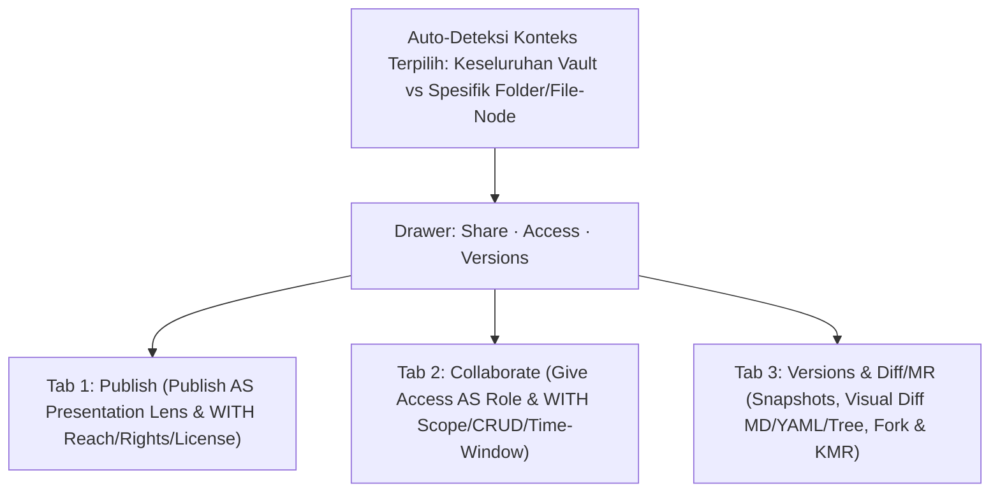

# Arsitektur Essential VCS, Kolaborasi & Publikasi Granular (`Vault & Node Level`)

## Ringkasan 3 Baris
- Mengkonsolidasikan tiga kapabilitas pembeda platform ke dalam satu antarmuka kontekstual di `/app` (**"Share · Access · Versions" Drawer/Sheet**): **Essential VCS** (*Snapshot, Visual Diff, Fork, Knowledge Merge Request*), **Collaborate (`Give Access AS & WITH`)**, dan **Share & Publish (`Publish AS & WITH`)**.
- Menegakkan prinsip **Granular Vault-Level & Node-Level Sovereignty**: aturan akses, kolaborasi, dan publikasi berlaku penuh baik pada **keseluruhan Vault** maupun **spesifik Folder-Node / File-Node**—memungkinkan satu Vault tetap `private` selagi menerbitkan atau membagikan cabang Folder/File pilihan ke `/:username` atau kolaborator tertentu.
- Mempertahankan simetri mutlak `PolicyEngine` ↔ Postgres RLS (`can_access_resource`), *hard cutover* root kanonik `/:username` & `/@:username` di `src/domains/community/`, dan lisensi terbuka default **`CC BY-SA 4.0`**.

---

## 1. Essential VCS (*Zero Git CLI Friction*)

Dirancang untuk peneliti, penulis, dan dosen/murid tanpa kewajiban menguasai baris perintah Git (`src/domains/vcs/`):
1. **Snapshot (*Version History & Rollback*):** Rekam titik kondisi teks Markdown, properti YAML, dan struktur pohon secara berkala atau manual beserta pemulihan satu klik.
2. **Visual Diff:** Antarmuka komparasi visual (`vcsDiffEngine.ts`) yang membandingkan perubahan **teks Markdown**, **properti YAML Frontmatter**, dan **struktur Folder-Node / File-Node** secara berdampingan.
3. **Fork & Knowledge Merge Request (`KMR`):** Pengguna terautentikasi dapat mem-*fork* karya publik (`Allow Fork`) ke vault pribadi, menyuntingnya secara bebas, lalu mengajukan **`KMR`**—baik untuk kolaborasi riset terbuka, review artikel di mode `Studio`, maupun pengumpulan & evaluasi tugas murid di mode `Academy`.

---

## 2. Collaborate — *"Give Access AS & WITH"* (Vault-Level & Node-Level)

| Dimensi Kolaborasi | Nilai & Opsi Resmi | Implementasi & Penyimpanan |
| :--- | :--- | :--- |
| **`AS` (Peran Umum)** | `Viewer` · `Commenter / Reviewer` · `Contributor` *(via Merge Request)* · `Editor / Co-Author` · `Admin / Curator` | Evaluasi simetris di `policyEngine.ts` ↔ `can_access_resource()` & `audit_logs`. |
| **`AS` (Peran Kontekstual `Academy`)** | `Student` · `Teacher / Mentor` · `Institution Admin` | Terintegrasi dengan *Living Student Sub-Nodes* & aturan 3 lapis `academy`. |
| **`WITH` (Cakupan Target)** | **Seluruh Vault** ATAU **spesifik Folder-Node / File-Node** | Diatur pada blok `access` (dan `access.node_overrides`) di **`.app/config.json`** serta `vault_members`. |
| **`WITH` (Batasan Operasional)** | Matriks izin **CRUD** per node, **time-window** (*open/close*), & visibilitas tautan undangan (`share_links`) | Token ber-expiry + *Co-Presence Avatars* + *Block-Hash Comments*. |

---

## 3. Share & Publish — *"Publish AS & WITH"* (Vault-Level & Node-Level)

1. **`AS` (*Presentation Lens* di `/:username` dan `/explore`):**
   - **`atlas`**: Konstelasi peta pengetahuan, sitasi riset, dan graf interaktif (1-to-1 dengan mode `Atlas`).
   - **`publication`**: Artikel, esai, buku, & portofolio baca publik (1-to-1 dengan mode `Studio`).
   - **`course`**: Silabus, kompetensi DAG, & materi ajar terbuka (1-to-1 dengan mode `Academy`).
   - **`template`**: Berbagi paket konfigurasi **`.app/config.json`** sebagai *Community Preset* di `/explore`.
2. **`WITH` (Jangkauan & Hak Publik):**
   - **Visibilitas 4-State:** `public_listed` (tampil di `/explore` & `/:username`), `public_unlisted` (hanya via tautan langsung), `shared` (komunitas/grup/kolaborator terbatas), atau `private` (tertutup penuh).
   - **Hak & Lisensi:** Lisensi default **`CC BY-SA 4.0`** (dapat di-override di `.app/config.json` / YAML), tombol toggle **`Allow Citation`** (menghasilkan `[[@user/vault/note]]` & ekspor APA/MLA/IEEE/BibTeX), dan **`Allow Fork`**.
3. **Granularitas Node-Level (*Partial Vault Publishing*):**
   - Pemilik dapat membiarkan Vault induk berstatus `private` di disk/cloud, namun menandai spesifik **Folder-Node** atau **File-Node** di `publishing.node_overrides` (`.app/config.json`) atau YAML frontmatter (`visibility: public_listed`) agar hanya node terpilih yang tayang di `/:username/:vaultSlug/...`. Sebaliknya, pada Vault publik, node ber-YAML `visibility: private` dikecualikan secara mutlak dari indeks, graf publik, & bundle CDN.

---

## 4. Unified UI Surface di `/app`: `"Share · Access · Versions"` Drawer/Sheet

Untuk menghilangkan fragmentasi antara modal share, daftar anggota, dan panel riwayat VCS, seluruh fungsi kolaborasi dan penerbitan disatukan dalam **satu Drawer/Sheet kontekstual cerdas** pada `/app`:

---

## 5. Refaktor `community`, Rute `/:username` & Gerbang Rilis (`ReleaseStageGate`)
- **`src/domains/community/`:** Menggantikan `public-reader/` dengan penghentian total rute `/p/*` (*hard cutover*) menuju `/:username`, `/@:username`, dan `/explore` yang dijaga `RESERVED_SLUGS` 3 lapis.
- **`ReleaseStageGate`:** Menegakkan akses publik & autentikasi lintas Stage 1 (`partner_invitations`), Stage 2 (approval individual per-user di `/admin` + kurasi manual *Verified Scholar*), hingga Stage 3 (`plans`/`plan_quotas` dinamis + CRDT Yjs).

---

## Terkait
- [Master Blueprint v2.0](../00-meta/00-0-master-blueprint.md)
- [Arsitektur Data & Skema `.app/config.json`](data-and-storage.md)
- [Visi & Spesifikasi Academy 3-Lapis](../06-lms/lms-vision.md)
- [ADR-0005: In-Browser VCS](adr/ADR-0005-in-browser-vcs-for-markdown-collaboration.md)
- [ADR-0007: Community Domain & Canonical Routing](adr/ADR-0007-community-domain-and-canonical-root-routing.md)
- [ADR-0009: Stage Gate, RBAC & Dynamic Billing](adr/ADR-0009-release-stage-gate-rbac-and-dynamic-billing.md)
- [ADR-0010: Visibility State Machine & Citations](adr/ADR-0010-visibility-state-machine-licensing-and-citations.md)
