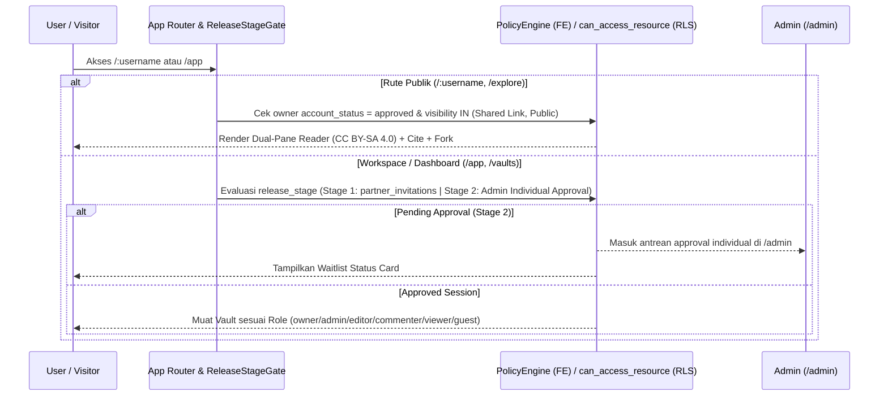

# Arsitektur Kolaborasi, RBAC & Publikasi `/:username` (`Collaboration & Publishing`)

## Ringkasan 3 Baris
- Mengintegrasikan alur kontrol rilis **3-Stage Progressive Shipping**, **PolicyEngine RBAC 2-Lapis**, dan **4 State Visibilitas Vault** secara simetris antara antarmuka SPA dan kebijakan Postgres RLS.
- Mengunci **hard cutover** dari rute legacy `/p/*` menuju `/:username` & `/@:username` beserta refaktor `src/domains/public-reader/` → **`src/domains/community/`** (`STEP-01.2`).
- Menstandardisasi protokol pengetahuan publik dengan lisensi default **`CC BY-SA 4.0`**, kurasi manual *Verified Scholar* di `/admin`, sitasi federated `[[@user/vault/note]]`, dan *Fork & Merge Request* berbasis VCS.

---

## 1. Aliran Gate Rilis & Kontrol Akses Berlapis

---

## 2. Empat State Visibilitas Vault & Pengecualian Per-Catatan

| State Visibilitas | Penentu Akses (`PolicyEngine` & RLS) | Override Per-Catatan | Pengiriman Media & Indeks |
| :--- | :--- | :--- | :--- |
| **`Private`** *(Default)* | Hanya pemilik (`auth.uid() = owner_id`) | Seluruh catatan privat | Bucket privat + `createSignedUrl`; `noindex` |
| **`Shared`** | Anggota `vault_members` + pemegang token `share_links` ber-expiry | Menghormati hak peran per folder | `createSignedUrl` ber-TTL pendek; `noindex` |
| **`Public Unlisted`** | Siapa pun dengan URL tepat + akun pemilik `approved` | `visibility: private` pada YAML memfilter note keluar | Signed/published manifest terotorisasi; `noindex` |
| **`Public Listed`** | Terindeks terbuka pada `/:username` dan `/explore` + akun pemilik `approved` | `visibility: private` pada YAML memfilter note keluar | CDN + OG Card dinamis + `Schema.org/ScholarlyArticle` |

---

## 3. Refaktor `community` & Protokol Sitasi / Fork (`STEP-01.2`, `03.1`–`03.3`)

1. **Refaktor Domain & Hard Cutover (`STEP-01.2`):** Seluruh modul `src/domains/public-reader/` (`PublicReaderOrchestrator.tsx`, `InteractiveGraph.tsx`, `MarkdownReader.tsx`, `PublicReaderService.ts`) dipindahkan ke `src/domains/community/` (`CommunityOrchestrator.tsx`). Semua rute `/p/*` di `src/App.tsx` **dimatikan langsung tanpa redirect** dan digantikan oleh `/explore`, `/:username`, `/:username/:vaultSlug`, `/:username/:vaultSlug/:noteSlug`, dan alias `/@:username/*` dengan validasi `RESERVED_SLUGS`.
2. **Lisensi Default & Kurasi Akademik:** Vault publik mewarisi **`CC BY-SA 4.0`** (dapat di-override via YAML `license`) agar legal dan higienis untuk fitur *Cite this Note* serta *Fork to My Vault*. Lencana *Verified Scholar* dikurasi secara manual oleh Admin melalui `/admin`.
3. **VCS Merge Request & CRDT:** Fitur *Knowledge Merge Request* (`VcsCreateMergeRequestModal.tsx`, `VcsInteractiveMergeModal.tsx`, `vcsDiffEngine.ts`) diperluas untuk kontribusi lintas-pengguna dari fork publik (`STEP-03.3`), disusul sinkronisasi real-time CRDT Yjs untuk tim (`STEP-04.3`).

---

## Terkait
- [ADR-0005: In-Browser VCS](adr/ADR-0005-in-browser-vcs-for-markdown-collaboration.md)
- [ADR-0007: Community Domain & Canonical Routing](adr/ADR-0007-community-domain-and-canonical-root-routing.md)
- [ADR-0009: Stage Gate, RBAC & Dynamic Billing](adr/ADR-0009-release-stage-gate-rbac-and-dynamic-billing.md)
- [ADR-0010: Visibility State Machine & Citations](adr/ADR-0010-visibility-state-machine-licensing-and-citations.md)
