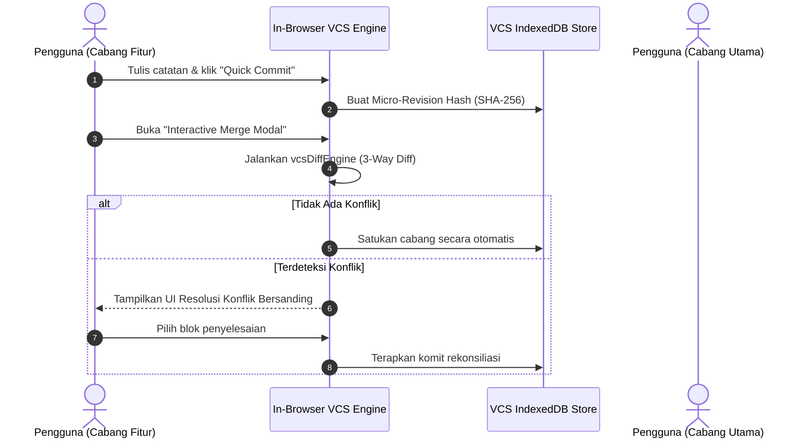

# Arsitektur Kolaborasi dan Publikasi

## Ringkasan 3 Baris
- Menggunakan arsitektur kontrol versi terpadu (*In-Browser VCS*) untuk mencatat komit mikro, percabangan, dan penyatuan draf kerja tim.
- Portal pembaca publik anonim (`/p/:username/:vaultSlug`) memisahkan aset pembaca dari ruang kerja utama untuk performa maksimal.
- Mengombinasikan RLS Supabase dan deteksi konflik 3-arah (*3-way merge engine*) sebagai fondasi sebelum adopsi penuh CRDT.

---

## 1. Alur Kontrol Versi Internal (`src/domains/vcs/`)

---

## 2. Rute dan Arsitektur Pembaca Publik (`/p/*`)

Portal pembaca publik diisolasi di `src/domains/public-reader/`:
- **Pemuatan Ringan:** Tidak memuat seluruh store editor berat atau pustaka parsing kompleks yang tidak diperlukan pembaca.
- **Rute yang Didukung:**
  - `/p/:username/:vaultSlug/:noteSlug`: Membaca catatan spesifik.
  - `/p/:username/:vaultSlug`: Menampilkan pohon berkas publik dan graf tinjauan.
  - `/p/:vaultSlug`: Tautan publik singkat (*short-link*).

---

## Terkait
- [Ikhtisar Arsitektur Sistem](system-overview.md)
- [Arsitektur Data dan Penyimpanan](data-and-storage.md)