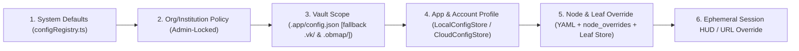

# Arsitektur Data, Storage & Single Central `.app/config.json`

## Ringkasan 3 Baris
- Mendokumentasikan strategi penyimpanan multi-driver (`IVaultStorageDriver.ts`) yang menjamin data lokal (`FileSystemService.ts`, `IndexedDbVaultDriver.ts`) berdaulat di atas berkas `.md` + YAML murni dan 100% gratis selamanya.
- Menetapkan aturan **Satu File Konfigurasi Sentral (`.app/config.json`)** yang mengkonsolidasikan seluruh preset mode, **`Deep Explorer`**, layout graf, schema YAML, publikasi/akses granular Vault & Node, aturan *Academy* 3-lapis, dan ekstensi `@app/sdk` tanpa fragmentasi berkas (`preset.json`, `lms-policy.json`, `setting.json` dilarang).
- Memetakan skema PostgreSQL V4+, proteksi bucket privat (`createSignedUrl`), 6-Layer Cascading Config, serta standar migrasi kompatibilitas mundur *zero-loss* dari path legacy `.vk/` dan `.obmap/`.

---

## 1. Isolasi Storage Drivers (`ADR-0004`)

| Driver | Modul Kode | Tujuan & Tahap | Jaminan Kedaulatan Data |
| :--- | :--- | :--- | :--- |
| **File System Access API** | `FileSystemService.ts` | `[IMPLEMENTED]` — Penyimpanan folder `.md`, Folder-Node/File-Node, media, & konfigurasi tunggal `.app/config.json` di disk lokal. | Berkas murni *unopinionated* di disk pengguna; gratis tak terbatas selamanya. |
| **IndexedDB Driver** | `IndexedDbVaultDriver.ts` | `[IMPLEMENTED]` — Cache offline PWA & penyimpanan lokal lintas-peramban. | Reaktif lokal tanpa ketergantungan jaringan. |
| **Cloud Vault Driver** | `CloudVaultService.ts` | `[IMPLEMENTED]` — Sinkronisasi terotorisasi ke Supabase Postgres & Storage. | Diatur kuota dinamis DB pada Stage 3; media privat via `createSignedUrl`. |
| **In-Memory Sandbox Driver** | `InMemoryVaultDriver.ts` `[PLANNED]` | `STEP-02.2` — Sandbox instan di Landing `/` (`< 65KB`). | Data sementara di RAM & langsung dimigrasikan saat akun lolos `ReleaseStageGate`. |
| **Prototype Mock State (Track 2)** | `src/prototype/**/mock*.ts` `[IMPLEMENTED]` | `/prototype` — Eksperimen UI/UX & arsip `src/prototype/snapshots/<stage-id>/`. | 100% *zero-backend* (*in-memory deterministic mock state*); dilarang menyentuh Supabase, Auth, atau IndexedDB/FS API. |

---

## 2. Skema Database & Storage Security

### Skema Terpasang (`supabase/migrations/`)
- **Tabel Inti V4+:** `user_roles`, `vault_members`, `notes`, `note_revisions`, `note_links`, `audit_logs`, `platform_settings`, `partner_invitations`, `share_links`, serta fungsi `can_access_resource()`.
- **Bucket Storage (`vault-media`, `avatars`):** Terisolasi pada folder UUID user dan **wajib diakses memakai `createSignedUrl`** (aturan absolut #5 `AGENTS.md`).

### Migrasi Terencana v2.0 (`STEP-01.2` s/d `STEP-04.2`)
- **Node-Level Publishing & Granular Access:** Dukungan override per Folder-Node/File-Node (`node_overrides`) pada evaluasi visibilitas & akses `can_access_resource()`.
- **Social Graph & Essential VCS (`STEP-03.1`–`03.3`):** `scholar_profiles`, `scholar_follows`, `vault_topics`, `scholar_verifications`, `cross_vault_citations`, `vault_forks`, `knowledge_merge_requests`, `note_annotations`.
- **Dynamic Plans, Academy Rules & Quotas (`STEP-04.1`–`05.1`):** `plans`, `plan_entitlements`, `plan_quotas`, `subscriptions`, `usage_quotas`, `billing_invoices`, `org_teamspaces`, `org_seats`, `academy_progress`.

---

## 3. Single Central Configuration (`.app/config.json`) & Konfigurasi 6-Lapis

### 3.1 Larangan Fragmentasi File Konfigurasi
Seluruh konfigurasi tingkat vault dan override tingkat node/folder **wajib terpusat di dalam satu berkas kanonik: `.app/config.json`**.
- **DILARANG** memecah konfigurasi menjadi berkas terpisah seperti `preset.json`, `lms-policy.json`, `setting.json`, `layout.json`, atau file konfigurasi sampingan lainnya.
- Path `.vk/` dan `.obmap/` (seperti `.vk/config.json`, `.obmap/config.json`, `.vk/mindmap-layout.json`, `.obmap/mindmap-layout.json`) hanya dipertahankan sebagai **fallback pembacaan legacy** untuk kompatibilitas mundur *zero-loss*, dan disatukan ke `.app/config.json` saat disimpan.
- `.app/config.json` dapat diinspeksi dan disunting secara langsung di UI melalui **`Settings Hub > Workspace > Central .app/config.json Raw Inspector & Dynamic Editor`** yang terhubung real-time ke seluruh kontrol `<SettingsHub />` (dilengkapi **Real-Time Validation** & **Help/Documentation Section**).

### 3.2 Skema Kanonik `.app/config.json` (7 Blok Top-Level)

```json
{
  "meta": {
    "version": "2.0.0",
    "vault_id": "uuid-or-local-slug",
    "title": "Vault Pengetahuan Utama",
    "default_license": "CC BY-SA 4.0",
    "namespace": "app"
  },
  "mode": {
    "primary_mode": "atlas",
    "default_deep_explorer_view": "diagram",
    "layout": {
      "default_diagram_solver": "mindmap",
      "subtree_overrides": {},
      "boundaries": [],
      "summaries": [],
      "manual_offsets": {}
    }
  },
  "schema": {
    "templates": {},
    "required_yaml_properties": ["epistemic_status", "tags"],
    "epistemic_states": ["seedling", "budding", "evergreen", "peer_reviewed"]
  },
  "publishing": {
    "presentation_lens": "atlas",
    "visibility": "private",
    "allow_citation": true,
    "allow_fork": true,
    "node_overrides": {
      "publik/esai-unggulan.md": {
        "visibility": "public_listed",
        "presentation_lens": "publication",
        "slug": "esai-unggulan"
      }
    }
  },
  "access": {
    "collaborators": [],
    "node_overrides": {
      "riset/rahasia/": {
        "role": "reviewer",
        "crud": { "create": false, "read": true, "update": false, "delete": false },
        "time_window": { "start": "2026-11-20T00:00:00Z", "end": "2026-12-31T23:59:59Z" }
      }
    }
  },
  "academy": {
    "enabled": false,
    "student_subnodes": true,
    "node_rules": {
      "kurikulum/modul-1/tugas-1/": {
        "layer": 2,
        "allowed_formats": [".md", ".pdf"],
        "max_files": 3,
        "max_size_mb": 10,
        "required_yaml": ["student_id", "progress"],
        "crud": { "create": true, "read": true, "update": true, "delete": false },
        "time_window": { "open": "2026-11-20T08:00:00Z", "close": "2026-12-01T23:59:00Z" },
        "execution_environment": {
          "allowed_devices": ["laptop", "tablet"],
          "require_focus_fullscreen": false
        }
      }
    }
  },
  "extensions": {
    "enabled_plugins": [],
    "permissions": {},
    "plugin_configs": {},
    "ai": {
      "provider": "ollama",
      "local_rag": true
    }
  }
}
```

### 3.3 Hierarki Resolusi Konfigurasi 6-Lapis (`ADR-0011`)



- Lapis yang memiliki prioritas lebih tinggi menimpa lapisan sebelumnya, **kecuali** properti yang dikunci flag `lockedByOrgAdmin` pada Lapis 2 (*Org/Institution Policy*) yang tetap mutlak dan tampil *read-only* dengan indikator pemilik kebijakan.

---

## 4. Standar Namespace Storage *Brand-Agnostic* & Migrasi Zero-Loss (`ADR-0013`)

Seluruh infrastruktur teknis menggunakan namespace netral **`app`** (dengan pembacaan fallback *zero-loss* dari namespace transisi `vk-*`/`.vk/` dan legacy `obmap-*`/`.obmap/` lewat `storageKeyMigrator.ts`):

| Lapisan Storage | Kanonik Standar | Fallback Kompatibilitas (`vk` → `obmap`) | Mekanisme Migrasi Zero-Loss |
| :--- | :--- | :--- | :--- |
| **Vault Central Config** | **`.app/config.json`** | `.vk/config.json`, `.vk/mindmap-layout.json`, `.obmap/config.json` | Baca `.app/config.json` lebih dulu; bila belum ada, gabung & migrasikan dari `.vk/*` atau `.obmap/*`. |
| **IndexedDB & Device Keys** | `app-*` / `AppConfigDB` *(transisi kode saat ini `VkConfigDB`, `vk-*`)* | `VkConfigDB`, `vk-*`, `ObmapConfigDB`, `obmap-*` | Salin otomatis entri legacy ke kunci kanonik saat inisialisasi pertama tanpa menghapus data user. |
| **Theme & CSS Scope** | `.app-themed-root`, `--app-*` | `.vk-themed-root`, `--vk-*`, `.obmap-themed-root`, `--ob-*` | CSS root mendukung fallback berantai agar snippet & tema tersimpan tidak pernah rusak. |
| **Extension SDK** | **`@app/sdk`**, `.app/plugins/` | `@vk/sdk`, `.vk/plugins/`, `@obmap/sdk`, `.obmap/plugins/` | Paket SDK direferensikan kanonik sebagai `@app/sdk` dan dipetakan adaptif pada manifest. |

---

## Terkait
- [Master Blueprint v2.0 §6](../00-meta/00-0-master-blueprint.md)
- [Glosarium Kanonik](../00-meta/glossary.md)
- [ADR-0004: Multi-Strategy Storage Isolation](adr/ADR-0004-multi-strategy-storage-isolation.md)
- [ADR-0011: Six-Layer Config & Unified Theme Engine](adr/ADR-0011-six-layer-cascading-config-and-unified-theme-engine.md)
- [ADR-0013: Brand-Agnostic Infrastructure & Dynamic Branding](adr/ADR-0013-brand-agnostic-infrastructure-and-dynamic-branding.md)
