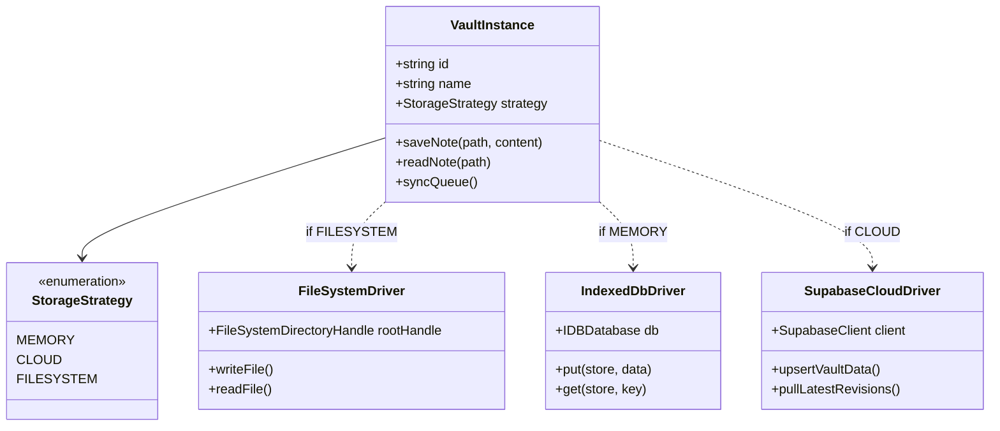

# Arsitektur Data dan Penyimpanan

## Ringkasan 3 Baris
- Mendukung tiga strategi penyimpanan per-vault yang terisolasi total: `memory`/IndexedDB, `cloud` (Supabase), dan `filesystem` (Native FS API).
- Mekanisme *auto-save* otomatis mencatat perubahan dokumen ke antrean jurnal lokal sebelum melakukan sinkronisasi *cloud*.
- Skema PostgreSQL Supabase dilindungi RLS berjenjang pada level vault, folder, dan berkas catatan.

---

## 1. Strategi Penyimpanan Multi-Driver (Vault Storage Strategy)

---

## 2. Model Relasi Database Supabase (`supabase/migrations/`)

Tabel utama yang mengatur persistensi dan kolaborasi:
- `user_vaults`: Menyimpan metadata vault, pemilik (`owner_id`), dan strategi sinkronisasi.
- `vault_notes`: Berkas catatan individual dengan jalur folder, konten Markdown, dan hash integritas.
- `vault_collaborators`: Relasi banyak-ke-banyak antara pengguna dan vault dengan peran (`viewer`, `editor`, `admin`).
- `vault_permissions`: Perizinan granular tingkat folder dan file dengan dukungan *inheritance*.
- `vault_vcs_commits`: Riwayat komit mikro, penanda cabang, dan snapshot rekonsiliasi.

---

## 3. Kebijakan Row-Level Security (RLS Matrix)

| Tabel | Operasi | Kriteria Akses RLS |
| :--- | :--- | :--- |
| `user_vaults` | `SELECT` | `owner_id = auth.uid()` ATAU terdaftar di `vault_collaborators` |
| `vault_notes` | `INSERT/UPDATE` | Pemilik vault ATAU kolaborator dengan hak `editor` / `admin` |
| `public_published_notes` | `SELECT` | Akses terbuka tanpa autentikasi (`anon` & `authenticated`) |

---

## Terkait
- [Ikhtisar Arsitektur Sistem](system-overview.md)
- [Arsitektur Kolaborasi dan Publikasi](collaboration-and-publishing.md)