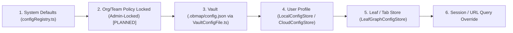

# Arsitektur Data, Storage & Konfigurasi 6-Lapis (`Data & Storage`)

## Ringkasan 3 Baris
- Mendokumentasikan strategi penyimpanan multi-driver (`IVaultStorageDriver.ts`) yang menjamin data lokal (`FileSystemService.ts`, `IndexedDbVaultDriver.ts`) 100% gratis dan berdaulat selamanya.
- Memetakan skema PostgreSQL V4 aktual (`20261031000000_v4_collaboration_and_publishing.sql`), proteksi bucket privat (`createSignedUrl`), serta skema v2.0 untuk Stage Gate, Citasi, dan paket/kuota dinamis.
- Menjelaskan tata kelola konfigurasi 6-lapis terisolasi (`.obmap/`, `LocalConfigStore.ts`, `CloudConfigStore.ts`) dengan mekanisme *Org-Lock* berbasis peran.

---

## 1. Isolasi Storage Drivers (`ADR-0004`)

| Driver | Modul Kode | Tujuan & Tahap | Jaminan Kedaulatan Data |
| :--- | :--- | :--- | :--- |
| **File System Access API** | `FileSystemService.ts` | `[IMPLEMENTED]` — Penyimpanan folder `.md` & `.obmap/` asli di OS lokal. | Berkas murni di disk pengguna; gratis tak terbatas selamanya. |
| **IndexedDB Driver** | `IndexedDbVaultDriver.ts` | `[IMPLEMENTED]` — Cache offline PWA & penyimpanan lokal lintas-peramban. | Reaktif lokal tanpa ketergantungan jaringan. |
| **Cloud Vault Driver** | `CloudVaultService.ts` | `[IMPLEMENTED]` — Sinkronisasi terotorisasi ke Supabase Postgres & Storage. | Diatur kuota dinamis DB pada Stage 3; media privat via `createSignedUrl`. |
| **In-Memory Sandbox Driver** | `InMemoryVaultDriver.ts` `[PLANNED]` | `STEP-02.2` — Sandbox instan di Landing `/` (`< 65KB`). | Data sementara di RAM & langsung dimigrasikan saat akun lolos `ReleaseStageGate`. |

---

## 2. Skema Database & Storage Security

### Skema Terpasang (`supabase/migrations/20261031000000_v4_collaboration_and_publishing.sql`)
- **Tipe Enum:** `app_role`, `vault_member_role`, `note_status`.
- **Tabel Inti V4:** `user_roles`, `vault_members`, `notes`, `note_revisions`, `note_links`, `audit_logs`.
- **Bucket Storage (`vault-media`, `avatars`):** Terisolasi pada folder UUID user dan **wajib diakses memakai `createSignedUrl`** (aturan absolut #5 `AGENTS.md`).
- **Catatan Utang Teknis (`TD-005`):** `src/global/api/untypedSupabase.ts` dijadwalkan untuk dihapus dan diganti tipe hasil generasi migrasi SQL pada **`STEP-01.1`**.

### Migrasi Terencana v2.0 (`STEP-01.2` s/d `STEP-04.2`)
- **Stage Gate & Profiles (`STEP-01.2`–`01.3`):** `platform_settings` (`release_stage`), `partner_invitations`, kolom `account_status` (`pending_approval` | `approved` | `suspended`), constraint `RESERVED_SLUGS`.
- **Policy Engine & Visibility (`STEP-01.4`):** `share_links`, fungsi RLS `can_access_resource()`.
- **Social Graph & Fork/MR (`STEP-03.1`–`03.3`):** `scholar_profiles`, `scholar_follows`, `vault_topics`, `scholar_verifications` (kurasi manual Admin), `cross_vault_citations`, `vault_forks`, `knowledge_merge_requests`, `note_annotations`.
- **Dynamic Plans, Quotas & Billing (`STEP-04.1`–`04.2`):** `plans`, `plan_entitlements`, `plan_quotas`, `subscriptions`, `usage_quotas`, `billing_invoices`, `org_teamspaces`, `org_seats`.

---

## 3. Hierarki Resolusi Konfigurasi 6-Lapis (`ADR-0011`)

- Lapis yang memiliki prioritas lebih tinggi menimpa lapisan sebelumnya, **kecuali** properti yang diberi flag `lockedByOrgAdmin` pada Lapis 2 (*Org/Institution Policy*) yang tetap menjadi penentu mutlak dan tampil *read-only* pada UI `SettingsHub.tsx`.

---

## Terkait
- [Master Blueprint v2.0 §6.4](../00-meta/00-0-master-blueprint.md)
- [ADR-0004: Multi-Strategy Storage Isolation](adr/ADR-0004-multi-strategy-storage-isolation.md)
- [ADR-0011: Six-Layer Config & Unified Theme Engine](adr/ADR-0011-six-layer-cascading-config-and-unified-theme-engine.md)
- [Playbook Eksekusi (`STEP-01.1`, `STEP-01.5`, `STEP-04.1`)](../02-planning/README.md)
