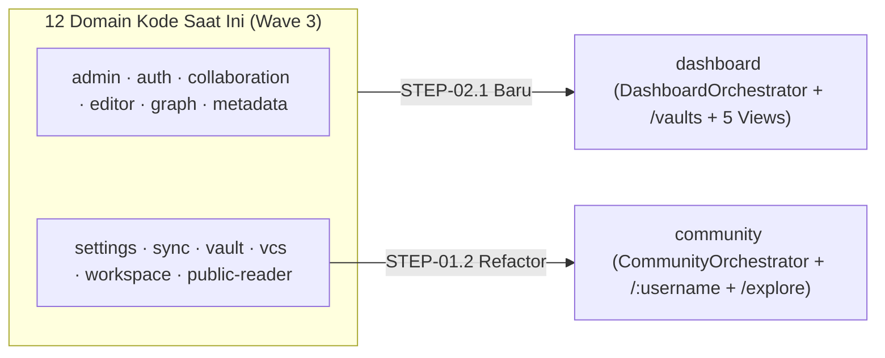

# Peta 13 Domain Terisolasi (`Domain Map`)

## Ringkasan 3 Baris
- Memetakan batas tanggung jawab seluruh domain di `src/domains/`: **12 domain aktif** pada kode saat ini dan transisi terencana menuju **13 domain target v2.0**.
- Mengunci keputusan refaktor `src/domains/public-reader/` → **`src/domains/community/`** (`STEP-01.2`) serta penambahan domain baru ke-13 **`src/domains/dashboard/`** (`STEP-02.1`).
- Mendokumentasikan registry pengaturan internal (`configRegistry.ts`, `pluginRegistry.ts`, `schemaRegistry.ts`) di `src/domains/settings/` untuk menutup `DRFT-013`.

---

## 1. Peta Topologi Transisi (`12 Aktif → 13 Target v2.0`)

---

## 2. Katalog Lengkap 13 Domain Target

| # | Domain (`src/domains/*`) | Status Aktual | Tanggung Jawab Inti | Modul / Simbol Kunci Terverifikasi | Evolusi Target v2.0 (`STEP`) |
| :-: | :--- | :---: | :--- | :--- | :--- |
| 1 | **`workspace`** | `[IMPLEMENTED]` | Shell multi-pane/tab `/app`, command palette, registry view & lifecycle vault | `WorkspaceOrchestrator.tsx`, `WorkspaceViewRegistry.tsx`, `CommandRegistry.ts`, `WorkspaceSettingsLeaf.tsx`, `useVaultLifecycle.ts` | Onboarding Guided Tour & host Extension Points SDK (`STEP-02.3`, `05.3`). |
| 2 | **`editor`** | `[IMPLEMENTED]` | Penyunting Markdown CodeMirror 6 terpisah dari YAML Frontmatter | `EditorMarkdownView.tsx`, `EditorPropertiesPanel.tsx` | Skema `epistemic_status`/`doi`/`license` & anotasi blok (`STEP-03.2`, `03.3`). |
| 3 | **`graph`** | `[IMPLEMENTED]` | Kanvas graf Canvas2D, solver deterministik + Free-Force (*Graph/Diagram* di **`Deep Explorer`**), kontroler reaktif | `GraphCanvas.tsx`, `GraphFloatingDock.tsx`, `useGraphCanvasController.ts`, `layoutCategory.ts`, `compositeLayoutEngine.ts`, `mindmap.ts`, `fishbone.ts`, `timeline.ts`, `treeLayouts.ts` | Academy 3-Layer Competence Tree DAG, `argument-map`, `citation-tree`, & modul visual **`Deep Explorer`** (`STEP-05.1`–`05.2`). |
| 4 | **`metadata`** | `[IMPLEMENTED]` | Indeks backlink, tag, & metadata via Aho-Corasick Web Worker | `mentions.worker.ts`, `aho-corasick.ts`, `MetadataCache.ts` | Parser rujukan federated `[[@username/vault/note]]` (`STEP-03.2`) + indeks lokal RAG BYO-AI / Zotero. |
| 5 | **`vault`** | `[IMPLEMENTED]` | Abstraksi CRUD, Workspace Preset metadata (`primary_mode`), & driver penyimpanan multi-strategi | `VaultManager.ts`, `IVaultStorageDriver.ts`, `FileSystemService.ts`, `IndexedDbVaultDriver.ts`, `CloudVaultService.ts`, `ImportExportService.ts`, `VaultMemberService.ts`, `VaultCard.tsx`, `VaultModeSelector.tsx` | `InMemoryVaultDriver` (Sandbox Landing) & penegakan kuota dinamis (`STEP-02.2`, `04.1`). |
| 6 | **`sync`** | `[IMPLEMENTED]` | Sinkronisasi status lokal-ke-cloud & antrean perubahan | Submodul `src/domains/sync/` | Dukungan sinkronisasi delta CRDT Yjs & status downgrade (`STEP-04.1`, `04.3`). |
| 7 | **`vcs`** | `[IMPLEMENTED]` | *Essential VCS*: Snapshot, Visual Diff (MD/YAML/Tree), branch, Fork, & Knowledge Merge Request | `VcsCreateMergeRequestModal.tsx`, `VcsInteractiveMergeModal.tsx`, `VcsCoPresenceAvatars.tsx`, `vcsDiffEngine.ts` | Integrasi ke Drawer `"Share · Access · Versions"`, *Fork to My Vault* & KMR riset/Academy (`STEP-03.3`). |
| 8 | **`collaboration`** | `[IMPLEMENTED]` / `[PARTIAL]` | *Give Access* & *Publish `AS & WITH`* tingkat Vault maupun spesifik Node/Folder | `CollabDocumentSharePopover.tsx`, `CollabBulkPublishModal.tsx`, `CollabSharePublishTab.tsx` | Unified `"Share · Access · Versions"` Drawer, Teamspaces, CRUD/time-window per node, & CRDT Yjs (`STEP-04.2`–`04.3`). |
| 9 | **`community`** | `[IMPLEMENTED]` / `[PARTIAL]` | Portal baca publik dual-pane & Presentation Lenses (`atlas`, `publication`, `course`, `template`) | `CommunityOrchestrator.tsx`, `PublicReaderInteractiveGraph.tsx`, `PublicReaderMarkdownReader.tsx`, `PublicReaderService.ts` | Halaman profil `/:username`, `/explore` (+ `Community Presets`), *Cite*, *Follow*, & *Fork* (`STEP-03.1`–`03.3`). |
| 10 | **`dashboard`** *(Baru)* | `[VISION]` | Beranda `/vaults`, **`Deep Explorer`** & *Derived Knowledge Views*, Core Presets (`Atlas`/`Studio`/`Academy`/`Freeform`), & Community Feed | `DashboardOrchestrator.tsx` `[PLANNED]`, `DashboardWidgetRegistry.ts` `[PLANNED]` | Memisahkan UX beranda & pemilih lensa dari `vault` (`STEP-02.1`). |
| 11 | **`auth`** | `[IMPLEMENTED]` / `[PARTIAL]` | Autentikasi sesi & evaluasi RBAC terpadu | `useVaultPermission.ts`, `policyEngine.ts`, `ReleaseStageService.ts` | Penegakan simetris PolicyEngine ↔ Postgres RLS baik level Vault maupun Node/Folder. |
| 12 | **`admin`** | `[IMPLEMENTED]` / `[PARTIAL]` | Panel operasional `/admin` & wizard setup awal admin | `AdminOrchestrator.tsx`, `AdminFirstTimeSetupWizard.tsx` | Kurasi *Verified Scholar* & *Community Presets → Core Presets*, serta kuota dinamis (`STEP-03.1`, `04.2`). |
| 13 | **`settings`** | `[IMPLEMENTED]` / `[PARTIAL]` | **Single Adaptive `<SettingsHub />`** (*Dual Navigator*: Breadcrumb + Right Sidebar; 3 Kategori `Account → Workspace → Vault`), sentralisasi tunggal **`.app/config.json`**, `Deep Explorer`, profil, tema, & **`@app/sdk`** | `SettingsHub.tsx`, `ProfileService.ts`, `SettingsClaimUsernameModal.tsx`, `VaultConfigFile.ts`, `LocalConfigStore.ts`, `CloudConfigStore.ts`, `useThemeStore.ts`, `configRegistry.ts`, `pluginRegistry.ts`, `schemaRegistry.ts`, `registerConfigSections.ts` | Migrasi 1:1 Track 2 `<SettingsHub />` (*Dual Navigator*, 3 kategori, `Workspace Preset` Impact Preview, `Central .app/config.json Raw Inspector`), fallback `.vk/`/`.obmap/`, & `@app/sdk` Worker Sandbox (`UI-STEP-07`, `STEP-05.3`). |

> **Pemisahan `src/domains/` vs `src/prototype/` (Track 2):** Eksperimen UI/UX awal dinkubasi secara *zero-backend* di `src/prototype/` (rute `/prototype`) sebelum dimigrasikan **1:1 secara identik** ke bounded domains di `src/domains/` dan diarsipkan ke `src/prototype/snapshots/<stage-id>/`.

---

## Terkait
- [Struktur Repositori (`repository-structure.md`)](repository-structure.md)
- [ADR-0001: Domain-Driven Design](adr/ADR-0001-domain-driven-design-restructuring.md)
- [ADR-0007: Community Domain & /:username](adr/ADR-0007-community-domain-and-canonical-root-routing.md)
- [ADR-0008: Dashboard Domain & Derived Views](adr/ADR-0008-dashboard-domain-and-derived-frontmatter-views.md)
