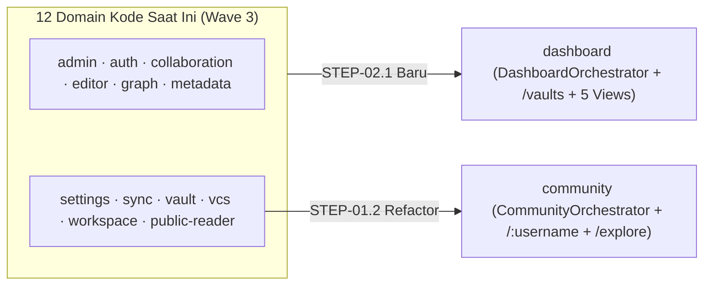

# Peta 13 Domain Terisolasi (`Domain Map`)

## Ringkasan 3 Baris
- Memetakan batas tanggung jawab seluruh domain di `src/domains/`: **12 domain aktif** pada kode saat ini dan transisi terencana menuju **13 domain target v2.0**.
- Mengunci keputusan refaktor `src/domains/public-reader/` → **`src/domains/community/`** (`STEP-01.2`) serta penambahan domain baru ke-13 **`src/domains/dashboard/`** (`STEP-02.1`).
- Mendokumentasikan registry pengaturan internal (`configRegistry.ts`, `pluginRegistry.ts`, `schemaRegistry.ts`) di `src/domains/settings/` untuk menutup `DRFT-013`.

---

## 1. Peta Topologi Transisi (`12 Aktif → 13 Target v2.0`)

---

## 2. Katalog Lengkap 13 Domain Target

| # | Domain (`src/domains/*`) | Status Aktual | Tanggung Jawab Inti | Modul / Simbol Kunci Terverifikasi | Evolusi Target v2.0 (`STEP`) |
| :-: | :--- | :---: | :--- | :--- | :--- |
| 1 | **`workspace`** | `[IMPLEMENTED]` | Shell multi-pane/tab `/app`, command palette, registry view & lifecycle vault | `WorkspaceOrchestrator.tsx`, `WorkspaceViewRegistry.tsx`, `CommandRegistry.ts`, `WorkspaceSettingsLeaf.tsx`, `useVaultLifecycle.ts` | Onboarding Guided Tour & host Extension Points SDK (`STEP-02.3`, `05.3`). |
| 2 | **`editor`** | `[IMPLEMENTED]` | Penyunting Markdown CodeMirror 6 terpisah dari YAML Frontmatter | `EditorMarkdownView.tsx`, `EditorPropertiesPanel.tsx` | Skema `epistemic_status`/`doi`/`license` & anotasi blok (`STEP-03.2`, `03.3`). |
| 3 | **`graph`** | `[IMPLEMENTED]` | Kanvas graf Canvas2D, 4 solver deterministik + Free-Force, kontroler reaktif | `GraphCanvas.tsx`, `GraphWorkspaceControls.tsx`, `useGraphCanvasController.ts`, `layoutCategory.ts`, `mindmap.ts`, `fishbone.ts`, `timeline.ts` | Theme Bridge `theme.ts`, LMS DAG overlay, `argument-map` & `citation-tree` (`STEP-01.5`, `05.1`–`05.2`). |
| 4 | **`metadata`** | `[IMPLEMENTED]` | Indeks backlink, tag, & metadata via Aho-Corasick Web Worker | `mentions.worker.ts`, `aho-corasick.ts`, `MetadataCache.ts` | Parser rujukan federated `[[@username/vault/note]]` (`STEP-03.2`). |
| 5 | **`vault`** | `[IMPLEMENTED]` | Abstraksi CRUD & driver penyimpanan multi-strategi | `VaultManager.ts`, `IVaultStorageDriver.ts`, `FileSystemService.ts`, `IndexedDbVaultDriver.ts`, `CloudVaultService.ts`, `ImportExportService.ts`, `VaultMemberService.ts`, `VaultCard.tsx`, `VaultModeSelector.tsx` | `InMemoryVaultDriver` (Sandbox Landing) & penegakan kuota dinamis (`STEP-02.2`, `04.1`). |
| 6 | **`sync`** | `[IMPLEMENTED]` | Sinkronisasi status lokal-ke-cloud & antrean perubahan | Submodul `src/domains/sync/` | Dukungan sinkronisasi delta CRDT Yjs & status downgrade (`STEP-04.1`, `04.3`). |
| 7 | **`vcs`** | `[IMPLEMENTED]` | Riwayat versi in-browser, diff, branch, & modal Merge Request | `VcsCreateMergeRequestModal.tsx`, `VcsInteractiveMergeModal.tsx`, `VcsCoPresenceAvatars.tsx`, `vcsDiffEngine.ts` | *Fork to My Vault* & *Knowledge Merge Request* lintas pengguna (`STEP-03.3`). |
| 8 | **`collaboration`** | `[IMPLEMENTED]` / `[PARTIAL]` | Share popover, bulk publish, & koordinasi izin kolaborator | `CollabDocumentSharePopover.tsx`, `CollabBulkPublishModal.tsx` | 4 state visibilitas, share links, Teamspaces, & CRDT Yjs (`STEP-01.4`, `04.2`–`04.3`). |
| 9 | **`community`** *(saat ini `public-reader`)* | `[PARTIAL]` | Portal baca publik dual-pane Graph + Markdown & jejaring cendekiawan | Saat ini `PublicReaderOrchestrator.tsx`, `InteractiveGraph`, `MarkdownReader`, `PublicReaderService.ts` | Refaktor ke `CommunityOrchestrator.tsx`; *hard cutover* `/p/*` → `/:username`, `/@:username`, `/explore`, *Cite*, *Follow*, *Fork* (`STEP-01.2`, `03.1`–`03.3`). |
| 10 | **`dashboard`** *(Baru)* | `[VISION]` | Beranda `/vaults`, 5 *Derived Views* YAML, Community Feed & Template Gallery | `DashboardOrchestrator.tsx` `[PLANNED]`, `DashboardWidgetRegistry.ts` `[PLANNED]` | Memisahkan UX beranda dari `vault` (`STEP-02.1`). |
| 11 | **`auth`** | `[IMPLEMENTED]` / `[PARTIAL]` | Autentikasi sesi & pemeriksaan izin dasar | `useVaultPermission.ts` | `ReleaseStageGate` (`Stage 1–3`) & evolusi ke `PolicyEngine` simetris RLS (`STEP-01.3`–`01.4`). |
| 12 | **`admin`** | `[IMPLEMENTED]` / `[PARTIAL]` | Panel operasional `/admin` & wizard setup awal admin | `AdminOrchestrator.tsx`, `AdminFirstTimeSetupWizard.tsx` | Antrean approval per-user Stage 2, kurasi manual *Verified Scholar*, konfigurasi dinamis `plans`/`plan_quotas`, & kupon (`STEP-01.3`, `03.1`, `04.2`). |
| 13 | **`settings`** | `[IMPLEMENTED]` / `[PARTIAL]` | Hub pengaturan terisolasi, profil/username, & registry ekstensibilitas | `SettingsHub.tsx`, `ProfileService.ts`, `SettingsClaimUsernameModal.tsx`, `VaultConfigFile.ts`, `LocalConfigStore.ts`, `CloudConfigStore.ts`, `useThemeStore.ts`, `configRegistry.ts`, `pluginRegistry.ts`, `schemaRegistry.ts`, `registerConfigSections.ts` | Guard `RESERVED_SLUGS`, 6-Layer Org-Lock, Unified Theme Engine, & `@obmap/sdk` Worker Sandbox (`STEP-01.2`, `01.5`, `05.3`). |

---

## Terkait
- [Struktur Repositori (`repository-structure.md`)](repository-structure.md)
- [ADR-0001: Domain-Driven Design](adr/ADR-0001-domain-driven-design-restructuring.md)
- [ADR-0007: Community Domain & /:username](adr/ADR-0007-community-domain-and-canonical-root-routing.md)
- [ADR-0008: Dashboard Domain & Derived Views](adr/ADR-0008-dashboard-domain-and-derived-frontmatter-views.md)
