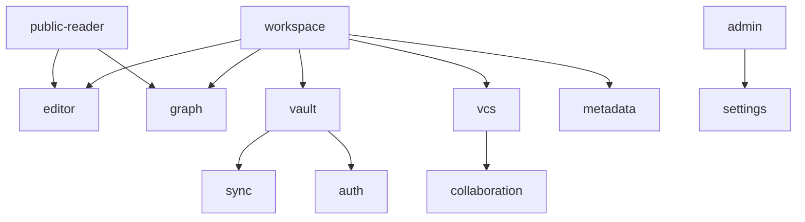

# Peta Domain Bisnis

## Ringkasan 3 Baris
- Aplikasi dibagi secara tegas menjadi 12 modul domain independen menggunakan prinsip Domain-Driven Design (DDD).
- Setiap domain memiliki satu `Orchestrator` yang mengekspos kapabilitas domain ke Workspace atau ke rute halaman.
- Komponen internal domain menerapkan struktur 3 lapis: Orchestrator (Façade), View (JSX Murni), dan Headless Controller Hook.

---

## 1. Matriks 12 Domain Sistem



### Rincian Modul Domain

| Domain | Orchestrator Utama | Subfolder Aktif | Tanggung Jawab & Fitur Kunci |
| :--- | :--- | :--- | :--- |
| **admin** | `AdminOrchestrator.tsx` | `components`, `shared/api,hooks` | Audit log, telemetri visual Bento, health check, sistem diagnostik. |
| **auth** | `AuthOrchestrator.tsx` | `components`, `shared/api,hooks` | Login, registrasi, sesi Supabase Cloud, route protection, dev banner. |
| **collaboration** | `CollaborationOrchestrator.tsx` | `components`, `shared/api,utils` | Review workflow, visual diff viewer, bulk publish modal, linter dua tahap. |
| **editor** | `EditorOrchestrator.tsx` | `components`, `shared/api,stores,utils` | Editor CodeMirror 6, collapsible YAML properties, footnote popover, tabel dinamis. |
| **graph** | `GraphOrchestrator.tsx` | `components`, `shared/api,hooks,stores,utils` | Engine tata letak multi-model (XMind/Mindmap/Force), Living Canvas, Color Engine. |
| **metadata** | `MetadataOrchestrator.tsx` | `components`, `shared/api,hooks,utils` | Web Worker Aho-Corasick untuk unlinked mentions, backlinks traversal. |
| **public-reader** | `PublicReaderOrchestrator.tsx`| `components`, `shared/api` | Render rute `/p/:username/:vaultSlug`, file tree publik, graf interaktif anonim. |
| **settings** | `SettingsOrchestrator.tsx` | `components`, `shared/api,hooks,stores,utils`| Settings Hub, command palette (Ctrl+P), manajemen API key, claim username. |
| **sync** | `SyncOrchestrator.tsx` | `components`, `shared/api,hooks,stores` | Status auto-save, sinkronisasi queue, antarmuka instalasi PWA. |
| **vault** | `VaultOrchestrator.tsx` | `components`, `shared/api,hooks,stores,utils`| CRUD vault, isolasi data, driver Local/Cloud/FS, backup & ZIP import/export. |
| **vcs** | `VcsOrchestrator.tsx` | `components`, `shared/api,stores,utils` | Version control internal: branch, commit mikro, merge request, co-presence. |
| **workspace** | `WorkspaceOrchestrator.tsx` | `components`, `shared/api,hooks,stores,utils`| Sistem dock antarmuka VS Code/Obsidian, group split, tabs, file explorer. |

---

## 2. Pola Arsitektur Internal Domain

1. **Domain Orchestrator (`<Domain>Orchestrator.tsx`):**
   Bertindak sebagai penghubung makro antara domain dengan *workspace layout* dan *leaf store*. Orchestrator tidak mengurusi kalkulasi kalkulasi detail UI individual.
2. **Headless Component Controller Pattern:**
   Komponen visual yang memiliki kerumitan grafis atau manipulasi data (seperti `GraphCanvas` atau `EditorMarkdownView`) mendelegasikan seluruh efek samping (`useEffect`), kalkulasi geometri (`useMemo`), dan *subscriptions* ke hook pendamping berawalan `use<Component>Controller.ts`.
3. **Leaf-Scoped Store Registry:**
   State interaksi kanvas (`useGraphInteractionStore`) dikelola secara independen per leaf workspace melalui *leaf registry* untuk mencegah mutasi kaskade antar-tab.
4. **Decoupled Event Bus:**
   Komunikasi tak langsung lintas domain disalurkan melalui `DomainEvents.ts` untuk menjaga batas isolasi modul.

---

## Terkait
- [Struktur Repositori](repository-structure.md)
- [Aturan Repositori](../05-engineering/repository-rules.md)
- [Standar Koding](../05-engineering/coding-standards.md)
```