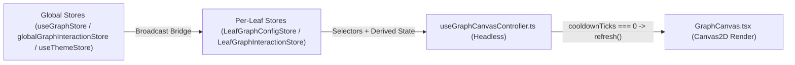

# Arsitektur Mesin Tata Letak & Kanvas Graf (`Layout Engine`)

## Ringkasan 3 Baris
- Mendokumentasikan arsitektur mesin visual graf ObMap berbasis `react-force-graph-2d` dan Canvas2D yang memisahkan mode simulasi fisika (*Free-Force*) dari solver tata letak deterministik (`ADR-0003`).
- Mencatat status `[IMPLEMENTED]` untuk penyelesaian *god components* kanvas (`TD-001`, `TD-002`, `TD-007`), deteksi kolisi *bounding box* (`TD-006` pada `textLayout.ts`, `fishbone.ts`, `timeline.ts`), pola **Headless Controller**, **Per-Leaf Store Bridge**, serta **Canvas Frame Invalidation** `graphRef.current?.refresh?.()` (`ADR-0006`).
- Menetapkan perluasan v2.0 berupa sinkronisasi token Unified Theme Engine (`STEP-01.5`), visualisasi state progres LMS DAG (`STEP-05.1`), serta solver analitik `argument-map` dan `citation-tree` (`STEP-05.2`).

---

## 1. Pemisahan Engine: Deterministik vs. Free-Force

| Mode Tata Letak | Sifat Komputasi | Modul / Berkas | Status & Kegunaan |
| :--- | :--- | :--- | :--- |
| **`Free-Force`** | Simulasi D3 kontinu (`cooldownTicks > 0`) | `GraphCanvas.tsx`, `useGraphCanvasController.ts` | `[IMPLEMENTED]` — Eksplorasi jejaring wikilink non-hierarkis ala Obsidian. |
| **`Mindmap`** | Solver deterministik radial / kiri-kanan | `layoutCategory.ts`, `mindmap.ts` | `[IMPLEMENTED]` — Brainstorming & taksonomi hierarkis (*spatial memory* stabil). |
| **`Org`** | Solver hierarkis top-down | `layoutCategory.ts` | `[IMPLEMENTED]` — Bagan organisasi, struktur pengetahuan & dependensi. |
| **`Timeline`** | Solver sumbu kronologis | `layoutCategory.ts`, `timeline.ts` | `[IMPLEMENTED]` — Linimasa riset, sejarah proyek, dan jadwal publikasi. |
| **`Fishbone`** | Solver tulang ikan (Ishikawa) | `layoutCategory.ts`, `fishbone.ts` | `[IMPLEMENTED]` — Analisis akar masalah (*Root Cause Analysis*). |
| **`Argument Map`** | Solver deterministik logika pembuktian | `layoutCategory.ts` `[PLANNED]` | `STEP-05.2` — Struktur *Claim → Evidence → Warrant → Counter → Synthesis*. |
| **`Citation Tree`** | Solver silsilah literatur terarah | `layoutCategory.ts` `[PLANNED]` | `STEP-05.2` — Pohon evolusi sitasi `[[@user/vault/note]]`. |

---

## 2. Tata Kelola State Reaktif, Frame Invalidation & Performa (`ADR-0006`)

1. **Zero-Regression Headless Extraction (`TD-001`, `TD-002`, `TD-007` `[IMPLEMENTED]`):** `GraphWorkspaceControls.tsx` (137 baris) dan `GraphCanvas.tsx` (125 baris) terpisah murni dari controller logika (`useGraphWorkspaceControlsController.ts`, `useGraphCanvasController.ts`) dengan deteksi kolisi *bounding box* deterministik (`TD-006` `[IMPLEMENTED]`).
2. **Canvas Frame Invalidation (`ADR-0006` `[IMPLEMENTED]`):** Pada solver deterministik (`cooldownTicks === 0`), setiap mutasi visual (*Subtree Override*, seleksi node, perubahan slider gaya, atau pergantian tema) wajib memicu `graphRef.current?.refresh?.()` secara reaktif.
3. **Target Performa (`NFR-001`):** `60 FPS` pada graf `2.000` node dan `>= 30 FPS` pada `5.000` node; penyatuan token CSS Variables ↔ `src/domains/graph/shared/utils/theme.ts` & `atmosphereConfig.ts` dijadwalkan pada `STEP-01.5`.

---

## Terkait
- [ADR-0003: Deterministic Solvers vs Free-Force](adr/ADR-0003-deterministic-layout-solvers-vs-force.md)
- [ADR-0006: Reactive State & Headless Governance](adr/ADR-0006-reactive-state-and-headless-controller-governance.md)
- [ADR-0011: Six-Layer Config & Unified Theme Engine](adr/ADR-0011-six-layer-cascading-config-and-unified-theme-engine.md)
- [Tech Debt Register (`TD-001`, `TD-002`, `TD-006`)](../05-engineering/tech-debt-register.md)
