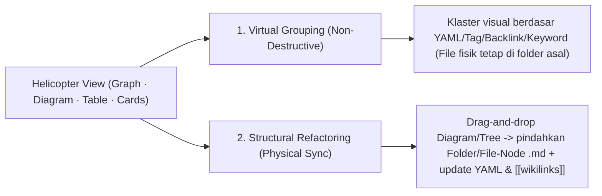

# Arsitektur Helicopter Views & Mesin Tata Letak Graf (`Layout Engine`)

## Ringkasan 3 Baris
- Memosisikan mesin graf sebagai jantung dari **4 Mandatory Helicopter Views** (*Graph View*, *Diagram View*, *Table View*, *Cards View*) yang wajib tersedia di semua *Workspace Modes* (`Freeform`, `Atlas`, `Studio`, `Academy`).
- Memisahkan simulasi jaringan non-hierarkis (`Graph View`: *Free-Force*) dari **6 Solver Deterministik (`Diagram View`)** berfitur komposisi multi-struktur zero-collision, serta mendukung **Restructure & Reorganize** (*Virtual Grouping* non-destruktif & *Structural Refactoring* sinkron ke berkas fisik).
- Mempersistensikan seluruh konfigurasi visual, *subtree overrides*, *boundaries*, dan *summaries* secara terpusat di blok `mode.layout` dalam **`.app/config.json`** (dengan fallback baca *zero-loss* dari `.vk/`/`.obmap/`).

---

## 1. Empat Mandatory Helicopter Views (Semua Workspace Modes)

| Helicopter View | Peran Kognitif | Mekanisme Teknis / Solver | Penggunaan per Core Mode |
| :--- | :--- | :--- | :--- |
| **1. Graph View** *(Network)* | Keterhubungan organik lintas catatan (`[[backlinks]]`, `tags`, `keywords`, klaster properti) | `Free-Force` (simulasi D3 `cooldownTicks > 0`) & klaster relasi | **Atlas:** jaringan sitasi & topik; **Studio:** *internal linking & topic clusters*; **Academy:** relasi lintas modul; **Freeform:** kanvas graf penuh. |
| **2. Diagram View** *(Deterministic Solvers)* | Pemetaan hierarkis, alur waktu, sebab-akibat, argumen, & pohon kompetensi | `layoutCategory.ts` + `compositeLayoutEngine.ts` (`cooldownTicks === 0`) | **Atlas:** Mindmap, Fishbone, Timeline, Argument Map; **Studio:** outline artikel/buku; **Academy:** *Competence/Skill Tree DAG* & hierarki kurikulum. |
| **3. Table View** *(Structured Matrix)* | Pengeditan massal properti YAML, status epistemik, sitasi, & jadwal/slug | Proyeksi derivatif dari YAML Frontmatter + `schema` `.app/config.json` | **Atlas:** matriks literatur/referensi; **Studio:** daftar artikel, slug, SEO, & status editorial; **Academy:** pelacakan progres murid & nilai. |
| **4. Cards View** *(Spatial Gallery)* | Eksplorasi visual berdasarkan Folder-Node, tag, status epistemik, atau grup properti | Grid responsif berbasis metadata YAML + kartu kanvas | **Atlas:** papan kartu bacaan & hipotesis; **Studio:** galeri karya & portofolio; **Academy:** kartu modul/tugas belajar. |

> **Batas Tegas Produk:** Seluruh *Table View*, *Cards View*, maupun variasi ringan *Kanban/Calendar* adalah murni lensa organisasi pengetahuan/riset/editorial/pembelajaran—bukan manajemen proyek korporat ala Trello/Asana/ClickUp.

---

## 2. Pemisahan Solver: Network (`Free-Force`) vs. Deterministic Solvers (`Diagram View`)

| Solver Tata Letak | Sifat Komputasi | Modul / Berkas | Status & Kegunaan |
| :--- | :--- | :--- | :--- |
| **`Free-Force`** | Simulasi D3 kontinu (`cooldownTicks > 0`) | `GraphCanvas.tsx`, `useGraphCanvasController.ts` | `[IMPLEMENTED]` — *Graph View* untuk jaringan wikilink non-hierarkis ala Obsidian. |
| **`Mindmap`** | Solver deterministik radial / kiri-kanan | `layoutCategory.ts`, `mindmap.ts`, `compositeLayoutEngine.ts` | `[IMPLEMENTED]` — Brainstorming, ideasi & taksonomi hierarkis (*spatial memory* stabil). |
| **`Org / Tree`** | Solver hierarkis top-down & compact leaf matrix | `layoutCategory.ts`, `treeLayouts.ts` | `[IMPLEMENTED]` — Struktur bab buku (`Studio`), struktur vault, & organisasi topik. |
| **`Timeline`** | Solver sumbu kronologis berjalur (*center-anchored*) | `layoutCategory.ts`, `timeline.ts` | `[IMPLEMENTED]` — Linimasa riset, sejarah proyek pengetahuan, dan jadwal terbit. |
| **`Fishbone`** | Solver tulang ikan (Ishikawa) kaku | `layoutCategory.ts`, `fishbone.ts` | `[IMPLEMENTED]` — Analisis akar masalah (*Root Cause Analysis*). |
| **`Argument Map`** | Solver deterministik logika pembuktian | `layoutCategory.ts` `[PLANNED]` | `STEP-05.2` — Pemetaan *Claim → Evidence → Warrant → Counter → Synthesis* (`Atlas`). |
| **`Competence / Skill Tree DAG` & `Citation Tree`** | Solver graf asiklik & silsilah literatur terarah | `layoutCategory.ts` `[PLANNED]` | `STEP-05.1`–`05.2` — Pohon **Falsafah → Kurikulum → Silabus → RPS → Tugas** (`Academy`) & silsilah sitasi `[[@user/vault/note]]`. |

---

## 3. Siklus *Restructure & Reorganize* di Helicopter View

---

## 4. Tata Kelola State Reaktif, Frame Invalidation & Persistensi Sentral (`ADR-0006`)
1. **Unified Dock & Headless Controller:** `GraphFloatingDock.tsx` + `useGraphFloatingDockController.ts` dan `GraphCanvas.tsx` terpisah tegas dari logika controller (`useGraphCanvasController.ts`), dengan isolasi blok kaku (*Rigid Subtree Block Isolation* via `resolveBlockAABBCollisions`).
2. **Canvas Frame Invalidation (`ADR-0006`):** Pada solver deterministik (`cooldownTicks === 0`), setiap mutasi visual (*Subtree Override*, perubahan tema `--app-*` / `--vk-*`, seleksi node, gaya garis) wajib memicu `graphRef.current?.refresh?.()` secara reaktif.
3. **Persistensi Sentral ke `.app/config.json`:** Data posisi, *subtree overrides*, *boundaries*, dan *summaries* disimpan ke blok `mode.layout` dalam **`.app/config.json`** (dengan fallback baca kompatibilitas dari `.vk/mindmap-layout.json` dan `.obmap/mindmap-layout.json`).

---

## Terkait
- [ADR-0003: Deterministic Solvers vs Free-Force](adr/ADR-0003-deterministic-layout-solvers-vs-force.md)
- [ADR-0006: Reactive State & Headless Governance](adr/ADR-0006-reactive-state-and-headless-controller-governance.md)
- [Arsitektur Data & `.app/config.json`](data-and-storage.md)
- [Master Plan Visual Engine XMind (`xmind-obsidian-visual-engine-plan.md`)](../02-planning/xmind-obsidian-visual-engine-plan.md)
