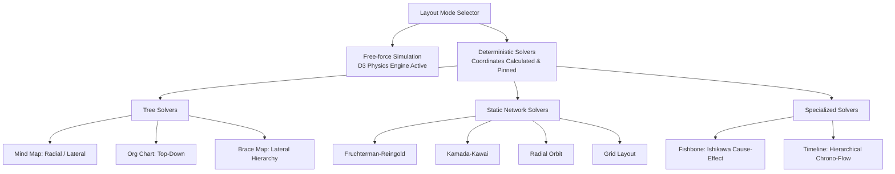

# Mesin Tata Letak Graf (Visual Layout Engine)

## Ringkasan 3 Baris
- Memisahkan secara ketat antara simulasi dinamis gaya fisika (Free-force) dan solver deterministik (Mindmap, Org Chart, Fishbone, Timeline).
- Hanya mode Free-force yang menjalankan komputasi simulasi D3 secara terus-menerus; solver lain mengunci posisi simpul (*pinned coordinates*) pasca-transisi.
- Mendukung mekanisme *subtree layout overrides* yang memungkinkan cabang anak memiliki algoritma tata letak berbeda dari induknya.

---

## 1. Taksonomi Kategori Tata Letak (`layoutCategory.ts`)



---

## 2. Algoritma Khusus: Timeline & Fishbone

### 2.1 Timeline Hierarkis (`timeline.ts`)
Berbeda dengan garis waktu berbasis tanggal kalender, timeline ObMap dihitung berdasarkan urutan berkas dalam hierarki sistem:
- **Root Node:** Topik utama di sebelah kiri atau atas.
- **Direct Children (Milestones):** Diposisikan secara berurutan di sepanjang poros utama (*primary axis*).
- **Sub-descendants:** Dicabangkan tegak lurus secara berselang-seling (*off-axis alternating*) untuk mencegah tabrakan visual.

### 2.2 Fishbone Ishikawa Diagram (`fishbone.ts`)
- **Spine (Tulang Belakang):** Garis horizontal dari kiri ke kanan yang berakhir di simpul kepala masalah (*Problem Statement*).
- **Major Bones (Kategori Akar):** Cabang miring dengan sudut konstan (60 derajat) di sisi atas dan bawah tulang belakang.
- **Minor Bones:** Ranting penyebab spesifik yang disusun paralel dengan tulang belakang.

---

## 3. Pencegahan Tabrakan Kotak Pembatas (Anti-Collision Engine)

```
[FORMULA PERHITUNGAN KOTAK PEMBATAS SIMPUL]
NodeWidth = max(minWidth, textLength × charWidth + paddingX + badgeWidth)
NodeHeight = baseHeight + (numberOfLines × lineHeight) + paddingY
SubtreeSpan = sum(ChildNodeSpans) + (numberOfChildren - 1) × SiblingsGap
```

- Status: `[PARTIAL]` — Penataan pohon dasar dan jarak antar-saudara (*sibling gap*) sudah terisolasi, namun teks yang sangat panjang pada mode Fishbone/Timeline masih dalam tahap penyempurnaan pembatas adaptif.

---

## Terkait
- [Ikhtisar Arsitektur Sistem](system-overview.md)
- [Katalog Fitur Graf](../04-features/feature-catalog.md)