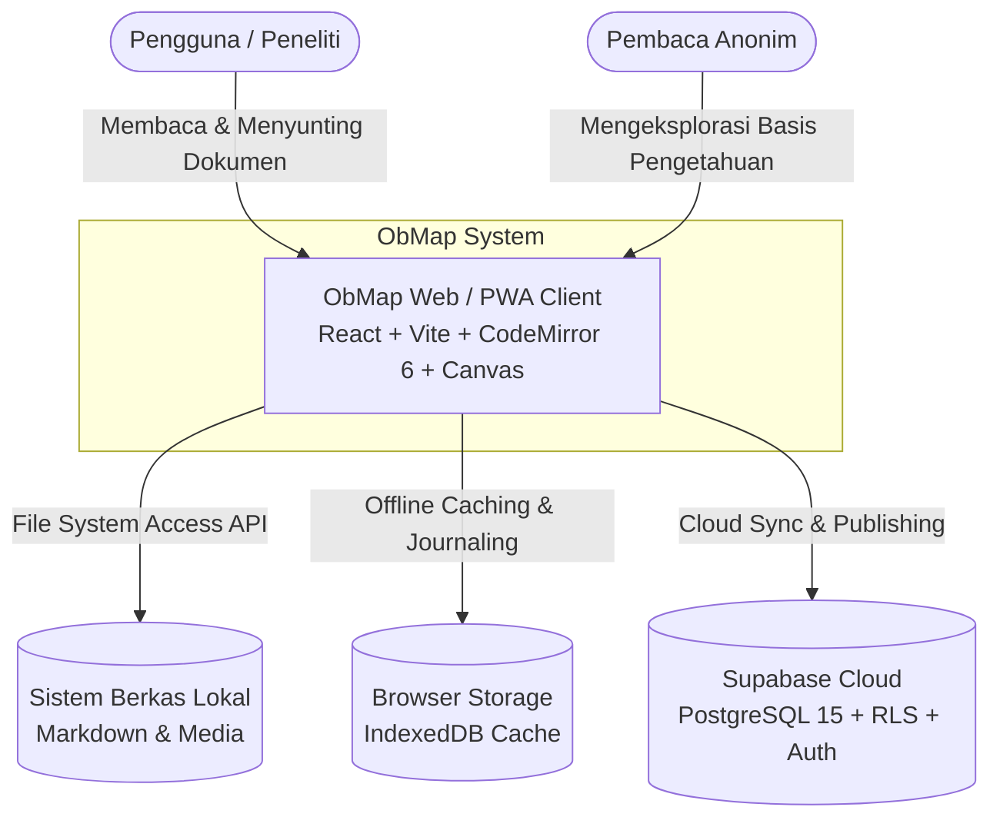
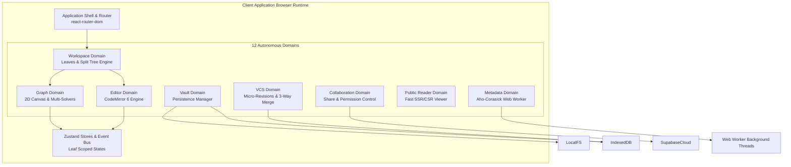

# Ikhtisar Arsitektur Sistem (System Overview)

## Ringkasan 3 Baris
- Mengadopsi arsitektur *local-first hybrid* dengan orkestrasi 12 domain independen berbasis Domain-Driven Design (DDD).
- Mengintegrasikan komputasi kanvas graf 2D dan parsing teks sepenuhnya di sisi klien (*client-side execution*).
- Menghubungkan penyimpanan lokal (FS API/IndexedDB) ke PostgreSQL Supabase melalui lapisan sinkronisasi ber-RLS.

---

## 1. Diagram Konteks Sistem (C4 Context Diagram)

---

## 2. Diagram Kontainer Aplikasi (C4 Container Diagram)

---

## 3. Aliran Data Utama (Primary Data Flows)

1. **Local Authoring Loop:** Penyuntingan di CodeMirror 6 memicu pembaruan state lokal -> di-debounce ke *auto-save* driver vault (FS API/IndexedDB) -> Web Worker memindai *wikilinks* dan *mentions*.
2. **Graph Visualization Loop:** Struktur file tree diproyeksikan ke `buildGraphProjection` -> solver deterministik menghitung posisi simpul -> kanvas merender simpul, tautan kurva, dan partikel atmosfer.
3. **Publishing Loop:** Modul kolaborasi memvalidasi izin -> mengekspor snapshot dokumen ke Supabase -> rute `/p/:username/:vaultSlug` merender tampilan publik tanpa login.

---

## Terkait
- [Peta Struktur Repositori](repository-structure.md)
- [Peta Domain Arsitektur](domain-map.md)
- [Arsitektur Data dan Penyimpanan](data-and-storage.md)
