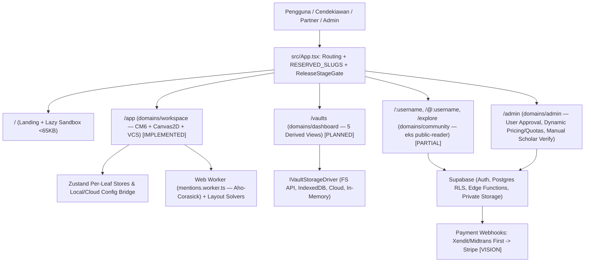

# Tinjauan Arsitektur Sistem ObMap v2.0 (`System Overview`)

## Ringkasan 3 Baris
- Menjelaskan arsitektur menyeluruh ObMap v2.0 berbasis *Local-First Single Page Application* (React 18, TypeScript 5, Vite 5, Zustand, CodeMirror 6, Canvas2D/D3) dengan backend Supabase (Auth, Postgres RLS, Edge Functions, Storage).
- Menetapkan arsitektur target **13 Domain DDD Terisolasi** (`community` menggantikan `public-reader` + penambahan `dashboard`), rute kanonik root `/:username` & `/@:username` (*hard cutover* tanpa `/p/*`), serta gerbang **3-Stage Progressive Shipping**.
- Mewajibkan pola **Headless Controller (`ADR-0006`)**, penegakan keamanan simetris (`PolicyEngine` ↔ Postgres RLS), konfigurasi dinamis paket & kuota melalui `/admin`, dan sandbox `@obmap/sdk`.

---

## 1. Diagram Konteks & Topologi Sistem (C4 Level 1–2)

---

## 2. Lapisan Arsitektur Kunci

| Lapisan | Komponen & Teknologi Utama | Status & Batas Arsitektural |
| :--- | :--- | :--- |
| **Presentation & Routing** | React 18, Tailwind, Radix/shadcn UI, `react-router-dom` | `[IMPLEMENTED]` di `src/App.tsx`; migrasi *hard cutover* `/p/*` → `/:username` dijadwalkan di `STEP-01.2`. |
| **Domain Orchestration (DDD)** | 12 domain aktif di `src/domains/` → 13 target domain (`community` + `dashboard`) | Pola `<Domain>Orchestrator.tsx` + Pure View (`<=300` baris) + `use<Feature>Controller.ts`. |
| **State & Config Engine** | Pure Zustand actions (`vaultSessionActions.ts`), Per-Leaf Store Bridge, 6-Layer Config | `[IMPLEMENTED]` untuk Leaf Bridge (`ADR-0006`); 6-Layer Org-Lock & Theme sync di `STEP-01.5`. |
| **Computation & Canvas** | Web Worker (`mentions.worker.ts`), `layoutCategory.ts` (4 solver + Free-Force) | Target `60 FPS` pada `2.000` node; `argument-map` & `citation-tree` di `STEP-05.2`. |
| **Data, Storage & Security** | `FileSystemService.ts`, `IndexedDbVaultDriver.ts`, Supabase V4 RLS, `createSignedUrl` | Local storage 100% gratis; media privat via `createSignedUrl`; `untypedSupabase.ts` dihapus di `STEP-01.1`. |
| **Stage Gate & Billing Engine** | `ReleaseStageGate`, `PolicyEngine`, tabel `plans`/`plan_quotas`, **Xendit/Midtrans → Stripe** | Taris & kuota diatur Admin di `/admin`; penegakan absolut di RLS & Edge Functions (`STEP-04.1`). |

---

## 3. Prinsip Lintas-Domain (*Cross-Cutting Invariants*)
1. Domain tidak boleh saling mengimpor komponen internal secara langsung; gunakan kontrak *shared API/store* atau Global Shared (`src/global/`).
2. Mutasi status workspace berjalan melalui *pure Zustand actions* dan sinkronisasi unidireksional (`ADR-0006`).
3. Seluruh rute aplikasi sistem (`app`, `vaults`, `auth`, `admin`, `explore`, `install`, dll.) dijaga `RESERVED_SLUGS` agar profil `/:username` di root domain tidak pernah berbenturan.

---

## Terkait
- [Master Blueprint v2.0](../00-meta/00-0-master-blueprint.md)
- [Peta 13 Domain (`domain-map.md`)](domain-map.md)
- [Struktur Repositori (`repository-structure.md`)](repository-structure.md)
- [Indeks ADR (`adr/README.md`)](adr/README.md)
