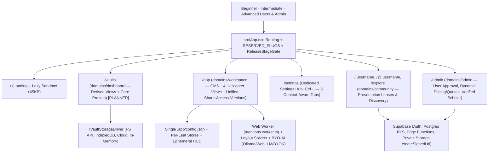
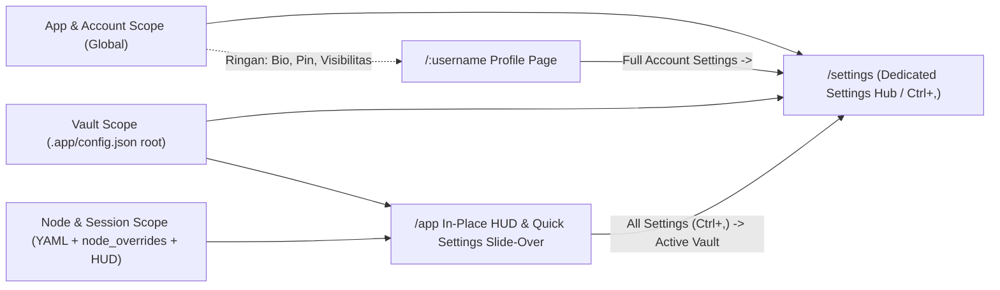

# Tinjauan Arsitektur Sistem (`System Overview`)

## Ringkasan 3 Baris
- Menjelaskan arsitektur menyeluruh berbasis *Local-First Single Page Application* (React 18, TypeScript 5, Vite 5, Zustand, CodeMirror 6, Canvas2D/D3) dengan backend Supabase (Auth, Postgres RLS, Edge Functions, Private Storage).
- Mengintegrasikan **6 Sistem Referensi**, **13 Bounded Domains**, **4 Workspace Modes** (`Freeform`, `Atlas`, `Studio`, `Academy`), **4 Helicopter Views** (*Graph, Diagram, Table, Cards*), konfigurasi tunggal **`.app/config.json`**, **Unified Essential VCS & Granular Access/Publishing**, serta **`@app/sdk`**.
- Menetapkan arsitektur kontrol dan pengaturan berbasis **3-Scope Contextual Escalation** lintas 3 permukaan UI proporsional (`/settings`, `/:username`, `/app`).

---

## 1. Diagram Konteks & Topologi Sistem (C4 Level 1–2)

---

## 2. Lapisan Arsitektur Kunci

| Lapisan | Komponen & Teknologi Utama | Status & Batas Arsitektural |
| :--- | :--- | :--- |
| **Presentation & Routing** | React 18, Tailwind, Radix/shadcn UI, `react-router-dom` | `[IMPLEMENTED]` untuk `/app`, `/:username`, `/@:username`, `/explore`, `/auth`, `/admin`; hub `/vaults` penuh di `STEP-02.1`. |
| **Domain Orchestration (DDD)** | 12 domain aktif → 13 target domain (`community` + `dashboard`) | Pola `<Domain>Orchestrator.tsx` + Pure View (`<=300` baris) + `use<Feature>Controller.ts`. |
| **Lenses, Helicopter Views & Config** | `Freeform`, `Atlas`, `Studio`, `Academy` + **`.app/config.json`** | Mode adalah lensa *opinionated*; **4 Helicopter Views** (*Graph, Diagram, Table, Cards*) wajib ada di semua mode; **1 file sentral `.app/config.json`**. |
| **State & Reactive Bridge** | Pure Zustand actions (`vaultSessionActions.ts`), Per-Leaf Store Bridge | `[IMPLEMENTED]` (`ADR-0006`); menjaga konsistensi Canvas2D (`refresh()`) dan kontrol 3-scope. |
| **VCS, Collaboration & Publishing** | `vcsDiffEngine.ts`, `policyEngine.ts`, `"Share · Access · Versions"` Drawer | *Essential VCS* (*Snapshot, Visual Diff, Fork, KMR*) + `Give Access` & `Publish` **`AS & WITH`** baik level Vault maupun spesifik Node/Folder. |
| **Computation, AI & Extensions** | `mentions.worker.ts`, `layoutCategory.ts` (6 solver), `@app/sdk`, Ollama/BYOK RAG | Target `60 FPS` pada `2.000` node; `argument-map` & `competence/skill-tree DAG`; sandbox Worker/Iframe CSP. |

---

## 3. Arsitektur Controls & Settings (3-Scope Contextual Escalation)

Untuk mencegah kebocoran pengaturan teknis ke profil publik atau tenggelamnya pengguna dalam puluhan menu di kanvas editor, seluruh kontrol dibagi menjadi **3 Scope** dan ditempatkan secara proporsional di **3 Lokasi UI**:

### 3.1 Tiga Scope Pengaturan
1. **App & Account Scope (Global):** Identitas publik (`/:username`, bio, ORCID, avatar), tema & tipografi global, *keybindings*, koneksi AI global (**Ollama / WebLLM / BYOK**), integrasi **Zotero**, bahasa (`id-ID`/`en-US`), notifikasi, billing/kuota, manajemen storage lokal.
2. **Vault Scope (`.app/config.json` root):** `primary_mode` (`freeform`, `atlas`, `studio`, `academy`), *default Helicopter View*, schema YAML & template, kebijakan *Publish & Access* tingkat vault, aturan `academy` tingkat vault, dan ekstensi `@app/sdk` aktif.
3. **Node & Session Scope (YAML Frontmatter + `node_overrides` di `.app/config.json` + Ephemeral HUD):** *Override* lensa visual aktif sementara per tab, properti YAML node, *Publish & Access* granular tingkat Folder-Node/File-Node, dan aturan `academy` tingkat sub-folder/node.

### 3.2 Penempatan UI Proporsional di Tiga Lokasi
- **Dedicated Settings Hub (`/settings` atau modal penuh `Ctrl+,`):** *Single Source of Truth* seluruh pengaturan mendalam; bersifat *context-aware* mengikuti halaman pemanggil dan terorganisasi dalam **5 Tab Kanonik**:
  1. *Account & Profile*
  2. *Appearance & App*
  3. *AI & Integrations*
  4. *Active Vault (`.app/config.json`)*
  5. *Presets & Extensions*
- **Profile Page (`/:username`):** Hanya menampilkan kontrol ringan terkait **Identitas Publik & Kurasi Portofolio** (edit bio/profil cepat, pin karya, atur visibilitas karya publik) + tombol eskalasi **"Full Account Settings →"**. Bebas penuh dari pengaturan teknis editor atau graf.
- **Editor Page (`/app`):** Menyediakan **In-Place HUD & Quick Settings Slide-Over Drawer** untuk **80% aksi harian tanpa meninggalkan kanvas** (ganti *Helicopter View*, ganti *Workspace Mode* sementara, buka **"Share · Access · Versions" Drawer**, edit YAML / aturan node) + tombol eskalasi **"All Settings (`Ctrl+,`)"** yang langsung membuka tab *Active Vault (`.app/config.json`)*.

---

## 4. Prinsip Lintas-Domain (*Cross-Cutting Invariants*)
1. Domain tidak boleh saling mengimpor komponen internal secara langsung; gunakan kontrak *shared API/store* atau Global Shared (`src/global/`).
2. Mutasi status workspace berjalan melalui *pure Zustand actions* dan sinkronisasi unidireksional (`ADR-0006`).
3. Seluruh rute aplikasi sistem (`app`, `vaults`, `auth`, `admin`, `explore`, `install`, `settings`, dll.) dijaga 3 lapis `RESERVED_SLUGS` agar `/:username` tidak pernah berbenturan.
4. Dilarang memecah `.app/config.json` ke file konfigurasi terpisah (`preset.json`, `lms-policy.json`, `setting.json`, dll.).

---

## Terkait
- [Master Blueprint v2.0](../00-meta/00-0-master-blueprint.md)
- [Arsitektur Data & `.app/config.json`](data-and-storage.md)
- [Peta 13 Domain (`domain-map.md`)](domain-map.md)
- [Master Plan UI/UX & 3-Scope Settings (`ui-ux-and-universal-design-system-plan.md`)](../02-planning/ui-ux-and-universal-design-system-plan.md)
- [Indeks ADR (`adr/README.md`)](adr/README.md)
