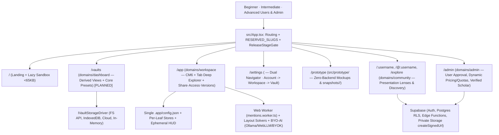
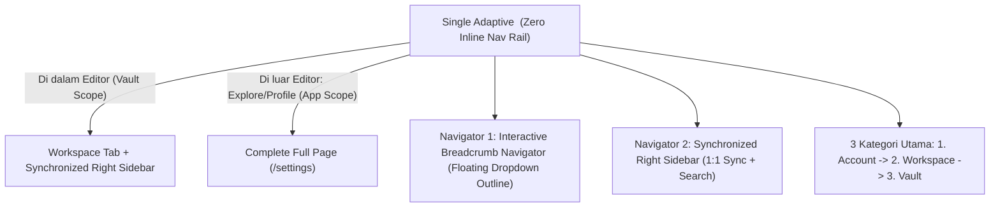

# Tinjauan Arsitektur Sistem (`System Overview`)

## Ringkasan 3 Baris
- Menjelaskan arsitektur menyeluruh berbasis *Local-First Single Page Application* (React 18, TypeScript 5, Vite 5, Zustand, CodeMirror 6, Canvas2D/D3) dengan backend Supabase (Auth, Postgres RLS, Edge Functions, Private Storage).
- Mengintegrasikan **6 Sistem Referensi**, **13 Bounded Domains**, **4 Workspace Modes** (`Freeform`, `Atlas`, `Studio`, `Academy`), **`Deep Explorer`** (*Graph, Diagram, Table, Cards* + pengelompokan dinamis), konfigurasi tunggal **`.app/config.json`**, **Unified Essential VCS & Granular Access/Publishing**, **3 Development Tracks** (+ arsip *Zero-Backend* `/prototype`), serta **`@app/sdk`**.
- Menetapkan arsitektur **Single Adaptive `<SettingsHub />`** (*Dual Navigator*: *Interactive Breadcrumb Navigator* + *Synchronized Right Sidebar*; 3 kategori **`Account` → `Workspace` → `Vault`**) yang sadar konteks di Editor maupun Explore/Profile.

---

## 1. Diagram Konteks & Topologi Sistem (C4 Level 1–2)

---

## 2. Lapisan Arsitektur Kunci

| Lapisan | Komponen & Teknologi Utama | Status & Batas Arsitektural |
| :--- | :--- | :--- |
| **Presentation & Routing** | React 18, Tailwind, Radix/shadcn UI, `react-router-dom` | `[IMPLEMENTED]` untuk `/app`, `/:username`, `/@:username`, `/explore`, `/auth`, `/admin`; hub `/vaults` penuh di `STEP-02.1`. |
| **Domain Orchestration (DDD)** | 12 domain aktif → 13 target domain (`community` + `dashboard`) | Pola `<Domain>Orchestrator.tsx` + Pure View (`<=300` baris) + `use<Feature>Controller.ts`. |
| **Lenses, `Deep Explorer` & Config** | `Freeform`, `Atlas`, `Studio`, `Academy` + **`.app/config.json`** | Mode adalah lensa *opinionated*; **`Deep Explorer`** (4 lensa *Graph, Diagram, Table, Cards* + pengelompokan dinamis *Hierarchy/Properties/Tags/Backlinks/Keywords*) dapat dijalankan di `Settings Hub > Workspace > Deep Explorer` atau sebagai Tab Workspace; **1 file sentral `.app/config.json`**. |
| **State & Reactive Bridge** | Pure Zustand actions (`vaultSessionActions.ts`), Per-Leaf Store Bridge | `[IMPLEMENTED]` (`ADR-0006`); menjaga konsistensi Canvas2D (`refresh()`) dan sinkronisasi **Dual Navigator `<SettingsHub />`**. |
| **VCS, Collaboration & Publishing** | `vcsDiffEngine.ts`, `policyEngine.ts`, `"Share · Access · Versions"` Drawer | *Essential VCS* (*Snapshot, Visual Diff, Fork, KMR*) + `Give Access` & `Publish` **`AS & WITH`** baik level Vault maupun spesifik Node/Folder. |
| **Computation, AI & Extensions** | `mentions.worker.ts`, `layoutCategory.ts` (6 solver), `@app/sdk`, Ollama/BYOK RAG | Target `60 FPS` pada `2.000` node; `argument-map` & `competence/skill-tree DAG`; sandbox Worker/Iframe CSP. |
| **Zero-Backend Prototype Track** | `src/prototype/three-pillar/` → `src/prototype/snapshots/<stage-id>/` | `[IMPLEMENTED]` — Jalur Track 2 fase 2A/2C (*in-memory deterministic mock state*, 0 panggilan backend/Auth/Supabase) pada rute `/prototype`. |

---

## 3. Arsitektur Unified `<SettingsHub />` (Dual Navigator & 3 Kategori Utama)

Seluruh pengaturan dikonsolidasikan ke dalam **satu komponen tunggal adaptif `<SettingsHub />`** yang menggantikan seluruh sistem Settings lama sambil tetap menjaga isolasi logis 3 cakupan (**App & Account Scope**, **Vault Scope [`.app/config.json`]**, **Node & Session Scope**):

### 3.1 Single Adaptive Component & Eliminasi Clutter
1. **Satu Komponen Dua Wujud Adaptif:**
   - **Workspace Tab** saat dibuka di dalam Editor `/app` (*Vault Scope*).
   - **Complete Full Page** (`/settings`) saat diakses dari luar Editor seperti Explore atau Profile (*App Scope*).
2. **Eliminasi Clutter UI:**
   - **Tidak ada** tombol *Quick Share* atau *Quick View Lens* pada tab bar Editor.
   - **Tidak ada** *inline vertical/horizontal navigation rail* di dalam body `<SettingsHub />`.
   - Halaman Profil `/:username` mempertahankan kontrol publik ringan + tombol **"Full Account Settings →"**, sementara aksi kolaborasi/publikasi di `/app` dilayani melalui **Drawer *"Share · Access · Versions"***.

### 3.2 Dual Navigator Architecture (Desktop, Tablet, & Mobile)
1. **Navigator 1 — Interactive Breadcrumb Navigator (VS Code / Antigravity Style):**
   - Terletak di bagian atas `<SettingsHub />`, menampilkan jalur hierarki aktif (`Settings Hub ▸ Kategori ▸ Sub-Setting ▸ Section Symbol`).
   - Mengklik segmen mana pun membuka **Floating Dropdown Outline** tepat di bawah segmen tersebut yang memuat daftar kategori saudara, sub-setting saudara, atau daftar seksi/simbol di dalam halaman aktif untuk lompat cepat tanpa membuka sidebar.
2. **Navigator 2 — Synchronized Right Sidebar:**
   - Panel navigasi di Right Sidebar Editor (lengkap dengan kotak pencarian) yang tersinkron **1:1** dengan struktur kategori dan sub-setting `<SettingsHub />`.

### 3.3 Urutan & Struktur 3 Kategori Utama (`Account` → `Workspace` → `Vault`)
1. **`Account`:**
   - **`Profile Customization`:** Nama, `@username`, bio, informasi tambahan & tautan media sosial.
   - **`Credentials & Security`:** Reset kredensial, reset email & password.
   - **`Session Activity`:** Daftar perangkat aktif, lokasi, waktu akses, dan pencabutan sesi.
2. **`Workspace`** *(mencakup seluruh pengaturan workspace, editor, schema, sync preferences, AI, dan ekstensi)*:
   - **`Workspace Preset (Dashboard Overview Settings Hub)`:** Peta ringkasan & tautan ke seluruh sub-setting terkait; katalog *Built-in Presets* (`Freeform`, `Atlas`, `Studio`, `Academy`), *User Custom Presets*, dan *Community Presets*; fitur tambah/ubah/hapus/set default preset; wajib menyertakan **Mini Instruction-Helps**, **Impact Preview (daftar perubahan sebelum ganti preset)**, dan **Validasi perubahan preset**.
   - **`Central .app/config.json Raw Inspector & Dynamic Editor`:** Menampilkan dan mengedit secara manual seluruh konfigurasi aplikasi & workspace dalam satu JSON mentah `.app/config.json` yang terhubung secara dinamis ke seluruh UI pengaturan, dilengkapi **Real-Time Validation** dan **Help/Documentation Section**.
   - **`Deep Explorer`:** Konfigurasi lanjutan & ruang eksplorasi interaktif untuk *vaults, nodes, branches, files* (4 lensa visual + pengelompokan dinamis, termasuk *Properties & Schema*, *Academy Competence Tree & Pedagogical Policy*, serta tombol buka sebagai **Tab Workspace**).
   - **`Appearance & Accessibility`:** Kustomisasi tampilan lintas aplikasi (*Profile & Explore page*) serta lintas *Workspace/Vault* (tipografi editor, pengetikan, asisten penulisan, bilah alat Markdown, *Features & System Sync preferences*, BYO-AI Ollama/BYOK, & Zotero).
   - **`Visual Engine`:** Pengaturan *Graph Mode* dan *Mindmap / Deterministic Diagram Solvers*.
3. **`Vault`:**
   - **`Vaults Dashboard`:** Overview, statistik, status sinkronisasi, dan insight seluruh vaults.
   - **`Vaults Collaborating`:** Manajemen kolaborasi & hak akses (`Give Access AS & WITH` di level Vault & Node).
   - **`VCS, Diff, Backup & History`:** Timeline snapshot, visual diff, Knowledge Merge Request, serta backup & riwayat vault.
   - **`Vaults Publish`:** Manajemen publikasi (`Publish AS & WITH` di level Vault & Node).
   - **`Import & Export Vault`:** Alat impor dan ekspor vault.

---

## 4. Prinsip Lintas-Domain (*Cross-Cutting Invariants*)
1. Domain tidak boleh saling mengimpor komponen internal secara langsung; gunakan kontrak *shared API/store* atau Global Shared (`src/global/`).
2. Mutasi status workspace berjalan melalui *pure Zustand actions* dan sinkronisasi unidireksional (`ADR-0006`).
3. Seluruh rute aplikasi sistem (`app`, `vaults`, `auth`, `admin`, `explore`, `prototype`, `install`, `settings`, dll.) dijaga 3 lapis `RESERVED_SLUGS` agar `/:username` tidak pernah berbenturan.
4. Dilarang memecah `.app/config.json` ke file konfigurasi terpisah (`preset.json`, `lms-policy.json`, `setting.json`, dll.).
5. Direktori `src/prototype/` dan seluruh arsip `src/prototype/snapshots/<stage-id>/` wajib 100% *zero-backend* (*in-memory deterministic mock state*, tanpa ketergantungan Supabase, Auth live, atau storage backend runtime).

---

## Terkait
- [Master Blueprint v2.0](../00-meta/00-0-master-blueprint.md)
- [Arsitektur Data & `.app/config.json`](data-and-storage.md)
- [Peta 13 Domain (`domain-map.md`)](domain-map.md)
- [Master Plan UI/UX & Unified `<SettingsHub />` (`ui-ux-and-universal-design-system-plan.md`)](../02-planning/ui-ux-and-universal-design-system-plan.md)
- [Indeks ADR (`adr/README.md`)](adr/README.md)
