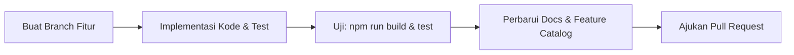

# Panduan Kontribusi Pengembang (Contribution Guide)

## Ringkasan 3 Baris
- Prosedur standar dalam mengajukan penambahan fitur, perbaikan bug, dan pembaruan arsitektur.
- Mewajibkan eksekusi build bersih (`npm run build`) dan pengujian (`npx vitest run`) sebelum pengajuan PR.
- Setiap perubahan fungsional wajib memperbarui dokumen terkait di folder `/docs`.

---

## 1. Alur Kerja Kontribusi Standar

1. **Sinkronisasi Kode:** Pastikan basis kode lokal selaras dengan branch utama.
2. **Validasi Kualitas:** Jalankan pemeriksaan kompilasi TypeScript `npx tsc --noEmit` dan pengujian `npx vitest run`.
3. **Audit Dokumentasi:** Perbarui `feature-catalog.md` jika menambahkan kapabilitas baru.

---

## Terkait
- [Standar Penulisan Kode](coding-standards.md)
- [Aturan Repositori Rekayasa](repository-rules.md)