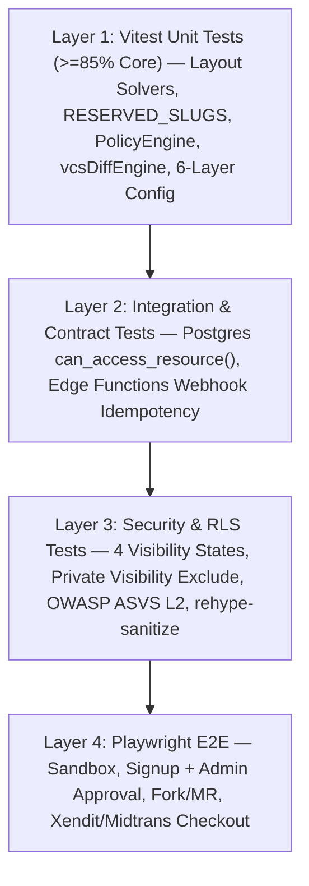

# Strategi Pengujian & Gerbang Verifikasi (`Testing Strategy`)

## Ringkasan 3 Baris
- Memutakhirkan status pengujian baseline (menghapus catatan usang *93 passed / 1 failed* & `src/shared/lib/untypedSupabase.ts`, mencerminkan verifikasi **`TD-004` 97/97 tes lulus** dan path nyata `src/global/api/untypedSupabase.ts`).
- Menetapkan piramida pengujian berlapis untuk Stage 1–3: Unit (`Vitest`), Integrasi RLS Multi-Tenant (`Supabase Postgres`), Sanitasi Keamanan & Kontrak Webhook (**Xendit/Midtrans**), serta E2E (`Playwright`).
- Mendefinisikan metrik kelayakan wajib (`Coverage >= 85%` modul inti, `0` kebocoran RLS, `LCP < 2.0s`) bagi setiap langkah di `docs/02-planning/README.md`.

---

## 1. Status Baseline & Aturan Tooling Pengujian
- **Runner Wajib:** Gunakan `npx vitest run` (Node environment). Dilarang memakai `bun test` karena ketidakcocokan mock DOM/browser (`AGENTS.md` §2).
- **Catatan Baseline Terverifikasi (`TD-004`):** Kegagalan lama pada `VaultManager.test.ts` telah diperbaiki (`expect(result.success).toBe(true)` dengan **`97/97` tes hijau** tercatat pada `tech-debt-register.md`). Hutang type-safety tersisa adalah penghapusan `src/global/api/untypedSupabase.ts` (`TD-005`) pada `STEP-01.1`.

---

## 2. Piramida Pengujian Target v2.0

---

## 3. Matriks Pengujian Spesifik Fitur Kritis v2.0

| Area Verifikasi | Kasus Uji Wajib | Step Target |
| :--- | :--- | :--- |
| **Type Safety & Static Check** | `npx tsc --noEmit` & `npm run lint` (`0` error/warning) setelah `untypedSupabase.ts` dihapus. | `STEP-01.1` |
| **Namespace & Hard Cutover** | `RESERVED_SLUGS` menolak slug sistem; rute `/p/*` tidak lagi merender reader publik; `/:username` dan `/@:username` me-resolve identik. | `STEP-01.2` |
| **ReleaseStageGate & Approval** | Stage 1 menolak signup bebas; Stage 2 menahan akun `pending_approval` hingga Admin menyetujui secara individual di `/admin`. | `STEP-01.3` |
| **RLS & Visibility Isolation** | Uji multi-tenant membuktikan note ber-YAML `visibility: private` **tidak bocor** via API publik maupun `community` graph; media privat memakai `createSignedUrl`. | `STEP-01.4`, `05.4` |
| **6-Layer Config & Theme Sync** | Flag *Org-Lock* tidak dapat ditimpa preferensi user/leaf; perubahan `useThemeStore` memperbarui Canvas2D via `refresh()`. | `STEP-01.5` |
| **Derived Views & Sandbox** | Mutasi Kanban/Calendar di `/vaults` menulis balik valid YAML frontmatter; bundle chunk sandbox `< 65KB` gzipped. | `STEP-02.1`–`02.2` |
| **Federated Citations & Fork/MR** | Parser `[[@user/vault/note]]` di Worker `< 100ms`; alur Fork → Edit → Knowledge Merge Request lintas dua akun lulus. | `STEP-03.2`–`03.3` |
| **Dynamic Plans & Billing** | Webhook **Xendit/Midtrans** idempoten; perubahan kuota di `/admin` langsung berlaku di RLS & `useEntitlement()`; downgrade bersifat *Non-Destructive*. | `STEP-04.1`–`04.2` |
| **LMS DAG & Analytical Solvers** | Validasi penolakan siklus pada `prerequisites`; koordinat `argument-map` & `citation-tree` 100% deterministik; `60 FPS` @ `2.000` node. | `STEP-05.1`–`05.2` |
| **SDK Sandbox & A11y GA** | `@obmap/sdk` memblokir panggilan jaringan/storage tanpa manifest izin; uji WCAG 2.2 AA & i18n `id-ID`/`en-US` lulus penuh. | `STEP-05.3`–`05.4` |

---

## Terkait
- [Standar Penulisan Kode (`coding-standards.md`)](coding-standards.md)
- [Register Hutang Teknis (`tech-debt-register.md`)](tech-debt-register.md)
- [Playbook Eksekusi Step-by-Step (`../02-planning/README.md`)](../02-planning/README.md)
- [System Requirements Specification (`../02-planning/srs.md`)](../02-planning/srs.md)
